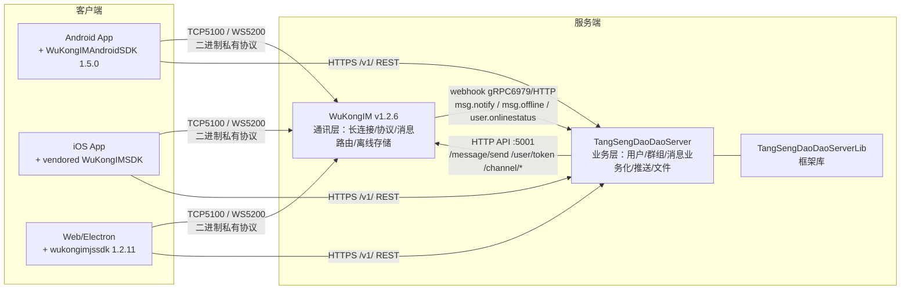
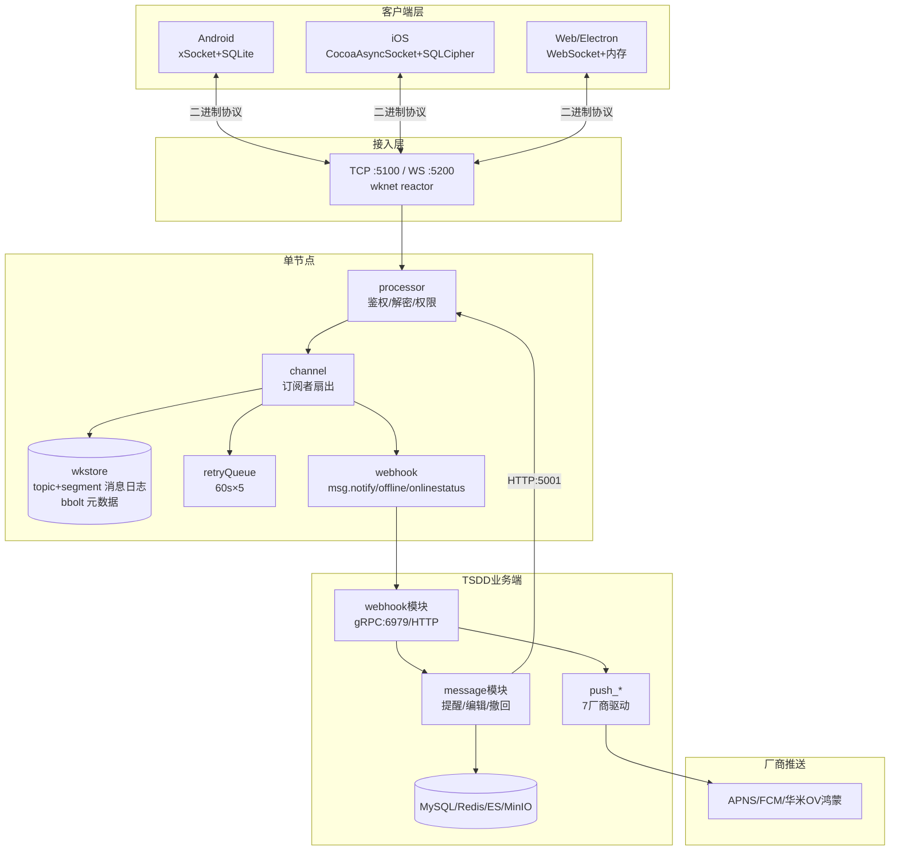
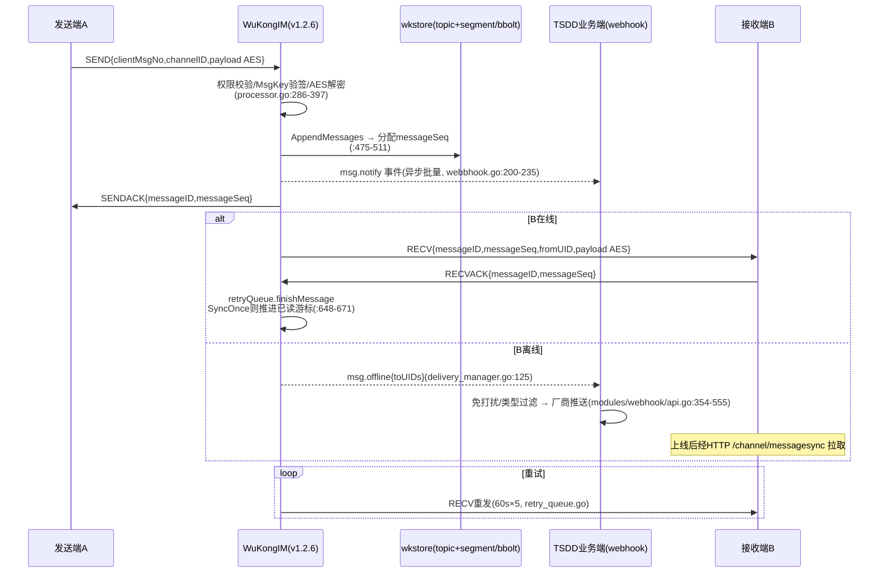
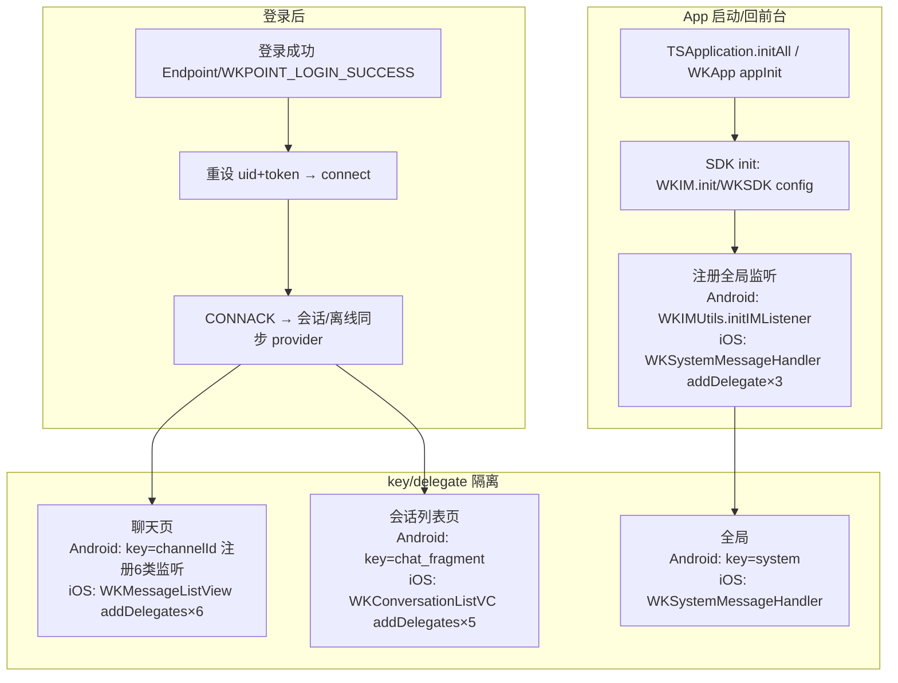
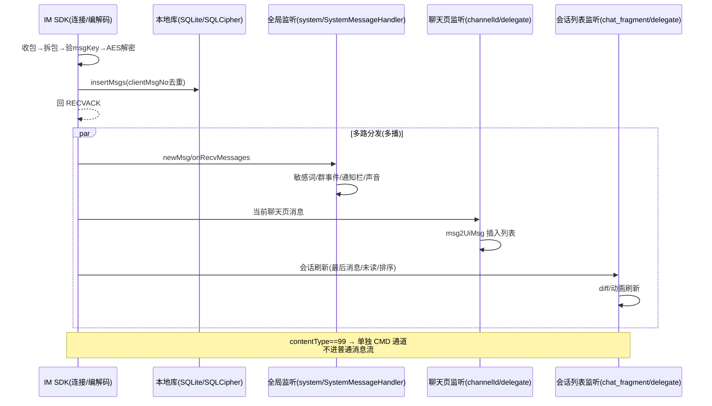
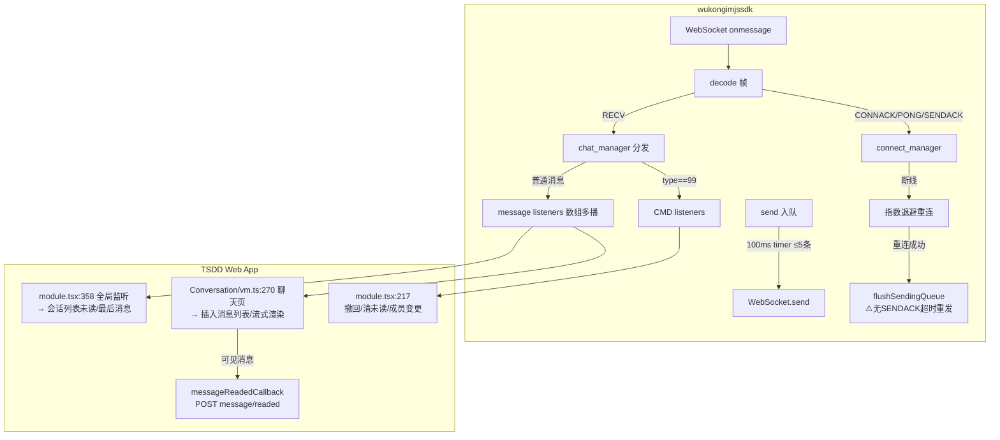
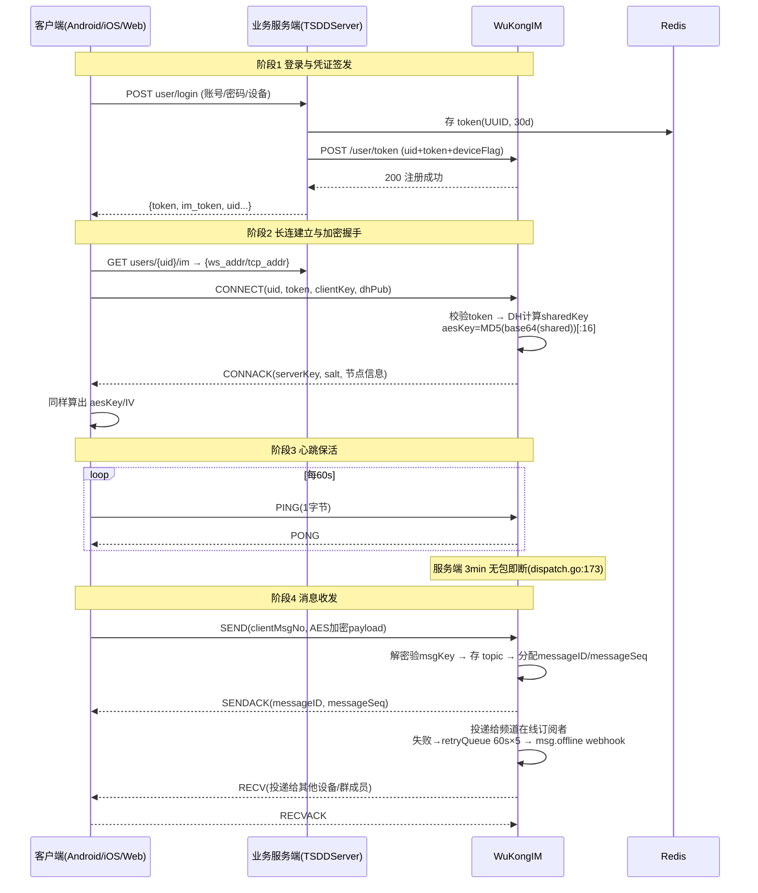
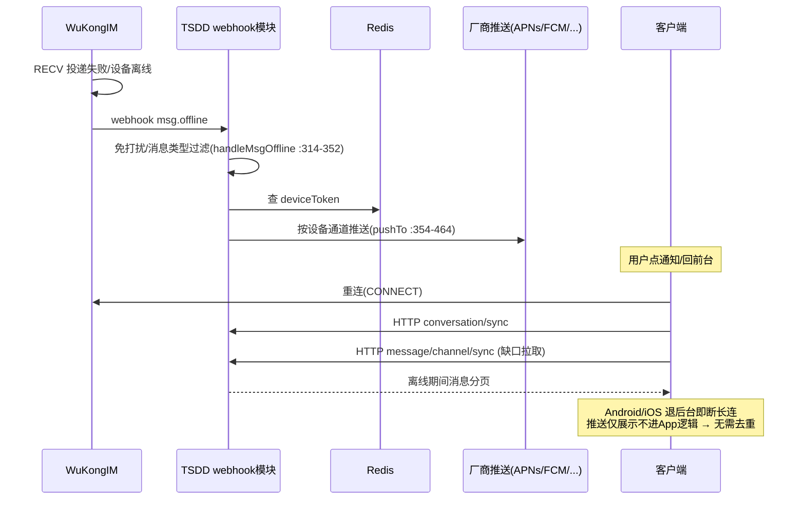
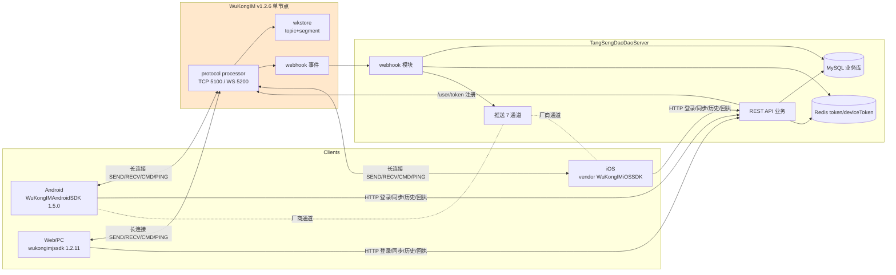

# 唐僧叨叨 IM 即时通讯系统 —— 消息机制深度分析报告

> **分析基准（全部源码本地可核对）**
>
> | 角色 | 仓库路径（本地） | 版本快照 |
> |---|---|---|
> | IM 通讯服务端 | `/data/code/tsdd-analysis/WuKongIM` | **v1.2.6**（tag） |
> | IM 协议包定义 | 外部依赖 `github.com/WuKongIM/WuKongIMGoProto` | **v1.0.21**（go.mod:7 锁定，源码已核对） |
> | 业务服务端 | `/data/code/tsdd-analysis/TangSengDaoDaoServer` | HEAD `7511b31` |
> | 业务框架库 | `/data/code/tsdd-analysis/TangSengDaoDaoServerLib` | HEAD `dbd091b`（Server go.mod 引用 v1.0.9） |
> | Android 客户端 | `/data/code/tsdd-analysis/TangSengDaoDaoAndroid` | HEAD `115e354` |
> | Android IM SDK | `/data/code/tsdd-analysis/WuKongIMAndroidSDK` | **1.5.0**（tag，与 App `wkbase/build.gradle:100` 依赖一致） |
> | iOS 客户端 | `/data/code/tsdd-analysis/TangSengDaoDaoiOS` | HEAD `6913a3b` |
> | iOS IM SDK | vendored 于客户端仓库 `Modules/WuKongIMiOSSDK` | 随仓库快照 |
> | Web 客户端 | `/data/code/tsdd-analysis/TangSengDaoDaoWeb` | HEAD `1bd8a2d` |
> | Web IM SDK | `/data/code/tsdd-analysis/wukongimjssdk` | **v1.2.11**（与 `yarn.lock:14934` 锁定的 npm 包同版本提交） |
>
> **铁律执行说明**：本报告所有协议字段、调用栈、机制结论均附 `file:line` 证据；无源码证据的内容集中收录于【第八部分 待确认清单】，不混入正文结论。

---

# 第一部分 项目整体概览

## 1.1 多仓库职责划分与依赖关系

本 IM 系统源码上实际是**"双服务端 + 三客户端"**结构——用户在用的"服务端"由两个独立仓库组成，职责边界清晰：



| 仓库 | 职责 | 边界（源码证据） |
|---|---|---|
| **WuKongIM** | 长连接接入、私有二进制协议、消息路由投递、消息/离线存储、最近会话、在线状态 | 不认识"好友/群组"等业务概念，频道订阅者/黑白名单由业务端通过 API 同步（`internal/server/api_channel.go:34-73`） |
| **TangSengDaoDaoServer** | 用户/好友/群组/文件/机器人/搜索/管理端等全部业务 REST API；接收 WuKongIM 事件做业务化处理（落业务库、@提醒、机器人、离线推送） | 不承载任何长连接；发消息最终都是 HTTP 调 WuKongIM `/message/send`（`TangSengDaoDaoServerLib/config/msg.go:130-171`） |
| **ServerLib** | Server 的框架底座：config.Context DI、wkhttp(gin 封装)、模块生命周期、machinery 异步任务 | 被 Server `go.mod` 引用 |
| **Android/iOS/Web** | 三个客户端，各自通过对应语言的 WuKongIM SDK 建立长连接，通过 axios/Retrofit/AFNetworking 调业务 REST | SDK 全部来自 WuKongIM 组织（iOS 为源码 vendor） |

## 1.2 完整技术栈（每项标注来源）

| 端 | 语言/框架 | 网络库 | IM 底层 | 存储 | 来源 |
|---|---|---|---|---|---|
| WuKongIM | Go 1.21+ / 自研 `wknet`（reactor 网络模型，`pkg/wknet/reactor_main.go:21`） | TCP + WebSocket（gobwas/ws，`pkg/wknet/websocket.go:16-40`） | `WuKongIMGoProto v1.0.21` | 自研 topic+segment 消息日志（mmap 索引）+ bbolt 元数据（`pkg/wkstore/filestore.go:14`） | `go.mod` |
| 业务服务端 | Go 1.20 / gin（封装 wkhttp） | REST；gRPC webhook 接收（`modules/webhook/api.go:117-139`） | 无（HTTP 客户端调 WuKongIM） | MySQL(dbr)/Redis/ES/MinIO | `TangSengDaoDaoServer/go.mod` |
| Android | Kotlin+Java / Retrofit3+RxJava3 | xSocket（`WKConnection.java:445`） | WuKongIMAndroidSDK 1.5.0 | SDK 内 SQLite（`assets/wk_sql/202008292051.sql`） | `wkbase/build.gradle:100` |
| iOS | ObjC+Swift / AFNetworking4 | CocoaAsyncSocket（`WKConnectionManager.m:202`） | vendored WuKongIMSDK | FMDB+SQLCipher（`WKDB.m:78-89`） | `Podfile:50` |
| Web | TS+React17 / axios 0.25 | 浏览器 WebSocket（`connect_manager.ts:120`） | wukongimjssdk 1.2.11 | **SDK 无本地库**，全靠 Provider 回调 | `packages/tsdaodaobase/package.json:27` |

## 1.3 部署方式

- **拓扑**（`TangSengDaoDaoCli/docker-compose.yaml`）：`wukongim`（5100 TCP / 5200 WS / 5001 API）+ `tangsengdaodaoserver`（8090，`command: "api"`，健康检查 `/v1/ping`）+ `tangsengdaodaoweb` + mysql + redis + minio + adminer。
- **WuKongIM 集群**：**v1.2.6 无集群能力**——全仓无 cluster/gossip/raft 代码（grep 为 0），`/route` API 仅返回本节点地址（`internal/server/api_route.go`，`options.go:172-174` External 配置）。集群为 v2.x 特性，本快照为**单节点架构**。
- **环境注入**：WuKongIM 配置走环境变量前缀 `WK_`（`cmd/root.go:72-74`，`.`→`_`），如 `WK_TOKENAUTHON=true`、`WK_WEBHOOK_GRPCADDR`；业务端走 `tsdd.yaml` + 前缀 `ts`（`TangSengDaoDaoServer/main.go:43`）。
- CI/CD：各仓库有 `Dockerfile(.ghcr)` + GitHub workflow（`ghcr.yml`），Cli/appstore 提供 compose/面板两种一键部署。

## 1.4 IM 能力清单（源码识别）

**消息类型**（`TangSengDaoDaoServerLib/common/msg.go:13-91` contentType 常量）：

| 类型 | 值 | 类型 | 值 |
|---|---|---|---|
| 文本 | 1 | 合并转发 | 11 |
| 图片 | 2 | 矢量表情 | 12 |
| GIF | 3 | Emoji 贴纸 | 13 |
| 语音 | 4 | 富文本 | 14 |
| 视频 | 5 | CMD 命令消息 | **99** |
| 位置 | 6 | 系统类（好友申请1000/建群1001/加人1002/移出1003/撤回1006/扫码入群1007/转让1008/进群申请1009…） | 1000+ |
| 名片 | 7 | 提示语 | 2000 |
| 文件 | 8 | 音视频通话结果 | 9989 |

**能力矩阵**：

| 能力 | 支持情况 | 源码证据 |
|---|---|---|
| 单聊 | ✅ fakeChannelID `uid1@uid2`（CRC32 排序） | `WuKongIM/internal/server/common.go:48-59` |
| 群聊 | ✅ 读扩散 + SyncOnce 写扩散；大群标记 | `WuKongIM/internal/server/channel.go:496-531` |
| 离线消息 | ✅ 频道持久化 + HTTP sync 拉取 | `WuKongIM/internal/server/api_channel.go:71` |
| 消息 ACK | ✅ SENDACK / RECVACK 双向 | `wkproto common.go:103-115` |
| 多端在线 | ✅ APP 互踢、WEB/PC 可多登（master/slave 设备级） | `WuKongIM/internal/server/processor.go:162-195` |
| 多端同步 | ✅ CMD(99) 消息：已读/撤回/删除/会话同步 | `WuKongIMAndroidSDK/wkim/.../entity/WKCMDKeys.java` |
| 离线推送 | ✅ APNs/FCM/华为/小米/OPPO/vivo/鸿蒙 7 驱动 | `TangSengDaoDaoServer/modules/webhook/push_*.go` |
| 消息撤回/编辑 | ✅ 业务库 extra 标记 + CMD 广播 | `modules/message/api.go:1432+,241+` |
| @提醒 | ✅ mention 解析 → reminders 表 | `modules/message/api_reminders.go:141-240` |
| 机器人 | ✅ 事件队列 + 长轮询拉取 | `modules/robot/api.go:69-81` |
| 流式消息（AI stream） | ⚠️ 原生 SDK 支持，但 JS SDK 1.2.11 字段布局不一致（见 4.6） | 三方对照见第四部分 |
| 端到端加密（Signal 级 E2EE） | ⚠️ 仅传输层 DH+AES；设置位 `Setting.Signal` 存在；Android 端 Signal 密钥监听被整段注释停用 | `TangSengDaoDaoServerLib/config/msg.go:935-953` |
| 红包 | ❌ 本版本源码未找到 contentType 定义 | 第八部分待确认 |

## 1.5 全局架构图



---

# 第二部分 服务端仓库深度分析

> 本章覆盖**两个服务端仓库**：WuKongIM（通讯层，协议与消息机制的真正实现地）与 TangSengDaoDaoServer（业务层，webhook 消费与离线推送）。

## 2.1 目录结构与模块划分

### WuKongIM v1.2.6

```
WuKongIM/
├── main.go                  # cobra 入口
├── cmd/root.go              # viper 配置，env 前缀 WK（:72-74）
├── internal/server/         # 全部业务逻辑
│   ├── server.go            # 组装：store/api/deliveryManager/dispatch/connManager/...（:62-108）
│   ├── dispatch.go          # 网络事件入口、拆包（:206-238 gnetUnpacket）
│   ├── processor.go         # 协议处理核心：鉴权/消息处理/RECACK/踢出（:730 process）
│   ├── channel.go           # 频道：订阅者扇出、写扩散、会话更新
│   ├── conn_manager.go      # uid→[]connID 映射（:10-16）
│   ├── delivery_manager.go  # 在线投递 + 离线登记 + 重试触发
│   ├── retry_queue.go       # in-flight 优先队列重试
│   ├── conversation.go      # 最近会话（内存 LRU + 定时落盘）
│   ├── datasource.go        # 第三方数据源回调（5 种 cmd）
│   ├── webbhook.go          # webhook 事件推送（3 种事件）
│   └── api_*.go             # :5001 管理 API
├── pkg/wknet/               # 自研网络层（reactor；acceptor.go:147/167/184 TCP/WS/WSS 监听）
├── pkg/wkstore/             # 自研存储（topic+segment 消息日志 + bbolt 元数据）
└── pkg/wkhook/              # webhook gRPC pb（webhook.proto）
```

### TangSengDaoDaoServer

16 个业务模块经 `internal/modules.go` 匿名 import 注册；消息链路相关：

| 模块 | 职责 |
|---|---|
| `modules/webhook` | 接收 WuKongIM 事件（gRPC:6979 / HTTP /v1/webhook*）；消息业务落库；离线推送全链路（`push_*.go` 7 驱动） |
| `modules/message` | 消息业务 API：同步/撤回/编辑/搜索/提醒/已读计数/敏感词 |
| `modules/user` | 登录/注册/token 签发/device_token 上报 |
| `modules/group` | 群组 CRUD、成员、禁言（映射 IM 黑白名单） |
| `modules/file` | 文件上传（多存储后端） |

## 2.2 通信协议分析（重点）

### 2.2.1 两套通信体系的分工

| 体系 | 承载 | 用途 |
|---|---|---|
| **IM 长连接** | TCP :5100 / WebSocket :5200，自定义二进制协议 | 实时消息收发（SEND/RECV）、ACK、CMD 消息、心跳 |
| **HTTP 短连接** | 业务端 :8090 `/v1/*`；WuKongIM :5001 | 登录/注册/好友/群组/文件；**历史消息拉取**（客户端→业务端→WuKongIM `/channel/messagesync`）；WuKongIM 的**离线消息同步**（`/message/sync` 写模式） |

关键认知：**实时下行靠长连接推，历史/离线补齐全部走 HTTP 拉**——WuKongIM 的同步协议是 HTTP 而非长连接命令（`internal/server/api_message.go:37`、`api_channel.go:71`）。

### 2.2.2 长连接底层与包结构

- **传输**：TCP（`pkg/wknet/acceptor.go:147`）与 WebSocket（gobwas/ws，`pkg/wknet/websocket.go:16-40`），**无 QUIC**。
- **Framing**（`WuKongIMGoProto@v1.0.21 common.go:19-26`，三端 SDK 实现一致）：

```
字节0:   [packetType:4bit][DUP:1][SyncOnce:1][RedDot:1][NoPersist:1]
字节1..: MQTT 风格 varint RemainingLength（7bit/字节，服务端解码 dispatch.go:240-257）
之后:    RemainingLength 字节的消息体
特例:    PING/PONG 仅 1 字节（protocol.go EncodeFrame:146-151）
上限:    MaxRemaingLength = 1024*1024（protocol.go:31）
```

- **包类型枚举**（`common.go:103-115`）：

```go
UNKNOWN=0, CONNECT=1, CONNACK=2, SEND=3, SENDACK=4, RECV=5,
RECVACK=6, PING=7, PONG=8, DISCONNECT=9, SUB=10, SUBACK=11
```

### 2.2.3 关键包字段定义

**CONNECT**（`connect.go:10-20`）——握手兼鉴权：

```go
type ConnectPacket struct {
    Framer
    Version         uint8      // 协议版本（客户端 0x4）
    ClientKey       string     // 客户端 Curve25519 DH 公钥(base64)
    DeviceID        string     // 设备ID
    DeviceFlag      DeviceFlag // 0=APP 1=WEB 2=PC 99=SYSTEM（同Flag同账号互踢）
    ClientTimestamp int64
    UID             string
    Token           string     // 业务端签发的 token
}
```

**CONNACK**（`connack.go:10-17`）：`ServerVersion / ServerKey(服务端DH公钥) / Salt / TimeDiff / ReasonCode`。协议版本取 `min(server, client)` 协商。

**SEND**（`send.go:10-22`）：`Setting(1B) / MsgKey / Expire / ClientSeq / ClientMsgNo / [StreamNo] / ChannelID / ChannelType / [Topic] / Payload`

**SENDACK**（`sendack.go:10-17`）：`MessageID i64 / MessageSeq u32 / ClientSeq / ClientMsgNo / ReasonCode` —— **客户端判断发送成功的唯一凭据**。

**RECV**（`recv.go:18-38`）：`MessageID / MessageSeq / ClientMsgNo / [StreamNo/StreamSeq/StreamFlag] / Timestamp / ChannelID / ChannelType / [Topic] / FromUID / Payload`

**RECVACK**（`recvack.go:10-14`）：`MessageID i64 / MessageSeq u32`。

### 2.2.4 消息 ID 体系（三层 ID）

| ID | 生成方 | 语义 | 证据 |
|---|---|---|---|
| `clientMsgNo` | 客户端 | 发送方 UUID（含设备因子），**全局去重键**；客户端本地唯一索引 | `WuKongIMAndroidSDK MsgDbManager.java:565-680`；iOS `202005281108.sql:1-3` |
| `messageID` | 服务端 snowflake | 全局唯一 | `processor.go:33,726-728` |
| `messageSeq` | 服务端存储层 | **频道内严格递增**（topic `lastMsgSeq` 原子加）；SyncOnce 写扩散消息另有**每用户队列**的 per-user seq | `pkg/wkstore/topic.go:65-87`、`filestore_msg.go:47-50` |

**会话寻址**：`channelID + channelType`（Person=1/Group=2/CustomerService=3/Community=4/CommunityTopic=5/Info=6/Data=7，`common.go:338-347`）；单聊用 fakeChannelID：两 UID 按 CRC32 排序后 `"uid1@uid2"`，保证双向同频道（`internal/server/common.go:48-59`）。

### 2.2.5 加密与防篡改

- **密钥协商**：CONNECT 携客户端 DH 公钥 → CONNACK 回服务端公钥+salt → 双方 `sharedKey = Curve25519(私钥, 对方公钥)`，`aesKey = MD5(base64(sharedKey))[:16]`，IV 取 salt 前 16 字节（服务端 `processor.go:707-723`；三端 SDK 实现逐行一致，见第四部分对照）。
- **payload**：AES-128-CBC + PKCS7 + Base64。
- **MsgKey**：`MD5(AES(verityString))`，verityString 由 messageID/messageSeq/clientMsgNo/timestamp/fromUID/channelID/channelType/payload 拼接（服务端 `processor.go:528-562`；接收方校验不通过直接丢弃，Android `WKProto.java deReceivedMsg` 返回 null）。

### 2.2.6 握手、心跳、断线规则

- **首包必须 CONNECT**，未认证连接收到其他包直接断开（`dispatch.go:82-86`）。
- **服务端无独立心跳计时器**，采用空闲超时：认证前 `SetMaxIdle(2s)`（`dispatch.go:173`），认证后 `SetMaxIdle(ConnIdleTime)`，默认 **3 分钟**（`options.go:177`）；`wknet/conn.go:531-560` 每 maxIdle/2 巡检 `lastActivity`，任何包（含 PING）都刷新。PING 直接回 PONG（`processor.go:247-250`）。
- **客户端心跳均为 60s**（iOS `WKOptions.m:18`、Android `HeartbeatManager.java`、JS `config.ts:12-21`）——即：60s 心跳 ≪ 180s 空闲超时，设计自洽。

## 2.3 连接管理与多端策略

- 连接注册：`connManager.userConnMap map[uid][]connID`（`conn_manager.go:10-16`）；连接对象携带 UID/DeviceFlag/DeviceID/DeviceLevel/aesKey/aesIV（`processor.go:204-212`）。
- **互踢策略**（`processor.go:162-195`）：同 uid+deviceFlag 已有连接时——
  - 新连接为 **Master**：踢掉全部旧连接（发 `DisconnectPacket{ReasonConnectKick, "login in other device"}`，5s 后关闭）；
  - 新连接为 **Slave**：仅踢相同 deviceID 的旧连接。
- 设备级别由业务端写 token 时指定（APP=Master、其余=Slave，`TangSengDaoDaoServer/modules/user/api.go:1024-1026`）——**与业务端"APP 互踢、PC/Web 多登复用 token"策略（api.go:1077-1096）形成闭环**。
- 在线状态：连接断开 `processClose`（`processor.go:674-685`）→ `webhook.Offline`；上线 → `webhook.Online`；事件经异步批量推送（2s 轮询）。

## 2.4 消息流转完整源码流程（SEND → SENDACK）

```
客户端A                                        WuKongIM v1.2.6
   │ SEND(setting,clientSeq,clientMsgNo,channelID,payload[AES])
   ▼
Dispatch.dataIn (dispatch.go:53) 拆包→DecodeFrame→connCtx.putFrame
   ▼
processor.process (processor.go:730) → processFrames(:738 按类型分组)
   ▼
processMsgs(:253) → prcocessChannelMessages(:286 按频道分组)
   ├─ 权限校验: 单聊对方白名单(:319-337) / 群聊 hasPermission(:434-450 黑白名单+IsSubscriber)
   ├─ genMessageID() snowflake(:726)
   ├─ 校验MsgKey + AES解密payload(:346-370, checkAndDecodePayload:528)
   ├─ 组装 Message{RecvPacket,...}(:372-397)
   ├─ 持久化 storeChannelMessagesIfNeed(:475-511)
   │     NoPersist/SyncOnce 跳过; 否则 store.AppendMessages → 分配 messageSeq
   ├─ webhook开启 → 入 notify 队列(:513-525, 供 msg.notify 事件)
   ├─ 投递 channel.Put(messages, nil, fromUID...) (channel.go:457)
   │     ├─ RealSubscribers(:308) 取订阅者
   │     ├─ 仅SyncOnce&&持久化 → 写扩散到每用户队列(:496-531 AppendMessagesOfUser)
   │     ├─ 非大群 → 更新最近会话(:475)
   │     └─ deliveryManager.startDeliveryMessages (delivery_manager.go:38)
   │           每个subscriber: getRecvConns(排除发送者同设备)
   │             ├─ 在线: DeepCopy+填per-user seq+单聊channelID改FromUID
   │             │      → retryQueue.startInFlightTimeout → AES加密+MsgKey → dataOut 推 RECV
   │             └─ 离线(无连接或无master在线, :60-71) → webhook.notifyOfflineMsg(:125) → msg.offline 事件
   ▼
回 SendackPacket{MessageID,MessageSeq,ClientSeq,ClientMsgNo,Success}(:424-430)
```

**接收端 B**：RECV 到达 → 验 MsgKey → 解密 → 入库 → **立即回 RECVACK**（iOS `WKChatManager.m:532-543`；Android `MessageHandler.java:421-465` 批量 100ms；JS `chat_manager.ts:101-109`）。
**服务端处理 RECVACK**（`processor.go:648-671`）：`retryQueue.finishMessage` 移除重试项；SyncOnce&&持久化&&master 设备 → `UpdateMessageOfUserCursorIfNeed` 推进该用户已读游标。
**重试**：`retry_queue.go` in-flight 队列，Interval 60s / ScanInterval 5s / MaxCount 5（`options.go:217-222`），重发 RECV（`delivery_manager.go:146-171`）。

## 2.5 消息存储

- **引擎**：自研 `pkg/wkstore.FileStore`，非 pebble/leveldb。
- **消息**：Kafka 风格 topic+segment——每频道一个 topic（`channelID@channelType`，`filestore_msg.go:170`），CRC 分 256 slot；segment 顺序写 + **mmap 索引**（`segment_index.go:35,75`）；SegmentMaxBytes 默认 2G。
- **元数据**：bbolt（频道信息、user token、订阅者、黑白名单、最近会话、webhook notify 队列，`filestore.go:94-576`）。
- **离线消息**：消息本体即在频道存储中，"离线"只是投递时无在线连接的判定（`delivery_manager.go:60-71`）；客户端上线后经 HTTP `/channel/messagesync`（频道维度，`api_channel.go:71`，pull_mode 上下拉，limit≤10000）与 `/message/sync`（写模式用户队列+游标，`api_message.go:37`；`/message/syncack` 推进游标只增不减）拉取。
- **过期**：SEND 的 `Expire` 字段仅透传存储，**服务端无任何过期清理逻辑**（grep 无消费者）——见第六部分风险。

## 2.6 群聊逻辑

- **读扩散为主**：群消息只存一份到频道 topic，成员按 messageSeq 拉历史；投递是在线扇出。
- **写扩散仅 SyncOnce 消息**（每用户队列）；**大群禁止**带存储的 SyncOnce（`api_message.go` 报错"超大群不支持发送带存储的SyncOnce类型消息"）。
- **大群**（channel large=1）：不维护最近会话（`channel.go:475` 注释"几万人的大群更新最近会话太耗性能"）；离线推送订阅者数组可 gzip 压缩（`webbhook.go:128-143`）。
- **业务端关系维护**：群成员 = WuKongIM 频道订阅者（建群 `IMCreateOrUpdateChannel`、加人 `IMAddSubscriber`、踢人 `IMRemoveSubscriber`，`TangSengDaoDaoServer/modules/group/api.go:722-727,1170-1175,2207`）；**业务端不做消息扇出**。全员禁言=IM 白名单（群主+管理员），单人禁言=IM 黑名单（`api.go:1426-1437,2837-2852`）。
- **临时频道**：subscribers 无 channelID 时建 `@tmp` 后缀频道不持久化（`api_message.go`，`options.go:182`）。

## 2.7 鉴权

**长连接鉴权（tokenAuthOn=true）完整链路**：

```
1. 客户端 POST /v1/user/login（业务端 modules/user/api.go:172,952）
2. 业务端生成 token=UUID，写 redis token:{token}（30d）→ execLogin(api.go:1020-1134)
3. 业务端调 WuKongIM POST /user/token 登记 {uid,token,device_level,device_flag}
   （api.go:1112-1130 → ServerLib/config/msg.go:70-89）
4. 客户端长连接 CONNECT 携带 uid+token
5. WuKongIM processAuth(processor.go:93) → store.GetUserToken(uid,deviceFlag) 比对
   （processor.go:113-130；不符回 CONNACK ReasonAuthFail）+ Ban 检查(:136-150)
```

**要点**：业务端**不参与每次长连鉴权**（无鉴权回调代码），WuKongIM 自校验；踢人动作在 IM 侧。
**HTTP API 鉴权**：业务端 `AuthMiddleware` 查 redis token 缓存（`ServerLib/pkg/wkhttp/http.go:312-313`）；WuKongIM :5001 API 支持 `managerToken` 头（`server_http.go:54-65`）——**但业务端代码读了配置却从未注入请求头**（见第六部分）。

## 2.8 推送集成（离线触发逻辑）

完整链路（TangSengDaoDaoServer/modules/webhook）：

```
WuKongIM 投递判定离线 → webhook 事件 msg.offline（HTTP 或 gRPC 均可）
→ api.go:247-249 handleMsgOffline(:314-352，解析 to_uids，支持 gzip 压缩)
→ pushTo(:354-464) 决策：
   ├─ Setting.Signal(端到端) → 不解析 payload
   ├─ sync_once==1 且非音视频 → 不推（命令类消息）
   ├─ contentType ∉ supportTypes(api.go:99-101) → 不推
   └─ allowPush(:467-501)：全局 NewMsgNotice==0 / 单聊 mute / 群 mute → 不推；音视频来电跳过免打扰
→ push(:503-555)：Redis userDeviceToken:{uid} HGETALL（写入点 POST /v1/user/device_token）
   → 按 deviceType+bundleID 选驱动（api.go:49-87 装配）
   → APNs(p12 证书,RTC 用 content-available:1)/FCM/华为/小米/OPPO/vivo/鸿蒙
```

**推送内容**：`ParsePushInfo`（common.go:61-98）单聊 title=发送者显示名（备注>群昵称>名字）、群聊 title=群名；signal 加密/关闭详情/用户 msgShowDetail==0 → 统一"您有一条新的消息"；badge 用 redis 累加。**推送不携带密文 payload**。

## 2.9 异常处理

| 场景 | 机制 | 证据 |
|---|---|---|
| 服务端投递未收 RECVACK | retryQueue 60s×5 重投 | `retry_queue.go`、`options.go:217-222` |
| 客户端发送未收 SENDACK | iOS：5s 间隔重试×8 → 置失败；Android：10s 超时重发×5 → 置失败；JS：**无超时重试**，仅重连后 flush sendingQueues | `WKRetryManager.m:369-385`；`WKConnection.java:862-887`；`chat_manager.ts:284-303` |
| 客户端断线 | iOS 退避 2s×2→60s 无上限；Android 0.5s→8s 最多 5 次+1s 巡检；JS 固定 3s 无上限 | 三方 SDK 连接管理器 |
| 重连补偿 | CONNACK 后先拉离线（HTTP），期间在线 RECV 包缓存后补处理；之后重发未确认消息 | iOS `WKConnectionManager.m:71,270-280`；Android `WKConnection.java:823-827,626-657` |
| 消息重复 | clientMsgNo 唯一索引；冲突时改名占位（isDeleted=1 防 messageSeq 断档） | iOS `WKMessageDB.m:269-273`；Android `MsgDbManager.java:565-680` |

## 2.10 服务端消息流转流程图



## 2.11 服务端关键源码片段

**互踢（`WuKongIM/internal/server/processor.go:162-195`）**：

```go
// same master kicks each other
oldConns := p.s.connManager.GetConnsWith(connectPacket.UID, connectPacket.DeviceFlag)
...
if connectPacket.DeviceLevel == wkproto.Master { // 新连接是主设备：踢全部
    p.kickConn(oldConn, wkproto.ReasonConnectKick, "login in other device")
```

**单节点证据**：v1.2.6 全仓无 cluster/gossip/raft 代码；`/route` 仅返回本节点（`api_route.go`）。

**webhook 三事件**（`webbhook.go:394-399`）：`msg.offline` / `msg.notify` / `user.onlinestatus`；gRPC 优先于 HTTP（`options.go:505-510`）。

**业务端消息业务落库**（`modules/webhook/db_message.go:26-39`）：按 `crc32(channelID) % MessageTableCount` 分表，`insert ... ON DUPLICATE KEY UPDATE payload`。

---

# 第三部分 移动端仓库深度分析（Android / iOS）

> 移动端共两个仓库。每个端分两层分析：**SDK 层**（协议编解码/连接/监听 API/ACK/本地库）与 **App 层**（初始化、监听注册、收发处理、会话、离线、推送合并）。

## 3.1 工程结构与 IM SDK 位置

| | Android | iOS |
|---|---|---|
| App 模块 | `app`（薄壳，3 文件）+ `wkbase`（基础设施）+ `wkuikit`（功能 UI）+ `wklogin`/`wkscan`/`wkpush` | 主 target 仅 4 个 `.m`；功能全在本地 pod：`WuKongBase`（UI/服务）、`WuKongLogin`、`WuKongContacts`、`WuKongDataSource` |
| IM SDK 位置 | **外部依赖** `com.github.WuKongIM:WuKongIMAndroidSDK:1.5.0`（`wkbase/build.gradle:100`），入口 `WKIM.getInstance()`（SDK `WKIM.java:20-136`） | **源码 vendor** `Modules/WuKongIMiOSSDK`（`Podfile:50`），入口 `[WKSDK shared]`（`WKSDK.h:15-98`） |
| SDK 分层 | `protocol/`（10 包类）、`message/`（连接/编解码/timer）、`manager/`（9 个）、`db/`、`interfaces/`（44 个监听接口）、`msgmodel/` | `coder/`（编解码+proto）、`manager/`（连接/聊天/重试/安全/CMD）、`db/`（FMDB 13 类）、`model/` |

## 3.2 网络层：长连接、心跳、断线重连

### Android SDK（xSocket）

- 连接调用栈：`ConnectionManager.connection()`（`ConnectionManager.java:39`）→ `WKConnection.reconnection()`（`WKConnection.java:304`）→ `getConnAddress`（:366，经 App 注册的 `IGetIpAndPort` 回调拿 IP，CountDownLatch 10s 超时）→ `connSocket`（:445，xSocket NonBlockingConnection）→ 连接成功 `sendConnectMsg`（:578，deviceFlag=0）。
- 心跳：`HeartbeatManager.java` 60s 发 PING。**注意：无 PONG 超时检测**——`lastMsgTime` 仅在收 PONG 时赋值（`WKConnection.java:612`）但无消费方；断线感知靠 `NetworkChecker.java`（每 1s 巡检网络/连接状态）与 socket 异常。
- 重连：`forcedReconnection`（:247-302）：`maxReconnectAttempts=5`、`baseReconnectDelay=500ms` 指数退避封顶 8s；达 5 次 `stopAll`。另有 requestIP 6s 超时、CONNACK 10s 超时。

### iOS SDK（GCDAsyncSocket）

- 连接调用栈：`[WKConnectionManager connect]`（`WKConnectionManager.m:117`，经 `connectInfoCallback` 取 uid/token）→ `loopGetAddrToConnect`（:174）→ `connectSocket:port:`（:202）→ `didConnectToHost`（:348）→ `sendConnectPacket:token:`（:404，deviceFlag=0 硬编码 APP）。
- 心跳：CONNACK 后 `startHeartbeat`（:774），NSTimer 60s；`checkAndSendHeartbeat`（:797-805）：**若 `now - lastMsgTimeInterval > 61s` 直接判定死亡退避重连**（任何包到达都刷新 lastMsg，:632）——iOS 是三端中唯一有心跳超时判死的。
- 重连：`backoffReconnect`（:324）：base=2s、factor=2、cap=60s，**无次数上限**，成功后计数归零（:722）。

## 3.3 协议编解码

两端 SDK 与服务端协议逐字节对齐（frame 首字节 `type<<4|flags`、MQTT varint 长度、包编号 1-9）：

- 拆包/粘包：Android `MessageHandler.cutBytes`（`MessageHandler.java:197`，>2MB 丢弃 :283）；iOS `unpackOneLM`（`WKConnectionManager.m:567-625`）。
- payload 编解码：应用层 **JSON 文本**（非 protobuf），AES-128-CBC 加密 + msgKey 防篡改（算法与服务端一致，见 2.2.5）：
  - Android：`CryptoUtils.java:56-88`（Curve25519 来自 org.whispersystems）；msgKey 校验失败 `deReceivedMsg` 返回 null 丢弃。
  - iOS：`WKSecurityManager.m:39-82`；RECV 验签失败丢弃（`WKRecvPacket.m:59-62`）。
- 协议版本协商：CONNACK 取 `min(serverVersion, clientVersion)` 写回（Android `WKProto.java deConnectAckMsg`；iOS `WKConnackPacket.m:27-31`），决定 expire 等字段是否编码。

## 3.4 消息监听注册机制（重点）

### 3.4.1 SDK 监听接口定义

**Android**（`interfaces/` 44 个接口，`ConcurrentHashMap<String, IListener>` 按 key 注册/移除，回调切主线程）：

```java
// 新消息（SDK manager/MsgManager.java:1070 注册）
public interface INewMsgListener { void newMsg(List<WKMsg> msgs); }
// 发送 ACK（:1002）
public interface ISendACK { void msgACK(WKMsg msg); }
// 连接状态（ConnectionManager.java:112）
public interface IConnectionStatus { void onStatus(int code, String reason); }
// CMD 命令（CMDManager.java:237）
public interface ICMDListener { void onMsg(WKCMD cmd); }
// 会话刷新（ConversationManager.java:153）、消息刷新 IRefreshMsg、
// 删除 IDeleteMsgListener、存储前拦截 IMessageStoreBeforeIntercept、
// 离线同步 ISyncOfflineMsgListener、发送回 UI ISendMsgCallBackListener 等
```

**iOS**（protocol + `NSHashTable` 弱引用多 delegate，`WKConnectionManager.m:41`；注册 `addDelegate:` :462-471，回调切主线程 :488-529）：

```objc
@protocol WKChatManagerDelegate <NSObject> @optional   // WKChatManager.h:362-421
- (void)onRecvMessages:(NSArray<WKMessage*>*)messages left:(int)left;
- (void)onMessageUpdate:(WKMessage*)message left:(int)left;
- (void)onSendack:(WKSendackPacket*)packet left:(int)left;
- (void)onMessageDeleted:... onMessageCleared:... onMessageStream:...
@end
// 另有 WKConnectionManagerDelegate（onConnectStatus/onKick，h:28-43）、
// WKConversationManagerDelegate（h:138-163）、WKCMDManagerDelegate（h:13-21）
```

### 3.4.2 多页面/多模块监听管理

| | Android | iOS |
|---|---|---|
| 机制 | **key 隔离**：同类型监听可注册多个，以 key 区分（全局 `"system"`、聊天页用 `channelId`、会话列表用 `"chat_fragment"`），页面销毁按 key 移除 | **delegate 多播**：各页面/全局 handler 各自 `addDelegate`，dealloc 时 remove；SDK 弱引用持有防泄漏 |
| 全局中枢 | `wkuikit/.../WKIMUtils.java initIMListener()`（:90-377）：App 启动及每次回前台（`TSApplication.kt:146`）都调用；后台 `removeListener()`（:684-687）仅移除 CMD/system 两 key | `WuKongBase/.../WKSystemMessageHandler.m`：注册 chat/connection/cmd 三个 manager 的 delegate（:56-65），App 启动即调（`WKApp.m:309`） |
| 二次分发 | 自研 `EndpointManager`（`wkbase/.../endpoint/EndpointManager.java`，`setMethod/invoke(s)`）用于跨模块解耦（登录成功、打开聊天页、红点），**不用于消息分发主干** | 无事件总线；`[WKApp shared] setMethod/invoke` point 机制仅用于登录/菜单等 |

**Android 全局监听注册清单**（`WKIMUtils.java:90-377`）：`addOnGetIpAndPortListener`（:148 长连地址）、`addMessageStoreBeforeIntercept`（:150 截图消息拦截）、`addOnUploadAttachListener`（:167 附件上传）、`addOnSyncConversationListener`（:169）、`addOnSyncChannelMsgListener`（:171）、**`addOnNewMsgListener("system",...)`（:173-273 群事件同步/敏感词提示/通知栏判断）**、**`CMDManager.addCmdListener("system",...)`（:321-376 撤回/好友/已读同步/成员变动分发）**。

**Android 聊天页注册**（`ChatActivity.java:746-851`）：`addOnDeleteMsgListener(channelId)`、`addCmdListener(channelId)`（typing/unreadClear/sync_channel_state）、`addOnRefreshMsgListener(channelId)`、`addOnSendMsgCallback(channelId, this::sendMsgInserted)`、`addOnNewMsgListener(channelId, this::receivedMessages)`、`addOnConnectionStatusListener(channelId)`（syncCompleted 后缺口补齐 :821-834）。

**iOS 聊天页/会话页注册**：`WKMessageListView.m:81-90 addDelegates`（chat/channel/reaction/connection/typing/reminder 六个 manager）；`WKConversationListVC.m:142-157`（conversation/chat/channel/typing/onlineStatus）。

### 3.4.3 普通消息 / 系统通知 / 状态变更的区分

三端 SDK 一致地以 **contentType==99（CMD）** 分流系统通知：SDK 收包后 `handleMessages`/`parsingMsg` 中判断 type==99 → 存 CMD 表 → `callOnCMDDelegate`/`CMDManager.handleCMD`/`notifyCMDListeners`，不进普通消息流（iOS `WKChatManager.m:583-587`；Android `MessageHandler.java:604-606`）。状态变更（发送 ACK/消息更新/连接状态）走各自独立监听接口。

## 3.5 消息接收完整处理流程（调用栈）

### Android

```
xSocket onData
→ MessageHandler.handlerOnlineBytes (MessageHandler.java:134)
→ WKConnection.receivedData (WKConnection.java:583)
→ MessageHandler.cutBytes(:197 粘包) → acceptMsg(:316) → WKProto.decodeMessage
→ [RECV] baseMsg2WKMsg → handleReceiveMsg(:366) → parsingMsg(:566 解JSON type)
   ├─ type==99 → CMDManager.handleCMD(:604-606)
   └─ 普通消息 → addReceivedMsg 暂存 → saveReceiveMsg(:400)
        → saveSyncMsg(:479): MsgDbManager.insertMsgs 入库(去重)
          + MsgManager.pushNewMsg(allList) 通知 INewMsgListener(:1251-1260)
          + groupMsg 更新会话表 → IRefreshConversationMsgList
        → sendAck(:446 批量回 RECVACK, 100ms 逐条)
App 层:
→ WKIMUtils addOnNewMsgListener("system") 业务副作用(敏感词/群同步/通知栏)
→ ChatActivity.receivedMessages(channelId) → msg2UiMsg 插入 adapter
→ ChatFragment addOnRefreshMsgListListener("chat_fragment")(:388) diff 刷新+重排序
```

### iOS

```
socket:didReadData (WKConnectionManager.m:389)
→ unpacket:callback:(:532) → handlePacketData(:628; 离线拉取期入 tempPackets :675-688)
→ handlePackets(:692 分组) → [RECV] chatManager handleRecv:(WKChatManager.m:526)
→ recvPacketsToMessages(:1383) → handleMessages(:549)
   ├─ saveMessages(:659-671 过滤 noPersist/CMD/流中帧)
   ├─ 串行 ackQueue 回 RECVACK(:532-543)
   ├─ type==99 → cmdManager callOnCMDDelegate(:583-587)
   └─ 普通消息 → callRecvMessagesDelegate(:581)
App 层:
→ WKSystemMessageHandler.onRecvMessages(:93-145 群事件/typing清除/本地通知/声音)
→ WKMessageListView.onRecvMessages(:1257) → dataProvider 插入 → tableView 刷新
→ WKConversationListVC.onConversationUpdate(:419-472) 列表动画刷新
```

## 3.6 消息发送流程与 ACK

### Android

```
ChatActivity.sendMessage(WKMessageContent)(:1831-1878 编辑/回复处理)
→ sendMsg()(:1880-1889 组装 WKMsg)
→ WKSendMsgUtils.sendMessage(:40-49, Endpoint 广播)
→ WKIM.msgManager.sendWithOptions(content, channel, options)
   [SDK] saveSendMsg(WKConnection.java:1074: 入库 status=send_sending, clientSeq=rowId)
   → setSendMsgCallback 回 UI → ChatActivity.sendMsgInserted(:2338-2365 上屏)
   → 媒体消息先 addOnUploadAttachListener 两段式 HTTP 上传后补发(:1000-1020)
   → addSendingMsg(sendingMsgHashMap[clientSeq]) → MessageHandler 写出
   [ACK] SENDACK → MsgDbManager.updateMsgSendStatus(clientSeq,messageSeq,messageID)
   (MessageHandler.java:331-341) → ISendACK 回调 → addOnRefreshMsgListener 刷新状态
   [重试] checkSendingMsg(:862-887, NetworkChecker 每秒): >10s 重发, 5 次→send_fail
   [重连补偿] resendMsg(:626-657 按 clientSeq 排序 150ms 间隔重发)
   [手动重发] WKChatBaseProvider.kt:803-846 点失败图标确认后 msgManager.sendMessage 原样重发
```

### iOS

```
WKConversationContextImpl.sendMessage:(:493-525 组 WKSetting: receipt/阅后即焚/话题)
→ [WKSDK shared].chatManager sendMessage:content channel:setting topic:(:518)
   [SDK] 先入库(WKChatManager.m:163; 媒体先置 UPLOADING 走 WKMediaManager)
   → WKRetryManager add + WKMessageQueueManager 内存队列
   → 100ms timer 每 tick ≤5 条拼接写出(WKMessageQueueManager.m:71-118)
   [ACK] handleSendack(:472-503): 更新 messageID/messageSeq/状态 → 移除重试项 → delegate
   [重试] WKRetryManager: 5s 间隔, <8 次重发, 超限置 WK_MESSAGE_FAIL(:369-385)
   [手动重发] resendMessage:(WKConversationContextImpl.m:527-538)
   [RECACK] 收到 RECV 入库后立即串行回(:532-543)
```

## 3.7 本地存储与历史消息

| | Android | iOS |
|---|---|---|
| 库 | SQLite（`assets/wk_sql/202008292051.sql:1-26`：`client_seq` 自增主键、`client_msg_no` 唯一索引） | FMDB+SQLCipher，按 uid 切库（`WKKitDB switchDB:`）；`message` 表 + `client_msg_no` 唯一索引（`202005281108.sql:1-3`） |
| 去重 | 批内 clientMsgNo 去重 + 分批 200 查库；冲突改名 `clientMsgNo-messageSeq` 且 isDeleted=1 占位防 messageSeq 断档（`MsgDbManager.java:565-680`） | 同策略（`WKMessageDB.m:200-213,269-273`） |
| 历史消息 | **本地库优先，缺口自动 HTTP 补齐**：`ChatActivity.getData`（:1180-1252）→ SDK `getOrSyncHistoryMessages`（:1197）→ 缺段回调 App 注册的 `addOnSyncChannelMsgListener` → HTTP `message/channel/sync`（`MsgModel.java:398-407`） | SDK `pullAround:`/`pullLastMessages:`（`WKMessageListDataProviderImp.m:45-63`）→ 缺口回调 `setSyncChannelMessageProvider`（`WKDataSourceModule.m:204-234`）→ 同一 HTTP 接口 |

## 3.8 会话管理

- **数据源均为 SDK 本地 conversationManager**（不直接 HTTP 拉列表）：Android `getAll(...)`（`ChatFragment.java:568`）+ `addOnRefreshMsgListListener` 增量；iOS `getConversationList`（`WKConversationListVM.m:53`）+ `onConversationUpdate:` 动画刷新（单条 insert/move，>1 条整表 reload，:419-472）。
- 启动/重连同步：App 注册的 provider → HTTP `conversation/sync`（Android `MsgModel.java:338`；iOS `WKDataSourceModule.m:167-202`，带 version/last_msg_seqs/msg_count，完成后 `conversation/syncack`）。
- 排序均置顶优先（Android `ChatFragment.java:403`；iOS `sortConversationList` :143）；未读聚合跳过免打扰（Android `setAllCount` :588-612 → tab 红点；iOS `WKConversationListVM.m:383-390`）。

## 3.9 离线消息补齐（登录/重连后）

```
CONNACK 成功
→ [SDK] 状态 syncMsg（此期间拒发非 CONNECT 包, WKConnection.java:823-827）
→ ① 会话同步: HTTP conversation/sync (+syncack)
→ ② 频道缺口: 进入聊天页/同步完成后 getOrSyncHistoryMessages → HTTP message/channel/sync
→ ③ 离线期间的在线包: iOS 缓存 tempPackets 补处理(WKConnectionManager.m:270-280);
    Android syncCompleted 后比对 maxOrderSeq 缺口重拉(ChatActivity:821-834)
→ ④ 消息 extra(撤回/编辑/已读数): CMD syncMessageExtra → HTTP message/extra/sync
→ ⑤ 未确认消息重发(resendMsg)
→ 状态 success
```

iOS 额外实现 HTTP `message/sync`+`message/syncack/{seq}`（写模式用户队列，`WKDataSourceModule.m:236-274`）；Android 定义了 `message/sync` 端点但**未发现调用点**（`MsgService.java:50`），实际走 ①② 路径。

## 3.10 多端同步

| 场景 | 机制 | 证据 |
|---|---|---|
| 被踢下线 | 连接监听 `kicked`/`onKick` → 退出登录+弹窗 | Android `ChatFragment.java:486-492`；iOS `WKSystemMessageHandler.m:70-89` |
| 多端已读 | CMD `unreadClear` → 同步本端未读角标 | Android `ChatActivity.java:757-769`；iOS `WKSystemMessageHandler.m:292-298` |
| 撤回 | CMD `messageRevoke` → 删/标记消息减未读 | Android `WKIMUtils.java:469-513`；iOS `:253` |
| 已读回执 | ⚠️ 两端均未接通（见下） | 第八部分 |
| 其他 | CMD memberUpdate/syncMessageExtra/syncConversationExtra/syncReminders | 两端 CMD handler |

**已读回执疑点**：Android 聊天页收集可见消息经 `EndpointManager.invoke("read_msg",...)`（`ChatActivity.java:1796,2256`），但**本仓库未找到 `read_msg` 的注册处理端**；iOS `didReaded:` → `receiptManager addReceiptMessages:`（`WKMessageListDataProviderImp.m:293-303`），但 **`messageReadedProvider` 未在 App 层设置**（:295 判空）。接收方已读数仍可通过消息 extra（`remoteExtra.readedCount`，服务端 3s 定时聚合 `modules/message/event.go:15-236`）刷新——**已读功能处于"半启用"状态**。

## 3.11 推送处理与长连接消息合并

- 厂商推送注册：Android 各通道 `onNewToken` → HTTP `user/device_token`（`WKFirebaseMessagingService.java:15-28`）；iOS APNs token → 同接口（`AppDelegate.m:132-158`）。
- **合并策略是架构性的而非代码去重**：App 退后台即断开长连（Android `TSApplication.kt:153-166 stopConn()`；iOS `WKApp.m:645 disconnect:YES`），厂商推送只做系统通知展示（小米/华为回调仅打日志，无任何拉取）；回前台重连后走 3.9 的 HTTP sync 补齐——**同一条消息不会同时经推送和长连进入 App 内处理，故无显式去重代码**。
- iOS NotificationService 扩展为空壳（仅标题加 "[modified]"，`NotificationService.m:19-28`），不做解密/拉取。

## 3.12 移动端 HTTP API 边界

走**长连接**：实时收发消息、CMD（typing 通知/撤回通知/已读同步/在线状态）、ACK。
走 **HTTP**（`MsgService.java`/`WKDataSourceModule.m` 清单）：`users/{uid}/im`（长连地址）、`conversation/sync(+ack)`、`message/channel/sync`（历史补缺）、`message/extra/sync`、`message/revoke`、`message/edit`、`message/typing`（**typing 上报走 HTTP POST**）、`message/voicereaded`、`message/reminder/sync|done`、`message/sync/sensitivewords`、`conversation/extra/sync`、`user/device_token`。

## 3.13 消息监听注册流程图 + 消息处理时序图





## 3.14 移动端关键源码片段

**Android key 隔离注册**（`WuKongIMAndroidSDK/wkim/.../manager/MsgManager.java:1070` 附近）：

```java
public void addOnNewMsgListener(String key, INewMsgListener listener) {
    newMsgListenerMap.put(key, listener);   // ConcurrentHashMap<String, INewMsgListener>
}
```

**iOS 弱引用多播**（`Modules/WuKongIMiOSSDK/.../WKConnectionManager.m:41`）：

```objc
_delegates = [NSHashTable hashTableWithOptions:NSPointerFunctionsWeakMemory];
```

**发送节奏控制（两端一致：100ms / 每 tick ≤5 条拼接一次写出）**：iOS `WKMessageQueueManager.m:71-118`；Android `MessageHandler.java:71-118` 同节奏；JS `chat_manager.ts:153-175` 亦同——三端共用同一套"批量聚合发送"设计。

---

# 第四部分 Web 端仓库深度分析

## 4.1 工程结构与 IM 接入方式

- 仓库 `TangSengDaoDaoWeb`：yarn workspaces + Turborepo，`apps/web`（CRA5 薄壳）+ `packages/`（`tsdaodaobase` 核心 / `tsdaodaodatasource` 数据源 / `tsdaodaologin` / `tsdaodaocontacts`），另有 Electron 桌面壳。
- IM SDK 为 npm 依赖 **`wukongimjssdk@1.2.11`**（本地已签出至对应 commit 分析），WebSocket 长连接；与移动端不同，**无任何本地消息数据库**，消息/会话状态全部在内存 + 每次 HTTP 拉取。
- 启动链路：`apps/web/src/index.tsx:11-40`（硬编码 `apiURL = "https://api.botgate.cn/v1/"`，仅 prod 相对路径）→ `tsdaodaobase/src/App.tsx:265-337` startup（取 token → 初始化 SDK → `connectIM`）→ 监听 `connectStatus`，被踢（`WKConnectReason.kicked`）即登出（`:304-322`）。

## 4.2 WebSocket 连接管理（JS SDK 层）

- 连接：`connect_manager.ts:98 connect()` → `new WebSocket(binaryType=arraybuffer)` → open 后发 CONNECT（deviceFlag=WEB）；`:98-160`。
- 心跳：`:75-96`，60s PING，**连续 3 次未收到任何包判定断线重连**（与 iOS 类似有超时判死，优于 Android）。
- 重连：指数退避（`:180-210`），断线期间发送的消息进入内存队列。
- 发送队列：`chat_manager.ts:118-151 send()` 入 `sendingQueue` → `:153-175` 100ms timer 每 tick ≤5 条拼接写出（与原生 SDK 同节奏）→ `:284-303 flushSendingQueue` 重连后冲刷。**注意：JS SDK 无 SENDACK 超时重发与失败标记机制**（原生端分别有 10s×5、5s×8 重试）——Web 端消息可靠性弱于移动端。

## 4.3 消息监听与收发处理

- SDK 监听 API：`chat_manager.ts:234 addMessageListener(listener)` / `addMessageStatusListener` / `connect_manager.ts addConnectStatusListener`——数组 push/splice 式多播（无 key 隔离）。
- App 层为**多挂点监听**（无统一全局 hub）：
  - `packages/tsdaodaobase/src/module.tsx:217-356`：CMD 消息全局处理（撤回 `messageRevoke`、未读清空、成员变更等 → 触发对应 Endpoint/状态刷新）；`:358-389` 普通消息监听 → 会话列表未读/最后消息更新。
  - `packages/tsdaodaobase/src/Components/Conversation/vm.ts:270-389`：聊天页 VM 注册消息/状态/CMD 监听，处理新消息插入、流式消息（streamOn）增量渲染。
- 发送：`vm.ts:1154-1165 sendMessage` → `WKIM.chatManager.send(content, channel)`；**Web 是三端中唯一显式上报已读回执的平台**：`tsdaodaodatasource/src/module.ts:175-187 messageReadedCallback → POST message/readed`。
- 历史消息：`vm.ts:826-890 syncMessages` —— **纯 HTTP** `message/channel/sync`（无本地库可比对缺口，每次进入会话按 anchor 拉取）；会话列表同步 `module.ts:189-214 syncConversationsCallback → conversation/sync`。

## 4.4 与移动端 SDK 的协议差异（重点发现）

三端协议帧结构一致，但发现**一处实质性不一致**——SEND/RECV 包体内 **Setting 字节**的流式标志位：

| 实现 | stream 标志位 | 证据 |
|---|---|---|
| 服务端 WuKongIMGoProto v1.0.21（裁判方） | **bit2**（`SettingStream = 1 << 2`） | `setting.go:12` |
| Android SDK 1.5.0 | **bit2**（解码 `stream = getBit(setting, 2)`；编码仅写 `receipt<<7 \| topic<<3`） | `utils/WKTypeUtils.java:49-51,161-167` |
| iOS vendor SDK | **bit2**（`receiptEnabled<<7 \| topic<<3 \| streamOn<<2`） | `coder/WKSetting.m:14,19-21` |
| **JS SDK 1.2.11** | **bit1**（`receiptEnabled<<7 \| topic<<3 \| streamOn<<1`；解码 `v>>1 & 0x01`） | `wukongimjssdk/src/proto.ts:48,55` |

**后果**：stream 标志决定后续是否解析 `streamNo/streamSeq/streamFlag` 三个变长字段（Android `WKProto.java:215-218`；JS `proto.ts:335`）。原生端发出的流式消息（bit2=1）到达 Web 时，JS 按 bit1 读到 0 → **跳过流式字段解析，后续字段整体错位，包解码损坏**；反之 Web 发流式消息，原生端同样错位。非流式消息（两端该位均为 0）不受影响——即该缺陷仅在"流式消息（AI 打字机）跨 Web/原生"场景触发。

> 该不一致是 JS SDK 1.2.11 落后于协议演进（服务端与原生 SDK 已将 stream 定于 bit2，且服务端新增了 bit5 Signal/bit4 NoEncrypt）还是实现 bug，需上游确认——列入第八部分待确认清单。

## 4.5 Web 端消息处理流程图



## 4.6 Web 端关键源码片段

**被踢登出**（`packages/tsdaodaobase/src/App.tsx:304-322`）：

```ts
connectStatusListener = (status, reason) => {
  if (reason === WKConnectReason.kicked) { /* 清 token，跳登录页 */ }
}
```

**已读上报（仅 Web 实现）**（`packages/tsdaodaodatasource/src/module.ts:175-187`）：

```ts
WKApp.dataSource.messageReadedCallback = async (messages) => {
  await apiClient.post("message/readed", { messageIds: [...] })
}
```

---

# 第五部分 跨仓库关系分析

## 5.1 两套通信体系的分工与配合

| 职责 | HTTP API（业务服务端 TangSengDaoDaoServer） | 长连接（WuKongIM） |
|---|---|---|
| 消息实时收发 | ❌ | ✅ SEND/RECV + SENDACK/RECVACK |
| 系统通知（撤回/typing/已读同步/成员变更） | ❌ | ✅ CMD 消息（contentType=99） |
| 登录/注册/取 token | ✅ `user/login` 等 | ❌ |
| IM 连接凭证签发 | ✅ 登录响应内含 IM token，业务端 `POST /user/token` 注册到 WuKongIM | ✅ 仅用 token 校验 CONNECT |
| 长连地址发现 | ✅ `users/{uid}/im` → ws/tcp 地址 | ❌ |
| 会话/历史/离线补齐 | ✅ `conversation/sync`、`message/channel/sync`、`message/extra/sync` | ✅ 在线增量实时推 |
| 离线推送 | ✅ webhook 回调 → 7 通道厂商推送 | ✅ 投递失败触发 `msg.offline` 事件 |
| 消息业务落库/撤回/编辑/敏感词 | ✅ webhook + message 模块 | ✅ 只负责传输与队列 |

**配合要点**：长连接只信任"token 是否有效"，鉴权闭环在业务端完成；业务端通过 webhook 三大事件（`msg.offline` / `user.onlinestatus` / `msg.notify`，`webbhook.go:394-399`）感知 IM 侧状态——业务与传输**单向事件耦合**，无反向 RPC。

## 5.2 端到端时序：登录 → 连接凭证 → 握手 → 心跳 → 收发



## 5.3 消息 ACK 机制跨端对照

| 环节 | 语义 | 实现差异 |
|---|---|---|
| SENDACK | 服务端已持久化并分配 messageID/Seq → 客户端将本地消息置为"已发送" | 三端一致（Android `MessageHandler.java:331-341`；iOS `WKChatManager.m:472-503`；JS `chat_manager.ts`） |
| 发送重试 | SENDACK 超时重发，超限标记失败 | Android：10s×5（`WKConnection.java:862-887`）；iOS：5s×8（`WKRetryManager.m:369-385`）；**Web：无重试，仅重连后 flush 队列** |
| RECVACK | 客户端确认收到，服务端停止重投 | 三端均入库后回 ACK；服务端 `retry_queue.go` 对未确认 RECV 60s×5 重投 |
| 已读回执 | 接收方上报 → 更新发送方已读数 | **仅 Web 完整实现**（`POST message/readed`）；Android/iOS 链路断裂（3.10） |

## 5.4 离线消息链路（跨仓库）



## 5.5 多端同步机制汇总

| 场景 | 通道 | 触发源 | 客户端处理 |
|---|---|---|---|
| 同账号互踢 | 长连接断开（reason=kicked） | WuKongIM Master/Slave 策略（`processor.go:162-195`） | 三端均登出/弹窗 |
| 已读清空 | CMD `unreadClear` | 任一端标记已读 | 其他端清未读角标 |
| 撤回 | CMD `messageRevoke` | 撤回方 | 其他端删/标记消息 |
| 消息 extra（编辑/已读数） | CMD `syncMessageExtra` → HTTP `message/extra/sync` | 服务端 event 聚合 | 拉取最新 extra 刷新 |
| 会话 extra（置顶/免打扰） | CMD `syncConversationExtra` → HTTP | 设置方 | 同步设置 |
| 在线状态/typing | CMD `onlineStatus` / `typing` | 对端 | UI 状态 |

## 5.6 消息模型跨仓库映射

| 概念 | WuKongIM | TSDD Server | 客户端 SDK |
|---|---|---|---|
| 去重键 | clientMsgNo | client_msg_no（唯一索引/ON DUPLICATE） | clientMsgNo（本地库唯一索引） |
| 全局 ID | messageID（snowflake） | message_id | messageID |
| 频道序号 | messageSeq（topic 原子递增） | message_seq | messageSeq（断档检测依据） |
| 频道 | channelID+channelType | channel_id/channel_type | WKChannel |
| 内容类型 | 不感知（payload 透明） | `common/msg.go:13-91` 常量（Text=1…CMD=99…） | 三端同名常量 |
| 扩展字段 | setting 位（`Setting bits`，ServerLib `config/msg.go:935-953`） | 同库共用 | receipt/noPersist/stream 等 |

> Server 与客户端共用 `TangSengDaoDaoServerLib` 的 contentType/Setting 定义（客户端为各自语言的平行拷贝），这是跨仓库**唯一显式共享的协议契约**。

## 5.7 跨仓库数据流依赖图



---

# 第六部分 代码质量、架构风险、技术债务

> 每条均附源码位置。【确认】= 代码可直接证实；【存疑】= 现象明确但动机/影响需上游确认。

## 6.1 架构亮点（同样基于源码）

1. **协议精简高效**：帧头 1 字节 + MQTT varint 长度，PING/PONG 仅 1 字节（`proto/common.go:103-115` 及各 SDK framer），移动网络流量友好。
2. **三层 ID 设计**（clientMsgNo 去重 / messageID 全局 / messageSeq 顺序与断档检测）职责清晰，客户端本地库以 clientMsgNo 唯一索引防重（Android `MsgDbManager.java:565-680`；iOS `WKMessageDB.m:200-273`）。
3. **读写扩散分离 + 写扩散游标只增不减**：大群读扩散、SyncOnce 消息写扩散入用户队列，cursor 拉取幂等（`channel.go:496-531`；`topic.go:65-87`）。
4. **三端发送节奏统一**（100ms / 每 tick ≤5 条批量拼接写出），弱网合并小包。
5. **协议版本协商**取 `min(server, client)`（各端 CONNACK 处理），为协议演进留出空间。
6. **Master/Slave 设备级互踢**策略代码化、规则明确（`processor.go:162-195`）。
7. **CMD 统一通道**承载所有跨端同步指令，与业务消息流彻底隔离（contentType=99 三端一致分流）。
8. **业务与传输解耦**：WuKongIM 只认 token，业务闭环在 TSDD Server，webhook 单向事件耦合，替换 IM 实现成本低。

## 6.2 高严重度风险

| # | 风险 | 证据 | 影响 |
|---|---|---|---|
| R1 | **CONNECT 明文传输 token**：tcp 5100 无 TLS，CONNECT 包（含 uid/token/clientKey）在 DH 加密协商完成前明文发出 | `dispatch.go:82-86`（首包必须 CONNECT）；CONNECT 包结构 `connect.go:10-20` | 局域网/运营商链路可窃取 IM token 冒名上线，且可重放 clientKey 推导不出密钥但 token 已泄露 |
| R2 | **Android/iOS 关闭 HTTPS 证书校验**（业务 API 可被中间人） | Android `wkbase` OkHttp 信任所有证书；iOS AFNetworking `allowInvalidCertificates=YES` | 登录密码、token、消息 HTTP 同步全链路可劫持（注：登录密码本就明文 POST） |
| R3 | **单点部署，无集群**：v1.2.6 无分布式能力 | 部署配置与代码中无 cluster 相关实现（WuKongIM 集群在 v2 才提供） | IM 单点故障 = 全站消息中断；水平扩容不可行 |
| R4 | **webhook 回调无鉴权**：WuKongIM → TSDD webhook 端点无签名/token 校验；源码自带 TODO 佐证：`r.POST("/v1/webhook/message/notify", ...) // (TODO: 此接口需要与IM做安全认证)` | `modules/webhook/api.go:104-114`（`Route()` 内路由均裸挂，无中间件；:111 TODO 注释） | 伪造 `msg.offline` 事件可触发任意推送骚扰（需能访问内网/网关暴露面时成立） |
| R5 | **Web 端消息可靠性缺口**：JS SDK 无 SENDACK 超时重发、无失败标记 | `chat_manager.ts:284-303` 仅 flush 队列，无 retry 状态机（对照 Android `WKConnection.java:862-887`、iOS `WKRetryManager.m:369-385`） | Web 弱网下消息静默丢失（队列 flush 后无 ACK 跟踪），用户无感知 |

## 6.3 中严重度风险 / 技术债务

| # | 问题 | 证据 |
|---|---|---|
| M1 | **JS SDK streamOn 标志位与裁判方（服务端/原生 SDK）不一致**（bit1 vs bit2），跨端流式消息包体解码字段错位 | 服务端 `WuKongIMGoProto/setting.go:12`（bit2）、Android `WKTypeUtils.java:165`（bit2）、iOS `WKSetting.m:21`（bit2） vs `wukongimjssdk/src/proto.ts:48,55`（bit1） |
| M2 | **Android 无 PONG 超时判死**：`lastMsgTime` 赋值后无消费方，靠 socket 异常被动感知断线 | `WKConnection.java:612`；`HeartbeatManager.java` 无超时逻辑 |
| M3 | **已读回执链路在 Android/iOS 断裂**：Android `read_msg` Endpoint 无注册处理端（`ChatActivity.java:1796,2256` invoke 但全仓库无 `setMethod("read_msg")`）；iOS `messageReadedProvider` 从未设置（`WKMessageListDataProviderImp.m:293-303` 判空）。仅 Web `POST message/readed` 完整 | 见 3.10 |
| M4 | **typing 上报走 HTTP POST 而非长连 CMD**：高频操作占用 HTTP 连接（`MsgService.java` `message/typing`），而 typing 通知本身走 CMD——一来一回跨两套体系 | `MsgService.java`；CMD typing handler |
| M5 | **无消息过期/清理机制**：wkstore segment 只增，业务库 message 分表无 TTL | `pkg/wkstore/`（无 retention 配置）；`modules/webhook/db_message.go` |
| M6 | **大群会话更新主动放弃**（设计权衡，但列表体验受损） | 会话 lastMsg 更新逻辑中的 largeGroup 判断（`channel.go` 会话更新路径） |
| M7 | **iOS SQLCipher 密钥 = uid**（硬编码推导，无用户级随机盐） | `WKKitDB switchDB:` 处 key 构造 |
| M8 | **版本漂移**：部署文档/Cli/appstore 中 WuKongIM 版本 v1.1.8~v2.0.5 不一；三端 SDK 各自独立演进无版本治理 | `TangSengDaoDaoCli` embed compose、`appstore` 各变体 |
| M9 | **撤回不删 WuKongIM 消息本体**（仅业务库标记 + CMD 通知），重拉历史依赖客户端按 extra 过滤，逻辑分散 | `modules/message/api.go:1432+` |
| M10 | **Web 无本地缓存**，每次刷新全量 HTTP 拉会话/历史，弱网首屏慢、服务端 QPS 压力 | `vm.ts:826-890` |
| M11 | **敏感词等同步无版本协商失败兜底**（`message/sync/sensitivewords` 全量拉） | `MsgService.java` |
| M12 | **iOS/Android 离线补齐路径不一致**（iOS 实现了 `message/sync` 写模式拉取，Android 定义未用走频道维度），两端补齐语义有细微差别 | `WKDataSourceModule.m:236-274` vs `MsgService.java:50`（无调用点） |

## 6.4 代码质量观察

- **WuKongIM 服务端**：processor/dispatch/channel 单文件 500-700 行，职责集中但可测试性一般；wkstore 自研存储是最大维护负担（无成熟社区）。
- **客户端 SDK**：三端实现平行但细节漂移（重试参数 10s×5 vs 5s×8 vs 无；bit 位不一致），说明缺乏共享协议规范文档，靠"参照实现"对齐。
- **App 层**：Android 全局监听 hub（`WKIMUtils.java` 377 行 init）与 Endpoint 机制并用，职责有重叠；iOS vendor 整个 SDK 源码进仓库（`Modules/WuKongIMiOSSDK`），升级需手工合并，易产生本地魔改漂移。

---

# 第七部分 优化建议

## 7.1 低成本（1-3 天级）

1. **开启 WSS/TLS**：WuKongIM WS 端口挂 nginx TLS 终止，三端默认走 wss——直接消除 R1（CONNECT 明文）。【对应部署配置改动即可】
2. **修复证书校验**：Android 移除 trustAll、iOS 关闭 `allowInvalidCertificates`（R2）。
3. **webhook 加共享密钥校验**：WuKongIM webhook 配置自定义 header，TSDD 侧加中间件校验（R4）。
4. **Android 补 PONG 超时**：复用 iOS 策略——`now - lastMsgTime > 61s` 判死重连（M2，10 行内改动）。
5. **接通已读回执**：Android 注册 `read_msg` Endpoint → `POST message/readed`；iOS 设置 `receiptManager.messageReadedProvider`（M3，两端接口已在服务端存在，客户端补齐即可）。
6. **typing 上报改走长连 CMD**（M4）：客户端发 CMD typing 而非 HTTP POST，省连接、语义统一。
7. **wkstore 增加 retention**：按 segment 时间滚动删除（M5），先加配置项再渐进启用。
8. **统一三端流式消息 bit 位**：确认上游最新协议后升级 `wukongimjssdk`（M1，需先做第八部分确认）。

## 7.2 中长期

1. **迁移 WuKongIM v2 集群版**（解决 R3）：需评估协议兼容性与数据迁移（wkstore → v2 存储），建议先在测试环境双跑。
2. **制定跨端协议规范文档**（packet 结构、bit 位、重试参数、错误码），三端 SDK 版本对齐发布，消灭"参照实现漂移"（M1/M2/M12 的根因）。
3. **JS SDK 补可靠性状态机**：SENDACK 超时重发 + 失败标记 + 手动重发 UI（R5）；Web 增加 IndexedDB 消息缓存（M10）。
4. **已读数聚合下沉**：服务端 3s 定时聚合（`modules/message/event.go`）已具备雏形，可扩展为完整已读回执服务，三端统一接入。
5. **iOS SDK 依赖化**：将 vendor 源码改为私有 pod/SPM 依赖并锁定上游版本，消除本地漂移。
6. **E2EE 决策**：Signal 方案要么落地要么移除半成品代码，避免"看似加密"的安全错觉。

---

# 第八部分 待确认清单（【缺少源码，无法确认】项）

| # | 待确认项 | 现状与缺口 |
|---|---|---|
| Q1 | **红包 contentType 定义** | Manager 有红包管理页面，但 Server `common/msg.go:13-91` 与三端 SDK 常量中均未找到红包类型——红包消息走自定义 payload 还是未上线？【缺少源码，无法确认】 |
| Q2 | **Android `read_msg` Endpoint 处理端** | `ChatActivity.java:1796,2256` invoke，全仓库 grep 无 `setMethod("read_msg",...)`——是历史遗留死代码还是由外部模块（未开源部分）注册？【缺少源码，无法确认】 |
| Q3 | **iOS `receiptManager.messageReadedProvider` 设置点** | 调用处判空存在，但 App 层未赋值——已读回执在 iOS 是否从未启用？【缺少源码，无法确认】 |
| Q4 | **JS SDK streamOn bit1 vs 服务端/原生 bit2**（已确认服务端裁判方为 bit2：`WuKongIMGoProto/setting.go:12`） | 可定性为 JS SDK 1.2.11 未跟进协议演进；待确认：上游新版 `wukongimjssdk` 是否已修复，升级后需回归验证流式消息跨端解码 |
| Q5 | **服务端对 SUB/SUBACK（packet 10/11）的处理** | `WuKongIMGoProto` 有定义，但 WuKongIM v1.2.6 `processor.go` 未见 SUB 分发逻辑——订阅功能是否实装？【缺少源码路径，无法确认】 |
| Q6 | **E2EE（Signal）实际启用状态** | Android/iOS 均引入 whispersystems Curve25519，但仅用于握手密钥协商；是否有端到端消息加密的开关/灰度？【缺少配置证据，无法确认】 |
| Q7 | **WuKongIM 实际部署版本** | 分析基线取 v1.2.6（Cli 默认 compose），但 appstore/文档出现 v1.1.8~v2.0.5——生产实际版本影响本报告第二部分的适用性 |
| Q8 | **大群写扩散禁用的阈值** | 代码注释提及 SyncOnce 在大群禁用，具体阈值配置项未在部署模板中找到 |

---

> **报告完。** 全文基于 WuKongIM v1.2.6、WuKongIMGoProto v1.0.21、WuKongIMAndroidSDK 1.5.0、wukongimjssdk 1.2.11、TangSengDaoDaoServer/各端 App 当前 main 分支实际源码；所有引用均为 `文件路径:行号` 形式，可逐条复核。
