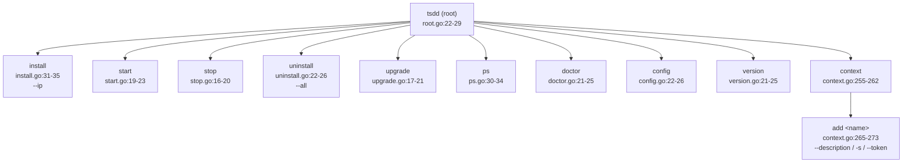

# TangSengDaoDaoCli 深度分析文档

> 分析对象：`/data/code/tsdd-analysis/TangSengDaoDaoCli`
> 分析方式：静态代码审查（全部 17 个源文件逐一 Read 确认），文中所有 `file:line` 引用均已核实存在。
> 分析日期：2026-10-12

---

## 1. 仓库概述

TangSengDaoDaoCli（命令名 `tsdd`，二进制名 `tsddcli`）是唐僧叨叨（TangSengDaoDao）开源即时通讯系统的**一键安装部署工具**。它把"写 docker-compose 文件、生成配置、拉镜像、启停服务、体检"这一整套私有部署流程收敛成一条 `tsdd install && tsdd start` 命令，目标是**显著降低私有部署门槛**——用户无需了解 Docker Compose 语法、无需手动编辑 MySQL/MinIO 连接串，甚至无需安装 `docker-compose` 插件（CLI 通过 compose-go 库在进程内直接驱动 Docker daemon）。

**在生态中的角色**：唐僧叨叨生态由 TangSengDaoDaoServer（业务后端）、TangSengDaoDaoWeb（Web 端）、TangSengDaoDaoManager（管理后台）、wukongim（底层通讯服务，外部依赖）、各端 SDK（Android/iOS/JSBridge）组成。本 CLI 是**部署入口/分发渠道之一**，与同生态另外两条部署路径并存：

1. **本 CLI（tsdd）**：交互最少、面向通用 Linux/macOS 服务器的一键部署；
2. **Server 仓库内 `docker/tsdd/docker-compose.yaml`**：手工 compose 部署（与本 CLI 内嵌 compose 内容逐字节相同，见第 6 节）；
3. **appstore 仓库**：面向 1Panel / 宝塔面板用户的应用商店式部署（配置全部环境变量化、镜像版本固定）。

CLI 通过 GitHub Actions（SLSA Go releaser）+ GoReleaser 构建多平台二进制，经 gitee Releases 分发，`install.sh` 提供 `curl | sudo bash` 一键安装。

---

## 2. 技术栈与依赖

- 语言：Go 1.20（`go.mod:3`）
- 代码规模：17 个文件、约 1326 行 Go 代码（含 1 个测试文件）
- 构建：GoReleaser（`scripts/.goreleaser-for-linux.yaml`、`scripts/.goreleaser-for-darwin.yaml`），ldflags 注入 Version/Commit/CommitDate（`main.go:20-23`）
- CI：GitHub Actions SLSA3 Go releaser（`.github/workflows/goreleaser.yml`）

### 核心依赖表

| 依赖 | 版本 | 用途 | 备注 |
|---|---|---|---|
| `github.com/spf13/cobra` | v1.7.0 | CLI 命令框架 | 10 个子命令 |
| `github.com/docker/compose/v2` | v2.20.0 | **以库形式驱动 docker compose** | 见下文说明 |
| `github.com/compose-spec/compose-go` | v1.16.0 | compose 文件解析、.env 加载 | `context.go:13` |
| `github.com/docker/cli` | v24.0.2 | Docker CLI client 构造 | `context.go:15-17` |
| `github.com/docker/docker` | v24.0.4 | Docker API 类型 | ps 端口展示 |
| `github.com/docker/go-units` | v0.5.0 | 时间人性化显示 | `ps.go:14` |
| `github.com/google/uuid` | v1.3.0 | 生成随机密码 | `pkg/util/uuid.go` |
| `github.com/stretchr/testify` | v1.8.4 | 测试断言 | 仅 1 个测试 |
| `golang.org/x/term` | v0.10.0 | 终端宽度获取 | `common.go:154-167` |

### docker compose-go 程序化调用的意义

`cmd/context.go:46-71` 是关键设计：CLI **不 shell 出到 `docker compose` 命令**，而是：

1. `findDockerSock()`（`context.go:223-234`）定位 Docker socket（优先 `~/.docker/run/docker.sock`，回退 `/var/run/docker.sock`，兼容 Docker Desktop）；
2. 用 `docker/cli` 的 `command.NewAPIClientFromFlags` 构造 API client（`context.go:55`）；
3. 用 `compose.NewComposeService(dockerCli)` 创建 compose 服务代理（`context.go:69`）；
4. 之后 Up/Stop/Down/Ps/Pull/Config 全部通过 `api.Service` 接口在进程内完成。

**收益**：产物是**单个静态二进制**，目标机器只需有 Docker daemon，无需安装 docker compose 插件——这对"一键安装"定位至关重要。**代价**：vendor 了庞大的 docker/compose/k8s 依赖树（go.mod 中 150+ 间接依赖，含 containerd、buildx、k8s client-go），二进制体积大，且版本升级成本高。

---

## 3. 目录结构与模块架构

### 目录树

```
TangSengDaoDaoCli/
├── main.go                  # 入口：go:embed 内嵌资源 + ldflags 版本注入
├── docker-compose.yaml      # 内嵌的部署拓扑模板（7 个服务）
├── .env                     # 内嵌的环境变量模板（含 #占位符#）
├── configs/
│   ├── tsdd.yaml            # 唐僧叨叨业务服务配置模板
│   └── wk.yaml              # 悟空IM 配置模板
├── install.sh               # curl|bash 一键安装脚本
├── cmd/                     # 全部 cobra 子命令
│   ├── root.go              # 根命令与 TangSengDaoDao 装配
│   ├── context.go           # 核心：compose 服务封装 + context 子命令
│   ├── common.go            # Options（路径/持久化）+ CMD 接口
│   ├── install.go           # install 子命令
│   ├── start.go / stop.go / uninstall.go / ps.go
│   ├── upgrade.go / doctor.go / config.go / version.go
│   ├── compose.go           # 死代码（未被引用的 ProjectOptions 结构体）
│   └── install_test.go      # 唯一测试
├── pkg/util/
│   ├── uuid.go              # GenUUID（生成随机密码）
│   └── ip.go                # 内网 IP 探测
└── scripts/                 # GoReleaser 配置（linux/darwin）
```

### 命令树（cobra 层级）



装配顺序见 `cmd/root.go:48-65`；根命令禁用了 cobra 默认的 completion 子命令（`root.go:26-28`）。

### go:embed 资源机制

`main.go:10-17` 用三个 `go:embed` 指令把部署所需全部静态资源编译进二进制：

```go
//go:embed docker-compose.yaml
var dockerComposeYaml string      // main.go:10-11

//go:embed .env
var dotEnv string                 // main.go:13-14

//go:embed configs
var configs embed.FS              // main.go:16-17（configs/ 整个目录）
```

`main()` 把这些资源注入 `TangSengDaoDaoContext`（`main.go:26-34`），install 时原样落盘到用户目录（`~/tsdd/`）。**收益**：零外部依赖、资源与代码同版本、离线可用；**代价**：修改部署模板必须重新编译发版，用户无法在不升级 CLI 的情况下获得 compose 模板修复。

---

## 4. 核心流程走读

### 4a. `install` 全流程

> 修正一个容易误判的点：**install 只做"配置生成与落盘"，不拉镜像、不启动服务、不做健康检查**。拉镜像/启动发生在随后的 `tsdd start`；健康检查由 compose 文件的 healthcheck 段在容器运行期持续执行，`tsdd doctor` 提供事后状态查看。README 的使用顺序（install → start → doctor）印证了这一点（`README.md:10-32`）。

调用链：

```
main()                                   main.go:25
 └─ NewTangSengDaoDao()                  root.go:19      构造根命令 + Context
 │   └─ NewOptions()                     common.go:34    rootDir=~/tsdd(0700)、projectName="tsdd"
 └─ Execute()                            root.go:48
     └─ installCmd.RunE = install.run    install.go:49
```

`install.run`（`install.go:49-114`）分四步：

**第 1 步：确定外网 IP**（`install.go:50-55`）
- 优先取 `--ip` flag（`install.go:36`）；
- 未指定时调用 `util.GetIntranetIP()`（`pkg/util/ip.go:10-63`）枚举网卡，跳过 down/loopback/`docker*`/`w-*` 接口，取第一个**内网 IPv4** 地址（10/8、192.168/16、172.16-31/16，`ip.go:66-89`）。注意：这里取的是**内网 IP**，变量名却叫 externalIP——若服务器有公网 IP 而用户不传 `--ip`，生成的 `API_URL` 将是内网地址，Web 端外网不可用（易用性陷阱）。

**第 2 步：四类文件落盘**（`install.go:57-92`）。每个文件"不存在才写"（`existFile`，`install.go:234-237`），函数名叫 `downloadXxx` 但实际是把内嵌内容写入磁盘，无任何网络请求：

| 落盘文件 | 来源 | 代码 |
|---|---|---|
| `~/tsdd/docker-compose.yaml` | `ctx.DockerComposeYaml`（内嵌字符串） | `install.go:167-171` |
| `~/tsdd/.env` | `ctx.DotEnv` | `install.go:177-181` |
| `~/tsdd/configs/wk.yaml` | `embed.FS` 的 `configs/wk.yaml` | `install.go:187-196` |
| `~/tsdd/configs/tsdd.yaml` | `embed.FS` 的 `configs/tsdd.yaml` | `install.go:202-209` |

**第 3 步：占位符替换**（`install.go:93-108`）。密码在 `CMD()` 构造期生成：MySQL 密码 = UUID 去横线的前 16 位 hex（`install.go:43`），MinIO 密码 = 完整 32 位 hex（`install.go:44`）。

- `replaceDotEnvVarz`（`install.go:117-134`）：替换 `#MINIO_ROOT_PASSWORD#`、`#MYSQL_ROOT_PASSWORD#`、`#API_URL#` → `http://<ip>:8090/`（`install.go:131`）；`#MINIO_SERVER_URL#`/`#MINIO_BROWSER_REDIRECT_URL#` 被替换为**空串**（`install.go:126-127`）。
- `replaceWkConfigVarz`（`install.go:137-149`）：`#EXTERNAL_IP#` → IP；`#GRPC_ADDR#` → 硬编码 `tangsengdaodaoserver:6979`（`install.go:145`，即 wukongim 的 webhook gRPC 指向业务服务）。
- `replaceTsddConfigVarz`（`install.go:151-164`）：替换 tsdd.yaml 中的 IP、MySQL 密码、MinIO 密码。

**第 4 步**：打印安装路径与"please run 'tsdd start'"提示（`install.go:110-111`）。

幂等性：文件已存在则跳过下载，但**变量替换无条件执行**——若用户手工改过配置中的占位符已不在，替换是 no-op，不会破坏已有配置；但若用户重装想重新生成密码，不会生效（密码只在首次写入时被替换进文件）。

随后的 `tsdd start`（`start.go:28-31`）→ `DockerComposeUp`（`context.go:73-81`）→ `getDockerProject`（`context.go:173-185`，用 compose-go 的 `cli.WithDotEnv` 加载 `~/tsdd/.env`）→ `dockerComposeUp`（`context.go:138-163`）：`CreateOptions{RemoveOrphans: true, Recreate: api.RecreateDiverged, Timeout: 60s}`，`StartOptions{Wait: false}`（`context.go:157-159`）——**不等待健康检查通过即返回**；镜像在 Up 过程中按需拉取（`QuietPull: false`，`context.go:146`）。

### 4b. `upgrade` 流程

实现极为简单（`upgrade.go:26-41`）：

```
upgrade.run
 ├─ pull("wukongim")              upgrade.go:28
 ├─ pull("tangsengdaodaoserver")  upgrade.go:32
 └─ pull("tangsengdaodaoweb")     upgrade.go:36
      └─ DockerComposePull(...)   context.go:122-128 → compose Pull API
```

关键事实：

1. **只拉取 3 个业务镜像**，minio/mysql/redis/adminer 不更新；
2. **没有备份**：不备份数据库、不备份配置、不保留旧镜像 tag；
3. **没有重启**：仅 `docker compose pull`，新镜像要等用户手动 `tsdd stop && tsdd start`（或下次 start 时 `RecreateDiverged` 触发重建）才生效；
4. 由于 compose 中三个镜像 tag 均为 `latest`（`docker-compose.yaml:4,14,32`），"升级"的语义是"拉取 registry 上最新的 latest"，**版本不可预期、不可回滚**（除非 registry 侧有历史 digest）。

即：`upgrade` = "更新 latest 镜像缓存"，备份与替换版本的能力**不存在**。

### 4c. `doctor` 检查项清单与实现

`doctor.go:30-68`：

1. `DockerComposePs`（`context.go:106-112`）获取项目全部容器（含停止的，`All: true`，`context.go:169`）；
2. `DockerComposeServices`（`context.go:114-120`）从 compose 文件解析出**期望的服务清单**；
3. 对每个期望服务匹配容器，记录 `container.State`；无容器则记 `"not exist"`（`doctor.go:48-53`）；
4. 输出：state 为 `running` 打绿色 `[✓]`，否则红色 `[✗]`（`doctor.go:56-66`，ANSI 颜色码硬编码）。

**检查项清单**（即 compose 定义的 7 个服务）：wukongim、tangsengdaodaoserver、tangsengdaodaoweb、minio、mysql、redis、adminer。

**局限**：只检查容器 `State == "running"` 字符串，**不区分健康状态**（healthy/unhealthy 不看，尽管 compose 定义了 healthcheck）；不检查端口可达性、磁盘、日志错误；不检查配置文件完整性。属于"容器活着吗"级别的粗检。

---

## 5. 对外接口（命令/参数/flag 完整表）

| 命令 | 说明 | 参数 | Flag | 实现 |
|---|---|---|---|---|
| `tsdd` | 根命令，无 RunE，显示帮助 | — | — | `root.go:22-29` |
| `tsdd install` | 生成配置并落盘 | — | `--ip string` 外网 IP | `install.go:30-47` |
| `tsdd start` | compose up（含拉镜像） | — | — | `start.go:18-31` |
| `tsdd stop` | compose stop | — | — | `stop.go:15-28` |
| `tsdd uninstall` | compose down；`--all` 时删除 `~/tsdd` 全部数据 | — | `--all` | `uninstall.go:21-44` |
| `tsdd upgrade` | 拉取 3 个业务镜像的 latest | — | — | `upgrade.go:16-46` |
| `tsdd ps` | 表格列出容器（NAME/IMAGE/COMMAND/SERVICE/CREATED/STATUS/PORTS） | — | — | `ps.go:29-48` |
| `tsdd doctor` | 服务存活体检（彩色输出） | — | — | `doctor.go:20-68` |
| `tsdd config` | 输出 compose 解析后的完整 yaml（等价 `docker compose config`） | — | — | `config.go:21-39` |
| `tsdd version` | 打印 version/commit/date/treeState | — | — | `version.go:20-36` |
| `tsdd context add <name>` | 保存一个连接上下文（url/description/token）到 `~/tsdd/.config/context/<name>.json`（0600），并写入 meta 指向当前上下文 | `name`（校验禁止 `..` 和路径分隔符，`context.go:291-293`） | `--description`、`-s/--server`（默认 `http://127.0.0.1:5001`）、`--token` | `context.go:264-289`、`common.go:119-148` |

说明：`context` 机制目前只被 `Options.Load()`（`common.go:78-117`）读取 ServerAddr/Description/Token，但**没有任何子命令实际使用 ServerAddr/Token 发起 API 调用**——属于为将来远程管理能力预留的半成品。

---

## 6. 部署与运维

### 6.1 内嵌 docker-compose.yaml 逐服务解读（`docker-compose.yaml`，共 82 行）

| 服务 | 镜像（tag） | 端口映射 | 卷 | 环境变量（来自 .env） | 健康检查 | 依赖/重启 |
|---|---|---|---|---|---|---|
| wukongim（悟空IM 通讯层） | `registry.cn-shanghai.aliyuncs.com/wukongim/wukongim:latest`（:4） | 5100(TCP长连接)、5200(WS)、5300(监控) 全部公网映射（:6-9） | `./configs/wk.yaml` → 容器 `/root/wukongim/wk.yaml`；日志 `./logs/wk`（:10-12） | 无（全走配置文件） | 无 | `restart: always` |
| tangsengdaodaoserver（业务 API） | `.../tangsengdaodaoserver:latest`（:14） | 8090（:26-27） | `./configs/tsdd.yaml` → `/home/configs/tsdd.yaml`；日志 `./logs/tsdd`（:28-30） | 无 | `wget ... localhost:8090/v1/ping`，10s 间隔/3 次（:17-21） | `depends_on: redis, mysql, wukongim`（:22-25）；`command: "api"`（:16） |
| tangsengdaodaoweb（Web 端） | `.../tangsengdaodaoweb:latest`（:32） | **82:80**（:36-37） | 无 | `API_URL`（:34-35） | 无 | `restart: always` |
| minio（对象存储） | `minio/minio:latest`（:39） | 9000(S3 API)、9001(控制台) 均公网映射（:44-46） | `./miniodata` → `/data`（:57-58） | `MINIO_ROOT_USER/PASSWORD/SERVER_URL/BROWSER_REDIRECT_URL`（:47-51） | curl `/minio/health/live`（:52-56） | `command: server /data --console-address ':9001'`（:43） |
| mysql | `mysql:latest`（:60） | **无端口映射**（仅内网） | `./mysqldata` → `/var/lib/mysql`（:68-69） | `TZ`、`MYSQL_ROOT_PASSWORD`、`MYSQL_DATABASE=im`（:64-67） | `mysqladmin ping`（:62-63） | `command: --default-authentication-plugin=mysql_native_password`（:61）；**无 restart 策略** |
| redis | `redis`（:71，隐式 latest） | **无端口映射** | 无（**无持久化卷**） | 无 | `redis-cli ping` 1s×30（:73-77） | `restart: always`；**无密码** |
| adminer（MySQL Web 管理） | `adminer:latest`（:79） | **8306:8080 公网映射**（:80-81） | 无 | 无 | 无 | 注释自述"调试用，为了安全生产不要打开"（:78），但**默认就在 compose 里、默认随 stack 启动** |

启动顺序：`depends_on` 只约束 tangsengdaodaoserver 在 redis/mysql/wukongim 之后**启动**（不等待健康，compose v2 的 `depends_on` 无 `condition` 字段时只保证顺序），其余服务并行。

### 6.2 配置模板关键配置

**`configs/tsdd.yaml`**（155 行，业务服务配置）：
- `mode: "debug"`（:3）——默认 debug 模式；
- `wukongIM.apiURL: http://wukongim:5001`（:17）——容器网络内直连；
- `db.mysqlAddr` 内嵌 `root:#MYSQL_ROOT_PASSWORD#@tcp(mysql)/im`（:22），redis 无密码（:23-24）；
- `external.ip: "#EXTERNAL_IP#"`（:31）；
- **`smsCode: "123456"`**（:42）——测试验证码默认值，不接入短信商时所有手机验证码恒为 123456；
- `fileService: minio`（:57），accessKeyID 固定 `minio`（:60），secret 为占位符（:61）；
- 默认头像走第三方 `api.multiavatar.com`（:117）——有外网依赖与隐私外发。

**`configs/wk.yaml`**（60 行，悟空IM 配置）：
- `mode: "release"`（:4）、`tokenAuthOn: true`（:8，最新 commit 修复点）；
- `external.ip: "#EXTERNAL_IP#"`（:13）；
- `webhook.grpcAddr: "#GRPC_ADDR#"`（:42）→ 安装时替换为 `tangsengdaodaoserver:6979`；
- `conversation.on: true`（:49-50）。

### 6.3 install.sh 解读（共 50 行）

- `install.sh:4-7`：`uname -s/-m` 探测 OS/ARCH；`install.sh:9-13`：默认版本硬编码 `v1.0.5`，可用 `$1` 覆盖；
- `install.sh:16-43`：linux/darwin × amd64/arm64 矩阵（x86_64→amd64、aarch64→arm64 做了别名），其余报错退出；
- `install.sh:48-49`：核心两行——`curl -L https://gitee.com/.../releases/download/$VERSION/tsddcli-$OS-$REALARCH -o /usr/local/bin/tsdd && chmod +x`。**无 checksum/签名校验、无失败重试、写系统目录需 root**。GoReleaser 配置确实生成了 `tsddcli-linux-checksums.txt`（`scripts/.goreleaser-for-linux.yaml` 末尾），但脚本没有下载校验它。

### 6.4 三种部署方式 compose 对比

| 维度 | 本 CLI 内嵌 compose | Server 仓库 `docker/tsdd/docker-compose.yaml` | appstore（1Panel `tangsengdaodao/1.5`） |
|---|---|---|---|
| 内容 | 7 服务，全 `latest` tag | **与本 CLI 逐字节相同**（ diff 为空，两者同一份文件） | 4 服务（无 mysql/redis/minio/adminer），**版本固定**（wukongim:v1.2、server:v1.5） |
| 配置注入 | 挂卷注入 wk.yaml/tsdd.yaml + .env | 同左 | **全环境变量化**（`WK_*`/`TS_*` env，:13-20, :40-53），不挂配置文件 |
| 数据库 | 容器内自建 mysql/redis | 同左 | 复用面板已有 DB（`${PANEL_DB_HOST}` 等，:43-45） |
| 端口 | 硬编码（82/8090/5100...） | 同左 | 面板变量（`${PANEL_APP_PORT_*}`） |
| 管理后台 | **无** tangsengdaodaomanager | 无 | **有**（:66-75） |
| 网络 | 默认 bridge | 同左 | external `1panel-network`（:76-78） |
| adminer | 默认携带并暴露 8306 | 同左 | 无 |

结论：CLI 与 Server 仓库的手工 compose 是同源文件（CLI 侧相当于把它内嵌进二进制）；appstore 版是更"生产化"的演进方向（固定版本、env 配置、含管理后台），CLI 尚未跟进这些改进。

---

## 7. 安全审计（静态审查）

### CONFIRMED

1. **全部镜像使用 `latest` tag（供应链 + 不可重现部署）** — `docker-compose.yaml:4`（wukongim）、`:14`（server）、`:32`（web）、`:39`（minio）、`:60`（mysql）、`:71`（redis，隐式 latest）、`:79`（adminer）。任何一次 `tsdd start`/升级拉到的版本不可预期；`upgrade` 命令（`upgrade.go:28-39`）更是完全依赖 latest 漂移，无 digest 固定、无回滚能力。对照 appstore 仓库已固定 `v1.2`/`v1.5`，说明官方已知此问题但 CLI 未跟进。

2. **adminer 数据库管理台默认部署且公网暴露** — `docker-compose.yaml:78-81`：`8306:8080` 全接口映射，注释自述"为了安全生产不要打开"却仍然默认包含在 stack 中且无开关。配合 MySQL root 凭据若泄露（见第 4 条），等于开放了一个公网数据库入口。

3. **安装链路 curl|bash 且二进制无校验** — `README.md:6` 推荐 `curl -sSL ... | sudo bash`；`install.sh:48-49` 从 gitee Releases 下载二进制直接写入 `/usr/local/bin/tsdd`，**不校验 checksum/签名**（尽管 GoReleaser 生成了 checksums 文件，GitHub 侧甚至有 SLSA provenance，但分发走 gitee 时全部丢失）。中间人/Release 篡改可直接获得用户 root 权限。另 `install.sh:10` 硬编码默认版本 `v1.0.5`。

4. **含密配置文件权限为 0644** — `install.go:132`（.env，含 MySQL root 密码与 MinIO root 密码）、`install.go:162`（tsdd.yaml，同样含两个密码）、`install.go:146`（wk.yaml）。**缓解因素**：根目录 `~/tsdd` 以 0700 创建（`common.go:46`），其他用户无法穿越目录读取，实际风险较低；但密码明文落盘 + 0644 的组合仍属不规范（对比 context 文件正确地使用了 0600，`common.go:133,142`）。

5. **默认短信验证码恒为 123456** — `configs/tsdd.yaml:42` `smsCode: "123456"`。用户不接短信服务商时，任意手机号可用 123456 注册/登录。模板未给出醒目安全警告。

6. **业务服务默认 debug 模式** — `configs/tsdd.yaml:3` `mode: "debug"`（wk.yaml 已是 release，`:4`）。debug 模式通常意味着详细错误输出/调试端点，生产默认不应开启。

7. **MinIO 控制台公网暴露 + 弱用户名** — `docker-compose.yaml:44-46` 将 9001 控制台映射到所有网卡；`.env:2` `MINIO_ROOT_USER: minio`（弱、可猜测）。密码虽是 32 位随机 hex（`install.go:44`），但 `install.go:126-127` 将 `MINIO_SERVER_URL`/`MINIO_BROWSER_REDIRECT_URL` 置空，控制台直接暴露于 `http://<ip>:9001`。

8. **wukongim 监控端口 5300 公网映射** — `docker-compose.yaml:9`。监控/metrics 端口默认应对内网。

### PLAUSIBLE

9. **`.env` 使用冒号语法（`KEY: value`）而非标准 dotenv `KEY=value`** — `.env:2-12`。标准 dotenv 解析器（godotenv 等）拒绝冒号分隔；本项目依赖 compose-go v1.16.0 的解析器行为（`context.go:180` `cli.WithDotEnv`）。若解析失败，MySQL/MinIO 将以空密码启动。该语法在本仓库 v1.16.0 的 compose-go 下是否被正确解析**待验证**（若用户实际部署成功，则说明 compose-go 兼容此遗留格式，但仍属脆弱写法，升级 compose-go 可能突然崩溃）。

10. **大量 panic 式错误处理** — `common.go:37,47,53`（NewOptions）、`context.go:52,57,61,67`（Docker client 初始化）、`install.go:40`（MkdirAll）。Docker 未运行时用户得到的是 Go panic 堆栈而非友好提示。另外 `common.go:108,111,114` 对 context json 的 `.(string)` 类型断言，遇到手工编辑过的畸形 json 会直接 panic。

11. **Redis 无密码且无持久化卷** — `docker-compose.yaml:70-77`、`configs/tsdd.yaml:24`（`redisPass: ""`）。仅在容器网络内可达，直接风险低；但无卷意味着 Redis 若承担队列/缓存持久化职责时容器重建即丢数据（需结合 Server 端用法确认，待验证）。

12. **MySQL 无 restart 策略** — `docker-compose.yaml:59-69`（其余核心服务均 `restart: always`）。MySQL 意外退出后不会自愈，业务随之不可用，需人工 `tsdd start`。

13. **唯一测试存在 nil 解引用隐患** — `install_test.go:13` `install.run(nil, nil)`：`run` 的错误分支调用 `cmd.Println`（`install.go:61,70,80,90`），一旦走到即 nil panic；且该测试直接操作用户真实 `~/tsdd` 目录，非隔离环境。

14. **API_URL 使用明文 HTTP** — `install.go:131` 生成 `http://<ip>:8090/`，Web 端到 API 全程明文，无 TLS 引导（生态中由用户自行加反向代理，CLI 不提供任何提示）。

15. **升级无备份、不重启即"完成"** — `upgrade.go:26-41`：拉完镜像就返回成功，用户若不手动 stop/start 则服务仍跑旧版本，且拉取前无数据备份提示。属运维陷阱。

---

## 8. 代码质量评估

**测试**：仅 1 个测试文件 `cmd/install_test.go`（15 行），只断言 install 不报错，且直接污染真实 `~/tsdd`、无 mock、无清理；无 CI 测试流水线（GitHub workflow 只做 release）。测试覆盖率接近于零。

**错误处理**：两极化—— cobra RunE 路径的错误返回做得规矩（`install.go:58-108` 逐步返回 error），但基础设施初始化大量 `panic`（见安全审计第 10 条）；`install.go:51` `ips, _ := util.GetIntranetIP()` 静默吞错；`stop.go:16` 变量误命名 `startCMD`（复制粘贴痕迹）；`cmd/compose.go` 整个文件是未被引用的死代码（`ProjectOptions` 结构体，实际用的是 `composecmd.ProjectOptions`，`context.go:174`）；`context.go:244-253` `newContextCMD` 构造的 `c.cmd` 从未被使用（`CMD()` 方法另建了一个命令对象）。函数命名误导：`downloadDockerCompose` 等实为"写文件"，无任何下载。

**交互体验设计**：
- 亮点：零交互即可安装（密码自动生成、IP 自动探测）；doctor 彩色 ✓/✗ 输出（`doctor.go:56-66`）；ps 复用 docker 官方 formatter 输出对齐 docker 风格（`ps.go:45-48`）；`uninstall --all` 与默认卸载分离，数据删除需显式 flag（`uninstall.go:27`）。
- 不足：无交互式确认（uninstall --all 直接 `os.RemoveAll`，`uninstall.go:38`）；无进度反馈（拉镜像静默）；内网 IP 当外网 IP 用的陷阱无提示（`install.go:50-55`）；`install.sh:45` 有拼写错误 "Dolowadning"；README 极简，无卸载/升级/故障排查文档。
- 工程化：ldflags 版本注入（`main.go:20-23`）+ GoReleaser + SLSA workflow 是规范做法；`validName` 防路径穿越（`context.go:291-293`）细节到位。

---

## 9. 风险与改进建议汇总

| # | 风险 | 严重度 | 位置 | 建议 |
|---|---|---|---|---|
| 1 | 全镜像 latest，升级不可预期不可回滚 | 高 | `docker-compose.yaml:4,14,32,39,60,71,79` | 固定语义化版本 tag（跟随 appstore 做法），upgrade 支持指定版本并先备份数据卷 |
| 2 | adminer 默认公网暴露 8306 | 高 | `docker-compose.yaml:78-81` | 移出默认 compose，改为 `tsdd` 显式 flag（如 `tsdd start --with-adminer`）或绑定 127.0.0.1 |
| 3 | curl\|bash + 无二进制校验 | 高 | `install.sh:48-49`、`README.md:6` | 下载 checksums 文件并 `sha256sum -c`；提供 detached 签名；默认版本从远端 latest API 获取而非硬编码 |
| 4 | 短信验证码默认 123456 | 高 | `configs/tsdd.yaml:42` | 未配置短信商时默认关闭注册或 install 时强制交互确认 |
| 5 | MinIO 控制台 9001 公网 + 弱用户名 minio | 中 | `docker-compose.yaml:44-46`、`.env:2` | 控制台绑 127.0.0.1；用户名一并随机化 |
| 6 | 默认 debug 模式 / 监控口 5300 公网 | 中 | `configs/tsdd.yaml:3`、`docker-compose.yaml:9` | release 为默认；5300 改为 expose 或内网绑定 |
| 7 | upgrade 无备份不重启即成功 | 中 | `upgrade.go:26-41` | 升级前提示/自动备份 `mysqldata`，升级后自动 `compose up -d` 重建 |
| 8 | 含密文件 0644 | 低（被 0700 目录缓解） | `install.go:132,162` | 统一 0600 |
| 9 | panic 式错误处理 / 类型断言 panic | 低 | `common.go:37,108-114`、`context.go:52-67` | 改为 error 返回 + 友好提示"请先启动 Docker" |
| 10 | MySQL 无 restart、Redis 无持久化 | 低 | `docker-compose.yaml:59-77` | 补 `restart: always`；按 Server 端需求评估 Redis 卷 |
| 11 | 内网 IP 误作 external IP | 中（可用性） | `install.go:50-55`、`pkg/util/ip.go` | 探测公网 IP 或强制要求 `--ip` 并校验 |
| 12 | 测试缺失、死代码、拼写错误 | 低 | `install_test.go`、`cmd/compose.go`、`install.sh:45` | 补集成测试（testcontainers）；删死代码 |
| 13 | .env 冒号语法兼容性 | 待验证 | `.env:2-12` | 改为标准 `KEY=` 格式并验证 compose-go 解析 |
| 14 | CLI compose 与 appstore 版本漂移 | 中 | 第 6.4 节 | 建立单一模板源（如从 appstore 反向同步固定版本与 env 化配置） |

**最不确定项**：`.env` 冒号语法的 compose-go 兼容性（第 9 条 PLAUSIBLE）与 Redis 无持久化是否影响业务（第 11 条 PLAUSIBLE），两者需运行时验证。
