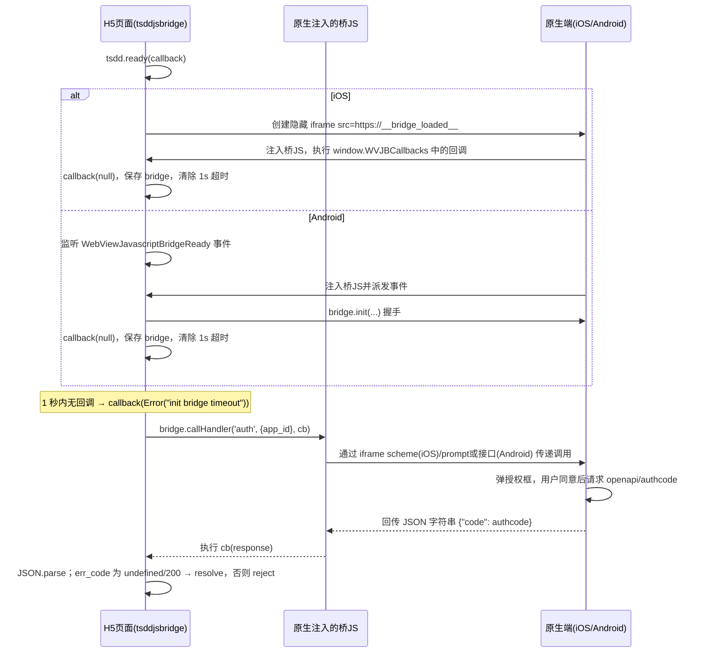

# TangSengDaoDaoJSBridge 仓库分析文档

> 分析日期：2026-10-12 ｜ 分析方式：静态源码审查（未构建、未运行）
> 仓库路径：`/data/code/tsdd-analysis/TangSengDaoDaoJSBridge`
> Git 历史：仅 1 个提交 `c989839 first commit`（2025-03-13，作者 tt）

---

## 1. 仓库概述

TangSengDaoDaoJSBridge 是唐僧叨叨（TangSengDaoDao，底层为 WuKongIM 生态）的 **H5 ↔ 原生 App 通信桥 JS 端 SDK**，以 npm 包 `tsddjsbridge@1.0.1`（MIT）发布（package.json:2-4）。

**定位**：嵌入唐僧叨叨 Android/iOS App WebView 中的 H5 页面（典型场景为开放平台「应用/小程序」，即 workplace 中配置的第三方或官方 H5 应用）通过本库调用原生能力，如用户授权（`auth`）、选择会话（`chooseConversation`）等。协议层采用经典的 WebViewJavascriptBridge 方案：

- **iOS**：基于 `WVJBIframe`（`src=https://__bridge_loaded__`）+ `window.WVJBCallbacks` 回调数组（src/index.ts:19-27）；
- **Android**：基于原生注入 JS 后派发的 `WebViewJavascriptBridgeReady` 事件（src/index.ts:38-44）。

**在生态中的角色**（已交叉验证客户端仓库）：

| 端 | 桥的原生实现 | 已注册的原生 handler |
|---|---|---|
| Android | `TangSengDaoDaoAndroid/wkbase/src/main/java/com/chat/base/jsbrigde/`（BridgeWebView 等），注入脚本 `wkbase/src/main/assets/WebViewJavascriptBridge.js` | `WKWebViewActivity.java`：`quit`(L219)、`auth`(L222)、`getChannel`(L237)、`showConversation`(L243) |
| iOS | `TangSengDaoDaoiOS/Modules/WuKongBase/.../Vendor/WebViewJavascriptBridge/` | `WKWebViewService.m`：`quit`(L28)、`getChannel`(L33)、`chooseConversation`(L41)、`showConversation`(L58)、`auth`(L72) |

- 与 **Manager 的关系**：Manager 端管理 workplace 应用配置（appID/appKey、H5 入口 URL）；App 端在 WebView 中打开这些 URL，H5 内引入 `tsddjsbridge`，用 appID 换取用户授权码（authcode），再到开放平台后端（`api.botgate.cn/v1/openapi/...`，见 examples/src/App.vue:109,122）换取 `access_token` 与用户信息。
- 本仓库同时包含 `examples/`：一个独立可 Docker 部署的 Vue3 演示应用，演示完整的「授权 → 换 token → 拉用户信息」开放平台上层流程。

## 2. 技术栈与依赖

**运行时零依赖**（package.json:35 `"dependencies": {}`），TypeScript 5.2 编写，Rollup 3 构建：

- devDependencies：rollup ^3.29.1、@rollup/plugin-typescript ^11.1.3、@rollup/plugin-node-resolve、@rollup/plugin-commonjs、tslib、typescript（package.json:24-31）
- tsconfig：target ES2016、module ESNext、strict 开启、outDir `./lib`（tsconfig.json:3-12）

**三格式产物**（package.json:5-8 + rollup.config.mjs）：

| 入口字段 | 文件 | 预期格式 | 实际状态 |
|---|---|---|---|
| `main` | `lib/tsddjsbridge.cjs.js` | CJS | 正常（rollup.config.mjs:41） |
| `module` | `lib/tsddjsbridge.esm.js` | ESM | 正常（rollup.config.mjs:42） |
| `browser` | `lib/tsddjsbridge.umd.js` | UMD（全局名 `wk`） | **配置有 typo**（rollup.config.mjs:14 `ormat: 'umd'`），`format` 未设置，按 Rollup 3 文档默认输出 `es` 格式，`name: 'wk'`（L12）不生效——详见第 7 节 |
| `types` | `lib/index.d.ts` | 类型声明 | 由 plugin-typescript 生成 |

发布时通过 `files: ["lib/**/*"]`（package.json:32-34）仅打包产物。仓库内不含 `lib/`（已验证），产物在 `yarn build` 时生成（README.md:6-8）。

examples/ 技术栈：Vue 3.2 + vue-cli-service 5 + axios + `tsddjsbridge ^1.0.1`（依赖 npm 已发布版本而非本地源码，examples/package.json:10-24），纯 JS 非 TS。

## 3. 目录结构与模块架构

```
TangSengDaoDaoJSBridge/
├── package.json            # npm 包定义：tsddjsbridge@1.0.1，三格式入口
├── rollup.config.mjs       # 构建配置（含 UMD 块 typo）
├── tsconfig.json
├── README.md               # 仅安装/编译两行说明
├── src/
│   ├── index.ts            # 全部源码（113 行）：Tsdd 类 + Config + 单例 tsdd
│   └── model.ts            # DTO：AuthResp、ChannelInfo
└── examples/               # 独立 Vue3 演示应用（vue-cli5，JS）
    ├── src/App.vue         # 演示：auth 授权 → access_token → userinfo → 选会话
    ├── src/main.js
    ├── package.json        # 依赖已发布的 tsddjsbridge ^1.0.1
    ├── Dockerfile          # 两阶段：node:18.17.1 构建 → nginx 托管
    ├── nginx.conf.template # 静态站点配置
    ├── docker-entrypoint.sh
    └── Makefile            # 构建并推送阿里云镜像仓库
```

**协议时序图**（以 iOS `auth` 为例）：



## 4. 核心流程走读

### 4a. bridge 初始化：两平台探测与 ready 流程

调用链：`tsdd.ready(callback)` → src/index.ts:66

1. **启动 1 秒超时**：`ready` 首先 `setTimeout(..., 1000)`（src/index.ts:68-70），超时时以 `Error("init bridge timeout")` 回调。
2. **iOS 探测** — `setupWebViewJavascriptBridge`（src/index.ts:13-30）：
   - 若 `window.WebViewJavascriptBridge` 已存在（原生已注入），直接回调（L16-18）；
   - 若 `window.WVJBCallbacks` 已存在，push 回调（L19-21）；
   - 否则初始化 `WVJBCallbacks = [callback]`（L22），创建隐藏 iframe，`src = 'https://__bridge_loaded__'`（L23-26）触发原生拦截并注入桥 JS，随后 `setTimeout 0` 移除 iframe（L27）。iOS 原生注入的桥 JS 会读取并执行 `WVJBCallbacks` 数组（实现见 iOS 仓库 `WebViewJavascriptBridge_JS.m`）。
3. **Android 探测** — `connectWebViewJavascriptBridge`（src/index.ts:33-46）：
   - 桥已存在则直接回调（L35-36）；
   - 否则监听 `WebViewJavascriptBridgeReady` 事件（L38-44）。Android 注入脚本 `wkbase/src/main/assets/WebViewJavascriptBridge.js:199` 确实会 `initEvent('WebViewJavascriptBridgeReady')` 并派发，已交叉验证。
4. **两条路径并行注册**（src/index.ts:73-89）：任一回调触发即保存 `self.bridge`、`clearTimeout` 并调用用户 `callback()`。Android 分支还会执行 `bridge.init(...)` 握手（L85-87）。

**缺陷**：
- 若 `window.WebViewJavascriptBridge` 在 `ready()` 调用前已存在，则 iOS 分支（L17）与 Android 分支（L36）**同步各回调一次**，用户 callback 被调用两次，且 Android 分支额外执行 `bridge.init`。[CONFIRMED]
- 平台判断完全依赖「事件会不会来」，iOS 上 Android 分支的事件监听器会永久残留（无 removeEventListener）；1 秒超时在低端机/WebView 冷启动场景偏激进，超时后 bridge 仍可能迟到就绪，但库未提供重试。

### 4b. `call<T>` 调用全链路：以 `auth`（AuthResp.code）为例

调用链：examples/src/App.vue:95 `tsdd.auth()` → src/index.ts:92-96 `auth()` → src/index.ts:48-64 `call<AuthResp>('auth', {app_id})`

1. **前置检查**：`this.bridge` 未就绪时直接 `Promise.reject("bridge not ready")`（src/index.ts:63）。
2. **发起调用**：`bridge.callHandler('auth', {app_id: this.config.appID}, cb)`（L52）。注意 `auth()` 方法名为 `'auth'`，参数键为 `app_id`（L93）。
3. **原生处理**（交叉验证）：
   - iOS `WKWebViewService.m:72-100`：校验 `app_id` → 请求 `apps/{appID}` 拉应用信息 → 弹 `WKUserAuthView` 授权框 → 用户同意后请求 `openapi/authcode` → 回传 `{"code": authcode}`（L88）；失败回传 `{"error": ...}`（L92，**无 `err_code` 字段**）。
   - Android `WKWebViewActivity.java:222-236`：解析 `app_id` 后走 `getAppInfo`。
4. **JS 端回调处理**（src/index.ts:52-60）：`JSON.parse(response)`（L53），`err_code == undefined || err_code == 200` 视为成功 `resolve(result)`（L54-55），否则 `reject(result)`（L58）。
5. **DTO 转换**：`AuthResp.fromMap(res)` 取 `map["code"]`（src/model.ts:5-9）。
6. **后续流程**（examples 演示）：H5 拿 `authcode` 调 `https://api.botgate.cn/v1/openapi/access_token?authcode=...&app_key=...`（App.vue:109），再用 `access_token` 拉 `userinfo`（App.vue:122）——代码注释自承「仅演示，此步骤应该在服务端调用」。

**错误/超时处理**：
- `call` 本身**无任何超时**：原生不回调（如 Android 未注册 handler 且 DefaultHandler 返回非 JSON，见第 7 节）时 Promise 永远 pending。
- `JSON.parse` **无 try/catch**（L53）：非 JSON 响应抛出 SyntaxError，发生在桥回调闭包内，无人捕获，Promise 同样永不 settle。[CONFIRMED]
- iOS 错误回包 `{"error": ...}` 不含 `err_code` → 命中 L54 的 `undefined` 分支被**误判为成功**，`AuthResp.code` 为 `undefined`。[CONFIRMED，跨仓库]

## 5. 对外接口

### 5.1 API

| 成员 | 签名 | 说明 |
|---|---|---|
| `tsdd` | `export const tsdd = new Tsdd()`（src/index.ts:110） | 全局单例 |
| `tsdd.config` | `Config { appID?: string }`（src/index.ts:106-108） | 开放平台 appID，调用前赋值（示例：App.vue:82-84） |
| `ready` | `ready(callback: (err?: Error) => void)`（src/index.ts:66） | 初始化桥；1 秒超时返回 `Error("init bridge timeout")` |
| `call<T>` | `call<T>(method: string, params: any): Promise<T>`（src/index.ts:48） | 通用桥调用；`err_code` 为 undefined/200 视为成功 |
| `auth` | `auth(): Promise<AuthResp>`（src/index.ts:92） | 封装 `call('auth', {app_id})` |
| `chooseConversation` | `chooseConversation(): Promise<ChannelInfo>`（src/index.ts:98） | 封装 `call('chooseConversation', {app_id})` |
| `initBridgeTimeout` | `initBridgeTimeout?: number`（src/index.ts:8） | 超时计时器句柄（本可 private 却暴露为 public） |

### 5.2 DTO（src/model.ts）

| 类 | 字段 | fromMap 读取键 |
|---|---|---|
| `AuthResp`（L2-10） | `code?: string` | `code` |
| `ChannelInfo`（L12-21） | `channelID?: string`、`channelType?: number` | `channelID` / `channelType`（驼峰） |

### 5.3 桥方法清单（JS 端调用 × 原生端实现，跨仓库核对）

| 桥方法 | JS 端封装 | iOS 原生 | Android 原生 |
|---|---|---|---|
| `auth` | ✅ `tsdd.auth()` | ✅ WKWebViewService.m:72 | ✅ WKWebViewActivity.java:222 |
| `chooseConversation` | ✅ `tsdd.chooseConversation()` | ✅ WKWebViewService.m:41（回包键为蛇形 `channel_id`/`channel_type`，L46-47） | ❌ **未注册**，落入 DefaultHandler |
| `getChannel` | ❌ 未封装 | ✅ WKWebViewService.m:33（蛇形键） | ✅ WKWebViewActivity.java:237（驼峰键 `channelID`/`channelType`，L239-240） |
| `showConversation` | ❌ 未封装 | ✅ WKWebViewService.m:58 | ✅ WKWebViewActivity.java:243 |
| `quit` | ❌ 未封装 | ✅ WKWebViewService.m:28 | ✅ WKWebViewActivity.java:219 |

**关键不一致**（[CONFIRMED]，跨仓库）：
- `ChannelInfo.fromMap` 读驼峰键（src/model.ts:18-19），而 iOS 的 `chooseConversation`/`getChannel` 回蛇形键 → **iOS 上 `chooseConversation()` 解析结果两个字段均为 `undefined`**。
- Android 全库搜索无 `chooseConversation` 注册 → 调用落入 `DefaultHandler` 返回纯字符串 `"DefaultHandler response data"`（DefaultHandler.java:8）→ JS `JSON.parse` 抛异常（见 4b）。

## 6. 部署与运维

- **npm 发布**：包 `tsddjsbridge@1.0.1`，`files` 仅含 `lib/**`；`main/module/browser/types/exports` 五入口齐备（package.json:5-16）。examples 以 `^1.0.1` 引用公网包（examples/package.json:13），证明该包已实际发布。
- **构建**：`yarn build` → `rollup -c`（package.json:21）。仓库不含 CI 配置。
- **examples Docker 部署**（examples/Dockerfile）：
  - 阶段一：`node:18.17.1`，curl 安装 yarn，registry 切到 `registry.npm.taobao.org`（L4-5；该域名已停止服务，属过期配置），`yarn install && yarn build`；
  - 阶段二：`nginx:latest`，拷贝 `dist` 至 `/usr/share/nginx/html`，以 `docker-entrypoint.sh` 为 ENTRYPOINT；
  - `docker-entrypoint.sh:5` 用 `envsubst '${API_URL}'` 渲染模板，但 **nginx.conf.template 中并不存在 `${API_URL}` 占位符**（全文仅静态 `location /`，listen 80，nginx.conf.template:12-19），envsubst 实际无效——属残留脚手架；
  - Makefile 推送 `registry.cn-shanghai.aliyuncs.com/wukongim/tangsengdaodaojsbridge:latest`（Makefile:5）。

## 7. 安全审计（仅静态审查）

1. **[CONFIRMED] 桥无来源/origin 校验，安全性完全依赖原生端**。JS 侧（src/index.ts 全文）对调用方页面无任何校验——WebViewJavascriptBridge 协议本身的性质是：只要 H5 被加载进 App 的 `WKWebViewActivity`/`WKWebViewVC`，即可调用全部已注册 handler（`auth`/`getChannel`/`showConversation`/`quit`）。缓解措施在原生侧：iOS `auth` 会弹用户授权框（WKWebViewService.m:84-94），`app_id` 需真实存在（L76-82）；Android 侧是否对加载 URL 做白名单**需在 `WKWebViewActivity` 打开 WebView 的上游调用处交叉验证**（本次未覆盖该路径）。
2. **[CONFIRMED] iOS 授权失败被 JS 误判为成功**。iOS 错误回包为 `{"error": ...}`（WKWebViewService.m:92），无 `err_code`；JS 端 `err_code == undefined` 即 resolve（src/index.ts:54）→ `AuthResp.code` 为 `undefined`，上层用空 code 继续换 token。属于跨端错误协议未对齐。
3. **[CONFIRMED] `JSON.parse` 无异常保护导致 Promise 悬挂**（src/index.ts:53）。实证触发路径：Android 调用未注册方法（如 `chooseConversation`）→ DefaultHandler 返回非 JSON 字符串（DefaultHandler.java:8）→ 回调内抛 SyntaxError，Promise 永不 resolve/reject，调用方 `await` 永久挂起。
4. **[CONFIRMED] UMD 产物名不副实**。rollup.config.mjs:14 `ormat: 'umd'` 为 typo，`output.format` 缺省；按 Rollup 3 文档 `output.format` 默认 `'es'`，故 `lib/tsddjsbridge.umd.js` 实际输出 ES module，`name: 'wk'`（L12）被忽略。后果：通过 `<script>` 标签直接引用 UMD 产物会失败（含 `export` 语句），CDN/直引场景不可用；npm 的 `browser` 字段指向它（package.json:7），部分打包器按 browser 字段解析时可能拿到错误格式。
5. **[PLAUSIBLE] UMD 全局污染风险（理论上）**。若 typo 修复，`window.wk` 全局名将暴露整个 SDK；`wk` 命名过短易冲突。当前因第 4 条反而未发生。
6. **[PLAUSIBLE] 开放平台凭证前置到浏览器**。examples 演示在前端用 `app_key` + `authcode` 直接换 `access_token`（App.vue:109）并在前端持有 token（App.vue:122）。代码注释已声明「仅演示，此步骤应该在服务端调用」（App.vue:18），但若开发者照抄，`app_key` 泄露后任何人可换 token。`AuthResp.code` 换 token 的假设流程：App 端向 `GET openapi/authcode?app_id=` 取码（WKWebViewService.m:106）→ H5/服务端携 `authcode+app_key` 向 `api.botgate.cn/v1/openapi/access_token` 换 token。
7. **[PLAUSIBLE] `err_code == 200` 用宽松相等**（src/index.ts:54），字符串 `"200"` 也会判成功；属类型契约不严格，风险较低。
8. **[信息] 授权流程含用户明示同意**（iOS `WKUserAuthView`），设计上是正确的；但 JS SDK 文档缺失（README 仅 7 行），第三方开发者无从知晓安全边界。

## 8. 代码质量评估

**优点**
- 源码极简（src/index.ts 113 行），职责单一；TS strict 模式开启（tsconfig.json:11）；`call<T>` 泛型 + Promise 封装对调用方友好；DTO 提供 `fromMap` 静态工厂。

**问题**
- **错误处理薄弱**：`call` 无超时；`JSON.parse` 无 try/catch（src/index.ts:53）；bridge 未就绪时 reject 的是字符串而非 Error（src/index.ts:63）；`ready` 的超时错误与成功回调可能竞态双调（bridge 迟到时 callback 可能被调两次：先超时 err、后成功）。
- **重复回调缺陷**：bridge 预先存在时 iOS/Android 两分支同步各回调一次（src/index.ts:17,36）。
- **类型设计潦草**：`bridge: any`、`callback: any`、`params: any` 贯穿（src/index.ts:6,13,33,48）；`initBridgeTimeout` 应为 private 却 public（L8）；`auth()`/`chooseConversation()` 中 `this.call<...>(...)?.then` 的可选链（L93,100）掩盖了「call 永不返回 undefined」的事实，属无效防御。
- **跨端契约未对齐**：驼峰/蛇形键不一致（第 5.3 节），且库内无适配层。
- **无测试**：无任何测试文件/框架，tsconfig 还预留了 `**/__tests__/*` 排除项（tsconfig.json:15）。
- **无工程化配套**：无 lint/CI/CHANGELOG；README 仅安装与编译两行；构建配置含 typo 却未被任何流程拦截。
- **单提交历史**：仅 `c989839 first commit`，无法追溯演进；包已发布 1.0.1 但仓库无 tag/版本痕迹对应。
- 调试 `console.log` 残留于生产路径（src/index.ts:14,74,82）。

## 9. 风险与改进建议

| # | 风险/缺陷 | 级别 | 位置 | 建议 |
|---|---|---|---|---|
| 1 | UMD 产物因 `ormat` typo 实际为 ESM，`<script>`/browser 字段场景不可用 | 高 | rollup.config.mjs:14 | 改为 `format: 'umd'`；构建后对三产物做冒烟校验（node 加载 CJS、检查 UMD 头） |
| 2 | Android 无 `chooseConversation`，调用即 Promise 悬挂 + 未捕获异常 | 高 | 跨仓库：Android 端缺 handler；src/index.ts:53 | Android 补注册该 handler；JS 端 `JSON.parse` 加 try/catch 并 reject；`call` 增加可配置超时（默认如 10s）reject |
| 3 | iOS `chooseConversation`/`getChannel` 回蛇形键，与 `ChannelInfo.fromMap` 驼峰键不匹配，字段恒为 undefined | 高 | src/model.ts:18-19 × WKWebViewService.m:35-36,46-47 | 统一协议键名（建议蛇形对齐原生多数端），`fromMap` 兼容双写 |
| 4 | iOS 错误回包无 `err_code`，授权失败被当成功 | 高 | src/index.ts:54 × WKWebViewService.m:92 | 原生错误回包统一带 `err_code != 200`；JS 端同时把 `result.error` 视为失败 |
| 5 | bridge 已存在时 `ready` callback 双调；超时后 bridge 迟到仍会成功回调 | 中 | src/index.ts:17,36,68-89 | 加 `settled` 标志保证 callback 恰好一次；两平台探测互斥（UA 或特征二选一） |
| 6 | 桥无 origin 校验，任意被加载网页可调原生能力 | 中（依赖原生缓解） | 协议性质；原生注册点见 5.3 | 原生侧校验 WebView URL 白名单/appID 绑定；在 README 明示安全模型 |
| 7 | examples 前端持 `app_key` 换 token 的演示易被照抄 | 中 | examples/src/App.vue:109 | 演示改为请求自有后端中转；文档加醒目安全提示 |
| 8 | reject 字符串而非 Error、无测试、无 CI、README 过简、单提交 | 低 | src/index.ts:63 等 | 补单元测试（桥可 mock）；reject(new Error(...))；补 API 文档与版本 tag |
| 9 | `docker-entrypoint.sh` 的 `API_URL` envsubst 无对应占位符；taobao npm 镜像域名过期 | 低 | examples/docker-entrypoint.sh:5；Dockerfile:4-5 | 清理残留脚手架；镜像源换 `registry.npmmirror.com` |
| 10 | UMD 全局名 `wk` 过短易冲突（typo 修复后显现） | 低 | rollup.config.mjs:12 | 更名为 `tsdd`/`tsddjsbridge` |
