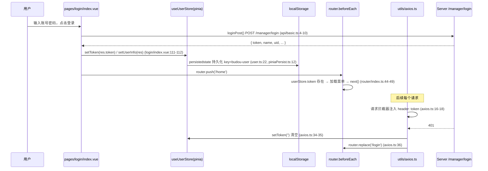

# TangSengDaoDaoManager 深度分析报告

> 分析对象：`/data/code/tsdd-analysis/TangSengDaoDaoManager`（包名 `tsdd-control`，版本 1.5.0）
> 分析方式：纯静态代码审查（未运行、未构建）。所有 `file:line` 引用均经 Read 工具核实。
> 标注约定：[CONFIRMED] = 代码中直接证实；[PLAUSIBLE] = 基于代码的合理推断；"待验证" = 需运行时或对端确认。

---

## 1. 仓库概述

TangSengDaoDaoManager 是「唐僧叨叨」（TangSengDaoDao，IM 即时通讯系统，底层为 WuKongIM）的 **Web 运营/管理控制台前端**，即 IM 系统管理员使用的后台 SPA。

- **定位**：纯管理端 UI，不含任何 IM SDK / WebSocket 长连接，所有功能通过 REST API 与 TangSengDaoDaoServer 交互。其主要消费 Server 的 `/manager/*` 管理端路由（登录、用户/群/消息/举报/工作台管理），少量消费 `/statistics/*`、`/common/*`、`/file/*` 等通用路由。
- **与 Server 的关系**：本仓库第 5 节的端点清单即 Server 管理端 API 的"调用方投影"，可用于与 TangSengDaoDaoServer 的路由注册做逐条对账。`baseURL` 在开发环境指向 `https://api.botgate.cn/v1/`（`src/config/modules/dev.ts:3`），生产环境为相对路径 `/api/v1/`（`src/config/modules/prod.ts:3`），由同机 nginx 反代到 Server。
- **管理能力面**：管理员登录、用户增删封禁、群封禁/禁言/成员管理、消息查询/撤回(删除)/代发/全员通知、违禁词、举报查看、红包记录（占位/半成品，见 8 节）、工作台（应用/分类/轮播）配置、APP 版本发布、通用设置、修改密码、管理员账号管理（仅 superAdmin）。
- 规模：62 个 `.ts` + 63 个 `.vue`，源码总计约 11896 行，无测试代码。

---

## 2. 技术栈与依赖

### 2.1 核心运行时依赖（`package.json:14-36`）

| 依赖 | 版本 | 用途 | 新旧评估（以 2026 年视角） |
|---|---|---|---|
| vue | ^3.3.4 | 框架 | 偏旧，Vue 3 已至 3.5+；3.3.x 无已知高危漏洞但建议升级 |
| vue-router | ^4.2.0 | 路由 | 旧（4.5+ 当前） |
| pinia | ^2.0.36 | 状态管理 | 旧（2.3+ / 3.x 当前） |
| pinia-plugin-persistedstate | ^3.1.0 | 状态持久化 | 旧（4.x 当前） |
| element-plus | ^2.3.7 | UI 组件库 | 偏旧（2.11+ 当前）；2.3.x 曾有 XSS 类 issue 修复历史，建议升级 |
| @element-plus/icons-vue | ^2.1.0 | 图标 | 随 EP 升级 |
| axios | ^1.4.0 | HTTP 客户端 | **旧且需关注**：axios 1.x 早期版本有多个 CVE（如 CVE-2024-39338 SSRF、CVE-2025-27152 等，均影响 <1.8.x），应升级到最新 1.x |
| echarts | ^5.4.3 | 图表 | 旧（5.6/6.x 当前） |
| vue-i18n | ^9.2.2 | 国际化 | 旧（9.14/10.x 当前） |
| vue-grid-layout | ^3.0.0-beta1 | 首页仪表盘栅格 | **beta 版**，维护停滞，风险较高 |
| @vueuse/core | ^10.1.2 | 组合式工具 | 旧 |
| dayjs | ^1.11.9 | 日期 | 可接受 |
| mitt / nprogress / sortablejs / vue3-count-to / vue3-lottie / vue-color-kit / @fancyapps/ui / @icon-park/vue-next / @lottiefiles/lottie-player | 若干 | 辅助 | vue-color-kit、vue3-count-to 等小众包维护活跃度低 |

### 2.2 构建/开发依赖（`package.json:37-67`）

| 依赖 | 版本 | 用途 |
|---|---|---|
| vite | ^4.4.1 | 构建（README 称 Vite5，实际为 4.4，README 有误） |
| typescript / vue-tsc | ^5.0.4 / ^1.6.4 | TS 工具链（vue-tsc 极旧） |
| unplugin-vue-router | ^0.6.4 | 文件路由（声明式路由支持） |
| vite-plugin-pages | ^0.31.0 | 文件路由（实际生成 `virtual:generated-pages` 的是它） |
| vite-plugin-vue-meta-layouts | ^0.2.2 | 布局系统（`virtual:meta-layouts` / `setupLayouts`） |
| unplugin-auto-import / unplugin-vue-components | ^0.16.4 / ^0.25.1 | 自动导入 |
| @unocss/vite + preset-uno | ^0.51.12 | 原子化 CSS |
| vite-plugin-compression | ^0.5.1 | gzip 预压缩 |
| vite-plugin-html | ^3.2.0 | HTML 注入（标题/配置脚本） |
| vite-plugin-vue-devtools | ^0.4.14 | 调试（**生产构建也会引入该插件**，见 7 节） |
| sass / eslint / prettier / plop / cross-env | — | 工程化 |

**总体评估**：技术栈选型主流（Vue3 + TS + Vite + Pinia + EP 是标准中后台组合），但整体版本停留在 2023 年中水平，axios、element-plus、vite 均有升级必要；`vue-grid-layout@beta` 与多个低活跃度小依赖是供应链薄弱点。**无 lockfile 之外的依赖审计/更新机制（无 dependabot/renovate 配置）**。

---

## 3. 目录结构与模块架构

### 3.1 目录树（src/ 精简版）

```
src/
├── main.ts                 # 入口：注册 ElementPlus/GridLayout/指令/router/i18n/pinia
├── App.vue                 # 根组件：el-config-provider + router-view，初始化主题/语言
├── api/                    # REST 端点封装（第 5 节全量清单）
│   ├── basic.ts user.ts group.ts message.ts report.ts setting.ts
│   ├── statistic.ts tool.ts file.ts
│   └── workplace/{app,category,banner}.ts
├── assets/                 # 静态资源
├── components/             # BdPage/BdMsg/BdSendMsg/BdSandAllMsg/BdProhitWords/
│                           # BdAppVersion/SwitchDark 等业务组件
├── config/                 # 环境配置：index.ts + modules/{dev,prod}.ts
├── directives/             # 自定义指令：auth/copy/waterMarker/draggable/debounce/throttle/longpress
├── hooks/                  # useEcharts、useTheme
├── i18n/                   # vue-i18n：modules/{zh,en}.ts（仅覆盖框架级文案）
├── layouts/                # 4 种布局 + Header/Tabs/Footer/Menu/ThemeDrawer
├── menu/                   # 静态菜单定义 modules/*.ts（含 meta.auth 角色）
├── pages/                  # 文件路由页面（home/login/user/group/message/redpacket/
│                           #   report/setting/tool/my/workplace）
├── router/                 # index.ts(守卫) / routers.ts(合并) / staticRouter.ts
├── stores/                 # pinia：modules/{user,auth,global,tabs,keepAlive}.ts
├── styles/                 # scss 主题（含 element-dark）
├── types/                  # 自动生成 + 全局 d.ts
└── utils/                  # axios 封装、piniaPersist、nprogress、mittBus、通用函数
```

### 3.2 分层架构图

```mermaid
flowchart TD
    A[index.html<br/>注入 tsdd-config.js 可选] --> B[main.ts<br/>createApp]
    B --> C[App.vue<br/>el-config-provider / router-view]
    B --> D[router/index.ts<br/>beforeEach 守卫 + NProgress]
    B --> E[stores pinia<br/>user/auth/global/tabs/keepAlive]
    B --> F[directives / i18n / ElementPlus]

    D --> G[router/routers.ts<br/>staticRouter + setupLayouts&#40;generated-pages&#41;]
    G --> H[pages/**.vue<br/>文件路由页面]

    H --> I[api/*.ts<br/>REST 封装]
    I --> J[utils/axios.ts<br/>baseURL + token 头 + 401 处理]
    J --> K[(TangSengDaoDaoServer<br/>/api/v1/manager/* 等)]

    E -.persistedstate.-> L[(localStorage<br/>budou-user 等)]
    M[src/config/index.ts<br/>BU_DOU_CONFIG] --> J
    N[window.TSDD_CONFIG<br/>运行时注入] -.覆盖.-> M
    O[menu/modules/*.ts<br/>静态菜单+角色] --> E
```



### 3.3 文件路由机制

- `vite-plugin-pages`（`vite.config.ts:51-54`）扫描 `src/pages`（排除 `**/components/*.vue`），生成虚拟模块 `virtual:generated-pages`；`vite-plugin-vue-meta-layouts`（`vite.config.ts:48-50`，`defaultLayout: 'index'`）生成 `virtual:meta-layouts` 的 `setupLayouts`。
- `src/router/routers.ts:1-12`：`setupLayouts(generatedRoutes.filter(...))` 过滤掉 `meta.enabled===false`、`meta.constant===true`、`meta.layout===false` 的路由后套上默认布局，再与 `staticRouter`（`/` 重定向、`/login`，`src/router/staticRouter.ts:7-20`）合并。**注意：过滤条件包含 `meta.layout===false`，意味着登录页不能走 pages 目录——因此 `/login` 只能放在 staticRouter 中手动声明（`staticRouter.ts:12-19`），而 `src/pages/login/index.vue:64-68` 的 `<route>` 块虽写了 `layout: false`，该文件路由实际被过滤掉不生效（存在两份 login 页面定义，文件路由版是死代码，待验证）。**
- 每个页面用 `<route lang="yaml">` 块声明 meta（title/isAffix/isKeepAlive 等），如 `src/pages/user/userlist.vue:64-68`。
- **关键架构事实：所有页面路由在构建期全部静态注册，无动态路由下发**。`authStore.getAuthMenuList()`（`src/stores/modules/auth.ts:54-56`）只是把本地 `src/menu/` 菜单按角色过滤后用于**菜单渲染**，并不 `addRoute`。这决定了鉴权模型是纯前端展示层过滤（见 7 节）。

### 3.4 运行时配置注入机制（TSDD_CONFIG）

三层覆盖，后者优先（`src/config/index.ts:14-30`）：

1. `import.meta.glob('./modules/*.ts', {eager:true})` 按 `APP_ENV`（dev/prod）载入内置配置（`src/config/modules/dev.ts` / `prod.ts`）；
2. `window.TSDD_CONFIG`（若存在）展开覆盖；
3. 产出 `BU_DOU_CONFIG`，被 axios `baseURL`（`src/utils/axios.ts:8`）、头像 URL 拼接（如 `src/pages/user/userlist.vue:110`）、登录页标题（`src/pages/login/index.vue:87`）等消费。

注入链路：`pnpm build:config` 设置 `IS_CONFIG=true` → `vite-plugin-html` 在 index.html 注入 `<script src="/tsdd-config.js"></script>`（`vite.config.ts:42`）→ 容器/静态目录中的 `public/tsdd-config.js`（内容为 `window.TSDD_CONFIG = { APP_URL: ... }`）在应用 bundle 之前执行。

**注意**：`Dockerfile:10` 与 CI（`.github/workflows/ghcr.yml` 构建步骤）都执行的是 `pnpm build`（不含 `IS_CONFIG`），因此 **Docker 镜像产物中并不会注入 tsdd-config.js 脚本标签**，运行时注入机制在官方镜像里实际未启用，生效的是 `prod.ts` 的 `/api/v1/` + nginx 反代。`public/tsdd-config.js` 仍会被原样拷入 dist 但不被引用。该机制形同虚设（除非用户自行 `build:config`）。

---

## 4. 核心流程走读

### 4.a 登录与鉴权守卫



调用链（file:line）：

1. 登录表单校验（仅 required，**无验证码**）：`src/pages/login/index.vue:95-98`，提交逻辑 `src/pages/login/index.vue:103-124`。
2. `loginPost` → `POST {baseURL}/manager/login`：`src/api/basic.ts:4-10`。
3. token 写入 pinia 并持久化：`src/stores/modules/user.ts:14-16` + `persist: piniaPersistConfig('budou-user')`（`user.ts:22`）→ `storage: localStorage`（`src/utils/piniaPersist.ts:12`）。
4. 路由守卫：`src/router/index.ts:33-61`——有 token 则（必要时）加载菜单 `authStore.getAuthMenuList()` 并放行；无 token 且不在白名单（`ROUTER_WHITE_LIST = ['/login']`，`src/config/index.ts:11`）则 `replace` 到 `/login`。已登录访问白名单路由会 `next(from.fullPath)` 弹回原页（`router/index.ts:40-42`）。
5. axios 请求拦截器注入 `token` 请求头：`src/utils/axios.ts:13-24`；响应拦截器 401 → 清 token、重置 userInfo、跳登录（`axios.ts:31-37`）；400 → reject `error.response.data` 供页面 `err.msg` 提示（`axios.ts:38-40`）。
6. 退出登录：仅前端清 token + 跳 `/login`（`src/layouts/components/Header/components/Avatar.vue:51-57`），**不调用后端注销接口**（待验证 Server 是否有会话失效端点）。

### 4.b 典型管理操作全链路：用户列表（查询/分页/封禁）

页面：`src/pages/user/userlist.vue`（348 行，全仓最大业务页面之一）。

数据流：

1. `onMounted` → `getUserList()`（`userlist.vue:338-340, 229-236`）→ `userListGet(queryFrom)`（`src/api/user.ts:13-19`）→ `GET /manager/user/list?keyword=&page_size=15&page_index=1` → axios 注入 token → Server。
2. 响应 `{list, count}` → `tableData` / `total` 渲染 `el-table` + `el-pagination`（`userlist.vue:22-55`）。
3. 搜索：`queryFrom.keyword` 双向绑定输入框（`userlist.vue:13`），点"查询"重跑 `getUserList`（**未重置 page_index**，连续翻页后搜索可能落在空页，属体验 bug）。
4. 分页：`onSizeChange`/`onCurrentChange`（`userlist.vue:239-248`）改参重查，服务端分页。
5. 表格列采用 tsx `render` 函数渲染复杂单元格（头像、操作列），如头像拼接 `${BU_DOU_CONFIG.APP_URL}users/${uid}/avatar`（`userlist.vue:107-117`）——**`` 直链不带 token 头，说明头像端点是公开的或另有鉴权（待验证）**。
6. 行内操作：发消息（打开 `BdSendMsg` 弹窗，sender=管理员自己，`userlist.vue:259-268`）、好友/黑名单列表（跳路由带 query）、封禁/解禁（`ElMessageBox.confirm` → `userLiftbanPut({uid,status})` → `PUT /manager/user/liftban/{uid}/{status}`，`userlist.vue:293-326` + `src/api/user.ts:49-54`）、查看设备（`Devices` 组件 → `GET /manager/user/devices`）。
7. 错误处理约定：`.catch(err => { if (err.status == 400) ElMessage.error(err.msg) })`（如 `userlist.vue:314-318`），非 400 错误静默吞掉。

### 4.c 特色管理功能：workplace / redpacket / report

**工作台（workplace）——应用/分类/轮播的运营配置**：

- 应用管理 `src/pages/workplace/manage/index.vue`：列表 `GET /manager/workplace/app`（`index.vue:183` + `api/workplace/app.ts:4-10`），新增/编辑走 `Apply.vue` 弹窗（`POST /manager/workplace/app`、`PUT /manager/workplace/apps/{app_id}`，`manage/components/Apply.vue:164-200` + `api/workplace/app.ts:13-28`），删除 `DELETE /manager/workplace/apps/{app_id}`（`index.vue:212`）。
- 图标上传：`el-upload` 上传前 `feileGet({path, type:'report'})` → `GET /file/upload` 换取预签名上传地址 `res.url`，再直传（`Apply.vue:140-156` + `src/api/file.ts:4-10`）；上传请求头带 token（`Apply.vue:135-137`）。
- 工作台设置 `src/pages/workplace/configuration/index.vue`：两个 tab——轮播（Banner.vue，增删改/排序 `PUT /manager/workplace/banner/reorder`）与自定义分组（CustomGroup.vue，447 行，全仓最大文件；用 sortablejs 拖拽排序，调 `categoryReorderPut` / `categorysAppsReorderPut`，`CustomGroup.vue:96-109`）。
- **端点命名怪癖**（对账时注意）：单数复数混用——`PUT/DELETE /manager/workplace/apps/{id}`（复数）vs `GET/POST /manager/workplace/app`（单数）；分类同理 `categorys/{no}` vs `category`（`api/workplace/category.ts:22-35`）。

**红包（redpacket）——半成品/占位页面 [CONFIRMED]**：

`src/pages/redpacket/list.vue` 标题为"红包记录"，但实际 import 的是 `userListGet`（`list.vue:69`），渲染的是**用户列表**（含手机号/悟空号等列），"发消息"按钮绑定的是 `console.log`（`list.vue:181-183` 的 `aa` 函数）。且菜单中红包项 `isHide: true`（`src/menu/modules/redpacket.ts:9`）默认隐藏。结论：红包管理前端是复制 userlist 后的未完成占位，**没有调用任何红包专用端点**，后端红包端点是否存在需与 Server 对账（待验证）。

**举报（report）——只读审核列表**：

`src/pages/report/user.vue` / `group.vue` 均调 `reportListGet`（`GET /manager/report/list`，`src/api/report.ts:4-10`），以 `channel_type` 区分 1=用户 / 2=群（`report/user.vue:130`）。仅展示举报者、被举报对象、图片、原因、说明、时间，**前端无处置（封禁/忽略）操作按钮**——举报闭环需在后端或人工完成。举报图片列（`report/user.vue:103-106`）只渲染原始文本（imgs 字段），未做图片预览。

**消息管理（补充）**：

- 通知记录 `message/sendmsglist.vue` → `GET /manager/message`；全员通知组件 `BdSandAllMsg` → `POST /manager/message/sendall`；单发 `BdSendMsg` → `POST /manager/message/send`。
- **代发消息的身份伪造面**：群列表"发消息"把 `sender` 设为**群主 creator** 而非管理员（`src/pages/group/grouplist.vue:230-231`），即管理台以后端信任的身份代群主发消息——这是业务能力也是滥用面（见 7 节）。
- 聊天记录 `message/record.vue`（群）/ `recordpersonal.vue`（单聊）支持删除消息 `DELETE /manager/message`（body 传参，`src/api/message.ts:22-28`）。
- 违禁词 `message/prohibitwords.vue` + `BdProhitWords` 组件：`GET/POST/DELETE /manager/message/prohibit_words`。

---

## 5. 对外接口（src/api/ 端点全量清单）

baseURL：dev `https://api.botgate.cn/v1/`；prod `/api/v1/`。鉴权：`token` 请求头。下表按模块汇总（共 **40 个端点函数 / 34 条去重路径**）：

### basic（src/api/basic.ts）

| 方法 | 路径 | 用途 | 函数/行号 |
|---|---|---|---|
| POST | /manager/login | 管理员登录 | `loginPost` basic.ts:4 |

### user（src/api/user.ts）

| 方法 | 路径 | 用途 | 函数/行号 |
|---|---|---|---|
| POST | /manager/user/add | 添加用户 | `userAddPost` user.ts:4 |
| GET | /manager/user/list | 用户列表（分页/搜索） | `userListGet` user.ts:13 |
| GET | /manager/user/disablelist | 封禁用户列表 | `userDisablelistGet` user.ts:22 |
| GET | /manager/user/friends | 好友列表（URL 无前导斜杠） | `userFriendsGet` user.ts:31 |
| GET | /manager/user/blacklist | 用户黑名单 | `userBlacklistGet` user.ts:40 |
| PUT | /manager/user/liftban/{uid}/{status} | 用户封禁/解禁 | `userLiftbanPut` user.ts:49 |
| GET | /manager/user/admin | 管理员列表 | `adminList` user.ts:57 |
| POST | /manager/user/admin | 新增管理员 | `adminAdd` user.ts:65 |
| DELETE | /manager/user/admin | 删除管理员（query: uid） | `adminDelete` user.ts:74 |

### group（src/api/group.ts）

| 方法 | 路径 | 用途 | 函数/行号 |
|---|---|---|---|
| GET | /manager/group/list | 群列表 | `groupListGet` group.ts:4 |
| GET | /manager/group/disablelist | 封禁群列表 | `groupDisablelistGet` group.ts:13 |
| GET | /manager/groups/{groupNo}/members | 群成员 | `groupGroupmembersGet` group.ts:22 |
| DELETE | /manager/groups/{groupNo}/members | 移除成员（body） | `groupGroupmembersDelete` group.ts:31 |
| GET | /manager/groups/{groupNo}/members/blacklist | 群黑名单 | `groupBlacklistGet` group.ts:40 |
| PUT | /manager/groups/{groupNo}/forbidden/{forbidden} | 群禁言/解除 | `groupForbiddenPut` group.ts:49 |
| PUT | /manager/group/liftban/{groupNo}/{status} | 群封禁/解禁 | `groupLiftbanPut` group.ts:57 |

### message（src/api/message.ts）

| 方法 | 路径 | 用途 | 函数/行号 |
|---|---|---|---|
| GET | /manager/message | 通知/消息记录 | `messageGet` message.ts:4 |
| POST | /manager/message/send | 代发消息 | `messageSendPost` message.ts:13 |
| DELETE | /manager/message | 删除消息（body） | `messageDelete` message.ts:22 |
| POST | /manager/message/sendall | 全员消息 | `messageSendAllPost` message.ts:31 |
| GET | /manager/message/prohibit_words | 违禁词列表 | `messageProhibitWordsGet` message.ts:40 |
| POST | /manager/message/prohibit_words | 新增违禁词（params） | `messageProhibitWordsPost` message.ts:48 |
| DELETE | /manager/message/prohibit_words | 删除违禁词 | `messageProhibitWordsDelete` message.ts:56 |
| GET | /manager/message/recordpersonal | 单聊消息记录 | `messageRecordpersonalGet` message.ts:65 |
| GET | /manager/message/record | 群聊消息记录 | `messageRecordGet` message.ts:74 |
| GET | /manager/user/devices | 查看用户设备 | `messageUserDevices` message.ts:83 |

### report / setting / statistic / tool / file

| 方法 | 路径 | 用途 | 函数/行号 |
|---|---|---|---|
| GET | /manager/report/list | 举报列表（channel_type 区分用户/群） | `reportListGet` report.ts:4 |
| POST | /manager/user/updatepassword | 修改登录密码 | `userUpdatepasswordPost` setting.ts:4 |
| GET | /manager/common/appconfig | 获取通用设置 | `getAppconfigGet` setting.ts:13 |
| POST | /manager/common/appconfig | 更新通用设置 | `updateAppconfigPost` setting.ts:22 |
| GET | /statistics/countnum | 当日计数（注册/建群/总用户/总群） | `statisticsCountnumGet` statistic.ts:4 |
| GET | /statistics/registeruser/{start}/{end} | 注册统计 | `statisticsRegisteruserGet` statistic.ts:13 |
| GET | /statistics/createdgroup/{start}/{end} | 建群统计 | `statisticsCreatedgroupGet` statistic.ts:21 |
| GET | /common/appversion/list | APP 版本列表 | `commonAppversionListGet` tool.ts:4 |
| POST | /common/appversion | 新增 APP 版本 | `commonAppversionPost` tool.ts:13 |
| GET | /file/upload | 获取预签名上传地址 | `feileGet` file.ts:4 |

### workplace（src/api/workplace/）

| 方法 | 路径 | 用途 | 函数/行号 |
|---|---|---|---|
| GET | /manager/workplace/app | 应用列表 | `appGet` app.ts:4 |
| POST | /manager/workplace/app | 新增应用 | `appPost` app.ts:13 |
| PUT | /manager/workplace/apps/{app_id} | 编辑应用 | `appPut` app.ts:22 |
| DELETE | /manager/workplace/apps/{app_id} | 删除应用 | `appDelete` app.ts:31 |
| GET | /manager/workplace/category | 分类列表 | `categoryGet` category.ts:4 |
| POST | /manager/workplace/category | 新增分类 | `categoryPost` category.ts:13 |
| PUT | /manager/workplace/categorys/{category_no} | 编辑分类 | `categoryPut` category.ts:22 |
| DELETE | /manager/workplace/categorys/{category_no} | 删除分类 | `categoryDelete` category.ts:31 |
| PUT | /manager/workplace/category/reorder | 分类排序 | `categoryReorderPut` category.ts:39 |
| GET | /manager/workplace/categorys/{category_no}/app | 分类下应用 | `categoryAppGet` category.ts:48 |
| POST | /manager/workplace/categorys/{category_no}/app | 分类加应用 | `categoryAppPost` category.ts:56 |
| DELETE | /manager/workplace/categorys/{category_no}/apps/{app_id} | 分类删应用 | `categoryAppDelete` category.ts:65 |
| PUT | /manager/workplace/categorys/{category_no}/app/reorder | 分类内应用排序 | `categorysAppsReorderPut` category.ts:73 |
| GET | /manager/workplace/banner | 轮播列表 | `bannerGet` banner.ts:4 |
| POST | /manager/workplace/banner | 新增轮播 | `bannerPost` banner.ts:13 |
| PUT | /manager/workplace/banners/{banner_no} | 编辑轮播 | `bannerPut` banner.ts:22 |
| DELETE | /manager/workplace/banners/{banner_no} | 删除轮播 | `bannerDelete` banner.ts:31 |
| PUT | /manager/workplace/banner/reorder | 轮播排序 | `bannerReorderPut` banner.ts:39 |

**前端隐式依赖但不在 api/ 中的端点**：`GET {baseURL}users/{uid}/avatar`（头像 img 直链，如 `userlist.vue:110`、`Avatar.vue:40`）。对账时需补充。

---

## 6. 部署与运维

### 6.1 Docker / nginx

- **Dockerfile**（多阶段）：`node:20.11.1` 构建（npm 换 npmmirror 源，装 pnpm@9.15.9，`pnpm install --frozen-lockfile && pnpm build`）→ `nginx:1.27-alpine` 运行（`Dockerfile:1-18`）。注意构建用的是 `pnpm build` 而非 `build:config`，见 3.4 节。
- **docker-entrypoint.sh**（5 行）：`envsubst '${API_URL}' < /nginx.conf.template > /etc/nginx/conf.d/default.conf`，然后 `exec "$@"`。容器需注入环境变量 `API_URL`（如 `http://server:8080/v1/`），否则 `proxy_pass ${API_URL};` 会渲染为空导致 nginx 启动失败——**无默认值兜底 [CONFIRMED]**。
- **nginx.conf.template**：`location /api/ { proxy_pass ${API_URL}; client_max_body_size 1000m; }` + SPA fallback `try_files $uri $uri/ /index.html`（`nginx.conf.template:16-26`）。**无任何安全响应头（CSP/X-Frame-Options/HSTS 等）**；`client_max_body_size 1000m` 过宽。注意前端 prod baseURL 是 `/api/v1/`，与 `location /api/` 匹配（`/api/` 前缀匹配包含 `/api/v1/`），`API_URL` 需以 `/v1/` 之类的路径结尾使拼接正确——envsubst 模板对路径拼接敏感，部署文档未见说明（待验证部署约定）。
- **Dockerfile.ghcr**：CI 用，`nginx:latest`（**未固定版本**），dist 由 workflow 中 `pnpm run build` 预先构建（`.github/workflows/ghcr.yml`），随后 buildx 构建 amd64+arm64 推 GHCR；同时把 dist 部署到 `cf-dist` 分支（JamesIves/github-pages-deploy-action）。
- `default.conf`（监听 8084 的纯静态 SPA 配置）是残留文件，未被任何 Dockerfile 引用。
- `Makefile`：build / deploy（推阿里云上海 registry `wukongim/tangsengdaodaomanager`）/ deploy-multi（buildx 多架构）。

### 6.2 Vite 构建配置（vite.config.ts）

- gzip 预压缩：`vite-plugin-compression`，`.gz` 保留原文件（`vite.config.ts:55-58`）。
- 手动分包：`vue`（vue/router/pinia/i18n/element-plus）、`echarts`、`tgs-player` 三个 chunk（`vite.config.ts:110-115`）；`cssCodeSplit: false`（全量单 CSS），`sourcemap: false`，`chunkSizeWarningLimit: 1500`。
- `define: { 'process.env': { APP_ENV } }`（`vite.config.ts:70-74`）——仅注入 APP_ENV 一个键，业务代码里 `process.env.APP_ENV` 可用。
- `IS_CONFIG` 控制 index.html 是否注入 `/tsdd-config.js`（`vite.config.ts:42`，配合 `package.json:8` 的 `build:config`）。
- 别名 `@`→src；`vue-i18n` 指向 cjs 构建（`vite.config.ts:64-68`）。
- `VueDevTools()` 插件无条件启用（`vite.config.ts:29`），见 7 节。
- PostCSS 插件移除 `@charset`（`vite.config.ts:79-89`），规避 sass 告警。

### 6.3 plop 脚手架

`pnpm new` 启动 plop（`package.json:10`，`plopfile.js:1-6`），三个 generator：

- `page`：按 `plop-templates/page/index.hbs` 生成含 `<route>` meta 块的页面骨架（`src/pages/my/bb.vue` 即其产物——标题"页面标题"的空模板页，**作为 `/my/bb` 路由真实存在**，属残留死页面）；
- `component` / `store`：组件与 pinia store 模板。

---

## 7. 安全审计（静态审查）

### 7.1 token 持久化于 localStorage，XSS 一旦得手即失窃 [CONFIRMED]

- `src/utils/piniaPersist.ts:12` `storage: localStorage`；`src/stores/modules/user.ts:22` 对整个 user store（含 token、userInfo）持久化，key=`budou-user`。
- 任何 XSS/恶意浏览器扩展/同域第三方脚本都可读取该 key 窃取管理 token；无 HttpOnly Cookie 方案、无 token 轮换/续期逻辑、退出登录不通知后端（`Avatar.vue:51-57`）。
- 缓解因素：当前代码库 **未使用 `v-html`/`innerHTML`/`document.write`**（全仓 grep 无命中），Vue 模板默认转义，直接 XSS 注入面较小。

### 7.2 纯前端鉴权，菜单角色过滤可被绕过 [CONFIRMED（性质）/ 影响取决于后端]

- 所有路由构建期静态注册（`src/router/routers.ts:6-10`），守卫只检查 `userStore.token` 是否存在（`src/router/index.ts:44`），**不校验角色**。
- 角色控制仅体现在菜单渲染过滤：`src/stores/modules/auth.ts:12-24` 用 `userStore.userInfo.role` 过滤 `meta.auth`（如管理员页 `auth: ['superAdmin']`，`src/menu/modules/user.ts:69`）。而 `role` 来自登录响应并被持久化在 localStorage——**攻击者（低权限管理员）直接改 localStorage 或手动访问 `/user/administrator` URL 即可看到页面**；API 是否放行取决于 Server 鉴权（对账重点，待验证）。
- 按钮级指令 `v-auth`（`src/directives/modules/auth.ts:8-21`）依赖 `authButtonListGet`，但 `getAuthButtonList` 永远返回 `{}`（`src/stores/modules/auth.ts:50-52`），且全仓无 `v-auth` 使用——按钮权限体系是死代码。

### 7.3 登录无验证码/防爆破措施（前端视角）[CONFIRMED]

- `src/pages/login/index.vue:95-98` 仅 required 校验，`103-124` 直接 POST，无图形验证码、无滑块、无失败锁定提示、无登录频率限制前端倒计时。防爆破完全依赖 Server（待验证）。
- 修改密码仅要求新密码长度 ≥6（`src/pages/setting/updatepwd.vue:57`），无复杂度要求；添加用户表单（`src/pages/user/adduser.vue:13-37`）**完全没有表单校验**，手机号/密码任意提交。

### 7.4 axios 响应拦截器健壮性缺陷 [CONFIRMED]

- `src/utils/axios.ts:32` `const code = error.response.status;`——网络错误/超时/CORS 失败时 `error.response` 为 `undefined`，拦截器自身抛 TypeError，错误处理链断裂，页面 `.catch` 收到的是拦截器异常而非原始错误。
- 401 处理竞态：多个并发请求同时 401 时，每个都会执行清 token + `router.replace('/login')`（`axios.ts:33-37`），无去抖/单例化；影响轻微（重复跳转）但会在控制台产生冗余导航告警。
- `src/utils/axios.ts:5` 在模块顶层调用 `useUserStore()`——依赖"api 模块被页面懒加载时 pinia 已激活"这一隐式时序，脆弱但当前可用。
- token 以自定义头 `token` 传输（`axios.ts:17`），非标准 `Authorization: Bearer`；`withCredentials: false`（`axios.ts:9`），跨域场景 Cookie 不携带（符合 token 模式）。

### 7.5 echarts 渲染用户数据 [PLAUSIBLE，低风险]

- 首页统计图数据为日期-数值对（`src/pages/home/components/AddUser.vue:79-101`），tooltip 默认转义，当前数据形态无 XSS 路径；但若未来把用户昵称等不可信字符串接入 echarts 富文本/formatter，需重新评估。

### 7.6 管理台代发消息的身份伪造面 [CONFIRMED 前端行为 / 风险定级待后端验证]

- 群列表"发消息"将 sender 设为群主（`src/pages/group/grouplist.vue:230-231` `sender: item.creator, senderName: item.create_name`），即管理台以任意群主义身份发消息；单发时 sender 为管理员自己（`userlist.vue:265-266`）。`POST /manager/message/send` 的 sender 完全由前端传参（`src/components/BdSendMsg/index.vue:73-79`），Server 是否信任该字段决定滥用面（对账重点）。

### 7.7 供应链/构建期问题 [CONFIRMED]

- `vite-plugin-vue-devtools` 无条件加入插件列表（`vite.config.ts:29`），生产构建也包含 devtools 集成代码（体积+信息暴露面，待验证产物是否注入）。
- axios ^1.4.0、element-plus ^2.3.7、vite ^4.4.1 等版本老旧（见 2 节），存在已知 CVE 敞口。
- `Dockerfile.ghcr:1` 使用 `nginx:latest` 未固定版本。
- 敏感信息检查：仓内无硬编码密钥；dev 环境 API 域名 `api.botgate.cn` 硬编码于 `src/config/modules/dev.ts:3` 与 `public/tsdd-config.js:2`（属配置而非秘密，但暴露了开发/演示后端地址）。

### 7.8 nginx 无安全响应头 [CONFIRMED]

`nginx.conf.template` 全文（12-27 行）无 `Content-Security-Policy`、`X-Content-Type-Options`、`X-Frame-Options`、`Referrer-Policy` 等；配合 7.1 的 localStorage token，建议至少补 CSP 与 `X-Content-Type-Options: nosniff`。

---

## 8. 代码质量评估

### 8.1 规模与 TOP 文件

源码约 11896 行。TOP-10（行数）：

| 行数 | 文件 |
|---|---|
| 447 | src/pages/workplace/configuration/components/CustomGroup.vue |
| 350 | src/pages/group/grouplist.vue |
| 348 | src/pages/user/userlist.vue |
| 337 | src/layouts/components/Tabs.vue |
| 297 | src/pages/message/record.vue |
| 297 | src/layouts/components/ThemeDrawer.vue |
| 283 | src/pages/message/recordpersonal.vue |
| 268 | src/pages/group/groupmembers.vue |
| 265 | src/pages/workplace/configuration/components/Banner.vue |
| 256 | src/pages/workplace/manage/index.vue |

### 8.2 测试

**完全没有测试**：无 vitest/jest/cypress 依赖，无 `__tests__`/`.spec.` 文件，CI（ghcr.yml）无测试步骤，只有构建+推送。

### 8.3 TypeScript 严格度

- `tsconfig.json:19-22` 开启 `strict`、`noUnusedLocals`、`noUnusedParameters`，表面严格；
- 但实践中大面积 `any`：所有 api 函数参数/返回均为 `any`（如 `userListGet(params: any)`，`src/api/user.ts:13`），页面回调普遍 `(res: any)`；`declare module '*.vue'` 用 `DefineComponent<{},{},any>`（`src/types/env.d.ts:5-9`）使组件类型检查形同虚设；`vue-tsc` 未接入构建脚本（`build` 只跑 `vite build`，`package.json:7`），**类型错误不阻断构建**。
- 命名不规范：`BU_DOU_CONFIG`、`feileGet`（file 拼错）、`BdProhitWords`（Prohibit 拼错）、`queryFrom`（应为 queryForm）、`fromLiftban`（应为 form）等拼音/错别字遍布。
- 复制粘贴遗留：`redpacket/list.vue` 即 userlist 副本（见 4.c）；`src/pages/my/bb.vue` 是 plop 模板残留页；`src/pages/login/index.vue` 的文件路由被过滤（死路由定义，见 3.3）。
- 历史模式 bug：`Tabs.vue` 的 `setTabsTitle` 用 `location.hash.substring(1)`（`src/stores/modules/tabs.ts:53`），但路由是 `createWebHistory`（`src/router/index.ts:24`），hash 恒为空，该功能实际失效（当前无调用方，潜伏 bug）。
- 组件反模式：多个弹窗组件直接 `props.value = n` 修改 prop（如 `BdSendMsg/index.vue:61`、`Apply.vue:114`），违背单向数据流（Vue 会告警）。

### 8.4 i18n 完整度

vue-i18n 装配完整（`src/i18n/index.ts:7-15`，zh/en 双包，按浏览器语言默认），但 **`zh.ts`/`en.ts` 各仅 27 行，只覆盖 tabs/header/home 的框架级文案**；全部业务页面（登录、用户、群、消息、设置……）均为硬编码中文（如 `login/index.vue:21` "请输入账号"）。i18n 实质完成度 <10%，en 用户看到的业务界面仍是中文。

### 8.5 工程化亮点

布局体系（4 种布局可切换 + 主题抽屉 + 暗黑/灰色/色弱模式）、自定义指令集（防抖/节流/长按/水印/复制）、plop 脚手架、自动导入、UnoCSS 原子化、菜单-面包屑-Tabs-KeepAlive 联动体系完整，是一套功能齐全的中后台脚手架（血统上明显源自 Geeker-Admin 类模板，菜单/auth store/tabs 结构高度一致）。

---

## 9. 风险与改进建议

| # | 类别 | 风险/问题 | 严重度 | 建议 |
|---|---|---|---|---|
| 1 | 安全 | token 明文存 localStorage（`piniaPersist.ts:12`），无 HttpOnly/续期/注销 | 高 | 改后端下发 HttpOnly Secure Cookie 或至少缩短 token 有效期 + 加 CSP；退出登录调用后端注销 |
| 2 | 安全 | 纯前端鉴权，角色仅过滤菜单，localStorage 可改 role（`auth.ts:15`） | 高（取决于后端） | Server 必须逐接口鉴权（对账验证）；前端可对受控路由加守卫二次校验 |
| 3 | 安全 | 登录无验证码/防爆破（`login/index.vue:103`）；改密仅长度≥6（`updatepwd.vue:57`） | 中 | 接入图形/行为验证码；提高密码复杂度策略 |
| 4 | 安全 | axios/element-plus/vite 等依赖版本老旧有 CVE 敞口；`vue-grid-layout@beta` | 中 | 升级依赖，接入 dependabot/renovate 与 `pnpm audit` 门禁 |
| 5 | 安全 | nginx 无安全响应头（`nginx.conf.template`）；`client_max_body_size 1000m` | 中 | 补 CSP/nosniff/frame-ancestors；按业务收敛 body 大小 |
| 6 | 安全 | 代发消息 sender 由前端任意指定（`grouplist.vue:230`） | 中（待后端验证） | Server 端强制以 token 对应身份为准 |
| 7 | 健壮性 | axios 拦截器 `error.response.status` 空指针（`axios.ts:32`）；401 并发竞态 | 中 | `error.response?.status` + 网络错误兜底；401 处理单例化 |
| 8 | 功能 | 红包页面是 userlist 副本、调用错误 API（`redpacket/list.vue:69`） | 中 | 实现真实红包记录或下线菜单 |
| 9 | 功能 | i18n 完成度 <10%，业务全硬编码中文 | 低 | 渐进补齐业务文案或移除 en 入口 |
| 10 | 质量 | 零测试；构建不跑 vue-tsc；API 层全 any | 中 | 至少为 axios 封装/守卫/utils 补单测；`build` 前置 `vue-tsc --noEmit`；API 层补类型 |
| 11 | 质量 | 死代码：`my/bb.vue` 残留页、`v-auth` 体系、过滤掉的 login 文件路由、`default.conf` | 低 | 清理 |
| 12 | 运维 | TSDD_CONFIG 运行时注入在官方 Docker/CI 构建中未启用（`pnpm build` 无 IS_CONFIG） | 低 | 要么镜像改用 `build:config`，要么删除该机制避免误导 |
| 13 | 运维 | `API_URL` 无默认值，缺失时 nginx 配置渲染失败 | 低 | entrypoint 加默认值或启动检查 |
| 14 | 体验 | 搜索不重置 page_index；非 400 错误静默吞掉 | 低 | 统一查询封装（重置页码+全局错误提示） |

---

## 附：待验证事项汇总

1. Server 对 `/manager/*` 是否逐接口做角色鉴权（与 7.2 对账）。
2. `/manager/message/send` 是否信任前端 sender 字段（7.6）。
3. `users/{uid}/avatar` 是否公开端点（img 无 token 头）。
4. Server 是否有登录限流/锁定、会话注销端点。
5. 红包管理端点在 Server 是否存在（前端为占位）。
6. `Dockerfile` 构建产物中 devtools 注入情况与 tsdd-config.js 实际部署约定。
7. `src/pages/login/index.vue` 文件路由被过滤后是否完全无引用（推断为死代码）。
