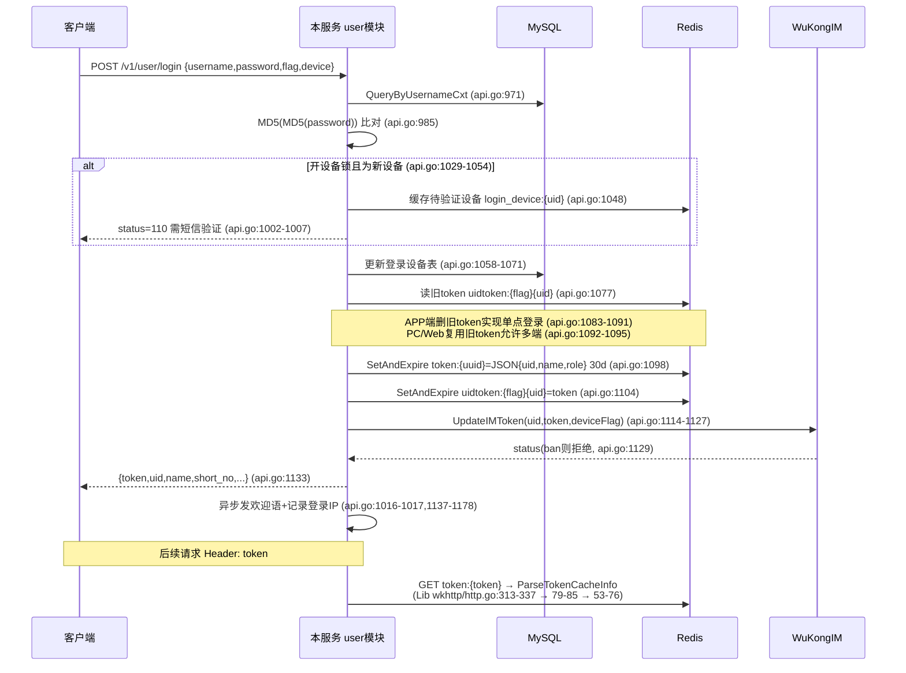
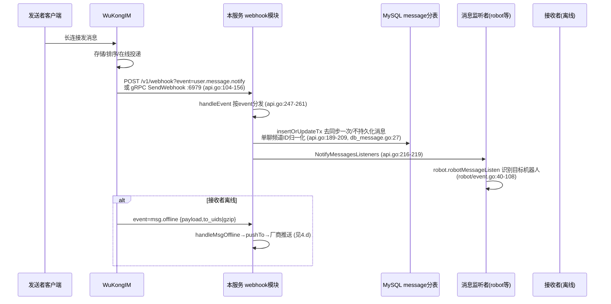
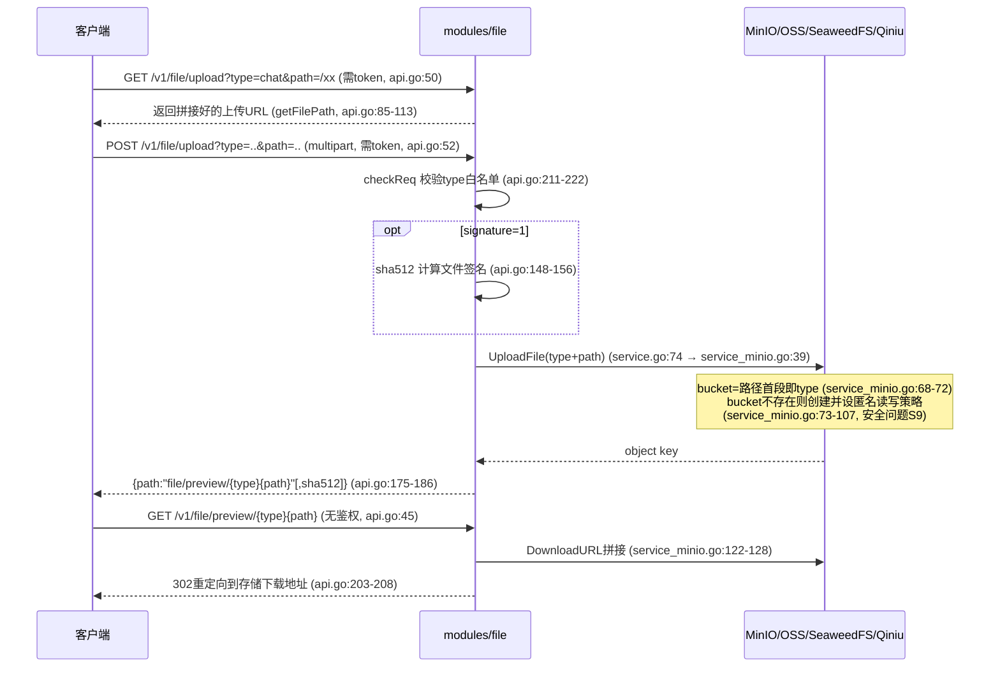
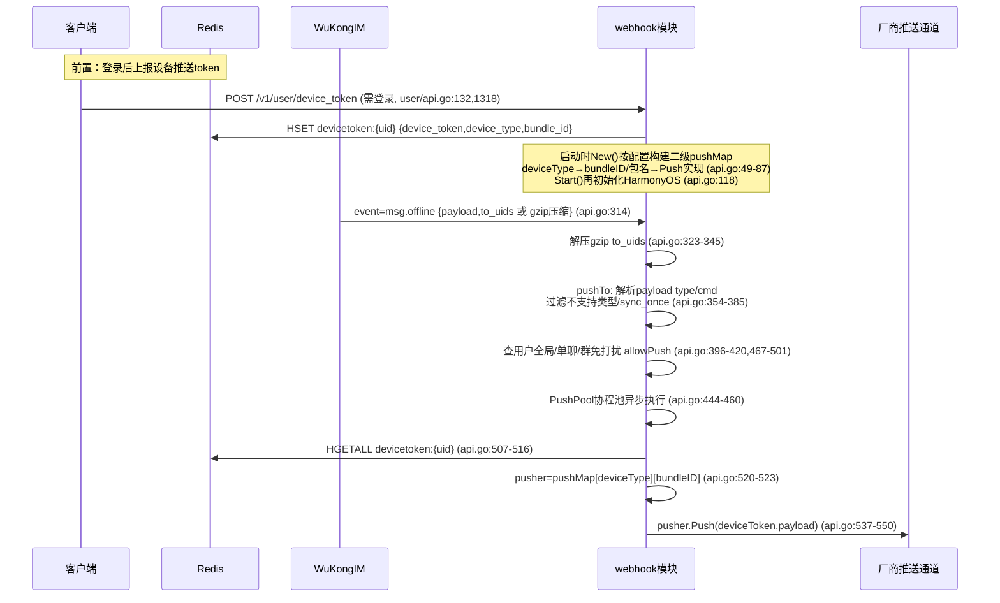

# TangSengDaoDaoServer 深度分析报告

> 分析对象：`/data/code/tsdd-analysis/TangSengDaoDaoServer`（唐僧叨叨服务端）
> 分析方式：纯静态代码审查（未做任何动态利用与验证性请求）
> 代码规模：209 个 Go 文件，约 45,189 行（`find . -name "*.go" | xargs cat | wc -l`），22 个 `*_test.go`
> 框架依赖：兄弟仓库 `TangSengDaoDaoServerLib`（`/data/code/tsdd-analysis/TangSengDaoDaoServerLib`），本文对该仓库内文件的引用以 `Lib/` 前缀标注（如 `Lib/config/config.go:335`）
> 所有 file:line 引用均经 Read/grep 实际核对；不确定处标注"待验证"

---

## 目录

1. [仓库概述](#1-仓库概述)
2. [技术栈与依赖](#2-技术栈与依赖)
3. [目录结构与模块架构](#3-目录结构与模块架构)
4. [核心流程走读](#4-核心流程走读)
5. [对外接口（REST 路由总表）](#5-对外接口rest-路由总表)
6. [部署与运维](#6-部署与运维)
7. [安全审计](#7-安全审计)
8. [代码质量评估](#8-代码质量评估)
9. [风险与改进建议](#9-风险与改进建议汇总)

---

## 1. 仓库概述

TangSengDaoDaoServer 是开源即时通讯系统"唐僧叨叨（TangSengDaoDao）"的**业务后端服务**，Go 1.20 编写（go.mod:3），对外提供 REST API（gin 封装为自研 wkhttp），对内承载几乎全部业务逻辑：用户/好友/群组/消息业务化/文件/机器人/工作台/举报/统计/OpenAPI/离线推送等。

在整个 TangSengDaoDao 生态中的分工：

| 组件 | 职责 |
|---|---|
| **WuKongIM**（独立服务） | 长连接接入（TCP 5100 / WebSocket 5200）、消息收发与投递、消息存储与同步、在线状态；暴露管理 API（5001）与 monitor（5300） |
| **TangSengDaoDaoServer**（本仓库） | 业务逻辑与 REST API：注册/登录/token 签发、好友关系、群组管理、消息业务化处理（撤回/已读/置顶/提醒/违禁词/最近会话）、文件上传下载、离线推送（APNs/FCM/华为 HMS/小米/OPPO/vivo/HarmonyOS）、机器人、管理后台 |
| TangSengDaoDaoWeb / 各端客户端 | 前端展现 |

两者通过三条通道交互（证据：`docker/tsdd/configs/wk.yaml`、`Lib/config/msg.go`、`modules/webhook/api.go`）：

1. **本服务 → WuKongIM**：HTTP 管理 API（默认 `http://127.0.0.1:5001`，Lib config/config.go:397）。典型调用：发消息 `SendMessage`（Lib/config/msg.go:130）、更新 IM 登录 token `UpdateIMToken`（Lib/config/msg.go:70）、消息搜索转发（modules/message/api.go:725）、流式消息 `IMStreamStart/IMStreamEnd`（modules/robot/api.go 引用）。
2. **WuKongIM → 本服务（webhook 事件回调）**：HTTP `POST /v1/webhook?event=xxx` 或 gRPC `SendWebhook`（默认监听 `0.0.0.0:6979`，modules/webhook/api.go:117-137）。事件包括 `msg.offline`（离线消息，触发推送）、`user.onlinestatus`（在线状态）、`user.message.notify`（消息落库通知）等。`docker/tsdd/configs/wk.yaml` 中 `webhook.grpcAddr: tangsengdaodaoserver:6979` 即此通道，并注明 gRPC 优先于 HTTP。
3. **共享存储**：MySQL（业务表由本服务独占管理）、Redis（登录 token、设备推送 token、各类授权码缓存）。

部署形态：单二进制（入口 main.go，`svc.Run(s)`，main.go:112，基于 judwhite/go-svc 支持 Windows 服务），与 WuKongIM、MySQL、Redis、MinIO 等以 docker-compose 组合部署（见第 6 节）。`main()` 仅识别 `api` 子命令（main.go:63-71），`serverType` 解析后仅 `api/空/config` 会启动服务，体现其单进程多职能（API + gRPC + 定时任务）的设计。

---

## 2. 技术栈与依赖

### 2.1 关键依赖清单（go.mod）

| 依赖 | 版本 | 用途 | 风险评估 |
|---|---|---|---|
| gin-gonic/gin | v1.9.1 | HTTP 框架（被 wkhttp 二次封装） | 偏旧（2023-05），建议升级 1.10+ |
| TangSengDaoDaoServerLib | v1.0.9-0.20260911080924-29367002982f | 自研框架库：config/module/server/wkhttp/IM 客户端/注册器 | 私有伪版本号，供应链审计困难 |
| gocraft/dbr/v2 | v2.7.5 | MySQL SQL builder（全部业务 SQL） | 低维护频率，稳定 |
| go-sql-driver/mysql | v1.7.1 | MySQL 驱动 | 可升级 |
| go-redis/redis | v6.15.9+incompatible | Redis 客户端 | **严重过时**（v6 为 2019 年代码线，主流 v8/v9），`+incompatible` 说明未启用语义化版本 |
| rubenv/sql-migrate | v1.5.2 | 启动期 SQL 迁移执行器 | OK |
| olivere/elastic | v6.2.37+incompatible | Elasticsearch 6 客户端 | **上游已停止维护**；且本仓内基本未被使用（见 3.2 base 模块），建议连代码一起移除 |
| minio/minio-go/v7 | v7.0.61 | MinIO/S3 文件存储 | OK |
| aliyun/aliyun-oss-go-sdk | v2.2.7+incompatible | 阿里云 OSS | `+incompatible` |
| qiniu/go-sdk/v7 | v7.19.0 | 七牛云存储 | OK |
| sideshow/apns2 | v0.23.0 | 苹果 APNs 推送 | OK |
| firebase.google.com/go/v4 | v4.13.0 | FCM 推送 | OK |
| golang-jwt/jwt/v4 | v4.5.0 | JWT | 仅用于 HarmonyOS 推送华为侧鉴权（modules/webhook/push_harmonyos.go:20,110）；**业务登录 token 未使用 JWT** |
| ethereum/go-ethereum | v1.12.2 | web3 签名验证（secp256k1/Keccak256，modules/user/api_usernamelogin.go:14） | 仅为验签引入巨大依赖树，供应链面大 |
| gomarkdown/markdown | v0.0.0-20230716120725 | markdown→HTML（pkg/markdown） | 产物未做 HTML 消毒（见 7.6） |
| sourcegraph/syntaxhighlight | v0.0.0-20170531 | 代码高亮（pkg/markdown） | 极旧 |
| spf13/viper | v1.16.0 | 配置加载 | OK |
| go.uber.org/zap | v1.24.0 | 结构化日志 | OK |
| robfig/cron | **v1.2.0** | main.go:19 的定时事件推送 | **2016 年的 v1 版本**；间接依赖中已存在 robfig/cron/v3 v3.0.1 却未切换，典型版本分裂 |
| judwhite/go-svc | v1.2.1 | 服务生命周期（Windows 服务兼容） | OK |
| opentracing-go / uber/jaeger-client-go | v1.2.1-0.2022… / v2.30.0+incompatible | 链路追踪 | jaeger-client-go 已归档，继任者为 OpenTelemetry |
| RichardKnop/machinery/v2 | v2.0.11（间接） | 异步任务框架（Lib asynctask） | 社区活跃度低 |
| gopkg.in/natefinch/lumberjack.v2 | v2.2.1 | 日志切割 | OK |
| golang.org/x/crypto | v0.14.0 | 加密原语 | 可升级（2023-10） |
| golang.org/x/net | v0.17.0（间接） | 网络库 | 可升级 |
| mattn/go-sqlite3 | v1.14.17 | SQLite（testutil 测试用） | 引入 CGO，生产以 CGO_ENABLED=0 编译 |
| disintegration/imaging | v1.6.2 | 图片处理（组合图片，modules/file） | OK |
| google.golang.org/grpc / protobuf | v1.57.0 / v1.31.0 | webhook gRPC 服务 | OK |
| alibabacloud-go/sms-intl、aliyun/alibaba-cloud-sdk-go、apistd/uni-go-sdk | 各版本 | 阿里云/阿里云国际/unisms 短信 | OK |
| sendgrid/rest | v2.6.9+incompatible | HTTP REST 工具（间接） | `+incompatible` |
| tidwall/gjson | v1.15.0 | JSON 快速取值（机器人消息解析） | OK |
| tjfoc/gmsm | v1.3.2（间接） | 国密算法 | 间接引入 |

### 2.2 依赖治理总体判断

- **Go 1.20 已 EOL**（2024-02 停止安全支持），建议升级 1.22+。
- 多个 `+incompatible` 依赖（go-redis v6、olivere/elastic v6、sendgrid/rest v2.6.9、aliyun-oss v2.2.7、jaeger-client-go v2.30.0、go-gorp/gorp v3.1.0）说明长期缺少依赖治理。
- `robfig/cron v1.2.0`（直接依赖）与 `robfig/cron/v3 v3.0.1`（间接依赖）并存。
- go-ethereum 整棵树仅为 web3 验签，可考虑替换为轻量 secp256k1/keccak 库。

---

## 3. 目录结构与模块架构

### 3.1 目录树（2 层）

```
TangSengDaoDaoServer/
├── main.go                  # 入口：加载配置、装中间件、module.Setup、cron、svc.Run
├── internal/
│   └── modules.go           # 匿名 import 全部业务模块（触发 init 注册）
├── modules/                 # 16 个业务模块（详见 3.2）
│   ├── base/                # 基础设施：app(机器人应用)、event(分布式事件)、elastic、common(短信)
│   ├── channel/             # 频道信息/消息定时删除/清空
│   ├── common/              # 通用：版本管理、国家区号、app配置、聊天背景、短号
│   ├── file/                # 文件上传下载（minio/oss/seaweedfs/qiniu 四后端）
│   ├── group/               # 群组（含管理端、邀请、设置动作流水线）
│   ├── message/             # 消息业务（撤回/已读/置顶/提醒/reaction/最近会话/违禁词）
│   ├── openapi/             # 第三方授权 access_token（类 OAuth2 授权码流）
│   ├── qrcode/              # 二维码信息解析
│   ├── report/              # 举报
│   ├── robot/               # 机器人（事件拉取/发消息/inline query/流式消息）
│   ├── search/              # 全局搜索
│   ├── source/              # 数据 provider 接口定义（无路由）
│   ├── statistics/          # 运营统计
│   ├── user/                # 用户/好友/设备/第三方登录/管理后台（最大模块）
│   ├── webhook/             # WuKongIM 回调 + 全部离线推送通道
│   └── workplace/           # 工作台（应用/分类/banner，含管理端）
├── pkg/                     # 本地工具包（部分与 Lib 重复，见 8.2）
│   ├── cache/  db/  redis/  log/  pool/  wait/  keylock/  wkevent/
│   ├── markdown/            # markdown→HTML（gomarkdown 封装）
│   ├── network/             # HTTP POST 工具（短信/IM 调用）
│   ├── register/            # 旧版路由注册器（已无人 import，死代码）
│   ├── util/                # IP 查询/反射/decimal 等
│   ├── wkhook/              # webhook gRPC 的 pb 定义
│   ├── wkhttp/              # 本地版 wkhttp（与 Lib 版几乎重复）
│   └── wkrsa/               # RSA 签名工具（仅测试引用，业务未使用）
├── configs/
│   ├── tsdd.yaml            # 主配置（默认几乎全注释，仅 mode 与 smsCode 生效）
│   └── push/push_dev.p12    # APNs 开发证书（入库，见安全节 S7）
├── assets/                  # 静态资源（/web 页面、默认头像等）
├── testenv/docker-compose.yaml   # 开发依赖环境（redis/mysql/wukongim/minio）
├── docker/tsdd/             # 生产 compose（含 web、模板化配置 tsdd.yaml/wk.yaml）
├── Dockerfile  Dockerfile.ghcr  Makefile
├── .github/workflows/       # ghcr.yml（多架构镜像构建）、ghcr-cleanup.yml
└── docs/                    # 截图与下载页
```

### 3.2 十六个模块职责（按代码量排序）

| 模块 | 行数 | 职责 |
|---|---|---|
| user | 11,743 | 注册/登录（手机号验证码、用户名密码、web3 签名、扫码、GitHub/Gitee OAuth）、好友申请/备注/同步、黑名单、登录设备管理、在线状态、客服、账号注销、管理端（管理员/封禁/重置密码）。内含 user/friend/user_manager 三个注册单元（modules/user/1module.go） |
| message | 7,328 | 消息业务层：写模式同步（sync/syncack，标注将弃用）、撤回、删除/双向删除、已读与回执、表情回应（reaction）、编辑、语音已读、置顶、提醒（reminders）、敏感词/违禁词、最近会话（conversation）、管理端（代发/群发/聊天记录） |
| group | 7,170 | 群创建/成员增删同步/管理员/全员与单人禁言/黑名单/邀请确认/二维码/扫码入群/转让/解散/头像、群设置动作流水线（api_setting_action.go）、管理端 |
| webhook | 2,719 | 接收 WuKongIM 事件（HTTP + gRPC 双通道）、消息业务落库、在线状态分发、离线推送：APNs（push_iosapns.go）、FCM（push_firebase.go）、HMS（push_hms.go）、小米（push_mi.go）、OPPO（push_oppo.go）、vivo（push_vivo.go）、HarmonyOS（push_harmonyos.go） |
| workplace | 2,721 | 工作台应用/分类/banner 的 C 端与管理端 |
| common | 1,616 | App 版本管理与升级检查（tauri 兼容）、国家区号、App 配置（开屏/欢迎语/注册邀请/搜索开关）、聊天背景、短号生成 |
| robot | 1,511 | 机器人体系：事件长轮询拉取（getEvents）、事件确认、发消息、typing、流式消息、inline query；通过 `AddMessagesListener` 监听消息总线（robot/event.go:40）按单聊/robot_id/@提及 三路识别目标机器人 |
| base | 1,272 | 机器人 app 公开信息查询（base/app/api.go:21-23）、分布式事件框架（base/event：Begin/Commit/定时重推 EventTimerPush，api.go:82-148；handler.go 注册群事件处理器）、短信服务（aliyun/unisms/smsbao，base/common/service_*.go）、elastic 服务（**仅包内自引用，消息搜索实际转发 WuKongIM，疑为遗留死代码**） |
| file | 1,180 | 文件上传/预览/组合图片（路由已注释），MinIO/OSS/SeaweedFS/七牛四后端策略选择（service.go:44-58） |
| report | 598 | 用户举报、举报分类与静态举报页、管理端举报列表 |
| search | 436 | 全局搜索（聚合用户/群/消息） |
| qrcode | 290 | 扫码解析 `v1/qrcode/:code`（qrcode/api.go:56-58） |
| source | 327 | 纯接口定义（vercode 维度的数据 provider），无路由无注册，被 group/user 引用 |
| statistics | 228 | 注册量/建群量/总量统计（处理器内要求管理员角色，statistics/api.go:44） |
| openapi | 200 | authcode→access_token→userinfo 的第三方授权流 |

注：`register.AddModule` 全仓调用 23 次（`grep -rn "register.AddModule" modules/*/1module.go | wc -l`）——user 注册 3 个单元、group/message/workplace/report 各注册 C 端 + 管理端两个单元。

### 3.3 分层架构图

```mermaid
graph TD
    subgraph 入口层
        A["main.go<br/>flag -config 加载 tsdd.yaml<br/>环境变量 TS_* 覆盖"] --> B["internal/modules.go<br/>匿名 import 16 个模块触发 init()"]
        A --> C["Lib/server.New<br/>gin引擎 + CORS + gin.Recovery<br/>/web静态 + /v1/ping + /swagger/:module"]
        A --> D["Lib/module.Setup(ctx)<br/>SQL迁移 + 路由注册 + 任务注册"]
        A --> E["robfig/cron v1<br/>每59秒 EventTimerPush 重推事件"]
    end
    subgraph 业务模块层
        M1["user / group / message<br/>(业务核心 58% 代码)"]
        M2["webhook / robot<br/>(IM 回调与推送)"]
        M3["file / common / channel /<br/>openapi / qrcode / report /<br/>search / statistics / workplace / base"]
    end
    subgraph 框架层 TangSengDaoDaoServerLib
        F["config.Context<br/>DB/Redis/Cache/EventPool/PushPool/<br/>RobotEventPool/Tracer/TimingWheel/雪花ID"]
        G["pkg/wkhttp<br/>AuthMiddleware / Context / CORS"]
        H["pkg/register + module<br/>模块注册与装配"]
    end
    subgraph 存储与外部服务
        I[("MySQL<br/>dbr + sql-migrate")]
        J[("Redis<br/>token/device/授权码/异步任务")]
        K["MinIO / AliyunOSS /<br/>SeaweedFS / Qiniu"]
        L["WuKongIM<br/>管理API :5001 / 长连接 :5100 :5200"]
        M["APNs / FCM / HMS /<br/>MiPush / OPPO / VIVO / HarmonyOS"]
        N["短信: 阿里云/阿里云国际/unisms/smsbao"]
    end
    D --> M1
    D --> M2
    D --> M3
    M1 --> F
    M2 --> F
    M3 --> F
    F --> I
    F --> J
    M3 --> K
    M1 --> L
    M2 --> M
    M3 --> N
    L -. "webhook事件回调<br/>HTTP /v1/webhook 或 gRPC :6979" .-> M2
```



### 3.4 模块注册机制详解

注册链路为 **匿名导入 → init() 内 register.AddModule → main 中 module.Setup 统一装配** 三段式。

**第 1 步：匿名导入触发 init。**
main.go:11 `_ ".../internal"` → internal/modules.go:5-19 匿名导入 16 个模块包。每个模块的 `1module.go` 在 `init()` 中调用 Lib 的 `register.AddModule(func(ctx interface{}) register.Module {...})`（Lib/pkg/register/register.go:125 收集工厂函数）。以 webhook 为例（modules/webhook/1module.go:15-29）：

- `SetupAPI`：返回实现 `Route(r *wkhttp.WKHttp)` 的 API 对象；
- `SQLDir`：`//go:embed sql` 内嵌迁移目录（`register.NewSQLFS(sqlFS)`）；
- `Start/Stop`：生命周期钩子（webhook 借此启动/停止 gRPC 服务）。

user 模块的 1module.go 还演示了另两类挂载：`Swagger`（`//go:embed swagger/api.yaml`，供 /swagger/:module 输出）与 `IMDatasource/BussDataSource`（供 WuKongIM 数据源回调及其他模块跨模块取数，如好友白名单、频道信息、设备信息、邀请码）。

**第 2 步：module.Setup 统一装配**（main.go:93 → Lib/module/module.go:16-51）：

1. **SQL 迁移**：收集所有模块 `SQLDir`，`executeSQL`（module.go:84-93）调用 `migrate.Exec(session.DB, "mysql", migrations, migrate.Up)`（module.go:88），即**启动时自动执行 rubenv/sql-migrate 迁移**。迁移文件来自各模块内嵌 FS 的 `sql/*.sql`（全仓 69 个），`FileDirMigrationSource.FindMigrations`（module.go:107-151）递归收集并按文件名排序，sql-migrate 以 `gorp_migrations` 表保证幂等。
2. **路由注册**：逐模块 `m.SetupAPI().Route(ctx.GetHttpRoute())`（module.go:34-40），所有模块共享同一个 gin Engine。
3. **任务注册**：`ctx.SetupTask` 为真时调用 `m.SetupTask().RegisterTasks()`（module.go:41-48）。

**第 3 步：HTTP 服务装配与启动。**

- `server.New(ctx)`（Lib/server/server.go:29-40）：创建 wkhttp（内部 `gin.New()` + `gin.Recovery()`，Lib wkhttp/http.go:94-104），挂 CORS 中间件（server.go:31）。
- main.go:82-91：在模块路由注册**之前**挂 OpenTracing 中间件与"条件化 gin.Logger"（跳过 `ingorePaths()` 中的 `/v1/robots/:robot_id/:app_key/events` 与 `/v1/ping`，main.go:176-182——即机器人长轮询与心跳不打访问日志）。
- `server.run`（server.go:51-96）：挂 `/web` 静态目录（server.go:54）、`/v1/ping`（server.go:55-57）、`/swagger/:module` 按模块名输出内嵌 swagger 文本（server.go:59-68）；可选 TLS（server.go:88-91，证书路径固定 `assets/ssl/ssl.pem|ssl.key`，配 `unrolled/secure` 强制跳转）。
- `server.Start`（server.go:98-112）：goroutine 启动 HTTP 后调用 `module.Start(ctx)` 执行各模块 Start 钩子（webhook 在此监听 gRPC，api.go:117-139）。
- main.go:98-106：`robfig/cron` 每 59 秒执行 `EventTimerPush()`（modules/base/event/api.go:137-148），扫描事件表待发布记录并分发——这是群创建/更新等事件的**异步可靠投递**机制（事件先落库再定时重推，handler.go:18 注册处理器）。

**关于本地 pkg/register**：`pkg/register/register.go:1-37` 定义了 APIRouter/TaskRouter 注册器，但全仓无任何 import（grep 验证），实际生效的是 Lib 版 register——本地文件属**死代码**。

---

## 4. 核心流程走读

### 4.a 用户登录/注册与 token 签发校验全流程



**登录路径细分：**

| 登录方式 | 入口（路由注册于 api.go:171-198） | 处理器 | 关键校验 |
|---|---|---|---|
| 手机号+密码 | POST /v1/user/login | api.go:952-990 | 用户名即 `区号+手机号`；MD5(MD5(pwd)) 比对（api.go:985） |
| 用户名+密码 | POST /v1/user/usernamelogin | api_usernamelogin.go:58-111 | 用户名 8-22 位；同样 MD5(MD5)（:91）；返回是否需补传 web3 公钥（:101-108） |
| web3 签名（找回密码/二次验证） | GET /user/web3verifytext；POST /user/web3verifysign；POST /user/pwdforget_web3 | api_usernamelogin.go:390-430 / 317-387 / 169-247 | 服务端生成 `随机20字符+yyyyMMddHHmmss` 存 Redis 5 分钟（:415-420）；以太坊前缀消息 Keccak256 + secp256k1 `crypto.VerifySignature`（:267-270）；公钥每账号仅可上传一次（:300-303） |
| 扫码登录 | GET /user/loginuuid → GET /user/loginstatus；APP 端 GET /user/grant_login（需登录）；POST /user/login_authcode/:auth_code | api.go:1393/1428/1643/1473 | uuid 与授权码存 Redis 短时效；APP 确认后 PC 轮询拿 token |
| 第三方 OAuth | GET /user/github、/user/oauth/github、/user/gitee、/user/oauth/gitee、/user/thirdlogin/authcode、/user/thirdlogin/authstatus | api_github.go / api_gitee.go | state 即服务端签发的 authcode（api_github.go:26,37），回调时校验 |
| 短信验证码相关 | POST /user/sms/registercode、/user/sms/forgetpwd、/user/pwdforget、/user/sms/login_check_phone、/user/login/check_phone、/user/sms/destroy | api.go:1907/2452/2395/2062/2110/2230 | 若配置 `smsCode` 非空则直接与之比对（api.go:1248-1252），否则走短信服务商 Verify |

**token 模型（签发/校验/过期）：**

- **签发**：`util.GenerUUID()` 不透明 UUID（api.go:1072）。两份 Redis 记录：`token:{token}` → JSON `{uid,name,role,ver}`（`EncodeTokenCacheInfo`，Lib wkhttp/http.go:39-50，api.go:1098）；`uidtoken:{flag}{uid}` → token（api.go:1104），后者用于"同人同端互踢"。
- **校验**：所有受保护路由组挂 `ctx.AuthMiddleware(r)`（Lib config/context.go:123-126 → Lib pkg/wkhttp/http.go:301-337）：取 Header `token` → `cache.Get("token:"+token)` → `ParseTokenCacheInfo`（http.go:53-76，兼容旧格式 `uid@name`，多段则拒绝"旧版token已失效"）→ `c.Set("uid"/"name"/"role")`。
- **角色**：`role` 仅管理端账号携带；`CheckLoginRole`/`CheckLoginRoleIsSuperAdmin`（http.go:203-224）在管理端处理器内逐个调用（全仓 62 处）。
- **过期**：默认 30 天（Lib config/config.go:360，`cache.tokenExpire`）。无 refresh token、无滑动续期；改名时会重写 token 缓存里的 name（api.go:636-644）。
- **IM 侧同步**：登录成功即调 `UpdateIMToken` 把同一 token 注册到 WuKongIM（api.go:1114-1127），IM 侧用它做长连接鉴权；返回 ban 则拒绝登录（api.go:1129-1131）。
- **退出**：`quit`（api.go:211）删除本端 token；`pcQuit` 踢 PC 端。
- **管理端登录**：POST /v1/manager/login（api_manager.go:144-194），额外要求 `role ∈ {admin, superAdmin}`（:168）；超管账号在配置了 `adminPwd` 且 admin 用户不存在时自动创建，用户名固定 `superAdmin`（api_manager.go:1062-1090）。

**注册流程**（POST /v1/user/register，api.go:1181-1275）：

1. `Register.Off` 总开关（api.go:1193）；2. App 配置 `RegisterInviteOn=1` 时强制邀请码，并通过 `BussDataSource.GetInviteCode` 跨模块查询（api.go:1206-1232）；3. 手机号查重（username=`zone+phone`，api.go:1240）；4. 验证码：`SMSCode` 非空走"万能码"比对，否则短信服务商核验（api.go:1247-1259，安全问题 S6）；5. `createUser`（api.go:2504）开事务建用户、加系统好友/文件助手（api.go:2305/2331）、发欢迎语、并直接完成登录签发。用户名注册（api_usernamelogin.go:21-55）受 `register.usernameOn` 控制，**无验证码**。

### 4.b 消息收发链路：客户端 → WuKongIM → webhook → 本服务

**发送侧两条路：**

1. **日常聊天消息不经过本服务**：客户端直连 WuKongIM（TCP/WS），WuKongIM 落库并投递；本服务通过 webhook 异步感知。
2. **业务代发**：系统消息/机器人消息/管理端群发/欢迎语等由本服务 `ctx.SendMessage(MsgSendReq)`（Lib config/msg.go:130）→ HTTP POST `{WuKongIM.APIURL}/message/send`。另有 `SendMessageBatch`（msg.go:108）、CMD 消息 `SendCMD`、流式消息 `IMStreamStart/End`。

**回调侧（核心）：**



关键点：

- **回调入口**：HTTP `POST /v1/webhook`、`POST /v2/webhook`（api.go:105-107，event 在 query）、`POST /v1/webhook/message/notify`（api.go:111，批量 JSON 直推）；gRPC `WebhookService/SendWebhook`（api.go:146-156，pb 定义于 pkg/wkhook/webhook.proto）。**均无鉴权（安全问题 S1/S2）**。
- **消息业务落库**：`handleMessageNotify`（api.go:174-221）在事务内逐条 `insertOrUpdateTx`（`ON DUPLICATE KEY UPDATE payload=payload`，webhook/db_message.go:27）；跳过 `sync_once/no_persist` 消息（api.go:192-194）；单聊频道用 `GetFakeChannelIDWith(from,to)` 归一化为 fakeChannelID（api.go:196-198），保证双向消息同表同行；表名按 `crc32(channelID) % TablePartitionConfig.MessageTableCount` 分表（modules/message/db.go:46-52）。
- **事件分发**：落库成功后 `NotifyMessagesListeners`（api.go:218，Lib config/context.go:226-230）广播给全部消息监听者；robot 模块在构造时注册（modules/robot/api.go:55 `ctx.AddMessagesListener(rb.robotMessageListen)`），robotMessageListen 按"单聊对端是机器人 / payload.robot_id / @提及"三种方式识别目标机器人并异步 `saveRobotMessage`（robot/event.go:40-108）。
- **在线状态**：`event=user.onlinestatus` → `handleOnlineStatus`（api.go:263-312）解析 `uid-deviceFlag-status[-socketID-onlineCount-totalOnlineCount]` 格式字符串，分发给 `AddOnlineStatusListener` 注册的监听者（Lib config/context.go:182-190），user 模块据此维护在线列表服务。
- **写模式同步**：`/v1/message/sync`、`/v1/message/syncack/:last_message_seq`（modules/message/api.go 路由，代码注释"写模式才用到，未来将弃用"）为客户端直读业务库的旧路径。
- **消息搜索**：`/v1/message/search` 直接把请求体转发 `{WuKongIM.APIURL}/message/search`（modules/message/api.go:709-739），全文检索由 WuKongIM 承担；本仓 modules/base/elastic 未接入。
- **撤回/已读/置顶等业务操作**：均先写业务库，再通过 `SendCMD`/`SendMessage` 经 WuKongIM 广播 CMD 消息通知各端（典型如 api.go:658-665 的资料变更 CMD）。

### 4.c 文件上传/下载链路



关键点：

- **后端抽象**：`IUploadService`（UploadFile/DownloadURL，service.go:30-36）；`NewService` 按 `fileService` 配置四选一（service.go:44-58）：minio（service_minio.go）/ aliyunOSS（service_oss.go）/ qiniu（service_qiniu.go）/ seaweedFS（service_seaweedfs.go），默认 minio。
- **鉴权设计**：上传两个接口挂 token（api.go:47-53）；预览 `GET /v1/file/preview/*path` **无鉴权**（api.go:45），安全性依赖对象 key 不可猜测（聊天文件含 UUID，头像等路径可预测）。
- **路径与类型校验**：`checkReq`（api.go:211-222）仅校验 type ∈ {chat, moment, moment_cover, sticker, report, chat_bg, common, download} 且 path 非空；**path 完全由客户端控制、不过滤 `..`、不绑定 loginUID**（api.go:117,136-139,159），登录用户可覆盖同 bucket 任意对象（安全问题 S10）。少数类型由服务端拼路径：moment_cover（:95-97）、sticker（:98-100）绑定 loginUID 或 UUID。
- **MinIO 实现细节**：每次上传新建 client（service_minio.go:60-67）；bucket 取路径首段（:68-72）；文件**整体读入内存**（:40-41）；bucket 不存在则创建并设置 `Principal:*` 的读写删策略（:73-107，S9）；下载 URL 通过 `response-content-disposition` 指定文件名并 302（:122-128）。
- **头像**走 user 模块独立接口 `POST /v1/users/:uid/avatar`（需登录，api.go:126，处理器 api.go:417）。
- 组合图片 `DownloadAndMakeCompose`（service.go:91+）存在但对应路由已注释（api.go:41-43），不可达。

### 4.d 离线推送链路



关键点：

- **device token 来源**：客户端登录后调 `POST /v1/user/device_token`（api.go:1318 registerUserDeviceToken）上报 APNs deviceToken / FCM registration token / 各厂商 token 与 device_type、bundle_id，写 Redis hash（webhook 侧读取键为 `common.UserDeviceTokenPrefix+uid`，api.go:507）；卸载走 `DELETE /v1/user/device_token`（api.go:133,1380）；角标数 `POST /v1/user/device_badge`（api.go:134,1352）。
- **通道选择**：`pushMap[common.DeviceType][bundleID]`（api.go:520-523）。初始化规则（api.go:49-87）：APNs 需 topic+cert 非空；mi/hms/oppo/vivo/firebase 各需 packageName 非空；HarmonyOS 在 `Start()` 中配置（api.go:118，需 bundleID + 服务账号 JSON）。设备类型常量来自 Lib common（DeviceTypeIOS/MI/HMS/OPPO/VIVO/Firebase）。
- **各通道实现**：
  - APNs：p12 证书 + 密码 `certificate.FromP12File`（push_iosapns.go:46-58），`dev` 配置决定 Development/Production 环境；
  - FCM：serviceAccount JSON + projectID（push_firebase.go）；
  - HMS：appID/appSecret 换 token 后推送（push_hms.go）；
  - HarmonyOS：服务账号私钥签 PS256 JWT（push_harmonyos.go:81,110），POST `push-api.cloud.huawei.com/v3/{projectID}/messages:send`（:157）；
  - 小米/OPPO/vivo：各自厂商 HTTP API（push_mi/push_oppo/push_vivo.go）。
- **免打扰与过滤**：仅解析未加密（Signal=0）消息的 payload（api.go:357）；`sync_once` 命令类消息不推（音视频呼叫除外，api.go:367-380）；支持推送的内容类型白名单 `getSupportTypes`（api.go:99-101：文本/图片/GIF/语音/视频/文件/位置/名片/合并转发/矢量表情/emoji）；rtc 呼叫（cmd=room.invoke/rtc.p2p.invoke）跳过免打扰强推（api.go:397,428）。
- **推送文案**：`push.contentDetailOn` 控制是否显示消息详情（Lib config/config.go:511）。
- **并发模型**：`ctx.PushPool`（大小 `push.pushPoolSize`，默认 100，Lib config/context.go:56）协程池异步执行，单个用户推送失败仅 Debug 日志（api.go:453-458）。

---

## 5. 对外接口（REST 路由总表）

标注说明：
- 🔓 = 无鉴权（未挂 AuthMiddleware）
- 🔑 = 需登录 token（路由组挂 `ctx.AuthMiddleware`）
- 👑 = 🔑 + 处理器内 `CheckLoginRole*` 管理员校验（注意：该校验依赖每个处理器自觉调用，见安全节 S4）
- 🤖 = 机器人 appKey 鉴权（URL 路径携带，robot/api.go:117-161）
- 行内 token = 无中间件但在 body/query 内手动校验 token

### 5.1 user 模块（modules/user/api.go:118-209）

| 方法 | 路径 | 鉴权 | 用途 |
|---|---|---|---|
| GET | /v1/users/:uid | 🔑 | 根据 uid 查询用户信息 |
| POST | /v1/users/:uid/avatar | 🔑 | 上传用户头像 |
| PUT | /v1/users/:uid/setting | 🔑 | 更新用户设置 |
| POST | /v1/user/device_token | 🔑 | 注册设备推送 token |
| DELETE | /v1/user/device_token | 🔑 | 卸载设备推送 token |
| POST | /v1/user/device_badge | 🔑 | 上传设备角标数 |
| GET | /v1/user/grant_login | 🔑 | 授权扫码登录 |
| PUT | /v1/user/current | 🔑 | 修改用户资料（字段白名单 api.go:2494-2503） |
| GET | /v1/user/qrcode | 🔑 | 我的二维码 |
| PUT | /v1/user/my/setting | 🔑 | 更新我的设置 |
| POST | /v1/user/blacklist/:uid | 🔑 | 添加黑名单 |
| DELETE | /v1/user/blacklist/:uid | 🔑 | 移除黑名单 |
| GET | /v1/user/blacklists | 🔑 | 黑名单列表 |
| POST | /v1/user/chatpwd | 🔑 | 设置聊天密码 |
| POST | /v1/user/lockscreenpwd | 🔑 | 设置锁屏密码 |
| PUT | /v1/user/lock_after_minute | 🔑 | 设置锁屏时间 |
| DELETE | /v1/user/lockscreenpwd | 🔑 | 关闭锁屏密码 |
| GET | /v1/user/customerservices | 🔑 | 客服列表 |
| DELETE | /v1/user/destroy/:code | 🔑 | 注销账号 |
| POST | /v1/user/sms/destroy | 🔑 | 注销短信验证码 |
| PUT | /v1/user/updatepassword | 🔑 | 修改登录密码 |
| POST | /v1/user/web3publickey | 🔑 | 上传 web3 公钥（仅一次） |
| POST | /v1/user/quit | 🔑 | 退出登录 |
| GET | /v1/user/devices | 🔑 | 登录设备列表 |
| DELETE | /v1/user/devices/:device_id | 🔑 | 删除登录设备 |
| GET | /v1/user/devices/:device_id | 🔑 | 查询某登录设备 |
| GET | /v1/user/online | 🔑 | 我的设备与好友在线列表 |
| POST | /v1/user/online | 🔑 | 指定 uid 在线状态 |
| POST | /v1/user/pc/quit | 🔑 | 退出 PC 登录 |
| POST | /v1/user/maillist | 🔑 | 上传手机通讯录 |
| GET | /v1/user/maillist | 🔑 | 通讯录列表 |
| GET | /v1/user/reddot/:category | 🔑 | 获取红点 |
| DELETE | /v1/user/reddot/:category | 🔑 | 清除红点 |
| POST | /v1/user/register | 🔓 | 手机号注册 |
| POST | /v1/user/login | 🔓 | 手机号密码登录 |
| POST | /v1/user/usernamelogin | 🔓 | 用户名登录 |
| POST | /v1/user/usernameregister | 🔓 | 用户名注册（无验证码） |
| POST | /v1/user/pwdforget_web3 | 🔓 | web3 签名重置密码 |
| GET | /v1/user/web3verifytext | 🔓 | 获取 web3 验证字符串 |
| POST | /v1/user/web3verifysign | 🔓 | web3 验签 |
| POST | /v1/user/sms/forgetpwd | 🔓 | 忘记密码短信码 |
| POST | /v1/user/pwdforget | 🔓 | 重置登录密码 |
| GET | /v1/user/search | 🔓 | **按手机号/短号搜用户（S3）** |
| GET | /v1/users/:uid/avatar | 🔓 | 用户头像（公开） |
| GET | /v1/users/:uid/im | 🔓 | 用户所在 IM 节点信息 |
| GET | /v1/user/loginuuid | 🔓 | 获取扫码登录 uuid |
| GET | /v1/user/loginstatus | 🔓 | 轮询扫码状态 |
| POST | /v1/user/sms/registercode | 🔓 | 注册短信验证码 |
| POST | /v1/user/login_authcode/:auth_code | 🔓 | 认证码登录 |
| POST | /v1/user/sms/login_check_phone | 🔓 | 设备验证短信码 |
| POST | /v1/user/login/check_phone | 🔓 | 登录设备手机号验证 |
| GET | /v1/user/thirdlogin/authcode | 🔓 | 第三方授权码获取 |
| GET | /v1/user/thirdlogin/authstatus | 🔓 | 第三方授权状态 |
| GET | /v1/user/github | 🔓 | GitHub 认证页 |
| GET | /v1/user/oauth/github | 🔓 | GitHub 登录回调 |
| GET | /v1/user/gitee（及 /user/oauth/gitee） | 🔓 | Gitee 认证与回调（api.go:198+，细节待验证） |

### 5.2 user/friend 子模块（modules/user/api_friend.go:52+）

| 方法 | 路径 | 鉴权 | 用途 |
|---|---|---|---|
| POST | /v1/friend/apply | 🔑 | 好友申请 |
| GET | /v1/friend/apply | 🔑 | 好友申请列表 |
| DELETE | /v1/friend/apply/:to_uid | 🔑 | 删除好友申请 |
| PUT | /v1/friend/refuse/:to_uid | 🔑 | 拒绝申请 |
| POST | /v1/friend/sure | 🔑 | 好友确认 |
| GET | /v1/friend/sync | 🔑 | 同步好友 |
| GET | /v1/friend/search | 🔑 | 查询好友 |
| PUT | /v1/friend/remark | 🔑 | 好友备注 |
| DELETE | /v1/friends/:uid | 🔑 | 删除好友 |

### 5.3 user/user_manager 子模块（modules/user/api_manager.go:54-73）

| 方法 | 路径 | 鉴权 | 用途 |
|---|---|---|---|
| POST | /v1/manager/login | 🔓 | 管理端账号登录 |
| POST | /v1/manager/user/admin | 👑 | 添加管理员 |
| GET | /v1/manager/user/admin | 👑 | 管理员列表 |
| DELETE | /v1/manager/user/admin | 👑 | 删除管理员 |
| POST | /v1/manager/user/add | 👑 | 添加用户 |
| POST | /v1/manager/user/resetpassword | 👑 | 重置用户密码 |
| GET | /v1/manager/user/list | 👑 | 用户列表 |
| GET | /v1/manager/user/friends | 👑 | 某用户好友 |
| GET | /v1/manager/user/blacklist | 👑 | 用户黑名单列表 |
| GET | /v1/manager/user/disablelist | 👑 | 封禁用户列表 |
| GET | /v1/manager/user/online | 👑 | 在线设备信息 |
| PUT | /v1/manager/user/liftban/:uid/:status | 👑 | 封禁/解禁用户 |
| POST | /v1/manager/user/updatepassword | 👑 | 修改用户密码 |
| GET | /v1/manager/user/devices | 👑 | 某用户设备列表 |

### 5.4 message 模块（modules/message/api.go:86-131）

🔑 组（/v1/message）：

| 方法 | 路径 | 用途 |
|---|---|---|
| POST | /v1/message/sync | 同步消息（写模式，将弃用） |
| POST | /v1/message/syncack/:last_message_seq | 同步回执（将弃用） |
| DELETE | /v1/message | 删除消息 |
| DELETE | /v1/message/mutual | 双向删除消息 |
| POST | /v1/message/revoke | 撤回消息 |
| POST | /v1/message/offset | 清除某频道消息 |
| PUT | /v1/message/voicereaded | 语音消息已读 |
| POST | /v1/message/search | 消息搜索（转发 WuKongIM） |
| POST | /v1/message/typing | 发送 typing 消息 |
| POST | /v1/message/channel/sync | 同步频道消息 |
| POST | /v1/message/extra/sync | 同步消息扩展 |
| POST | /v1/message/readed | 消息已读 |
| GET | /v1/message/sync/sensitivewords | 同步敏感词 |
| POST | /v1/message/edit | 消息编辑 |
| POST | /v1/message/reminder/sync | 同步提醒 |
| POST | /v1/message/reminder/done | 提醒处理完成 |
| GET | /v1/message/prohibit_words/sync | 同步违禁词 |
| POST | /v1/message/pinned | 置顶消息 |
| POST | /v1/message/pinned/sync | 同步置顶消息 |
| POST | /v1/message/pinned/clear | 清空置顶消息 |
| GET | /v1/messages/:message_id/receipt | 消息回执列表 |
| POST | /v1/reactions | 添加/取消表情回应 |
| POST | /v1/reaction/sync | 同步表情回应 |

其他：

| 方法 | 路径 | 鉴权 | 用途 |
|---|---|---|---|
| POST | /v1/message/send | 行内 token（api.go:125-127,148-179） | 代发消息（需 `message.sendMessageOn` 开启，api.go:134） |

### 5.5 message/conversation 子模块（modules/message/api_conversation.go:74+，全 🔑）

| 方法 | 路径 | 用途 |
|---|---|---|
| GET | /v1/coversations | 获取最近会话（注意拼写） |
| PUT | /v1/coversation/clearUnread | 清除会话未读 |
| POST | /v1/conversation/sync | 同步最近会话 |
| POST | /v1/conversation/syncack | 同步确认 |
| POST | /v1/conversation/extra/sync | 同步会话扩展 |
| DELETE | /v1/conversations/:channel_id/:channel_type | 删除最近会话 |
| POST | /v1/conversations/:channel_id/:channel_type/extra | 更新会话扩展 |

### 5.6 message 管理端（modules/message/api_manager.go:47+，组 /v1/manager，👑）

POST /message/send（代发）、POST message/sendfriends（发好友）、GET /message（代发记录）、POST /message/sendall（全员群发）、GET /message/record（消息记录）、GET /message/recordpersonal（单聊记录）、POST/GET/DELETE /message/prohibit_words（违禁词管理）、DELETE /message（删除消息）。

### 5.7 group 模块（modules/group/api.go:68-110）

🔑 组：POST /v1/group/create；GET /v1/group/my；GET /v1/group/forbidden_times。
🔑 组（/v1/groups）：

| 方法 | 路径 | 用途 |
|---|---|---|
| POST/DELETE/GET | /:group_no/members | 成员增/删/查（另有 POST /members_delete、GET /membersync） |
| GET | /:group_no | 群信息 |
| PUT | /:group_no/setting | 群设置 |
| PUT | /:group_no | 修改群信息 |
| PUT | /:group_no/members/:uid | 修改成员信息 |
| POST | /:group_no/exit | 退群 |
| POST/DELETE | /:group_no/managers | 管理员增删 |
| POST | /:group_no/forbidden/:on | 全员禁言 |
| GET | /:group_no/qrcode | 群二维码 |
| POST | /:group_no/transfer/:to_uid | 群主转让 |
| POST | /:group_no/member/invite | 邀请成员 |
| GET | /:group_no/member/h5confirm | 邀请确认 H5 页 |
| POST | /:group_no/blacklist/:action | 黑名单增删 |
| POST | /:group_no/forbidden_with_member | 单人禁言/解禁 |
| POST | /:group_no/avatar | 上传群头像 |
| DELETE | /:group_no/disband | 解散群 |

🔓 组（api.go:99-110）：

| 方法 | 路径 | 实际保护 | 用途 |
|---|---|---|---|
| GET | /v1/groups/:group_no/avatar | 无 | 群头像（公开） |
| GET | /v1/groups/:group_no/detail | 无（S3） | 群公开详情（api.go:422-445） |
| GET | /v1/groups/:group_no/scanjoin | Redis auth_code（api.go:1560+） | 扫码入群 |
| GET | /v1/group/invites/:invite_no | 邀请码本身 | 邀请详情 |
| POST | /v1/group/invite/sure | Redis auth_code（invite.go:161-180） | 确认邀请 |

### 5.8 group 管理端（modules/group/api_manager.go:42+，👑）

GET /v1/manager/group/list、GET /group/disablelist、PUT /group/liftban/:groupNo/:status、PUT /groups/:group_no/forbidden/:on、GET /groups/:group_no/members、GET /groups/:group_no/members/blacklist、DELETE /groups/:group_no/members。

### 5.9 webhook 模块（modules/webhook/api.go:104-115）—— ⚠ 全部无鉴权（S1）

| 方法 | 路径 | 鉴权 | 用途 |
|---|---|---|---|
| POST | /v1/webhook | 🔓 | WuKongIM 事件回调（event 走 query） |
| POST | /v2/webhook | 🔓 | 同上 v2 |
| POST | /v1/webhook/message/notify | 🔓 | 消息落库通知（api.go:111 自承 TODO 缺认证） |
| POST | /v1/webhook/github | 🔓 | GitHub webhook（仅打印，github.go:8-15） |
| gRPC | WebhookService/SendWebhook :6979 | 🔓 | gRPC 事件通道（api.go:117-156，S2） |

### 5.10 file 模块（modules/file/api.go:38-54）

| 方法 | 路径 | 鉴权 | 用途 |
|---|---|---|---|
| GET | /v1/file/preview/*path | 🔓 | 文件预览/下载（302） |
| GET | /v1/file/upload | 🔑 | 获取上传地址 |
| POST | /v1/file/upload | 🔑 | 上传文件 |

### 5.11 robot 模块（modules/robot/api.go:61-85；api_manager.go:29+）

| 方法 | 路径 | 鉴权 | 用途 |
|---|---|---|---|
| POST | /v1/robot/sync | 🔑 | 同步机器人菜单 |
| POST | /v1/robot/inline_query | 🔑 | 行内搜索 |
| GET/POST | /v1/robots/:robot_id/:app_key/events | 🤖 | 拉取事件（长轮询） |
| POST | /v1/robots/:robot_id/:app_key/events/:event_id/ack | 🤖 | 事件确认 |
| POST | /v1/robots/:robot_id/:app_key/answerInlineQuery | 🤖 | 响应 inlineQuery |
| POST | /v1/robots/:robot_id/:app_key/sendMessage | 🤖 | 机器人发消息 |
| POST | /v1/robots/:robot_id/:app_key/typing | 🤖 | 输入中 |
| POST | /v1/robots/:robot_id/:app_key/stream/start、/stream/end | 🤖 | 流式消息 |
| GET | /v1/manager/robot/menus | 👑 | 机器人菜单 |
| DELETE | /v1/manager/robot/:robot_id/:id | 👑 | 删除菜单 |
| PUT | /v1/manager/robot/status/:robot_id/:status | 👑 | 修改机器人状态 |

### 5.12 common 模块（modules/common/api.go:43+；api_manager.go:32+）

| 方法 | 路径 | 鉴权 | 用途 |
|---|---|---|---|
| POST | /v1/common/appversion | 🔑 | 添加 App 版本 |
| GET | /v1/common/appversion/:os/:version | 🔑 | 获取最新版本 |
| GET | /v1/common/appversion/list | 🔑 | 版本列表 |
| GET | /v1/common/chatbg | 🔑 | 聊天背景列表 |
| GET | /v1/common/appmodule | 🔑 | App 模块列表 |
| GET | /v1/common/countries | 🔓 | 国家区号 |
| GET | /v1/common/appconfig | 🔓 | App 配置（开屏/开关等） |
| GET | /v1/common/updater/:os/:version | 🔓 | 版本更新检查（tauri） |
| GET | /v1/common/pcupdater/:os | 🔓 | PC 版本更新检查 |
| GET | /v1/health | 🔓 | 健康检查 |
| GET/POST | /v1/manager/common/appconfig | 👑 | App 配置管理 |
| GET/PUT/POST/DELETE | /v1/manager/common/appmodule（DELETE 为 /common/:sid/appmodule） | 👑 | App 模块管理 |

### 5.13 其余模块

| 模块 | 方法 | 路径 | 鉴权 | 用途 |
|---|---|---|---|---|
| channel（api.go:40+） | GET | /v1/channel/state | 🔑 | 频道状态 |
| channel | GET | /v1/channels/:channel_id/:channel_type | 🔑 | 频道信息 |
| channel | POST | /v1/channels/:channel_id/:channel_type/message/autodelete | 🔑 | 消息定时删除 |
| channel | POST | /v1/channels/:channel_id/:channel_type/message/clear | 🔑 | 清空频道消息 |
| openapi（api.go:37-51） | GET | /v1/openapi/access_token | 🔓（authcode+app_key） | 换 access_token |
| openapi | GET | /v1/openapi/userinfo | 🔓（access_token，URL query） | 获取用户信息 |
| openapi | GET | /v1/openapi/authcode | 🔑 | 签发授权码 |
| qrcode（api.go:56-58） | GET | /v1/qrcode/:code | 🔑（无 token 时降级提示下载 App，api.go:60-74） | 二维码信息解析 |
| report（api.go:28-38） | GET | /v1/report/categories | 🔓 | 举报分类 |
| report | GET | /v1/report/html | 🔓 | 举报静态页 |
| report | POST | /v1/reports | 🔑 | 提交举报 |
| report（api_manager.go:42-44） | GET | /v1/manager/report/list | 👑 | 举报列表 |
| search（api.go:38+） | POST | /v1/search/global | 🔑 | 全局搜索 |
| statistics（api.go:33-38） | GET | /v1/statistics/countnum | 👑（api.go:44） | 统计数量 |
| statistics | GET | /v1/statistics/registeruser/:start_date/:end_date | 🔑+角色校验（处理器内，待逐行验证） | 注册统计 |
| statistics | GET | /v1/statistics/createdgroup/:start_date/:end_date | 🔑+角色校验（同上） | 建群统计 |
| workplace（api.go） | GET | /v1/workplace/banner | 🔑 | 横幅 |
| workplace | PUT | /v1/workplace/app/reorder | 🔑 | 排序 app |
| workplace | GET | /v1/workplace/app/record | 🔑 | 常用 app |
| workplace | GET | /v1/workplace/app | 🔑 | 我添加的 app |
| workplace | POST/DELETE | /v1/workplace/apps/:app_id | 🔑 | 添加/删除 app |
| workplace | POST/DELETE | /v1/workplace/apps/:app_id/record | 🔑 | 使用记录增删 |
| workplace | GET | /v1/workplace/category、/v1/workplace/categorys/:category_no/app | 🔑 | 分类与分类下 app |
| workplace 管理端（api_manager.go） | 全系列 | /v1/manager/workplace/category(s)/*、/app(s)/*、/banner(s)/* | 👑 | 分类/app/banner 管理与排序（18 个端点） |
| base/app（api.go:21-23） | GET | /v1/apps/:app_id | 🔓 | 机器人应用公开信息 |
| server 级（Lib server.go:54-68） | GET | /v1/ping | 🔓 | 存活探针 |
| server 级 | GET | /swagger/:module | 🔓 | 模块 swagger 文档 |
| server 级 | * | /web/* | 🔓 | 静态资源 |

### 5.14 openapi 模块单独说明

openapi 实现了类 OAuth2 授权码流程，供机器人体系中的第三方 app 获取用户信息：

1. `GET /v1/openapi/authcode?app_id=`（🔑，api.go:126-143）：登录用户为指定 app 签发授权码，存 Redis `openapi:authcodePrefix:{authcode}` → `appID@uid`，**5 分钟**（api.go:145-147）。
2. `GET /v1/openapi/access_token?authcode=&app_key=`（🔓，api.go:53-94）：校验 app 存在且启用（:71-74）、AppKey 匹配（:75-78），签发 UUID access_token，存 Redis **7 天**（:79-91）。
3. `GET /v1/openapi/userinfo?access_token=`（🔓，api.go:96-124）：返回 uid/name/avatar/app_id。

注意点：access_token 经 **URL query** 传递（api.go:97），会进入访问日志与网关日志；AppKey 比较为普通字符串比较（:75）；授权码/令牌均为无签名的 UUID，依赖 Redis 保密性。

---

## 6. 部署与运维

### 6.1 Dockerfile 解读（根目录 Dockerfile，多阶段）

**构建阶段**（`golang:1.20`）：
- `GOPROXY=https://goproxy.cn,direct`（国内代理）；
- 分层缓存：先 ADD go.mod/go.sum → `go mod download`，再 ADD 全部源码；
- `CGO_ENABLED=0 GOOS=$TARGETOS GOARCH=$TARGETARCH go build -ldflags="-w -extldflags '-static' -X main.Commit=... -X main.CommitDate=... -X main.Version=... -X main.TreeState=..."`：静态编译并注入版本信息（对应 main.go:24-27 变量，启动横幅打印，main.go:167-168）；版本取自 `git describe --tags --abbrev=0`。

**运行阶段**（`alpine`）：
- 拷贝 `/etc/passwd`、Asia/Shanghai 时区、CA 证书（注释说明 APNs 推送需要 ca-certificates）；
- `WORKDIR /home`，拷入二进制、`assets/`、`configs/`；
- `ENTRYPOINT ["/home/app"]`。
- 观察点：**无 `USER` 指令，以 root 运行**（Dockerfile 全文无 USER，待运行时验证）；`configs/push/push_dev.p12` 随 `configs/` 进入镜像（S7）；运行时日志默认写 `./logs`（compose 挂卷持久化）。

Dockerfile.ghcr 为 GitHub Container Registry 的变体（配合 .github/workflows/ghcr.yml 多架构构建）。

### 6.2 Makefile 目标

| 目标 | 行为 | 备注 |
|---|---|---|
| build | `docker build -t tangsengdaodaoserver .` | 本地构建 |
| push | tag 并 push 到阿里云 registry | **bug**：push 的目标名写成 `wukongim/wukongchatserver:latest`，与 tag 名不一致，疑为复制粘贴错误 |
| deploy / deploy-v2 | buildx 多架构（linux/amd64,linux/arm64）构建并推送 latest / v2 | `--provenance=false` |
| run-dev / stop-dev | `docker-compose build/up/stop` | **根目录未见 docker-compose 文件（find 验证无），该目标疑失效，待验证** |
| env-test | `docker-compose -f ./testenv/docker-compose.yaml up -d` | 启动开发依赖环境 |

### 6.3 CI（.github/workflows）

- `ghcr.yml`：多架构 Docker 镜像构建推送 GHCR；
- `ghcr-cleanup.yml`：定时（每日 03:00）清理 GHCR 上 30 天前的无标签/幽灵镜像；
- **无测试、无 lint、无安全扫描工作流**。

### 6.4 testenv 与 docker/tsdd 的 compose 差异

| 项 | testenv/docker-compose.yaml | docker/tsdd/docker-compose.yaml |
|---|---|---|
| 定位 | 本地开发的**依赖环境**（不含本服务，本服务宿主机 go run 调试） | 生产/演示**全套部署** |
| 服务清单 | redis、mysql:8.0.33（root/demo，库 test，3306 暴露）、wukongim:latest（5001/5100/5200/5300 全暴露，`WK_MODE=debug`）、minio（admin/12345678，9000/9001 暴露） | wukongim（挂 configs/wk.yaml，5100/5200/5300）、tangsengdaodaoserver（8090，`command: "api"`，healthcheck `wget http://localhost:8090/v1/ping`）、tangsengdaodaoweb（82→80，环境变量 API_URL）、minio、mysql、redis |
| 配置管理 | mysql 密码硬编码 demo | 配置含 `#MYSQL_ROOT_PASSWORD#`、`#EXTERNAL_IP#`、`#MINIO_ROOT_PASSWORD#` 占位符，需部署脚本 sed 替换 |
| 数据持久化 | ./wukongimdata、./miniodata 卷 | ./logs、./miniodata 等卷 |
| wk.yaml 关键项 | — | `tokenAuthOn: true`、`webhook.grpcAddr: tangsengdaodaoserver:6979`、`conversation.on: true` |

docker/tsdd/configs/tsdd.yaml 生效项：`mode: debug`、`wukongIM.apiURL: http://wukongim:5001`、mysql DSN（占位符）、`redisAddr: redis:6379`、**`smsCode: "123456"`（S6）**、minio 密钥（占位符）、`avatar.defaultBaseURL: https://api.multiavatar.com/{avatar}.png`。

### 6.5 configs/tsdd.yaml 配置项全表

文件默认几乎全部注释（仅 `mode: "debug"` 与 `smsCode: "123456"` 生效），缺省值来自 `Lib/config/config.go:296-546` 的 `New()`。环境变量覆盖：前缀 `TS_`，键中 `.` → `_`（main.go:43-45），如 `db.mysqlAddr` → `TS_DB_MYSQLADDR`。

| 键 | 含义 | 默认值 | 备注/风险 |
|---|---|---|---|
| mode | debug / release | release（config.go:299；ConfigureWithViper 缺省回退 debug，config.go:552） | yaml 显式 debug |
| adminpwd | 后台管理默认密码 | ""（不建超管） | 配置后自动建 superAdmin 账号（api_manager.go:1062-1090） |
| addr | API 监听 | :8090 | |
| grpcAddr | webhook gRPC 监听 | 0.0.0.0:6979 | **无认证（S2）** |
| sslAddr | HTTPS 监听 | "" | 证书固定 assets/ssl/ssl.pem |
| appName / rootDir / version | 应用元信息 | 唐僧叨叨 / tsdddata / 编译注入 | |
| messageSaveAcrossDevice | 消息跨设备保存 | true | |
| welcomeMessage | 登录欢迎语 | 欢迎使用{{appName}} | 模板变量替换（config.go:562-564） |
| phoneSearchOff / onlineStatusOn | 功能开关 | false / true | |
| groupUpgradeWhenMemberCount | 自动升级超级群人数 | 1000 | |
| eventPoolSize | 事件协程池 | 100 | |
| wukongIM.apiURL | IM 管理 API | http://127.0.0.1:5001 | |
| wukongIM.managerToken | IM 管理 token | "" | 生产必须配置 |
| db.mysqlAddr | MySQL DSN | root:demo@tcp(127.0.0.1:3306)/test（config.go:335） | **默认弱口令** |
| db.mysqlMaxOpenConns / mysqlMaxIdleConns / mysqlConnMaxLifetime | 连接池 | 100 / 10 / 4h | |
| db.migration | 是否执行迁移 | true | **Lib module.go:84-93 未读取该开关，疑无效，待验证** |
| db.redisAddr / redisPass / asynctaskRedisAddr | Redis | 127.0.0.1:6379 / "" / 同 redisAddr | 默认无密码 |
| external.ip / baseURL / webLoginURL / h5BaseURL | 外网地址 | 内网 IP 自动推导（config.go:572-591） | 影响上传 URL、头像 URL、web config.js |
| logger.level / dir / lineNum | 日志 | 按 mode / ./logs / false | |
| **smsCode** | 测试万能验证码 | ""（代码默认） | **yaml 第 40 行显式 "123456"（S6）** |
| smsProvider | aliyun / unisms | aliyun | 另有 smsbao 实现在代码中 |
| aliyunSMS.accessKeyID / accessSecret / templateCode / signName | 阿里云短信 | "" | |
| aliyunInternationalSMS.* | 国际短信 | "" | 国际区号自动切换 |
| uniSMS.accessKeyID / signature / accessKeySecret / templateId | unisms | "" | |
| fileService | minio/aliyunOSS/seaweedFS/qiniu | minio | |
| minio.url / accessKeyID / secretAccessKey | MinIO | "" | |
| oss.endpoint / bucketURL / accessKeyID / accessKeySecret / bucketName | 阿里云 OSS | "" | |
| seaweed.url | SeaweedFS | "" | |
| qiniu.url / bucketName / accessKey / secretKey | 七牛 | "" | |
| push.contentDetailOn / pushPoolSize | 推送详情/推送池 | true / 100 | |
| push.apns.dev / topic / password / cert | APNs | true / com.xinbida.tangsengdaodao / **"123456"（config.go:513-517，S7）** / "" | |
| push.harmonyos.bundleID / serviceAccountFile / category / testMessage | 鸿蒙推送 | "" | 详见 modules/webhook/README.harmonyos.md |
| push.hms.packageName / appID / appSecret | 华为 HMS | "" | packageName 非空即启用 |
| push.mi.packageName / appID / appSecret / channelID | 小米 | "" | 同上 |
| push.vivo.packageName / appID / appKey / appSecret | vivo | "" | 同上 |
| push.oppo.packageName / appID / appKey / appSecret / masterSecret | OPPO | "" | 同上 |
| push.firebase.packageName / jsonPath / projectId / channelID | FCM | "" | 同上（yaml 注释把 firebase 误写成"小米推送"） |
| register.off / onlyChina / stickerAddOff / usernameOn | 注册开关 | false | |
| account.systemUID / fileHelperUID / systemGroupID / systemGroupName / adminUID | 内置账号 | u_10000 / fileHelper / g_10000 / 意见反馈群 / admin | 启动时 updateSystemUserToken 注册 IM token（api.go:289-322） |
| avatar.defaultBaseURL / default / defaultCount / partition | 默认头像 | "" / "" / 900 / 100 | |
| shortNo.numOn / numLen / editOff | 短号 | false / 7 / false | |
| robot.messageExpire / inlineQueryTimeout / eventPoolSize | 机器人 | 7d / 10s / 100 | |
| gitee.oauthURL / clientID / clientSecret | Gitee 登录 | 官方 URL / "" | |
| github.oauthURL / clientID / clientSecret | GitHub 登录 | 官方 URL / "" | |
| cache.tokenCachePrefix / tokenExpire | token 缓存 | token: / **30d** | 有效期偏长 |
| cache.loginDeviceCachePrefix / loginDeviceCacheExpire | 设备锁缓存 | login_device: / 5m | |
| cache.uidTokenCachePrefix | uid→token | uidtoken: | |
| cache.friendApplyTokenCachePrefix / friendApplyExpire | 好友申请 | friend_token: / 15d | |
| cache.nameCacheExpire | 名称缓存 | 7d | |

代码内另有配置（yaml 注释未列全）：`cluster.nodeID`（雪花 ID 节点，默认 1，Lib config/context.go:47）、rtc/OWT、livekit、tgortc、`support.email/emailSmtp/emailPwd`（默认 smtp.exmail.qq.com:25）、`qrcodeInfoURL`（默认 `v1/qrcode/:code`，config.go:531）、`elasticsearchURL`（默认 http://elasticsearch:9200，config.go:542）、`tablePartitionConfig`（message/channel_offset/message_user_extra 分表数量）、`timingWheelTick/Size`（10ms/100）、`visitorUIDPrefix`（_vt_）、`test` 开关。

### 6.6 SQL 迁移机制

- 各模块 `//go:embed sql` 内嵌迁移目录（如 modules/user/1module.go:17-18、modules/webhook/1module.go:11-12），全仓 69 个 `.sql` 文件；
- 启动时 `module.Setup → executeSQL`（Lib/module/module.go:29-32 收集 → 84-93 执行），`migrate.Exec(session.DB, "mysql", migrations, migrate.Up)`（module.go:88）；
- `FileDirMigrationSource.FindMigrations`（module.go:107-151）遍历各模块 FS 的 `sql/*.sql`，按文件名（含日期序号，如 `message-20220418-01.sql`）排序执行，sql-migrate 以 `gorp_migrations` 表保证幂等；
- 失败即 `return err` → main.go:93-96 `panic`，**迁移失败服务不启动**（fail-fast，合理）；
- `db.migration` 配置存在（config.go:335,599）但 module.go 执行路径未读取——**开关疑似无效，待验证**。

### 6.7 依赖中间件清单与端口

| 中间件 | 端口 | 用途 | 必需性 |
|---|---|---|---|
| 本服务 API | 8090 | REST | 核心 |
| 本服务 gRPC webhook | 6979 | WuKongIM 事件回调 | 核心（或退化为 HTTP 回调） |
| WuKongIM | 5001 / 5100 / 5200 / 5300 | 管理 API / TCP / WebSocket / monitor | 核心 |
| MySQL | 3306 | 业务库 + 迁移 | 核心 |
| Redis | 6379 | token/设备/授权码缓存 + machinery 异步任务队列 | 核心 |
| MinIO | 9000 / 9001 | 文件存储（可替换 OSS/SeaweedFS/Qiniu） | 核心之一 |
| Elasticsearch | 9200 | 配置存在，代码基本未用 | 疑遗留，可不下发 |
| 短信（阿里云/unisms/smsbao） | — | 验证码 | 生产必需（或 smsCode 万能码） |
| 厂商推送（APNs/FCM/HMS/Mi/OPPO/VIVO/HarmonyOS） | — | 离线推送 | 按需 |

---

## 7. 安全审计

说明：[CONFIRMED] = 代码证据确凿；[PLAUSIBLE] = 存疑待验证。仅静态审查，未做任何利用。

### 7.1 wkhttp 鉴权中间件覆盖审计

逐模块核对全部 `Route()` 后，未挂鉴权的路由分四类：① 设计为公开（登录/注册/头像/版本检查等，合理）；② 依赖行内 token 或 auth_code（可接受但有瑕疵）；③ **本该鉴权而没有**（下列 S1-S3）；④ 机器人 appKey 路径鉴权。

**S1 [CONFIRMED] WuKongIM 回调接口完全无鉴权（高危）**
modules/webhook/api.go:104-115：`/v1/webhook`、`/v2/webhook`、`/v1/webhook/message/notify`、`/v1/webhook/github` 四个 POST 端点未挂任何中间件；api.go:111 行内注释自承"`TODO: 此接口需要与IM做安全认证`"。任何能访问 8090 端口的攻击者可：
- 调 `/v1/webhook/message/notify` 伪造任意消息直接写入 message 分表（api.go:174-221 → db_message.go:27 insertOrUpdateTx），**伪造他人聊天内容/注入钓鱼消息**；
- 调 `/v1/webhook?event=msg.offline` 触发对任意用户的离线推送（api.go:314-352 → 503-555），推送文案源自 payload，可用于批量钓鱼骚扰；
- 调 `event=user.onlinestatus` 伪造任意用户在线状态（api.go:263-312）。
缓解仅依赖"webhook 地址不公开"的隐式假设，而 API 端口通常直接对公网暴露。

**S2 [CONFIRMED] webhook gRPC 服务无认证无 TLS（高危）**
modules/webhook/api.go:117-137：`grpc.NewServer()` 未配置任何 credentials/interceptor，默认监听 `0.0.0.0:6979`（Lib config/config.go:303），`SendWebhook` 与 HTTP 回调同效力（api.go:146-156）。6979 端口若暴露则同 S1 全部成立；docker/tsdd 的 wk.yaml 正是通过该地址回调，运维上很容易误暴露。另 api.go:131-136 Serve 出错直接 panic。

**S3 [CONFIRMED] 无鉴权用户/群信息查询（中危）**
- `GET /v1/user/search?keyword=`（路由 modules/user/api.go:182，处理器 api.go:1276-1316）：无需登录即可按手机号/短号**精确查询**用户资料（`newUserResp` 含 uid/name/short_no 等），可批量枚举手机号验证是否注册。有 `search_by_phone`/`search_by_short`/`phoneSearchOff` 三重开关（api.go:1293-1309），但默认全部开启搜索。
- `GET /v1/groups/:group_no/detail`（group/api.go:102，处理器 api.go:422-445）：无鉴权暴露群名/头像/成员数等。
- `GET /v1/users/:uid/im`（user/api.go:184）：无鉴权返回用户所在 IM 节点信息（登录前需要，属设计）。
- `GET /v1/apps/:app_id`（base/app/api.go:21-23）：无鉴权返回 app 名/logo（公开信息，可接受）。
- `POST /v1/message/send` 无中间件但在 body 内手动校验 token、好友关系（message/api.go:133-192），可接受；缺点是 token 出现在请求体中。

**S4 [CONFIRMED] 管理端授权依赖逐处理器自觉（中危）**
`/v1/manager/**` 路由组仅挂登录中间件（如 api_manager.go:56 `r.Group("/v1/manager", m.ctx.AuthMiddleware(r))`），管理员校验依赖每个处理器自行调用 `CheckLoginRole()`/`CheckLoginRoleIsSuperAdmin()`（全仓 62 处调用，statistics/api.go:44 为正确示例）。该模式下**任何新增或遗漏校验的处理器即造成普通登录用户对管理接口的水平越权**；静态核对所有现存处理器工作量极大且回归无保障，建议中间件化强制。

### 7.2 SQL 注入面

全仓 SQL 以 dbr builder 参数化为主。逐条排查 `fmt.Sprintf` 拼接与 `InsertBySql/SelectBySql`：

- **[CONFIRMED] 坏味道（当前不可利用）**：modules/group/db.go:363 将 `loginUID` 拼入 LeftJoin 条件（`fmt.Sprintf("user_setting.uid='%s' ...", loginUID)`）；modules/message/db_reminders.go:59,77,85 同样将 uid 拼入 SQL。当前 uid 均来自服务端 token 解析（`GetLoginUID`），未发现用户可控路径，**判定为高风险模式而非可利用漏洞**；一旦未来某调用方传入外部输入即成注入。
- [CONFIRMED-安全] 动态表名全部由 `crc32(uid/channelID) % 分表数` 派生（modules/message/db.go:46-52、db_channel_offset.go:53-59、db_message_user_extra.go:57-63），不含用户输入。
- [CONFIRMED-安全] 其余 Sprintf 拼接 SQL（db_reminders.go:133、db_member_readed.go:44-52、webhook/db_message.go:27）值部分均为 `?` 占位符参数。
- [CONFIRMED-安全] 用户资料更新的字段名经白名单 `allowUpdateUserField`（user/api.go:2494-2503：sex/short_no/name/search_by_phone/...）过滤后才进 `Update("user").Set(field, value)`（db.go:147-150），无字段名注入。
- 结论：**当前无可利用注入点**，但存在上述拼接模式与技术债。

### 7.3 硬编码敏感信息

- **S5 [CONFIRMED]** pkg/util/ip.go:51：高德 Web 服务 API key `7e30415c3e9ce73d93d20189b9539be8` 明文入库（`GetIPAddress` 用于登录地解析）。
- **S6 [CONFIRMED]** configs/tsdd.yaml:40：`smsCode: "123456"` 随默认配置发布，docker/tsdd/configs/tsdd.yaml 同样携带。该值非空时注册/登录/找回密码的短信验证码恒为 123456（modules/user/api.go:1248-1252），**照默认配置部署 = 注册与密码找回大门敞开**。
- **S7 [CONFIRMED]** configs/push/push_dev.p12：APNs 开发证书二进制入库并随镜像分发；Lib 默认 `push.apns.password: "123456"`、预置 topic `com.xinbida.tangsengdaodao`（Lib config/config.go:513-517）。证书+口令同时泄露，可用于向开发环境设备伪造推送。
- **S8 [CONFIRMED]** 默认 DSN 弱口令：Lib config/config.go:335 `root:demo@tcp(127.0.0.1:3306)/test`；testenv compose MySQL `MYSQL_ROOT_PASSWORD: demo`、MinIO `admin/12345678`。默认值随二进制生效，开发可接受、生产危险。
- [INFO] modules/user/api.go:706 硬编码 5 个演示手机号（15900000002-6）作设备锁限制，属业务硬编码。
- [INFO] grep 未发现其他明文密码/私钥/AccessKey 硬编码于 Go 源码。

### 7.4 token 生成/校验/过期逻辑

- [CONFIRMED] token 为 UUID（user/api.go:1072），不透明、存 Redis、默认 30 天（Lib config/config.go:360），无刷新机制、无 JWT 签名；Redis 被读穿即全线失守，30 天有效期偏长。
- [CONFIRMED] PC/Web 登录**复用旧 token**（api.go:1092-1095），同一 flag 下旧 token 不失效，"踢下线"依赖 IM 侧连接管理与 uidtoken 覆盖时机。
- [CONFIRMED] 口令哈希为无盐 MD5(MD5(pwd))（api.go:985；api_usernamelogin.go:91；api_manager.go:164；重置/修改密码 api_usernamelogin.go:235,462-467），库泄露即可彩虹表碰撞。
- [CONFIRMED] **全仓无登录限流/失败锁定/图形验证码**：login、usernamelogin、manager/login、sms 发送接口均无 rate limit（grep 无 limiter/throttle 中间件），结合 MD5 口令与可选万能码，爆破成本低。
- [CONFIRMED] openapi 的 access_token 经 URL query 传递（modules/openapi/api.go:97），必进 gin 访问日志与网关日志。
- [CONFIRMED-低] 机器人 appKey 置于 URL path（robot/api.go:69），且 `appM.AppKey != appKey` 非常量时间比较（robot/api.go:154）；main.go:176-182 已将机器人 events 路径排除在 gin.Logger 外（部分缓解日志泄露）。
- [CONFIRMED-正面] token 缓存值已从分隔符格式升级为 JSON 并带版本号，旧格式显式拒绝（Lib wkhttp/http.go:53-76），有安全意识。

### 7.5 文件上传/路径校验

- **S9 [CONFIRMED]（高危）** MinIO 新建 bucket 策略允许匿名读写删：modules/file/service_minio.go:84-102，`Principal: {"AWS": ["*"]}` + Action 含 `s3:PutObject/GetObject/DeleteObject/ListBucket/ListMultipartUploadParts/AbortMultipartUpload`。MinIO（9000 端口，compose 中常暴露）一旦可达，**任何人可覆盖/删除全部聊天文件与头像**。
- **S10 [CONFIRMED]（高危）** 上传路径完全客户端可控：file/api.go:117 取 query `path`，:136-139 仅补 `/` 前缀，:159 直接拼接 `type+path` 作为对象 key；`checkReq`（api.go:211-222）只校验 type 白名单。**不过滤 `..`、不绑定 loginUID**——登录用户可覆盖同 bucket 任意对象（如他人头像、workplace banner，具体 key 形态待验证），或写入任意垃圾对象耗尽存储。
- **S11 [CONFIRMED]（高危）** 上传无大小限制且整文件读入内存：service_minio.go:40-41 `bytes.NewBuffer` + 全量拷贝，gin 未设 MaxMultipartMemory/BodyLimit——单请求即可内存 DoS。
- [PLAUSIBLE] `/v1/file/preview/*path` 无鉴权（api.go:45），路径可预测的文件（头像 `users/<uid>/avatar`、workplace 资源）可匿名遍历；聊天文件路径含 UUID 相对安全。
- [PLAUSIBLE] DownloadURL 将 `filename` 拼入 `response-content-disposition`（service_minio.go:125），经 url.Values 编码，CRLF 注入风险低，待验证。
- [INFO] 对象存储场景 `..` 不构成文件系统穿越（无本地落盘路径拼接），风险表现为对象覆盖而非目录穿越。

### 7.6 XSS / 富文本 / SSRF

- [CONFIRMED] pkg/markdown/markdown.go:13-24：`ToHtml` 用 gomarkdown 默认渲染（`html.CommonFlags | html.HrefTargetBlank`），**未启用 SkipHTML 也无 bluemonday 类消毒**，markdown 内嵌原始 HTML/JS 会原样输出。但全仓仅 markdown_test.go 调用该函数（业务无调用方，**实际暴露面待验证**；report 模块 /v1/report/html 返回静态模板而非用户内容渲染）。
- [CONFIRMED-低] SSRF 面收敛：仓库内出站 HTTP 目标均为配置或固定地址（华为 push、高德、短信商、WuKongIM API、ipw.cn）。file/service.go:457 `downloadImage` 下载客户端传入的 imageURLs（组合图片，service.go:91+）**但对应路由已注释不可达**（api.go:41-43）。机器人事件采用**拉取模式**（机器人主动 GET /events），服务端不回调机器人 URL，无该 SSRF 面。webhook/github.go 仅打印不外发。
- [PLAUSIBLE] GitHub/Gitee OAuth 的 state 为服务端签发的 authcode（api_github.go:26,37），具备 CSRF 防护语义；签发/比对细节（thirdAuthcode/thirdAuthStatus）未逐行验证，标注待验证。

### 7.7 日志泄露审计

- **S12 [CONFIRMED]** modules/webhook/api.go:235：事件处理失败时 `w.Error(..., zap.String("data", string(data)))` 将**完整事件数据（含消息 payload）写日志**；api.go:147 gRPC 入口 Debug 级打印 data；api.go:360 打印消息 payload。**消息内容落日志**。
- **[CONFIRMED]** modules/webhook/github.go:11,14：`fmt.Println` 打印 GitHub webhook 请求体到 stdout；modules/message/api.go:724 `fmt.Println("req->", req)` 打印搜索请求（含 keyword 与 uid）；modules/robot/event.go 多处 fmt.Println（mention、robotID）。全仓 modules 下共 25 处 fmt.Print*。
- [CONFIRMED-正面] 未发现将登录 token、密码明文写入 zap 日志的调用；登录处理器仅记录 username。
- [INFO] `ResponseError` 将内部 `err.Error()` 直接返回客户端（Lib wkhttp/http.go:121-126），可能泄露内部细节（SQL 错误等），轻微信息泄露面。

### 7.8 其他安全观察

- [CONFIRMED] CORS：`Access-Control-Allow-Origin: *` 与 `Allow-Credentials: true` 同时设置（Lib pkg/wkhttp/http.go:382-383；本地 pkg/wkhttp/http.go:371-372 同样）。该组合被 Fetch 规范禁止（credentials 被忽略），且 token 走自定义 Header 而非 Cookie，实际 CSRF 风险低，但配置随意。
- [CONFIRMED] main.go:187：`ioutil.WriteFile(path, ..., 0)` 写 assets/web/js/config.js，权限位 0——文件不存在时创建为 000 权限，静态服务将读不到（功能性 bug；文件已存在时权限不变故通常无感）。
- [CONFIRMED] TLS 证书路径硬编码 `assets/ssl/ssl.pem|ssl.key`（Lib server/server.go:91），仓库未包含该文件，sslAddr 开启后需人工放置。
- [CONFIRMED-正面] `createManagerAccount` 仅在显式配置 `adminPwd` 且 admin 不存在时建号（api_manager.go:1069-1075），**无默认密码后门**；但超管用户名固定 `superAdmin`，结合无登录限流，弱 adminPwd 易被爆破。
- [PLAUSIBLE] 扫码入群/邀请确认等 🔓 端点依赖 Redis auth_code 一次性凭证（group/api.go:1560+、invite.go:161-180），设计合理；auth_code 有效期与是否一次性销毁未逐行确认，待验证。
- [PLAUSIBLE] statistics 模块 countNum 有角色校验（api.go:44），registeruser/createdgroup 两处理器是否同样校验未逐行确认（路由组仅 🔑，api.go:33-38），待验证。
- [INFO] webhook/api_datasource.go 中 datasource 处理器（:15）对应路由已注释（api.go:109），WuKongIM 数据源改由模块注册的 IMDatasource 经 Lib 提供，不可达。

---

## 8. 代码质量评估

### 8.1 行数 TOP10 文件（`find . -name "*.go" | xargs wc -l | sort -rn`）

| # | 文件 | 行数 |
|---|---|---|
| 1 | modules/group/api.go | 2,974 |
| 2 | modules/user/api.go | 2,868 |
| 3 | modules/message/api.go | 2,134 |
| 4 | modules/user/api_manager.go | 1,204 |
| 5 | modules/message/api_conversation.go | 1,177 |
| 6 | pkg/util/decimal.go | 1,119 |
| 7 | modules/user/api_friend.go | 981 |
| 8 | modules/user/service.go | 967 |
| 9 | modules/message/api_manager.go | 933 |
| 10 | modules/workplace/api_manager.go | 894 |

模块维度：user 11,743（26%）> message 7,328（16%）> group 7,170（16%），三者合计 58%——业务重心与复杂度高度集中。

### 8.2 god object 与结构问题

- `User`/`Group`/`Message` 三个 handler 结构体是典型 god object：聚合 db/service/多个子 DB 等十余依赖，handler 方法数十个；虽用卫星文件拆分（user 拆出 13 个 api_*.go），但共享同一结构体，实质未解耦。
- **框架代码双份**：本地 pkg/wkhttp（http.go:301 AuthMiddleware）与 Lib pkg/wkhttp（http.go:313）是两份几乎相同的实现；pkg/register（register.go:1-37）**全仓无 import（死代码）**；pkg/redis、pkg/db、pkg/cache、pkg/log 与 Lib 同名包功能重叠。维护时极易改错副本，应统一收敛到 Lib 或本地。
- modules/base/elastic 仅包内自引用（消息搜索实际转发 WuKongIM，message/api.go:725），疑为遗留死代码；pkg/wkrsa 仅测试引用。
- 拼写问题已成 API 契约：`/v1/coversations`、`/v1/coversation`（conversation 拼错，api_conversation.go 路由注册），`ingorePaths`（main.go:176）、`execLoginAndRespose`（api.go:993）、`sentWelcomeMsg`（api.go:1137，send 误为 sent 的过去式但语义是"发送"）。
- 配置键注释错误：yaml 中 firebase 段注释写成"小米推送"（tsdd.yaml:109-110）。

### 8.3 测试分布与质量

- 22 个 `*_test.go`：user(4: api/api_manager/friend/service 系)、workplace(3)、webhook(3: db/push/push_harmonyos)、group(2)、message/file/report/robot/common/statistics(各1-2)、pkg(log/markdown/util/wkrsa 各1)。
- **集成测试风格**：依赖 `testutil.NewTestServer()` + 真实 MySQL/Redis（`testutil.CleanAllTables`，modules/user/api_test.go:24-29），httptest 打真实路由断言响应体字符串包含关系（api_test.go:41-49）。无 mock、无单元隔离、无表驱动。
- CI 无 test job（.github/workflows 仅镜像构建与清理），测试需人工在具备中间件的环境执行，**事实上处于不可回归状态**。
- 安全相关用例（鉴权缺失、越权、注入、限流）**零覆盖**。

### 8.4 错误处理与日志规范

- 错误体系混用 `github.com/pkg/errors` 与标准库 `errors`；大量 `errors.New("中文提示")` 直接回客户端，无统一错误码（仅特例 status=110 设备验证，api.go:1003）。
- zap 结构化日志为主，但 modules 内夹带 25 处 fmt.Print* 调试输出；`fmt.Print("编码文件", encoded)`（file/api.go:177）甚至打印文件 sha512。
- 日志级别随意：大量 Error 级记录可预期业务失败（如"密码不正确"路径的上游），真正需要告警的（推送失败）却用 Debug（webhook/api.go:455）。
- panic 策略激进：gRPC Serve 失败 panic（webhook/api.go:134）、迁移失败 panic（可接受）、事务模板 `defer recover + panic`（api.go:595-600 遍布全仓），依赖 gin.Recovery（Lib wkhttp/http.go:99）与进程 supervisor 兜底。
- 事务模式统一（Begin + defer recover + RollbackUnlessCommitted），但存在回滚后重复 Rollback、错误分支直接 return 依赖 defer 的隐晦路径，可读性差。

### 8.5 注释完整性

- 导出函数/方法大多有中文 godoc 注释；路由行内注释覆盖率高（本文第 5 节大量受益）。
- swagger 以 yaml 内嵌于多数模块（`//go:embed swagger/*.yaml`），经 /swagger/:module 暴露；webhook、qrcode、statistics、search 无 swagger。
- 专项文档稀缺：仅 modules/webhook/README.harmonyos.md（鸿蒙推送配置）与 pkg/wkhook/README.md；无架构级文档。

---

## 9. 风险与改进建议汇总

| # | 风险 | 严重度 | 建议 |
|---|---|---|---|
| S1 | webhook HTTP 回调无鉴权（webhook/api.go:105-113） | 高 | 与 WuKongIM 约定共享密钥/HMAC 签名并校验；或网络层仅允许内网来源 |
| S2 | webhook gRPC 无认证无 TLS 监听 0.0.0.0:6979（api.go:117-137） | 高 | 启用 mTLS 或 metadata token 拦截器；防火墙限制来源；Serve 错误改日志而非 panic |
| S9 | MinIO bucket 匿名读写删策略（file/service_minio.go:84-102） | 高 | 改私有 bucket + 预签名 URL；预览接口加签名校验 |
| S10 | 上传路径任意可控、可覆盖他人对象（file/api.go:117,159） | 高 | 路径强制以 loginUID 为前缀、过滤 `..`、按 type 限定目录模板 |
| S11 | 上传无大小限制、全量入内存（service_minio.go:40-41） | 高 | 限制 body 大小、改流式上传（minio PutObject 支持 reader+size） |
| S6 | 默认 smsCode=123456、默认弱口令 DSN 随包发布（tsdd.yaml:40；config.go:335） | 高 | 发布物移除 smsCode；启动时对危险默认值 fail-fast 或显著告警 |
| 爆破 | 登录/短信/管理端无 rate limit 与失败锁定 | 高 | IP/账号双维度限流、失败计数锁定、短信发送频控 |
| 口令 | 无盐 MD5(MD5) 口令哈希（api.go:985 等 5 处） | 中 | 迁移 bcrypt/argon2id（登录时透明重哈希升级） |
| S5/S7/S8 | 高德 key、p12 证书+默认口令入库（util/ip.go:51；configs/push/push_dev.p12；config.go:516） | 中 | 密钥外移环境变量/密钥管理；证书剔除并轮换；git 历史清洗 |
| S3 | 无鉴权用户/群信息查询（user/api.go:182；group/api.go:102） | 中 | search 加登录+频控；群详情脱敏或加邀请凭证 |
| token | 30 天长 token、PC 复用旧 token、openapi token 走 URL query | 中 | 缩短有效期 + refresh 轮换；token 改 Header/Body 传输 |
| S4 | 管理端授权依赖逐处理器 CheckLoginRole（62 处手工调用） | 中 | 中间件统一强制 role 校验；新增接口默认拒绝 |
| S12 | 消息 payload/请求体写日志（webhook/api.go:235；github.go:11,14） | 中 | 日志脱敏（仅记长度/hash）；清除 fmt.Print* |
| 依赖 | Go 1.20 EOL、go-redis v6、olivere/elastic v6、cron v1.2.0、jaeger 归档、go-ethereum 大树 | 中 | 升级 Go 与关键依赖；redis 换 v9；elastic 与死代码一并下线；cron 换 v3；验签换轻量库 |
| 结构 | wkhttp/register 双份代码、base/elastic 死代码、coversation 拼错 API | 低 | 删除本地重复包与死代码；拼错路由保留兼容后下线 |
| 测试 | 无 CI 测试、无安全用例、集成测试依赖真实中间件 | 低 | CI 增加 test job（compose service 容器）；补鉴权/越权/限流用例 |
| XSS | markdown 渲染未消毒（pkg/markdown/markdown.go:13-24） | 低（暂无业务调用方） | 启用前接入 bluemonday；或开启 SkipHTML |
| 运维 | Makefile push 目标镜像名错误；db.migration 开关疑无效；config.js 权限位 0（main.go:187）；无 USER 指令 root 运行 | 低 | 修正脚本；核实迁移开关；修正权限位；容器非 root 运行 |

---

*报告完。所有 file:line 引用均经 Read/grep 实际核对；标注"待验证"处为静态分析无法完全确认运行时行为之处。*
