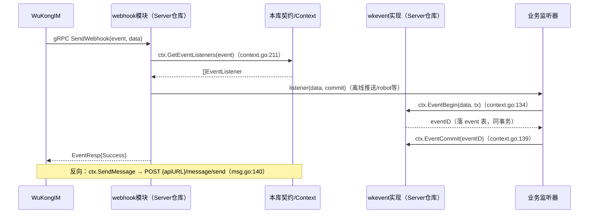

# TangSengDaoDaoServerLib 深度分析报告

> 分析对象：`/data/code/tsdd-analysis/TangSengDaoDaoServerLib`
> 分析方式：纯静态代码审查（未运行动态测试）
> 规模：73 个 Go 源文件，约 9.5k 行非测试/非生成代码（`wc -l` 实测 9537 行，含 2 个 protoc 生成文件）
> 报告日期：2026-10-12

---

## 1. 仓库概述

**定位**：TangSengDaoDaoServerLib 是「唐僧叨叨」（TangSengDaoDao）IM 系统的服务端**框架底座库**。它本身不是一个可运行程序（仓库内无 `main.go`，`go.mod` 声明为 `module github.com/TangSengDaoDao/TangSengDaoDaoServerLib`，`go.mod:1`），而是被主服务仓库 `TangSengDaoDaoServer` 以 Go module 方式引用（Server 端 `main.go:93` 调用本库的 `module.Setup(ctx)`，实测引用版本 v1.0.9）。

它承担五类职责：

1. **配置中枢**：`config.Config` 巨型结构体 + viper 绑定（`config/config.go:63`），以及作为 DI 容器的 `config.Context`（`config/context.go:23`），聚合 MySQL session、Redis 缓存、事件总线、tracer、HTTP 路由、snowflake ID 生成器、时间轮、ants 协程池。
2. **模块框架**：`pkg/register` 提供全局模块注册表（`pkg/register/register.go:125` `AddModule`），`module/module.go` 定义模块生命周期（Setup/Start/Stop，含内嵌 SQL 迁移）。
3. **HTTP 基础设施**：`pkg/wkhttp` 对 gin 的封装（鉴权中间件、角色校验、响应辅助），`server/server.go` 提供服务引导（CORS、`/v1/ping`、`/swagger/:module`、静态 `/web`、可选 TLS）。
4. **WuKongIM 对接契约**：`config/msg*.go` 封装对 WuKongIM HTTP API 的全部调用（发消息、同步、黑/白名单、在线状态等）；`pkg/wkhook` 是 WuKongIM webhook 的 gRPC protobuf 生成代码（契约在本库，实现位于 Server 仓库 `modules/webhook/api.go:146`）。
5. **通用工具集**：`pkg/util`（加解密、签名、UUID、金额、IP 等）、`pkg/db`、`pkg/redis`、`pkg/cache`、`pkg/log`、`pkg/pool`、`pkg/keylock`、`pkg/wait`、`pkg/network`、`pkg/markdown`、`pkg/wkrsa`。

**与 Server 的关系（被引用的契约）**：本库定义了 `Module` 结构（`pkg/register/register.go:102`）、`APIRouter`/`TaskRouter` 接口（`register.go:13`、`register.go:175`）、`IMDatasource`/`BussDataSource` 数据源契约（`register.go:69`、`register.go:84`），Server 端各业务模块（user/group/message/webhook 等）实现这些契约并在 `init()` 中调用 `register.AddModule` 完成挂载。这是一个典型的「库定契约、应用填实现」的插件式架构。

**发布方式**：作为 Go module 通过 Git tag 发布（Server 端 go.mod 以 `v1.0.9` 语义化版本引用），无二进制产物、无容器镜像。Apache 2.0 许可证（`LICENSE`）。

---

## 2. 技术栈与依赖

语言：Go 1.20（`go.mod:3`）。

### 关键依赖

| 依赖 | 版本 | 用途 |
|---|---|---|
| github.com/gin-gonic/gin | v1.9.1 | HTTP 框架（wkhttp 底层） |
| github.com/gocraft/dbr/v2 | v2.7.5 | MySQL 会话/查询构建 |
| github.com/go-sql-driver/mysql | v1.7.1 | MySQL 驱动 |
| github.com/mattn/go-sqlite3 | v1.14.17 | SQLite（`pkg/db/sqlite.go`） |
| github.com/go-redis/redis | v6.15.9+incompatible | Redis 客户端（`pkg/redis`） |
| github.com/go-redis/redis/v8 | v8.6.0（间接） | machinery 的 Redis broker 使用 |
| github.com/RichardKnop/machinery/v2 | v2.0.10 | 异步任务队列（Redis broker/backend） |
| github.com/rubenv/sql-migrate | v1.5.2 | 模块内嵌 SQL 迁移执行 |
| github.com/spf13/viper | v1.16.0 | 配置加载 |
| github.com/bwmarrin/snowflake | v0.3.0 | 分布式 ID |
| github.com/panjf2000/ants/v2 | v2.10.0 | 协程池（EventPool/PushPool/RobotEventPool） |
| github.com/RussellLuo/timingwheel | v0.0.0-2022... | 时间轮延迟任务 |
| go.uber.org/zap | v1.24.0 | 结构化日志（lumberjack 滚动） |
| github.com/opentracing/opentracing-go + uber/jaeger-client-go | v1.2.0 / v2.30.0 | 调用链追踪 |
| google.golang.org/grpc + protobuf | v1.57.0 / v1.31.0 | wkhook webhook gRPC 契约 |
| github.com/olivere/elastic | v6.2.37+incompatible | Elasticsearch 客户端 |
| github.com/gomarkdown/markdown | v0.0.0-2023... | Markdown→HTML 渲染 |
| github.com/unrolled/secure | v1.13.0 | TLS 重定向中间件 |
| github.com/judwhite/go-svc | v1.2.1 | Windows 服务/信号处理抽象 |
| golang.org/x/crypto | v0.11.0 | curve25519 DH 等 |
| github.com/tidwall/gjson | v1.15.0 | IM 响应 JSON 提取 |

### 过时/风险版本

| 依赖 | 风险 |
|---|---|
| go-redis/redis v6.15.9 **+incompatible** | v6 分支早已停止维护（2019），无 modules 支持标记，建议升级 v8/v9 |
| olivere/elastic v6.2.37 **+incompatible** | 仅支持 ES 6.x，项目已归档 |
| sendgrid/rest v2.6.9 **+incompatible** | 被 `pkg/network` 当作通用 HTTP 客户端使用，选型奇怪且老旧 |
| uber/jaeger-client-go v2.30.0 **+incompatible** | Jaeger 客户端已归档，官方迁移至 OpenTelemetry |
| golang.org/x/crypto v0.11.0 | 2023-07 版本，存在后续 CVE 修复（如 CVE-2023-48795 Terrapin 与本库间接相关的 ssh 部分不影响，但建议升级） |
| grpc v1.57.0 / protobuf v1.31.0 | 2023 年中版本，grpc 后续有多个安全修复（如 HTTP/2 相关），建议升级 |
| gin v1.9.1 | 尚可，但 1.10+ 已发布 |
| go.mongodb.org/mongo-driver v1.4.6（间接） | machinery 引入的旧间接依赖 |
| Go 1.20 工具链 | 已 EOL（2024-02 停止支持），无安全补丁 |

---

## 3. 目录结构与模块架构

### 目录树（精简）

```
TangSengDaoDaoServerLib/
├── go.mod                  # module github.com/TangSengDaoDao/TangSengDaoDaoServerLib, go 1.20
├── common/                 # 共享常量与模型：频道类型、消息内容类型、缓存实现、分页
│   ├── constant.go         # ChannelType/GroupMemberRole 等枚举（322 行）
│   ├── cache.go            # RedisCache / MemoryCache 实现 cache.Cache 接口
│   ├── msg.go              # 消息 ContentType、FakeChannelID 工具
│   └── page.go             # 分页结果
├── config/                 # 核心：Config + Context（DI 容器）+ WuKongIM API 客户端
│   ├── config.go           # Config 结构体与 viper 绑定（1144 行，全库最大文件）
│   ├── context.go          # Context DI 容器（238 行）
│   ├── msg.go              # WuKongIM HTTP API 封装（1108 行）
│   ├── msg_group.go        # 群事件消息发送（479 行）
│   ├── msg_channel.go / stream.go / msg_rtc.go / user.go
│   ├── msg_v3_cmd.go       # WuKongIM v3 持久 CMD 绑定逻辑
│   ├── asynctask.go        # machinery v2 异步任务封装
│   ├── seq.go              # DB 段式序列号生成
│   ├── tracer.go           # jaeger/opentracing 封装 + gin 中间件
│   └── elasticsearch.go    # ES 客户端懒加载
├── model/                  # 跨模块共享 DTO（ChannelResp、FriendResp 等）
├── module/module.go        # 模块生命周期：Setup（迁移+路由+任务）/Start/Stop
├── server/server.go        # HTTP 服务引导（ping/swagger/web/TLS）
├── pkg/
│   ├── register/register.go# 全局模块注册表 + Module/IMDatasource 契约
│   ├── wkhttp/http.go      # gin 封装：鉴权中间件、角色、响应辅助（394 行）
│   ├── wkhook/             # WuKongIM webhook gRPC 生成代码（仅契约）
│   ├── wkevent/event.go    # 事件总线接口（Begin/Commit）
│   ├── cache/cache.go      # Cache 接口
│   ├── db/                 # dbr Session 工厂、Time 类型、迁移源（含废弃的目录版）
│   ├── redis/redis.go      # go-redis v6 封装（425 行）
│   ├── log/                # zap + lumberjack 三级滚动日志
│   ├── pool/               # ants 协程池 dispatcher
│   ├── keylock/            # 分段关键字锁
│   ├── wait/               # etcd 风格 wait（按 id 触发 chan）
│   ├── network/            # 基于 sendgrid/rest 的 HTTP 客户端
│   ├── markdown/           # Markdown→HTML（含语法高亮）
│   ├── wkrsa/rsa.go        # RSA 签名（MD5）
│   └── util/               # 加解密/签名/UUID/base62/金额/IP 等工具（decimal.go 1119 行）
└── testutil/test.go        # 集成测试辅助（NewTestServer、清表、预置 token）
```

### 各 pkg 职责表

| 包 | 职责 | 关键导出 |
|---|---|---|
| config | 配置 + DI 容器 + IM API 客户端 | `Config`、`Context`、`New()`、`NewContext()` |
| module | 模块生命周期编排 | `Setup/Start/Stop(ctx)` |
| server | 服务引导 | `server.New(ctx)`、`Run/Start/Stop` |
| pkg/register | 模块注册表与契约 | `AddModule`、`GetModules`、`Module`、`IMDatasource` |
| pkg/wkhttp | gin 封装 | `WKHttp`、`Context`、`AuthMiddleware`、`CORSMiddleware` |
| pkg/wkhook | webhook gRPC 契约 | `WebhookServiceServer`、`RegisterWebhookServiceServer` |
| pkg/wkevent | 事件接口 | `Event`（`Begin`/`Commit`） |
| pkg/cache | 缓存接口 | `Cache`（Set/Get/Delete/SetAndExpire） |
| pkg/db / pkg/redis | 存储连接工厂 | `NewMySQL`、`redis.New` |
| pkg/log | zap 封装 | `Configure`、`NewTLog` |
| pkg/pool | ants 任务池 | `StartDispatcher`、`Collector` |
| pkg/keylock | 关键字互斥锁 | `NewKeyLock`、`Lock/Unlock` |
| pkg/wait | 按 ID 等待/触发 | `New`、`Register/Trigger` |
| pkg/network | HTTP 客户端 | `Post/Put/RequestBoy` |
| pkg/util | 工具大杂烩 | AES/RSA/MD5/SHA/签名/UUID/IP/金额 |
| pkg/markdown | Markdown 渲染 | `ToHtml` |
| pkg/wkrsa | RSA 签名 | `SignWithMD5` |
| testutil | 测试脚手架 | `NewTestServer`、`CleanAllTables` |

### 架构图（Context 作为 DI 核心）

```mermaid
flowchart TB
    subgraph ServerRepo["TangSengDaoDaoServer（应用层，另一仓库）"]
        Main["main.go"]
        Mods["业务模块 user/group/message/webhook..."]
    end

    subgraph Lib["TangSengDaoDaoServerLib（本库）"]
        Viper["viper（由调用方构造）"] -->|ConfigureWithViper| Config["config.Config<br/>config/config.go:63"]
        Config --> Ctx["config.Context（DI 容器）<br/>config/context.go:23"]
        Ctx --> MySQL["dbr.Session（MySQL）<br/>pkg/db"]
        Ctx --> RedisC["RedisCache / redis.Conn<br/>common/cache.go + pkg/redis"]
        Ctx --> Pools["ants 协程池 x3<br/>pkg/pool"]
        Ctx --> TW["timingwheel 时间轮"]
        Ctx --> Tracer["Tracer（jaeger）<br/>config/tracer.go"]
        Ctx --> Async["AsyncTask（machinery+Redis）<br/>config/asynctask.go"]
        Ctx --> Route["wkhttp.WKHttp<br/>pkg/wkhttp/http.go"]
        Ctx --> IMAPI["WuKongIM HTTP API 封装<br/>config/msg*.go"]
        Register["pkg/register 全局模块表"] -->|GetModules| Module["module.Setup/Start/Stop<br/>module/module.go"]
        Module -->|Route(r)| Route
        Module -->|sql-migrate| MySQL
        Server["server.Server<br/>server/server.go"] --> Route
        WKHook["pkg/wkhook（gRPC 契约）"]
        WKEvent["pkg/wkevent（事件接口）"]
    end

    Main -->|New / NewContext| Config
    Main -->|server.New + svc.Run| Server
    Mods -->|init: AddModule| Register
    WKIM["WuKongIM 服务"] -->|gRPC SendWebhook| WKHook
    WKHook -.实现位于 Server modules/webhook.-> WKEvent
    IMAPI -->|HTTP| WKIM
```

要点：**Context 是唯一枢纽**——所有模块的 API 结构体在 Setup 期拿到 `*config.Context`，通过它取 DB、缓存、路由、协程池与 IM 客户端。这带来极简的依赖注入，但 Context 是「上帝对象」，且内部多处使用包级全局变量（见第 7、8 节）。

---

## 4. 核心流程走读

### 4a. 应用启动全流程

调用链（以 Server 仓库 `main.go` 为入口）：

1. `main.go` 构造 viper（`SetEnvPrefix("ts")`、`AutomaticEnv()`），调用 `cfg.ConfigureWithViper(vp)`（`config/config.go:548`）把 yaml/env 合并进 `Config`。注意 `ConfigureWithViper` 会探测内网 IP，失败直接 `panic`（`config/config.go:1006-1010`）。
2. `config.NewContext(cfg)`（`config/context.go:46`）：
   - 用 `cfg.Cluster.NodeID` 创建 snowflake 节点（`context.go:47`），NodeID ≥1024 会 panic；
   - 启动 3 个 ants 协程池（EventPool/PushPool/RobotEventPool，`context.go:55-57`）；
   - 创建 machinery AsyncTask（`context.go:58` → `config/asynctask.go:24`，Redis broker/backend）；
   - 创建并启动时间轮（`context.go:59`、`context.go:67`）；
   - 创建 jaeger Tracer 并 `opentracing.SetGlobalTracer`（`context.go:62-66`）。
3. `server.New(ctx)`（`server/server.go:29`）：创建 gin 引擎（`wkhttp.New`，`pkg/wkhttp/http.go:94`，仅挂 `gin.Recovery()`），注册全局 CORS 中间件（`server.go:31`）。
4. 调用方把路由塞回 Context：`ctx.SetHttpRoute(s.GetRoute())`（`context.go:154`），并挂上 `ctx.Tracer().GinMiddle()`（`config/tracer.go:120`）。
5. `module.Setup(ctx)`（`module/module.go:16`）：
   - `register.GetModules(ctx)` 用 `sync.Once` 实例化全部已注册模块（`pkg/register/register.go:143-152`）；
   - 收集各模块 `SQLDir`（`embed.FS`），用 sql-migrate 以 `migrate.Up` 执行全部内嵌 `sql/*.sql`（`module.go:29` → `module.go:84-93` → `module.go:127-151` 读取 embed FS）；
   - 逐模块调用 `SetupAPI().Route(ctx.GetHttpRoute())` 注册路由（`module.go:34-39`）；
   - 若 `ctx.SetupTask` 为真，调用 `SetupTask().RegisterTasks()` 注册 machinery 任务（`module.go:41-48`）。
6. `svc.Run(server)`（go-svc）：`Server.Init`（`server.go:42`，Windows 服务时切换工作目录）→ `Server.Start`（`server.go:98`）：
   - goroutine 中 `run()`：注册 `Static("/web", ...)`（`server.go:54`）、`/v1/ping`（`server.go:55`）、`/swagger/:module`（`server.go:59`），然后 `s.r.Run(addr)` 监听 HTTP（`server.go:70-85`）；
   - 若配置了 `SSLAddr`，追加 `TlsHandler` 并以硬编码证书路径 `assets/ssl/ssl.pem`/`ssl.key` 起 HTTPS（`server.go:88-92`）；
   - 回到主 goroutine 调 `module.Start(ctx)` 启动各模块后台逻辑（`server.go:106` → `module.go:54`）。
7. 退出：go-svc 捕获信号 → `Server.Stop`（`server.go:114`）→ `module.Stop(ctx)`（`module.go:68`）逐模块 Stop。

**风险点**：启动期 panic 路径多（NewContext、NewMySQL、迁移失败返回 error 但被 main 处理）；`Server.Start` 里 HTTP 监听 error 直接 `panic`（`server.go:101-103`）。

### 4b. 一个 HTTP 请求的完整路径

以「带鉴权的业务 API」为例：

1. gin Engine 接收请求 → `gin.Recovery()`（`http.go:99`）。
2. 全局中间件：`CORSMiddleware`（`http.go:379`，server.go:31 注册）写入 `Access-Control-Allow-*` 头，OPTIONS 直接 204 短路（`http.go:387-390`）。
3. Tracer 中间件（由调用方 `UseGin(ctx.Tracer().GinMiddle())` 挂载，`config/tracer.go:120-152`）：从 header 提取/新建 span，`c.Set("spanContext", ...)`。
4. 路由命中模块在 `Route()` 中注册的处理器链。鉴权路由组会挂 `ctx.AuthMiddleware(r)`（`config/context.go:123-126`），其实现位于 `wkhttp.AuthMiddleware`（`http.go:313-337`）：
   - 从自定义 header `token` 取令牌（`http.go:316`），为空 → 401「token不能为空」；
   - `GetLoginTokenInfo(token, "token:", cache)`（`http.go:79-85`）以 `token:<token>` 为 key 查 Redis；
   - `ParseTokenCacheInfo`（`http.go:53-76`）解析缓存值：优先 JSON（`{"uid","name","role","ver"}`，`EncodeTokenCacheInfo` 于 `http.go:39-50`），兼容旧版 `uid@name` 分隔符格式（超过 2 段直接拒绝，防止角色注入——有对应单测 `pkg/wkhttp/http_test.go:24-29`）；
   - 解析失败 → 401「请先登录！」；成功则 `c.Set("uid"/"name"/"role")` 并 `c.Next()`。
5. gin → wkhttp 适配：`WKHttpHandler`（`http.go:230-241`）从 `sync.Pool` 取 `wkhttp.Context`、重置、包一层 gin.Context 后调用业务 handler。
6. 业务 handler 通过 `c.GetLoginUID()`（`http.go:178`）、`c.GetLoginRole()`（`http.go:193`）取身份；管理接口再调 `CheckLoginRole()`（`http.go:203`，要求 admin/superAdmin）或 `CheckLoginRoleIsSuperAdmin()`（`http.go:215`）。
7. 响应封装：成功 `c.Response(data)` / `ResponseOK()`（`http.go:161-170`，HTTP 200）；失败 `c.ResponseError(err)`（`http.go:121`，**HTTP 400 + `{"msg","status"}`**，注意错误文本直接回传给客户端）。

**观察**：
- token 校验是「一次 Redis GET」，无时序攻击面（key 查找而非值比较），但无速率限制，随机 token 洪峰会放大为 Redis QPS（缓存穿透，见 7 节）。
- `GetLoginUID` 使用 `MustGet(...).(string)`，未挂鉴权中间件的路由误调会 panic（被 Recovery 兜底成 500）。
- token 过期时间默认 30 天（`config/config.go:360`），且无设备绑定。

### 4c. WuKongIM 事件流（webhook → 事件总线）

这是消息链路的关键粘合层，**本库只提供契约与接口，接收实现在 Server 仓库**：

1. **契约（本库）**：`pkg/wkhook/webhook_grpc.pb.go` 由 protoc 生成，定义 gRPC 服务 `wkhook.WebhookService`，方法 `SendWebhook(EventReq{event string, data []byte}) → EventResp{status}`，全限定方法 `/wkhook.WebhookService/SendWebhook`（`webhook_grpc.pb.go:85`），注册函数 `RegisterWebhookServiceServer`（`webhook_grpc.pb.go:71`）。
2. **接收端（Server 仓库，供参考）**：`modules/webhook/api.go:40` 的 `Webhook` 结构内嵌 `wkhook.UnimplementedWebhookServiceServer`，`api.go:129` 注册到 grpc.Server（监听 `Config.GRPCAddr`，默认 `0.0.0.0:6979`，`config/config.go:303`），`api.go:146` 实现 `SendWebhook`：按 `req.Event` 分发——消息事件走推送与离线处理，同时投递到事件总线。
3. **事件总线接口（本库）**：`pkg/wkevent/event.go:37-42` 定义 `Event` 接口（`Begin(data, tx) (eventID, error)`、`Commit(eventID)`），事件类型 `Message/CMD`（`event.go:8-14`），状态 `Wait/Success/Fail`（`event.go:22-26`）。实现位于 Server 仓库 `modules/base/event/`（其 `db.go:49` 按 `wkevent.Wait` 扫描超时未提交事件重投，实现「本地消息表」式可靠投递）。
4. **Context 粘合**：业务侧通过 `ctx.EventBegin(data, tx)` / `ctx.EventCommit(id)`（`config/context.go:134-141`）在 DB 事务内落事件；同时 `Context` 还维护两套**进程内**监听器注册表：`AddEventListener/GetEventListeners`（`context.go:201-213`，包级 map）与 `AddOnlineStatusListener`（`context.go:183-190`）、`AddMessagesListener/NotifyMessagesListeners`（`context.go:221-230`），webhook 收到 WuKongIM 推送后借此扇出给各业务模块。
5. **反向通道（本库 → WuKongIM）**：`config/msg.go` 以 HTTP 调用 WuKongIM：`SendMessageWithResult`（`msg.go:136`，POST `/message/send`）、`SendMessageBatch`（`msg.go:108`）、`IMSyncMessage`（`msg.go:481`）、黑/白名单、订阅者维护等；v3 显式 CMD 绑定在发送前执行（`config/msg_v3_cmd.go:16` `ensureV3CMDDiscovery`，批量上限 1000、body 上限 256KiB，`msg_v3_cmd.go:11,24,89`）。



---

## 5. 对外接口

### 5.1 作为库暴露的关键 API

**配置与上下文**

| API | 位置 | 说明 |
|---|---|---|
| `config.New() *Config` | `config/config.go:296` | 带全部默认值的配置 |
| `(*Config).ConfigureWithViper(vp)` | `config/config.go:548` | yaml/env 覆盖默认值 |
| `config.NewContext(cfg) *Context` | `config/context.go:46` | DI 容器（创建即启动协程池/时间轮/tracer） |
| `Context.DB()/Cache()/GetRedisConn()` | `context.go:97,118,129` | MySQL session / Redis 缓存（均懒加载单例） |
| `Context.EventBegin/EventCommit/Schedule` | `context.go:134,139,144` | 事件与时间轮延迟任务 |
| `Context.AsyncTask()` | `context.go:87` | machinery 封装 |
| `Context.AuthMiddleware(r)` | `context.go:123` | 生成鉴权中间件 |
| `Context.AddEventListener/AddOnlineStatusListener/AddMessagesListener` | `context.go:201,183,221` | 进程内事件订阅 |
| `Context.SetValue/Value` | `context.go:158,162` | 任意键值袋（sync.Map） |
| `Context.SendMessage/IMSyncMessage/UpdateIMToken/...` | `config/msg.go` 等 | 60+ 个 WuKongIM API 方法（见 4 节 grep 结果） |

**模块框架**

| API | 位置 | 说明 |
|---|---|---|
| `register.AddModule(fn)` | `register.go:125` | 模块在 init() 注册工厂 |
| `register.Module` | `register.go:102` | Name/SetupAPI/SetupTask/SQLDir/Swagger/IMDatasource/BussDataSource/Service/Start/Stop |
| `register.NewSQLFS(embed.FS)` | `register.go:133` | 包装内嵌 SQL |
| `register.GetService(name)` | `register.go:165` | 跨模块服务查找 |
| `module.Setup/Start/Stop(ctx)` | `module/module.go:16,54,68` | 生命周期编排 |
| `server.New(ctx) *Server` | `server/server.go:29` | 实现 go-svc 的 `Init/Start/Stop` |

**wkhttp 方法集**

`WKHttp`：`GET/POST/PUT/DELETE/Any/Group/Static/Use/UseGin/LoadHTMLGlob/Run/RunTLS/ServeHTTP/HandleContext`（`http.go:244-300`）；中间件：`AuthMiddleware`（`http.go:313`）、`CORSMiddleware`（`http.go:379`）；`Context`：`Response/ResponseOK/ResponseError/ResponseErrorf/ResponseWithStatus/GetPage/GetLoginUID/GetLoginName/GetLoginRole/CheckLoginRole/CheckLoginRoleIsSuperAdmin/GetSpanContext/GetAppID`（`http.go:121-224`）；token 编解码：`EncodeTokenCacheInfo/ParseTokenCacheInfo/GetLoginTokenInfo`（`http.go:39,53,79`）。

### 5.2 server.go 内置路由

| 路由 | 位置 | 说明 |
|---|---|---|
| `ANY /v1/ping` | `server/server.go:55` | 健康检查，返回 `{status:200}` |
| `ANY /swagger/:module` | `server/server.go:59` | 按模块名吐内嵌 swagger 文档，未找到返回 404 |
| `GET /web/*` | `server/server.go:54` | 静态目录 `./assets/web` |
| HTTPS | `server/server.go:88-92` | 配置 `sslAddr` 时生效，证书固定为 `assets/ssl/ssl.pem|ssl.key` |

---

## 6. 部署与运维

**无 Dockerfile**：本库不产出可部署单元，版本管理通过 Git tag + Go module proxy（Server 端以 `v1.0.9` 引用）。发布流程 = 打 tag；升级 = 调用方改 go.mod。库内无 CI 配置。

**配置映射**：yaml 键 → `Config` 字段由 `ConfigureWithViper`（`config/config.go:548-803`）完成；环境变量由**调用方** viper 处理（Server 仓库 main.go：`SetEnvPrefix("ts")` + `.`→`_` 替换 + `AutomaticEnv()`），即 `db.mysqlAddr` ⇔ 环境变量 `TS_DB_MYSQLADDR` ⇔ tsdd.yaml 的 `db.mysqlAddr`。库自身仅个别字段直接读环境变量（如 `Test` 读 `Test`，`config/config.go:533,944`）。

### Config 全量字段表（主要项）

| yaml 键 | 字段 | 默认值 | 说明 |
|---|---|---|---|
| mode | Mode | release（New）/debug（viper 缺省，`config.go:552`） | debug/release/bench |
| appID / appName / version | AppID/AppName/Version | tangsengdaodao / 唐僧叨叨 / "" | |
| rootDir | RootDir | tsdddata | 数据根目录 |
| addr / grpcAddr / sslAddr | Addr/GRPCAddr/SSLAddr | :8090 / 0.0.0.0:6979 / "" | 监听地址 |
| messageSaveAcrossDevice | 同名 | true | 换设备同步消息 |
| welcomeMessage | 同名 | 欢迎使用{{appName}} | 支持模板替换（`config.go:562-564`） |
| phoneSearchOff / onlineStatusOn | 同名 | false / true | |
| groupUpgradeWhenMemberCount | 同名 | 1000 | 自动升级超级群 |
| eventPoolSize | EventPoolSize | 100 | 事件协程池 |
| adminPwd | AdminPwd | "" | 后台管理默认密码 |
| external.ip/baseURL/h5BaseURL/apiBaseURL/webLoginURL | External.* | 内网 IP 推导（`config.go:572-591`，默认 **http**://IP:8090） | 外网地址 |
| logger.level/dir/lineNum | Logger.* | info / {rootDir}/logs / false | level 输入会减 2（`config.go:819`，易踩坑） |
| db.mysqlAddr | DB.MySQLAddr | `root:demo@tcp(127.0.0.1:3306)/test...`（`config.go:335`，**内置弱口令**） | |
| db.mysqlMaxOpenConns / mysqlMaxIdleConns / mysqlConnMaxLifetime | DB.* | 100 / 10 / 4h | |
| db.migration | DB.Migration | true | **死配置：库与 Server 均未消费该标志**（`config.go:599` 读入后无人使用；`module.Setup` 无条件执行迁移） |
| db.redisAddr / redisPass / asynctaskRedisAddr | DB.* | 127.0.0.1:6379 / "" / "" | asynctask 注释声称「不写默认 RedisAddr」但代码无回退（`config/asynctask.go:38`） |
| cluster.nodeID | Cluster.NodeID | 1 | snowflake 节点，须 <1024 |
| cache.tokenCachePrefix / tokenExpire / loginDeviceCachePrefix / loginDeviceCacheExpire / uidTokenCachePrefix / friendApplyTokenCachePrefix / friendApplyExpire / nameCacheExpire | Cache.* | token: / 30d / login_device: / 5m / uidtoken: / friend_token: / 15d / 7d（`config.go:358-367`） | |
| account.systemUID / fileHelperUID / systemGroupID / systemGroupName / adminUID | Account.* | u_10000 / fileHelper / g_10000 / 意见反馈群 / admin | |
| fileService / oss.* / minio.* / seaweed.url / qiniu.* | 对应结构 | minio | 文件服务四选一 |
| smsCode / smsProvider / uniSMS.* / aliyunSMS.* / aliyunInternationalSMS.* / smsbao.* | 对应结构 | aliyun | smsCode 为模拟验证码（生产置空！） |
| wukongIM.apiURL / managerToken / v3ExplicitCMDBindings / v3SystemUID / cmdSyncAPIURL | WuKongIM.* | http://127.0.0.1:5001 / "" / false / \_\_\_\_system / "" | managerToken 在本库内**从未被附加到请求头**（grep 全库仅出现于 config.go） |
| avatar.default / defaultCount / partition / defaultBaseURL | Avatar.* | "" / 900 / 100 / "" | |
| shortNo.numOn / numLen / editOff | ShortNo.* | false / 7 / false | |
| robot.messageExpire / inlineQueryTimeout / eventPoolSize | Robot.* | 7d / 10s / 100 | |
| gitee.* / github.* | OAuth | 仅 oauthURL 有默认 | |
| owt.* / livekit.* / tgortc.* | RTC | RoomMaxCount 9 | 三类音视频服务 |
| register.off / onlyChina / stickerAddOff / usernameOn | Register.* | 全 false | |
| organization.importOn | 同名 | false | |
| friend.addedTipsText | 同名 | 固定文案 | |
| zincSearch.searchOn / apiURL / username / password / syncIntervalSecond / syncCount | ZincSearch.* | 默认关 | |
| group.sameDayCreateMaxCount / createGroupVerifyFriendOn | Group.* | 10 / true | |
| push.contentDetailOn / pushPoolSize / apns.* / mi.* / hms.* / harmonyos.* / vivo.* / oppo.* / firebase.* | Push.* | true / 100 / apns.dev=true、apns.password="123456"（`config.go:513-517`，**内置占位口令**） | |
| message.sendMessageOn / syncReadedCountIntervalSecond | Message.* | false / 0 | |
| wechat.appID / appSecret | Wechat.* | "" | |
| tracing.on / addr | Tracing.* | false / "" | 开启后采样率固定 100%（`config/tracer.go:43-46`） |
| support.email / emailSmtp / emailPwd | Support.* | "" / smtp.exmail.qq.com:25 / "" | |
| （无键） | Test | env `Test` | 测试模式 |
| （无键） | QRCodeInfoURL / VisitorUIDPrefix | v1/qrcode/:code / _vt_ | 代码内常量 |
| （无键） | TimingWheelTick / TimingWheelSize | 10ms / 100 | 时间轮 |
| （无键） | ElasticsearchURL | http://elasticsearch:9200 | 未被 viper 绑定，只能代码改（待验证是否故意） |
| （系统生成） | AppRSAPrivateKey / AppRSAPubKey | "" | 由系统生成（`config.go:291-292`） |

**运维要点**：日志按 info/warn/error 三文件滚动（500MB×3×28 天，`pkg/log/logger.go:33-79`）；grpc 端口（6979）暴露 webhook 服务，应限制仅 WuKongIM 可达；迁移在每次启动时自动执行，要求应用账号拥有 DDL 权限。

---

## 7. 安全审计（纯静态审查）

### 7.1 [CONFIRMED] CORS 配置矛盾：`Allow-Origin: *` 与 `Allow-Credentials: true` 并存

`pkg/wkhttp/http.go:382-384`：

```go
c.Writer.Header().Set("Access-Control-Allow-Origin", "*")
c.Writer.Header().Set("Access-Control-Allow-Credentials", "true")
```

且该中间件对**所有路由**全局生效（`server/server.go:31`）。浏览器规范下 `*` + credentials 组合会使凭据模式失效（浏览器拒绝），但此处的「凭据」是自定义 header `token` 而非 Cookie——任意源的网页脚本只需拿到 token 即可跨域调用全部 API；同时该配置明确允许任意 Origin 携带 `token` 头发起跨域请求（`Access-Control-Allow-Headers` 含 `token`，`http.go:384`）。风险等级：中。建议改为白名单 Origin 并去掉 credentials。

### 7.2 [CONFIRMED] Markdown 渲染存在 XSS

`pkg/markdown/markdown.go:13-25` 的 `ToHtml` 使用 `html.CommonFlags | html.HrefTargetBlank` 创建渲染器。**gomarkdown 的 `CommonFlags` 不含 `SkipHTML`**，原文中的内嵌 HTML（如 `<script>`、``）会原样透传到输出。更严重的是自定义钩子 `renderHookCodeBlock`：行内代码节点直接 `w.Write([]byte(fmt.Sprintf("<pre class=\"notranslate\">%s</pre>", string(node.AsLeaf().Literal))))`（`markdown.go:32`），**字面量未做任何 HTML 转义**——构造 `` `` `` 形式的行内代码即可注入。代码块分支（`markdown.go:38-45`）经 `syntaxhighlight.AsHTML` 转义，相对安全。若该函数用于渲染用户内容（公告/机器人消息等，调用方在 Server 仓库，待验证），即为存储型 XSS。风险等级：高（取决于调用面）。建议加 `html.SkipHTML` 并对 Literal 做 `html.EscapeString`。

### 7.3 [CONFIRMED] 内置默认弱口令/凭据

- `config/config.go:335`：默认 MySQL DSN `root:demo@tcp(127.0.0.1:3306)/test`；
- `config/config.go:516`：APNS 默认 `Password: "123456"`；
- `testutil/test.go:31`：测试脚手架硬编码 `root:demo@tcp(127.0.0.1)/test`；
- `testutil/test.go:16,43`：预置测试 token `token122323` + SuperAdmin 角色写入缓存（仅 Test 模式，但若 Test 模式误开到生产即为后门——[PLAUSIBLE]）。

这些默认值在漏配时不会报错而是静默生效，属于「不安全的默认」。

### 7.4 [CONFIRMED] RSA 签名使用 MD5

`pkg/wkrsa/rsa.go:19,29`：`SignWithMD5` 以 `crypto.MD5` 做 `rsa.SignPKCS1v15`。MD5 抗碰撞已破，签名方案整体强度被拉低；且密钥解析失败仅返回 `"private key error"`。建议迁移至 SHA-256（PSS）。

### 7.5 [CONFIRMED] AES 工具存在严重实现缺陷

- `pkg/util/aes.go:11-13`：`AesEncryptSimple` 名为加密，实际调用 `AesDecryptPkcs5`（复制粘贴错误）。任何使用它「加密」的调用方得到的是解密结果（对未填充明文会直接 panic 或产生垃圾），功能与语义双重错误。
- `aes.go:95-100`：`PKCS5UnPadding` 校验失败时返回 `[]byte("unpadding error")` 作为「数据」而非 error，解密失败被静默吞掉，破坏完整性检测。
- 整体仅提供 CBC、无 AEAD、无 MAC，IV 由调用方管理。

### 7.6 [CONFIRMED] 签名串构造函数逻辑错误

`pkg/util/sign.go:23`：`signStr = fmt.Sprintf("%s=%s", k, vs)` 为**赋值而非追加**，循环结束后 `signStr` 只剩最后一个键值对（`&` 也只在非末位追加一次，`sign.go:25-27`）。用此串做签名校验等价于只签最后一个参数，**其余参数均可被篡改而不影响签名**。是否被用于安全敏感校验取决于调用方（Server 仓库，待验证），但作为库 API 属高危缺陷。

### 7.7 鉴权中间件细节（token 校验 / 缓存穿透 / 时序）

实现见 4b（`http.go:313-337`、`http.go:79-85`、`http.go:53-76`）。结论：

- **时序攻击面**：[CONFIRMED 无] token 是「以 token 为后缀拼 Redis key 做 GET」，不是值比较，不存在逐字节比较的时序泄漏。
- **角色注入**：[CONFIRMED 已修复] 旧格式 `uid@name@role` 可被含 `@` 的名字污染角色；现 `ParseTokenCacheInfo` 对 >2 段直接报错（`http.go:69-71`），并有回归测试（`http_test.go:24-29`）。新格式用 JSON 编码（`http.go:39-50`）。
- **缓存穿透/DoS**：[PLAUSIBLE] 每个带任意随机 token 的请求都产生一次 Redis GET，中间件无速率限制、无负缓存；redis 客户端只有 `MaxRetries:3`（`pkg/redis/redis.go:23`），攻击者可低成本放大对 Redis 的压力。
- **会话安全**：[CONFIRMED] token 默认有效期 30 天（`config/config.go:360`），无设备/IP 绑定，无滑动续期可见逻辑；角色随缓存值存储，缓存被写（如 Redis 未授权访问）即等于提权。
- **错误信息**：401 文案区分「token不能为空」与「请先登录」（`http.go:318,325`），信息区分度低，风险可忽略。

### 7.8 [CONFIRMED] machinery 任务队列的 Redis 连接无认证、任务无签名

`config/asynctask.go:38-39`：`redisbroker.NewGR(cnf, []string{cfg.DB.AsynctaskRedisAddr}, 0)` —— broker 与 backend 均**未传密码**（即使 `db.redisPass` 已配置也不生效）。任何能写该 Redis 的人都可以向 `machinery_tasks` 队列投递伪造任务（machinery 默认 JSON 序列化，无完整性校验），以 worker 进程权限执行任意**已注册**任务及参数。同时 [CONFIRMED] `AsynctaskRedisAddr` 注释声称「不写默认为 RedisAddr」（`config/config.go:105`），代码却无回退——漏配时 broker 地址为空，属可用性隐患。Redis 暴露面取决于部署，综合评级 [PLAUSIBLE-高]。

### 7.9 [CONFIRMED] SQL 迁移执行面

`module/module.go:84-93`：每次启动对所有模块 embed 的 `sql/*.sql` 执行 `migrate.Exec(..., migrate.Up)`，以应用数据库账号直接跑 DDL/DML。嵌入内容编译期固定，运行期不可被注入，风险主要在：①应用账号权限过大（需 DDL）；②`db.migration` 配置项是死开关（见 6 节表），运维无法关闭自动迁移；③多模块迁移合并排序仅按文件名 ID（`module.go:122`），跨模块命名冲突时行为取决于字典序。综合：低-中。

### 7.10 其他

- [CONFIRMED] TLS 证书路径硬编码 `assets/ssl/ssl.pem|ssl.key`（`server/server.go:91`）；`TlsHandler` 每次请求都 `secure.New(...)` 重建中间件（`server.go:119-124`），仅配了 `SSLRedirect`，未启用 HSTS 等头部。
- [CONFIRMED] 默认对外 URL 使用明文 `http://`（`config/config.go:580-584,636`）。
- [CONFIRMED] `pkg/redis/redis.go:19-26`：客户端未设 Dial/Read/WriteTimeout、无 TLS。
- [CONFIRMED] `/swagger/:module` 未鉴权暴露 API 文档（`server/server.go:59-68`）——信息泄露（低）。
- [PLAUSIBLE] `pkg/util/md5.go:21-27` `SHA1()` 内 `fmt.Println("str:", str)` 把待哈希内容打到 stdout，若用于口令/敏感串将泄露进日志。
- [PLAUSIBLE] gRPC webhook 端口（6979）无鉴权契约（proto 无 metadata 校验），需网络层隔离——实现在 Server 仓库，待验证。
- [PLAUSIBLE] 事件监听器注册表为无锁包级 map（`config/context.go:198-208`），若运行期并发注册/读取存在 data race；通常仅启动期写，风险低。

---

## 8. 代码质量评估

### TOP 文件（非测试非生成，按行数）

| 文件 | 行数 | 评价 |
|---|---|---|
| `config/config.go` | 1144 | 巨型配置结构 + 逐字段 viper 绑定，机械重复、可机器生成 |
| `pkg/util/decimal.go` | 1119 | 内嵌十进制库（vendor 式拷贝） |
| `config/msg.go` | 1108 | 60+ 个 IM API 方法堆在 Context 上，重复的错误处理样板 |
| `pkg/util/uuid.go` | 481 | 拷贝自 satori/go.uuid（保留版权声明，合规 OK） |
| `config/msg_group.go` | 479 | 群事件消息构造，大量重复 payload 拼装 |
| `pkg/redis/redis.go` | 425 | go-redis v6 薄封装 |
| `pkg/wkhttp/http.go` | 394 | 核心 HTTP 封装 |
| `common/constant.go` | 322 | 枚举集中地 |

### 测试分布

10 个 `*_test.go` 共 478 行，覆盖极不均衡：`config/msg_v3_cmd_test.go`（190 行，针对 v3 CMD 绑定的边界，质量最高）、`tracer_test.go`（78）、`wkhttp/http_test.go`（33，恰好覆盖 token 角色注入回归）、`wkrsa/rsa_test.go`（43）、`markdown_test.go`（14）。**核心路径（鉴权中间件、迁移、pool、keylock、redis 封装、seq）无单测**；`testutil/` 提供的是依赖真实 MySQL/Redis 的集成测试脚手架，CI 可用性差。估测行覆盖率 <10%（待验证，未运行 `go test -cover`）。

### 错误处理规范

- 风格统一性差：库代码大量 `panic`（`context.go:48,64`、`db/mysql.go:20`、`config/elasticsearch.go:13`、`config/seq.go:32`、`config/config.go:1009`、`pool/dispatcher.go:19`、`wait/wait.go:55` 的 `log.Panicf`）——作为库向调用方抛 panic 是 API 设计失分。
- `pool/dispatcher.go:36,44` 用 `fmt.Println` 吞任务提交错误；`pkg/log` 已有 zap 却不用。
- HTTP 层把内部错误文本直接回传客户端（`http.go:121-126` 的 `ResponseError(err.Error())`），可能泄露内部细节。
- 注释与实现不符两处已确认：`db.asynctaskRedisAddr` 回退注释（`config.go:105`）、`db.migration` 开关（`config.go:599` 无人消费）。

### 库 API 设计评价：全局状态 register 的利与弊

**利**：`register.AddModule` + `init()` 的模式让 Server 仓库以纯 import 侧效应完成模块装配（`main.go` 极薄），`sync.Once` 保证单实例（`register.go:140-149`），模块间通过 `GetService(name)` 解耦——对单体应用简单有效。

**弊**：
1. **全局可变状态**：`modules`（`register.go:48`）、`eventListeners`（`context.go:198`）、`onlinStatusListeners`（`context.go:180`）、`messagesListeners`（`context.go:218`）、`seqMap`（`config/seq.go:10`）都是包级变量，注册无锁、无去重、无注销，单进程跑两个 Context（测试场景）会互相污染。
2. **上帝对象**：`Context` 聚合 15+ 种依赖并以方法形式再挂 60+ IM API（config/msg*.go），接口面爆炸，可测试性差（无法 mock 局部）。
3. **初始化顺序隐式**：`SetHttpRoute` 必须在 `module.Setup` 前调用，否则路由注册 nil panic——契约靠注释和调用方自觉。
4. **panic 式失败**：见上。
5. 命名/拼写问题：`aysncTask`（`context.go:36`）、`onlinStatusListeners`（`context.go:180`）、`timeFormart`（`pkg/db/db.go:8`）等。
6. 死代码：`pkg/register/register.go:17-44` 大段注释掉的旧 API；`pkg/db/mysql.go:30-102` 的目录版迁移器（`FileDirMigrationSource`）与 `pkg/db/sqlite.go` 在当前路径无人使用（待验证）。

---

## 9. 风险与改进建议汇总表

| # | 类别 | 位置 | 问题 | 等级 | 建议 |
|---|---|---|---|---|---|
| 1 | 安全 | `pkg/markdown/markdown.go:17,32` | Markdown 渲染不过滤 HTML + 行内代码不转义 → XSS | 高 | 加 `html.SkipHTML`；Literal 先 `html.EscapeString` |
| 2 | 安全 | `pkg/util/sign.go:23` | GetSignStr 只保留最后一个参数 → 签名校验失效 | 高（视调用面） | 改为 `+=` 拼接并补单测 |
| 3 | 安全 | `pkg/util/aes.go:11-13` | AesEncryptSimple 实际执行解密 | 高（视调用面） | 修正实现；全面审查调用方 |
| 4 | 安全 | `config/asynctask.go:38-39` | machinery Redis 无密码、任务无签名；地址无回退 | 中-高 | 复用 redisPass；空地址回退 RedisAddr；评估任务签名 |
| 5 | 安全 | `pkg/wkhttp/http.go:382-384` | CORS `*` + credentials 矛盾且全局限定 | 中 | Origin 白名单；去 credentials |
| 6 | 安全 | `config/config.go:335,516`；`testutil/test.go:31,43` | 默认弱口令/测试后门 token | 中 | 启动校验必配项；测试凭据移出代码库 |
| 7 | 安全 | `pkg/wkrsa/rsa.go:29` | RSA-MD5 签名 | 中 | 迁移 SHA-256/PSS |
| 8 | 安全 | `pkg/wkhttp/http.go:313-337` | 鉴权无速率限制 → Redis 穿透放大；token 30 天无绑定 | 中 | 加限流/负缓存；缩短有效期；设备绑定 |
| 9 | 安全 | `pkg/redis/redis.go:19-26` | 无超时、无 TLS | 低-中 | 补超时配置项 |
| 10 | 安全 | `server/server.go:59,91,119` | swagger 无鉴权；证书路径硬编码；secure 中间件每请求重建 | 低 | 鉴权/可配置路径/启动期创建 |
| 11 | 配置 | `config/config.go:105,599` | `db.migration`、`asynctaskRedisAddr` 注释/语义与实现不符 | 中 | 要么实现开关，要么删字段 |
| 12 | 健壮性 | 多处（`context.go:48`、`seq.go:32`、`wait/wait.go:55` 等） | 库代码 panic/Panicf | 中 | 改返回 error |
| 13 | 并发 | `context.go:180-230`、`register.go:48` | 全局注册表无锁 | 低-中 | 启动期冻结 + RWMutex |
| 14 | 依赖 | go.mod | go-redis v6、elastic v6、jaeger、sendgrid/rest、x/crypto 0.11、grpc 1.57、Go 1.20 | 中 | 制定升级批次（先 x/crypto、grpc，再评估 v9 redis/OTel） |
| 15 | 质量 | 全库 | 测试覆盖 <10%（待验证）；fmt.Println 吞错；错误文本直回客户端 | 中 | 对鉴权/迁移/seq/pool 补单测；统一走 zap |
| 16 | 架构 | `config/context.go` | 上帝对象 + 全局状态 | 低（重构成本高） | 新模块采用显式依赖注入，逐步收敛 Context |

---

## 附：分析可信度说明

- 所有 file:line 均经 Read/grep 实测确认。
- wkhook 的「接收→分发」实现位于 TangSengDaoDaoServer 仓库（`modules/webhook/api.go`），本报告仅引用其与本库的接口关系（已 grep 确认行号）。
- 以下事项标注「待验证」：markdown.ToHtml 的实际调用面与输入来源；GetSignStr/AesEncryptSimple 在 Server 仓库的调用面；Test 模式在生产被开启的可能性；测试覆盖率数值（未执行 `go test`）。
