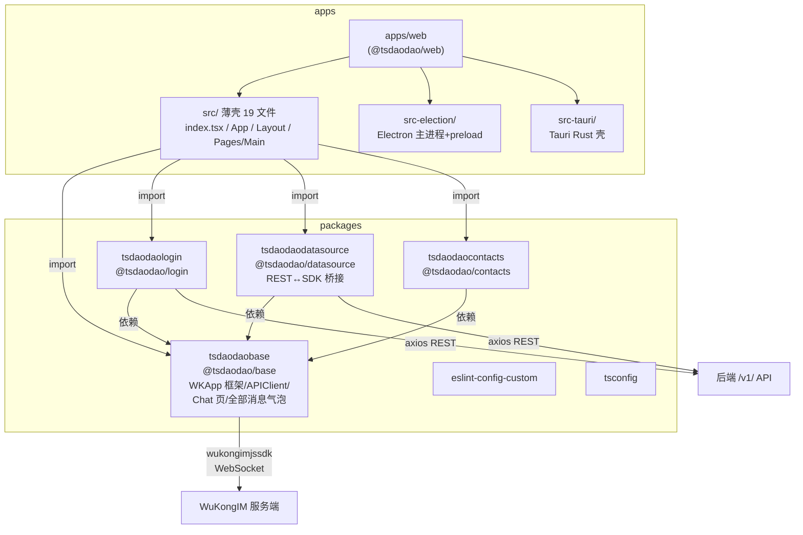
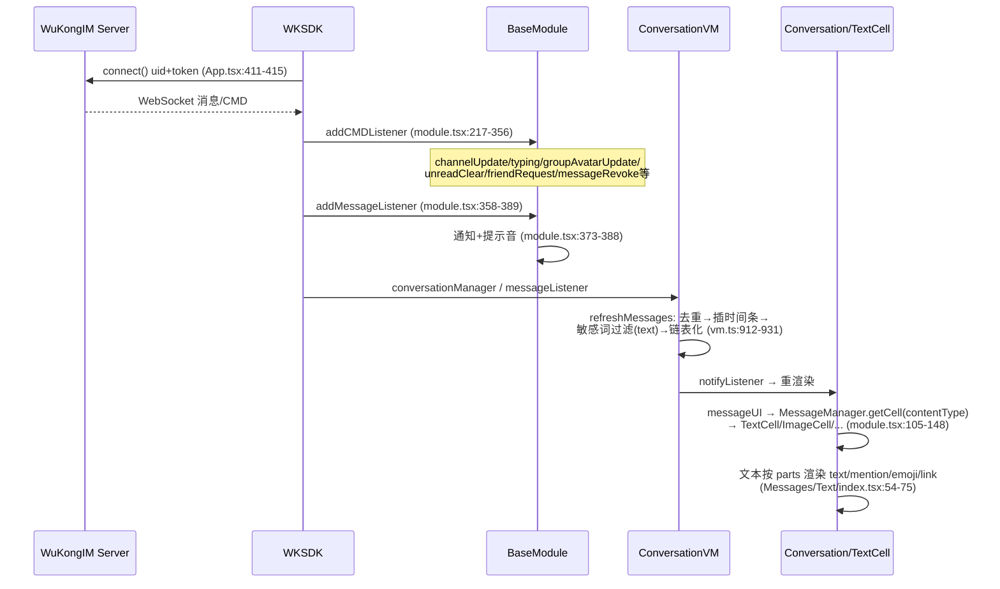
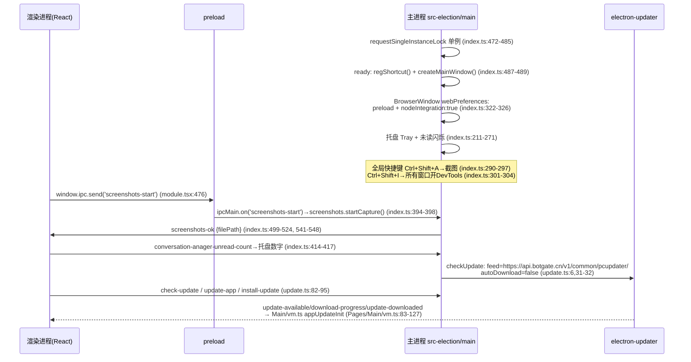
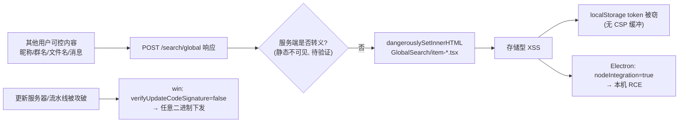

# TangSengDaoDaoWeb（唐僧叨叨 Web/桌面端）深度分析报告

> 分析对象：`/data/code/tsdd-analysis/TangSengDaoDaoWeb`
> 分析方式：纯静态代码审查（未运行、未构建）
> 报告日期：2026-10-12
> 代码规模：约 155 个 TS/TSX 文件（不含 `*.d.ts`），源码约 2.06 万行；仓库无任何测试文件

---

## 1. 仓库概述

TangSengDaoDaoWeb 是「唐僧叨叨」（TangSengDaoDao，TSDD）即时通讯产品的 **Web 端 + 桌面端统一代码库**，基于同一套 React 前端派生出三个运行形态：

| 形态 | 壳 | 状态 |
|---|---|---|
| Web 浏览器端 | CRA5 + react-app-rewired 构建静态站点，Nginx 托管 | 主力形态（Docker 镜像发布） |
| Electron 桌面端 | `apps/web/src-election/` 主进程 + electron-builder 打包 | 主力形态（mac/win/linux 多平台产物） |
| Tauri 桌面端 | `apps/web/src-tauri/`（Rust 配置 + 极薄 main.rs） | 实验性/半成品（仅菜单、更新器配置，无业务代码） |

与移动端的关系：

- 后端共用同一套服务：REST API（`/v1/` 前缀）+ WuKongIM 长连接（`wukongimjssdk@1.2.11`，WebSocket）。WuKongIM 同时是唐僧叨叨服务端所基于的开源 IM 内核，本仓库的 Docker 镜像推送到 `registry.cn-shanghai.aliyuncs.com/wukongim/tangsengdaodaoweb`（见 `Makefile`），可佐证其与 WuKongIM 生态的同源关系。
- 扫码登录逻辑（`packages/tsdaodaologin/src/login_vm.tsx`）明确依赖移动端 App：Web 端生成二维码 → 手机 App 扫码 → 手机端确认 → Web 端轮询 `user/loginstatus` 拿到 `auth_code` 换 token。即 **Web/桌面端在账号体系上从属于移动端**。
- 消息类型协议（文本/图片/语音/小视频/名片/合并转发/Lottie 贴图/位置/截屏/阅后即焚等，见 `packages/tsdaodaobase/src/Service/Const.ts:44-79`）与移动端对齐，Web 端对不支持的消息类型有 `UnsupportCell` 兜底（`packages/tsdaodaobase/src/module.tsx:203-215`，当前 `unsupportMessageTypes` 为空数组，见 `Const.ts:89`）。
- 音视频通话消息号段 9900-9999 已定义（`Const.ts:67-77`），但 Web 端无 RTC 实现，仅渲染通话结果类消息。

版本信息：根 `package.json` version `1.5.0`，`apps/web` version `1.0.6`。git 最近提交为 2026-06-11（`1bd8a2d Support multi-arch Docker builds`）。

关键数字：

- 约 155 个 TS/TSX 源文件、约 2.06 万行源码（不含 node_modules 与 `.d.ts`）。
- 0 个测试文件；`any` 出现 269 处；单文件最大 1456 行（`packages/tsdaodaobase/src/module.tsx`）。
- 4 处 `dangerouslySetInnerHTML`（全部在全局搜索组件）；1 处 `nodeIntegration: true`。
- REST 端点约 60 个（见 5.1 清单）；服务端下行 CMD 命令字 15 种；消息类型渲染分支 20+。

---

## 2. 技术栈与依赖

### 2.1 构建与工程化

| 项 | 版本 | 说明 |
|---|---|---|
| 包管理 | yarn 1.22.19 workspaces（`apps/*`、`packages/*`） | 根 `package.json` |
| 任务编排 | Turborepo 2.2.1 | `turbo.json`，build-ele 依赖 `^build` |
| 前端构建 | react-scripts 5.0.0 + react-app-rewired 2.1.8 + customize-cra | `apps/web/config-overrides.js` 中 `babelInclude` 把 `../../packages` 纳入编译（monorepo 源码直引，无预构建） |
| 语言 | TypeScript ^5.3.3 | 但 `apps/web/tsconfig.json` 继承的是 `tsconfig/nextjs.json`（nextjs 配置用于 CRA 项目，属配置异味，待验证是否有意为之） |
| Node | >= 18（engines）；Docker 构建用 node:20.9.0 | |
| Electron | 26.0.0（devDependency 锁死） + electron-builder ^26.0.12 | |
| Tauri | @tauri-apps/api/cli ^1.5.0，Rust crate tauri 1.0.1 | 实验性 |

### 2.2 运行时关键依赖

| 依赖 | 版本（声明/锁定） | 用途 | 新旧评估与升级风险 |
|---|---|---|---|
| react / react-dom | ^17.0.2 | UI 框架 | **过时**。React 17 发布于 2020 年，19 已普及。升 18 需改 `ReactDOM.render`（`apps/web/src/index.tsx:45-50`）为 createRoot，类组件为主（全部页面/组件均为 class Component）兼容性好，但 `react-virtuoso@4`、`semi-ui` 等需联动验证 |
| wukongimjssdk | ^1.2.11（锁 1.2.11） | IM 长连接 SDK（WebSocket）、会话/频道/消息管理 | 自研生态核心，升级需与 WuKongIM 服务端协议联动评估 |
| axios | ^0.25.0（锁 **0.25.0**） | REST 客户端 | **严重过时且有已知 CVE**（见第 7 节）。0.x → 1.x 有拦截器/CancelToken 等 breaking changes，`task.ts` 用了 `axios.CancelToken`（已废弃 API） |
| @douyinfe/semi-ui | ^2.24.2 | UI 组件库（抖音 Semi Design） | 活跃维护，2.x 大版本内升级风险低 |
| howler | ^2.2.4 | 消息提示音（`module.tsx:412-422`） | 稳定 |
| benz-amr-recorder | ^1.1.3 | AMR 语音播放/录制 | 小众包，长期未更新，锁版本即可 |
| sensitive-word-tool | ^1.1.9 | 客户端敏感词过滤 | 小众包，见第 7 节分析 |
| mitt | ^3.0.1 | 事件总线（`App.tsx:232`） | 稳定 |
| moment | ^2.29.3 | 时间处理 | **官方已宣布维护状态**，建议迁 dayjs/date-fns |
| qrcode.react | ^1.0.1 | 登录二维码渲染 | 1.x 很旧，现已是 3.x |
| react-mentions | ^4.3.1 | 输入框 @ 提及 | 维护放缓 |
| react-virtuoso | ^4.5.0 | **声明于 apps/web/package.json 但全仓库 0 引用** | 死依赖；聊天消息列表实际是 `vm.messages.map(...)` 全量渲染（`Conversation/index.tsx:511-518`），无虚拟化 |
| react-virtualized / react-lazyload | ^9.22.5 / ^3.2.0 | 同上，基本为死代码/边缘使用 | 建议清理 |
| electron-log / electron-updater / electron-screenshots | ^5.1.2 / ^6.1.8 / ^0.5.26 | Electron 日志/自更新/截图 | electron-updater 6 与 Electron 26 匹配 |
| keypair / @types/node-forge | ^1.0.4 / ^1.0.0 | **tsdaodaologin 声明但代码 0 引用** | 疑似遗留的「登录密码 RSA 加密」方案的残留依赖（见第 4.b 节更正） |

### 2.3 版本新旧总评

- **三大高危陈旧项**：axios 0.25（2022 年初）、Electron 26（2023 年中，Chromium 116，已停止安全更新）、React 17。Electron 26 意味着内嵌浏览器内核存在两年以上累积的已知漏洞，对「加载远端/本地 HTML 的桌面客户端」是实质性风险。
- dev 依赖中 `@types/react@^16.9.0`（apps/web）与 React 17 不匹配，属配置异味。
- 根 `resolutions` 锁了 `react-error-overlay: 6.0.9`，是 CRA5 的常见兼容性补丁。
- CRA/react-scripts 5.0.0 本身也已进入事实维护停滞（官方重心转向 Vite/Next），中长期需评估迁移 Vite 的成本——本仓库 `config-overrides.js` 的定制点很少（babelInclude、Terser、BundleAnalyzer、devServer overlay），迁移阻力不大。
- yarn.lock 中同时存在 axios 0.25.0 与 1.7.7 两个主版本（后者被某依赖间接引入），运行时实际生效的是 0.25.0（业务代码直接 import 的那份）。

---

## 3. 目录结构与模块架构

### 3.0 物理目录速览

```
TangSengDaoDaoWeb/
├── package.json            # 根: yarn workspaces + turbo 2.2.1, version 1.5.0
├── turbo.json              # 任务编排: dev/build/build-ele:*
├── Dockerfile              # Web 镜像: node20 构建 → nginx + envsubst
├── Dockerfile.ghcr         # 薄镜像: 直接拷 CI 构建产物
├── docker-entrypoint.sh    # envsubst ${API_URL} → nginx conf
├── nginx.conf.template     # /api/ 反代 ${API_URL}, 静态托管
├── Makefile                # buildx 多架构, 推阿里云 registry
├── docs/                   # 仅 3 张截图, 无文字文档
├── .github/workflows/      # ghcr.yml / pubulish-electron.yml / ghcr-cleanup.yml
├── apps/
│   └── web/                # @tsdaodao/web, 唯一应用
│       ├── src/            # 薄壳: index.tsx + App + Layout + Pages/Main (19 文件)
│       ├── src-election/   # Electron 主进程(main/) + preload/ + tsconfig.e.json
│       ├── src-tauri/      # Tauri: tauri.conf.json + main.rs(15行) + menu.rs
│       ├── electron-builder*.js  # 默认/x64/arm64/universal 四份打包配置
│       ├── config-overrides.js   # react-app-rewired: babelInclude ../../packages
│       ├── resources/      # 图标/托盘/mac entitlements/app-update.yml
│       └── scripts/        # 桌面产物架构校验 shell 脚本
└── packages/
    ├── tsdaodaobase/       # @tsdaodao/base 核心框架 + 聊天 UI (约 60% 代码量)
    ├── tsdaodaodatasource/ # @tsdaodao/datasource REST↔SDK 桥接
    ├── tsdaodaologin/      # @tsdaodao/login
    ├── tsdaodaocontacts/   # @tsdaodao/contacts
    ├── eslint-config-custom/
    └── tsconfig/
```

值得注意的物理事实：`packages/*/package.json` 的 `main` 均直接指向 `src/index.tsx`（源码分发），由 `apps/web/config-overrides.js` 的 `babelInclude([...,'../../packages'])` 把各包源码直接纳入 CRA 编译——monorepo 内**没有包级构建产物**，任何包改动即改即生效，但也意味着 base 包无法脱离本仓库独立发布/复用。

### 3.1 Workspace 拓扑



依赖方向严格单向：`web → {login, datasource, contacts} → base`。base 通过接口（`IChannelDataSource`/`ICommonDataSource`/`IConversationProvider`）反向依赖注入，datasource 在 `init()` 时 new 出实现类赋给 `WKApp.dataSource`（`packages/tsdaodaodatasource/src/module.ts:16-19`）。

### 3.2 WKApp 自研框架机制

仓库**没有使用 Redux/MobX，也没有 react-router**，而是自研了一套以单例 `WKApp` 为核心的框架，全部位于 `packages/tsdaodaobase/src/`：

**(1) 全局单例 `WKApp`**（`App.tsx:212-739`）

`WKApp.shared`（`App.tsx:216`）聚合了全部全局服务：`route`（RouteManager）、`routeLeft`/`routeRight`（ContextRouteManager）、`menus`、`apiClient`、`config`、`remoteConfig`、`loginInfo`、`endpoints`、`conversationProvider`、`messageManager`、`emojiService`、`sectionManager`、`dataSource`、`endpointManager`、`mittBus`。它继承 `ProviderListener`（`Service/Provider.tsx`），是一个「属性赋值 + `notifyListener()` 触发重渲染」的手工 MVVM 基类。

**(2) 模块系统 ModuleManager**（`Service/Module.ts:7-21`）

```ts
interface IModule { id(): string; init(): void; }
```

`registerModule(module)` 即 `map.set(id, module); module.init()`——**注册即初始化**，在 `apps/web/src/index.tsx:35-38` 顺序执行 BaseModule → DataSourceModule → LoginModule → ContactsModule。各模块在 `init()` 中向 EndpointManager/SectionManager/RouteManager 注册自己的扩展点实现。

**(3) Endpoint 扩展点机制**（`Service/Module.ts:24-105`）

这是全仓库最核心的设计模式，相当于一个字符串键的 IoC 容器：

- `Endpoint`：`{ sid, category, sort, handler }`（`Module.ts:24-36`）。
- `EndpointManager` 双 Map：`endpointIDMap`（按 sid 唯一）+ `endpointCategoryMap`（按 category 聚合、按 sort 排序，`Module.ts:61-67`）。
- 调用：`invoke(sid, param)` 单点调用（`Module.ts:68-73`）；`invokes<T>(category, param)` 聚合调用并收集非空返回值（`Module.ts:74-86`）。
- 典型应用：`BaseModule.init()` 中 `registerMessageFactor`（`module.tsx:105-148`）按消息 contentType 返回气泡组件；聊天工具栏（`module.tsx:445-492` 注册 emoji/mention/screenshot/image 四个 toolbar）；消息右键菜单（`module.tsx:514-619`，sort 控制顺序）；聊天「+」号菜单（`module.tsx:494-512`）。

**(4) Section/Row 声明式设置页**（`Service/Section.tsx` + `App.tsx:503-542`）

频道设置页、用户资料页不是写死的组件树，而是各模块用 `channelSettingRegister(sectionID, fnc, sort)` / `userInfoRegister(...)` 注册「返回 Section{rows: Row{cell, properties}}」的工厂函数，页面按 sort 拼装。例：`module.tsx:1038-1184`（群名称/群头像/群二维码/群公告/备注）、`module.tsx:1220-1304`（免打扰/置顶/保存通讯录开关）。这是典型的插件化 UI 注入设计。

**(5) 自研路由**（`Service/Route.tsx`）

- `RouteManager.register(path, handler)` 实际是把 `route:<path>` 注册成 Endpoint（`Route.tsx:26-30`）。
- `push(path)`：`invoke` 拿组件 → `history.pushState` → `WKApp.restContent(component)` 触发重渲染（`Route.tsx:37-45`）。`onpopstate`/`onpageshow` 也直接 push 当前 path（`Route.tsx:11-19`）。
- **注意**：`restContent` 设置的 `WKApp.content` 在主布局中并未实际渲染（MainPage 用 `MainVM.historyRoutePaths` + `display:none` 切换页面，见 `apps/web/src/Pages/Main/index.tsx:27-34`），RouteManager 更多承担「path → 组件」的查表职责，真正的导航是菜单点击切换 `currentMenus`。
- 左右分栏区域各有一个 `ContextRouteManager`（`Route.tsx:48-69`），它是「能力委托」壳：真正的 push/pop 由 `WKLayout` 内的 `WKViewQueue`（视图栈容器）在 `apps/web/src/Pages/Main/index.tsx:49-74` 注入。如打开会话 = `WKApp.routeRight.replaceToRoot(<ChatContentPage/>)`（`EndpointCommon.tsx:103-109`）。

**(6) 菜单机制**（`Service/Menus.ts`）

`MenusManager.register(sid, f, sort)` 注册 `menus:<sid>` Endpoint（`Menus.ts:10-13`）；`menusList()` 聚合调用（`Menus.ts:15-17`）。`apps/web/src/App/index.tsx:26-62` 注册「会话」「通讯录」两个一级菜单并在回调中动态计算 badge；`menus.refresh()` 通过 `tab_normal_screen.tsx:15-17` 注入的 `setRefresh = () => this.setState({})` 强制刷新侧边栏。

**(7) UI 刷新模型（自研 MVVM）**

核心在 `Service/Provider.tsx`（69 行）：

- `ProviderListener`（`Provider.tsx:10-29`）：持有 `callback`，`notifyListener()` 即调用它；`listen(f)` 由宿主组件注入回调。
- `Provider` 组件（`Provider.tsx:38-69`）：构造时 `create()` 出 VM，`componentDidMount` 时把「`this.setState({})` 强刷」注入为 VM 的 callback（`Provider.tsx:49-55`），卸载时解绑并调 `didUnMount()`。

即：**VM 是普通 class，改字段后手工 `notifyListener()` → Provider setState 空对象 → 重渲染**。无响应式依赖追踪，漏调 notify 即不刷新（代码中大量手工 `notifyListener()` 调用，是可维护性隐患；也有 `vm.notifyListener(() => {...})` 把回调透传成 setState 回调的用法，见 `Conversation/vm.ts:926-930`）。

**(8) 视图栈容器 WKViewQueue**

`Components/WKViewQueue/index.tsx` 实现了一个 JSX.Element 数组栈：`push/replaceToRoot/pop/popToRoot`（接口定义 `index.tsx:7-16`），配合 push/pop 方向做位移动画（`WKViewQueueStatus` 枚举）。左右分栏各持有一个实例，其 context 在 `apps/web/src/Pages/Main/index.tsx:49-74` 注入到 `WKApp.routeLeft/routeRight`（`ContextRouteManager`，`Service/Route.tsx:48-69`）。于是业务代码写的 `WKApp.routeRight.replaceToRoot(<ChatContentPage/>)`（`EndpointCommon.tsx:103-109`）就完成了「打开会话」的界面切换——路由即组件栈，URL 完全不参与。

**(9) Section/Row 的底层实现**

`Service/Section.tsx`：`SectionManager.register` 实际也是注册 `section-<sectionID>` Endpoint（`Section.tsx:7-14`），`sections(category)` 即 `invokes(category, context)` 按 sort 排序聚合。`Row = { cell: ElementType, properties, sort }`（`Section.tsx:44-58`）——设置页本质是「数据驱动的组件渲染器」，与 Endpoint 体系完全同构。

### 3.3 各包职责

| 包 | 职责 | 关键文件 |
|---|---|---|
| tsdaodaobase | 框架（WKApp/Endpoint/Route/Menus/Section/Provider）+ APIClient + 聊天页 + 20 余种消息气泡 + 全部通用组件 | `App.tsx`、`module.tsx`（1456 行，全仓库最大文件） |
| tsdaodaodatasource | 实现 base 定义的数据接口：把 WKSDK 的 provider 回调桥接到 REST API | `module.ts`（9 个回调注册）、`datasource.ts`、`conversation.ts`、`task.ts`（媒体上传） |
| tsdaodaologin | 密码登录 + 扫码登录 | `login.tsx`、`login_vm.tsx`、`module.tsx` |
| tsdaodaocontacts | 通讯录/新朋友/黑名单/保存的群/组织架构选人 | `module.tsx`、`Contacts/`、`NewFriend/`、`Organizational/GroupNew/`（755 行） |
| eslint-config-custom | 共享 ESLint 配置（继承 next/turbo/prettier） | `index.js`（12 行，配置与 CRA 项目错配，见 8.4） |
| tsconfig | 共享 tsconfig（base/nextjs/react-library） | `base.json`（strict: true） |

### 3.4 数据模型层

base 包在 WKSDK 模型之上包了一层 UI 模型（`Service/Model.tsx`，440 行）：

- `ConversationWrap`（`Model.tsx:8-114`）：包装 SDK 的 `Conversation`，透出 avatar（带头像版本号防缓存，`Model.tsx:26-31`）、unread、lastMessage、isMentionMe、reminders 等 getter；`category` getter（`Model.tsx:91-109`）内含客服会话分类逻辑（new/assignMe/allAssigned/solved），说明该代码库与客服系统（botgate）共享业务模型。
- `MessageWrap`（`Model.tsx:143-...`）：包装 `Message`，核心是 `order = messageSeq * OrderFactor`（`Model.tsx:151`，`OrderFactor=10000`，`Const.ts:128`）——给「本地发送中消息」「时间条」「历史分割线」等非服务端消息留出排序间隙；`_parts` 缓存富文本分段。
- `Part`/`PartType`（`Model.tsx:118-141`）：文本消息被切成 text/emoji/mention/link 四种片段，`TextCell` 按片段类型分别渲染（`Messages/Text/index.tsx:54-75`），这是文本消息不依赖 innerHTML 的关键设计。
- `BubblePosition`（`Model.tsx:125-132`）：连续消息气泡的头/中/尾/单独形态计算，用于气泡圆角与头像显示。

消息气泡的注册是「双注册」：① `WKSDK.register(contentType, () => new XxxContent())` 注册**协议层**编解码（`module.tsx:150-193`）；② `WKApp.messageManager.registerMessageFactor/registerCell` 注册**渲染层**组件（`module.tsx:105-148, 196-215`），`MessageManager.getCell` 按 contentType 查表、工厂兜底、最终落到 UnknownCell（`Service/MessageManager.tsx:16-32`）。1000-2000 号段统一走 `SystemCell`（`module.tsx:143-145`）。

---

## 4. 核心流程走读

### 4.a 应用启动

```mermaid
sequenceDiagram
    participant IDX as apps/web/src/index.tsx
    participant WK as WKApp.shared
    participant MOD as 各 Module.init()
    participant SDK as WKSDK(wukongimjssdk)
    participant UI as App/Layout/MainPage

    IDX->>IDX: 判定运行环境(Tauri/Electron/dev/prod)<br/>设置 apiURL (index.tsx:11-25)
    IDX->>WK: tokenCallback = () => loginInfo.token (index.tsx:28-30)
    IDX->>WK: loginInfo.load() 从 localStorage 读 token (index.tsx:33)
    IDX->>MOD: registerModule(Base/DataSource/Login/Contacts)<br/>(index.tsx:35-38, 注册即 init)
    MOD-->>WK: 注册路由/菜单/Endpoint/Section/消息气泡工厂
    IDX->>WK: startup() (index.tsx:40 → App.tsx:265)
    WK->>WK: 设备指纹(deviceId/OS/浏览器) (App.tsx:269-277)
    WK->>SDK: 设置 connectAddrCallback<br/>imConnectAddrs()→wss_addr (App.tsx:284-294)
    WK->>WK: addOnLogin(startMain); 若已登录直接 startMain (App.tsx:296-302)
    WK->>SDK: addConnectStatusListener(被踢/认证失败→logout) (App.tsx:304-322)
    WK->>WK: remoteConfig.startRequestConfig()<br/>GET common/appconfig (App.tsx:334, 89-94)
    IDX->>UI: ReactDOM.render(<App/>) (index.tsx:45)
    UI->>UI: App.registerMenus() 注册会话/通讯录菜单与路由<br/>(App/index.tsx:14-71)
    UI->>UI: AppLayout: 未登录→渲染 /login；已登录→WKBase+MainPage<br/>(Layout/index.tsx:94-105)
```

关键链路（file:line）：

1. `apps/web/src/index.tsx:11` — `const apiURL = "https://api.botgate.cn/v1/"`；环境三分支：Tauri（`__TAURI_IPC__`）/Electron（`__POWERED_ELECTRON__`）/dev 均用硬编码生产域名，仅生产 Web 构建用相对路径 `/api/v1/`（`index.tsx:23`）。
2. `apps/web/src/index.tsx:35-40` — 四个模块注册并 `startup()`。
3. `packages/tsdaodaobase/src/App.tsx:265-337` — `startup()`：加载登录信息、判定 PC 端、生成/读取 `deviceId`（localStorage，`App.tsx:339-346`，`Math.random` UUID，非加密随机）、设置 WKSDK 连接地址回调、注册连接状态监听（`ConnectKick` 或 reasonCode==2 时 `logout()`，`App.tsx:306-311`）、拉取远程配置（撤回时限 `revoke_second`）。
4. `packages/tsdaodaobase/src/App.tsx:399-409` — `startMain()`：`connectIM()`（设置 uid/token 后 `WKSDK.shared().connect()`，`App.tsx:411-415`）→ `contactsSync()` 同步通讯录 → `ProhibitwordsService.shared.sync()` 同步敏感词 → `GET /user/devices/{deviceId}` 取设备在服务器侧的 id 作为 `clientMsgDeviceId`。
5. 渲染入口：`apps/web/src/App/index.tsx:7-12` → `Layout/index.tsx:90-107`（未登录走 `WKApp.route.get("/login")`）→ `Pages/Main/index.tsx:38-81`（WKLayout 三栏：侧边 Tab / 左内容 / 右 WKViewQueue）。

各模块 `init()` 的职责明细：

| 模块 | init() 做的事 | 位置 |
|---|---|---|
| BaseModule | 注册 401 登出回调；注册 emojiService endpoint；注册全部消息气泡工厂（渲染层 + 协议层）；挂 CMD 监听（channelUpdate/typing/unreadClear/friendRequest/friendAccept/messageRevoke/onlineStatus 等 15 种）；挂新消息监听（通知 + 提示音）；注册聊天菜单/工具栏/右键菜单/用户资料 Section/频道设置 Section | `module.tsx:94-410` |
| DataSourceModule | new 出 ConversationProvider/ChannelDataSource/CommonDataSource 注入 WKApp；向 WKSDK 注册 9 个 provider 回调（频道信息/成员同步/上传任务/会话同步/会话扩展/消息扩展/提醒/提醒完成/已读上报） | `datasource/module.ts:13-30` |
| LoginModule | 仅注册 `/login` 路由 → `<Login/>` | `tsdaodaologin/src/module.tsx:12-15` |
| ContactsModule | 注册「新朋友/保存的群/黑名单」contactsHeader endpoints；注册组织架构选人工具；好友申请变更时刷新通讯录 | `tsdaodaocontacts/src/module.tsx:22-...` |

**启动时序的一个隐患**：`ModuleManager.register` 是「注册即 init」（`Service/Module.ts:13-16`），而 BaseModule.init 中大量使用 `WKApp.dataSource.commonDataSource` 等接口（实际在 DataSourceModule.init 才注入实现）。当前靠 `index.tsx:35-38` 的注册顺序（Base 在前、DataSource 在后）+ 这些调用都发生在登录后的回调里而「恰好」不炸——顺序契约隐式且无防护，调整注册顺序即出运行时错误（待验证边界，属架构脆弱点）。

### 4.b 登录流程

**重要更正**：背景材料所述「密码登录 RSA 加密」在当前代码中**不存在**。`tsdaodaologin/package.json` 声明了 `keypair` 与 `@types/node-forge` 依赖，但全仓库（除 node_modules）grep 不到任何 RSA/JSEncrypt/forge/keypair 的实际调用——是残留依赖。当前实现为**明文密码 JSON POST**（依赖 TLS 保护）。

**密码登录**（`packages/tsdaodaologin/src/login_vm.tsx:124-139`）：

```mermaid
sequenceDiagram
    participant U as 用户
    participant L as Login.tsx
    participant VM as LoginVM
    participant API as 后端
    U->>L: 输入手机号+密码, 点登录
    L->>L: 手机号归一化: 11位1开头→0086前缀; +→00; 其他→00<br/>(login.tsx:54-63)
    L->>VM: requestLoginWithUsernameAndPwd(fullPhone, pwd)
    VM->>API: POST user/login {username, password(明文), flag:1, device}<br/>(login_vm.tsx:133)
    API-->>VM: {app_id, uid, short_no, token, name, sex, ...}
    VM->>VM: loginSuccess(data): 写 LoginInfo 并 save()<br/>(login_vm.tsx:149-160)
    VM->>WKApp: endpoints.callOnLogin()
    WKApp->>WKApp: startMain()→连IM/同步通讯录/敏感词 (App.tsx:296-298)
    WKApp->>浏览器: AppLayout.onLogin: location.href=index.html?sid=xxx<br/>(Layout/index.tsx:16-22)
```

**扫码登录**（状态机 `login_vm.tsx:75-105`）：

1. `GET user/loginuuid`（带 device 参数）→ 得 `uuid` + `qrcode` 内容，前端 `qrcode.react` 渲染（`login_vm.tsx:162-182`，`login.tsx:82`）。
2. 状态 `waitScan` → **轮询** `GET user/loginstatus?uuid=xxx`（`login_vm.tsx:200-208`）：每轮响应驱动状态机 `advance()`。错误重试上限 10 次（`_pullMaxErrCount`，`login_vm.tsx:28`）；二维码过期自动重新获取，上限 5 次后停刷需手动点刷新（`login_vm.tsx:22-23, 95-103`）。
3. 手机扫码 → 状态 `scanned`（显示扫码人头像，`login.tsx:85-88`）→ 手机确认 → 状态 `authed` 并携带 `auth_code` → `POST user/login_authcode/{authCode}`（`login_vm.tsx:112-122`）换完整登录态 → 同密码登录的 `loginSuccess()`。
4. 全程为 **HTTP 短轮询，未使用长连接确认**（与背景材料「轮询/长连确认」的表述相比，只有轮询，待验证服务端是否有长连推送方案）。

**token 存储**：

- `LoginInfo.save()`（`packages/tsdaodaobase/src/App.tsx:115-124`）把 `token`/`uid`/`app_id`/`role` 等写入 **localStorage**，键名带 `sid` 后缀（`sid` 取自 URL query，`App.tsx:155-158` + `Utils/search.ts:8-15`，用于多开隔离；Electron 每窗口启动时生成随机 sid，见 `src-election/main/index.ts:349,353`）。
- 每次请求由 axios 请求拦截器注入自定义头 `config.headers["token"] = token`（`Service/APIClient.ts:30-39`）。
- 401 响应 → `logoutCallback()` → `WKApp.logout()` → 清 token 并 `window.location.reload()`（`APIClient.ts:52-56`、`App.tsx:433-436`）。

localStorage 中实际持久化的键一览（均经 `StorageService` → localStorage）：

| 键（含 sid 后缀的标注 *） | 内容 | 写入位置 |
|---|---|---|
| `token*` / `uid*` / `app_id*` / `short_no*` / `name*` / `role*` / `is_work*` / `sex*` | 登录态全套 | `App.tsx:115-124` |
| `theme-mode` | 主题 | `App.tsx:61` |
| `NotificationIsClose` | 通知开关 | `App.tsx:257` |
| `deviceId` | 设备指纹 UUID | `App.tsx:339-346` |
| `channelAvatarTag:<type><id>` | 头像缓存版本号 | `App.tsx:477-484` |
| `<uid>friendApplys` | 好友申请列表 JSON | `App.tsx:692-697` |
| `<uid>-friend-applys-unread-count` | 好友申请未读数 | `App.tsx:626` |
| `prohibitwords` | 敏感词库 JSON | `ProhibitwordsService.ts:47` |

可见敏感面集中于第一行：token 与账号标识全量落地。`logout()`（`App.tsx:201-209`）只删 token/app_id/role/is_work 四项，uid/name/short_no 等残留在本地（轻微隐私残留，记录在案）。

### 4.c 消息收发

**消息类型支持矩阵**（注册关系见 `module.tsx:105-215`，类型常量见 `Const.ts:44-79`）：

| contentType | 类型 | 协议层 Content | 渲染层 Cell |
|---|---|---|---|
| 1 | 文本 | SDK 内置 MessageText | TextCell（parts 富文本） |
| 2 | 图片 | ImageContent | ImageCell |
| 3 | gif | GifContent | GifCell |
| 4 | 语音 | VoiceContent（含 amr 波形） | VoiceCell + WaveCanvas |
| 5 | 小视频 | VideoContent | VideoCell |
| 6 | 位置 | LocationContent | LocationCell |
| 7 | 名片 | Card | CardCell |
| 11 | 合并转发 | MergeforwardContent | MergeforwardCell |
| 12/13 | Lottie 贴图 | LottieSticker | LottieStickerCell（lottie-player） |
| 16 | 加入组织 | JoinOrganizationContent | JoinOrganizationCell |
| 20 | 截屏 | ScreenshotContent | ScreenshotCell |
| -1/-2/-3 | 时间条/输入中/历史分割线（本地伪消息） | HistorySplitContent | TimeCell/TypingCell/HistorySplitCell |
| 1000-2000 | 系统消息号段 | SDK 内置 | SystemCell |
| 1009 | 审批群成员 | — | ApproveGroupMemberCell |
| 98 / signalMessage | 端到端加密错误提示 | — | SignalMessageCell |
| 其他未知 | — | — | UnknownCell 兜底 |

「阅后即焚」（Flame）有 `Messages/Flame/index.tsx` 与 `FlameMessageCell`（在 `Conversation/index.tsx:17` 引入），但 module.tsx 的注册表中未见对应 contentType 注册（待验证是否已废弃的功能残留）。

**收消息链路**：



- 历史消息拉取：`ConversationVM.syncMessages`（`Components/Conversation/vm.ts:830-890`）→ `ConversationProvider.syncMessages` → `POST message/channel/sync`（`datasource/conversation.ts:44-65`），`pageSizeOfMessage=30`（`App.tsx:42`）；向上/向下翻页 `pulldownMessages`（`vm.ts:934-968`）/`pullupMessages`（`vm.ts:971-1005`），通过 `SyncMessageOptions{pullMode, startMessageSeq}` 控制。
- **虚拟列表更正**：背景材料所述「react-virtuoso 虚拟列表」**不成立**。`react-virtuoso` 在 `apps/web/package.json` 中声明但全仓库无一处 import；消息列表为 `vm.messages.map(...)` 全量渲染 + 手写滚动监听（`Conversation/index.tsx:509-518`），`allVisiableMessages` 用 DOM `offsetTop` 遍历计算可见消息（`index.tsx:440-464`）。长会话下存在性能隐患（见第 8 节）。

**发消息链路**：

1. 输入框 `MessageInput`（`Components/MessageInput/index.tsx`，react-mentions 实现 @）`onSend(text, mention)` → 构造 `MessageText` + `Mention` + 可选 `Reply`（`Conversation/index.tsx:607-637`）。
2. `Conversation.sendMessage`（`index.tsx:45-61`）→ `ConversationVM.sendMessage`（`vm.ts:1154-...`）→ `WKSDK.shared().chatManager.send(content, channel, setting)`，成功后进入 `sendQueue`（`vm.ts:36`，按 channelKey 分桶），ACK 回包回填状态（`vm.ts:571-574`）。
3. 附件类消息（图片/视频/文件）：WKSDK 调 `messageUploadTaskCallback` → `MediaMessageUploadTask`（`datasource/module.ts:120-125` → `task.ts`）：先 `GET file/upload?path=...&type=chat` 换取预签名上传 URL（`task.ts:75-80`），再 `axios.post(uploadURL, FormData)` 直传（`task.ts:46-72`），成功后把 `remoteUrl` 写回消息体再发送。
4. **敏感词过滤位置**：`ProhibitwordsService`（`Service/ProhibitwordsService.ts`，基于 `sensitive-word-tool`）在 `startMain` 时同步词库（`App.tsx:402`；增量同步 `GET message/prohibit_words/sync`，`ProhibitwordsService.ts:24-28`）。过滤发生在 **展示侧**：渲染消息列表前对每条文本消息 `filter()`（`Conversation/vm.ts:916-921`），会话列表的最后一条消息摘要同理（`Pages/Chat/vm.ts:102,112,270`）。**发送路径不过滤、存储不过滤**——词库只影响本客户端的显示（见第 7 节）。

**消息辅助机制**：

- 撤回：`revokeMessage` → `POST message/revoke?...`（`datasource/conversation.ts:32`）；收到 `messageRevoke` CMD 时本地把 lastMessage 标记为 revoked（`module.tsx:334-351`）。撤回按钮的可见性受远程配置 `revoke_second`（默认 2 分钟）与群管理员身份共同决定（`module.tsx:578-618`）。
- 已读回执：`messageReadedCallback` 批量上报 `POST message/readed`（`datasource/module.ts:175-187`）。
- 输入中状态：`typing` CMD → `TypingManager`（`module.tsx:227-235`），渲染为 `TypingCell`（contentType=-2）。
- 提醒项（@我）：`syncRemindersCallback` 仅拉取群会话的提醒（`datasource/module.ts:147-167`），聊天页右下角 `ConversationPositionView` 展示未读数与提醒跳转（`Conversation/index.tsx:521-533`）。
- 复制实现：消息右键「复制」用 `document.oncopy` 钩子 + `document.execCommand("Copy")`（`module.tsx:524-533`）——execCommand 已废弃 API，且全局 `document.oncopy` 覆写属 hack 写法（未用 navigator.clipboard）。

### 4.d Electron 主进程



要点：

- 窗口配置 `getWindowConfig()`（`index.ts:308-329`）：1200x800，**`nodeIntegration: true`**（`index.ts:325`），未显式设置 `contextIsolation`/`webSecurity`（取 Electron 26 默认值：contextIsolation=true、webSecurity=true）。preload（`src-election/preload/index.ts`）用 contextBridge 暴露 `__POWERED_ELECTRON__`、**通用 `ipc.send/invoke/on/once`（任意通道白名单缺失，第 5-21 行）** 与 `electronNotification`。
- 截图：渲染进程聊天工具栏点击（`module.tsx:470-483`，非 Electron 环境退化为打开 snipaste 官网）→ IPC → `electron-screenshots` 库 → 截图完成写临时 PNG（`tmp.tmpNameSync()`，`index.ts:542-544`）→ 回传 filePath 给渲染进程作为图片消息发送。
- 自更新：`electron-updater` generic provider 指向自建 HTTPS 地址（`update.ts:6` + `electron-builder.js:24-27`）；主进程 `autoDownload=false`，渲染进程收到 `update-available` 后立即 `send("update-app")` 自动下载（`Pages/Main/vm.ts:89-91`），下载完成后用户点「安装更新」触发 `quitAndInstall`。**Windows 下 `verifyUpdateCodeSignature: false`**（`electron-builder.js:64`）。
- 多开：通过 `?sid=<random>` 区分窗口存储命名空间（`index.ts:349,353`），支持「新建窗口」菜单（`index.ts:144-149`）。
- 深链：`open-url` → `deep-link` 转发渲染进程（`index.ts:460-469`）。
- 通知桥：`main/notification.ts`（355 行）实现原生通知管理，preload 暴露 `electronNotification.show/close/onClicked`，渲染侧 `Utils/NotificationUtil.ts` 按环境选择 Web Notification 或原生通知。Web 环境在登录成功回调里 `Notification.requestPermission()`（`apps/web/src/Layout/index.tsx:21`）；消息通知触发点统一在 `BaseModule.allowNotify/sendNotification`（`module.tsx:424-443`），免打扰（mute）频道与系统消息、自己发的消息不通知。
- 渲染进程侧更新 UI：`Main/vm.ts:83-131` 监听 5 个更新事件，驱动 Semi 的 Progress/Modal 组件展示下载进度与「安装更新」按钮。
- 窗口关闭行为：主窗口 close 时若有托盘则隐藏而非退出（`index.ts:374-386`），`forceQuit` 标志控制真正退出；`window-all-closed` 时非 mac 退出（`index.ts:594-596`）。

---

## 5. 对外接口

### 5.1 REST 端点清单（grep `apiClient.get/post/put/delete` + 直接 axios 调用整理）

baseURL：dev/桌面端 `https://api.botgate.cn/v1/`，生产 Web `/api/v1/`（Nginx 反代）。鉴权：自定义请求头 `token`。

**登录/账号**

| 方法 | 路径 | 用途 | 位置 |
|---|---|---|---|
| POST | `user/login` | 密码登录（明文密码） | login_vm.tsx:133 |
| GET | `user/loginuuid` | 获取扫码登录 uuid/二维码 | login_vm.tsx:169 |
| GET | `user/loginstatus?uuid=` | 轮询扫码状态 | login_vm.tsx:200 |
| POST | `user/login_authcode/{authCode}` | 扫码确认后换 token | login_vm.tsx:117 |
| GET | `users/{uid}` | 用户资料 | UserInfo/vm.tsx:192, tab_normal_screen.tsx:29 |
| PUT | `user/current` | 修改当前用户资料 | MeInfo/vm.tsx:54 |
| GET | `user/search?keyword=` | 搜索用户 | datasource.ts:198 |
| GET | `user/qrcode` | 我的二维码 | datasource.ts:201 |
| GET | `user/reddot/friendApply` / DELETE 同路径 | 好友申请红点 | App.tsx:624/671 |
| GET | `user/devices/{deviceId}` | 设备登记查询 | App.tsx:404 |
| GET | `users/{uid}/im` | 获取 IM wss/ws 地址 | datasource.ts:255,264 |
| POST/DELETE | `user/blacklist/{uid}` | 个人黑名单 | datasource.ts:156,159 |
| GET | `users/{uid}/avatar`、`groups/{gid}/avatar`（拼接） | 头像 | App.tsx:454-457 |

**好友/通讯录**

| 方法 | 路径 | 用途 | 位置 |
|---|---|---|---|
| GET | `friend/sync` | 通讯录增量同步/搜索 | datasource.ts:242,290 |
| POST | `friend/apply` / GET `friend/apply` | 申请/列表 | datasource.ts:211, NewFriend/vm.tsx:52 |
| POST | `friend/sure` | 同意好友 | datasource.ts:205 |
| PUT | `friend/remark` | 备注 | datasource.ts:166 |
| DELETE | `friends/{uid}` | 删好友 | datasource.ts:162 |
| GET | `organization/joined`、`organizations/{orgId}/department` | 组织架构 | GroupNew/index.tsx:84,97 |

**群组/频道**

| 方法 | 路径 | 用途 | 位置 |
|---|---|---|---|
| GET | `channels/{id}/{type}` | 频道信息（SDK channelInfoCallback） | module.ts:36 |
| POST | `group/create` | 建群 | datasource.ts:27 |
| GET | `group/my` | 保存的群 | datasource.ts:30 |
| GET/PUT | `groups/{gid}` | 群信息/改字段 | datasource.ts:105 |
| POST | `groups/{gid}/exit`、`groups/{gid}/transfer/{uid}` | 退群/转让 | datasource.ts:10,17 |
| GET/POST/DELETE | `groups/{gid}/members[/uid]` | 成员管理 | datasource.ts:24,62,69,79 |
| GET | `groups/{gid}/membersync` | 成员增量同步 | module.ts:93 |
| POST/DELETE | `groups/{gid}/managers` | 管理员 | datasource.ts:125,131 |
| POST | `groups/{gid}/blacklist/add|remove` | 群黑名单 | datasource.ts:135,140 |
| PUT | `groups/{gid}/setting`、`users/{uid}/setting` | 免打扰/置顶等 | datasource.ts:118,120 |
| GET | `groups/{gid}/qrcode` | 群二维码 | datasource.ts:109 |
| GET | `groups/{gid}/member/h5confirm` | 审批入群确认 | Messages/ApproveGroupMember/index.tsx:18 |

**消息/会话**

| 方法 | 路径 | 用途 | 位置 |
|---|---|---|---|
| POST | `conversation/sync` | 最近会话同步（SDK 回调） | module.ts:193 |
| POST | `conversation/extra/sync` | 会话扩展同步 | module.ts:130 |
| POST | `conversations/{id}/{type}/extra` | 草稿/阅读位置 | datasource.ts:144 |
| DELETE | `conversations/{id}/{type}` | 删会话 | conversation.ts:10 |
| PUT | `coversation/clearUnread`（**注意服务端路径拼写就是 coversation**） | 清未读 | conversation.ts:37 |
| POST | `message/channel/sync` | 历史消息拉取 | conversation.ts:53 |
| POST | `message/extra/sync` | 消息扩展（已读/回执） | conversation.ts:74 |
| POST | `message/revoke?...` | 撤回 | conversation.ts:32 |
| POST | `message/readed` | 已读上报 | module.ts:183 |
| POST | `message/reminder/sync`、`message/reminder/done` | @提醒同步/完成 | module.ts:159,171 |
| POST | `message/offset` | 清空聊天记录 | conversation.ts:80 |
| DELETE | `message` | 删除消息 | conversation.ts:25-28 |
| GET | `message/prohibit_words/sync` | 敏感词增量同步 | ProhibitwordsService.ts:24 |
| POST | `/search/global` | 全局搜索 | GlobalSearch/vm.ts:137 |
| GET | `file/upload?path=&type=chat` | 获取上传 URL | task.ts:76 |

**其他**

| 方法 | 路径 | 用途 | 位置 |
|---|---|---|---|
| GET | `common/appconfig` | 远程配置（撤回时限） | App.tsx:90 |
| GET | `common/appversion/web/{version}` | Web 版本检查 | Pages/Main/vm.ts:135-137 |
| GET/POST/DELETE | `favorites`、`favorite/my` | 收藏 | datasource.ts:168-190 |
| GET | `sticker/user/category`、`sticker/user/sticker` | 表情包 | datasource.ts:192,195 |
| GET | `v1/common/pcupdater/`（electron-updater generic feed） | 桌面端自更新 | update.ts:6 |
| GET | `v1/common/updater/{target}/{version}`（Tauri updater） | Tauri 自更新 | tauri.conf.json:62-64 |

### 5.2 长连接（wukongimjssdk）

- 连接地址：`GET users/{uid}/im` 返回 `wss_addr`（优先）/`ws_addr`（`datasource.ts:263-271`），注入 `WKSDK.config.provider.connectAddrCallback`（`App.tsx:284-294`）。
- 认证：`WKSDK.config.uid/token = loginInfo.uid/token`（`App.tsx:412-413`）。
- 失败切换：维护地址数组，Disconnect 时轮转（`App.tsx:312-320`；当前服务端只返回单地址，轮转逻辑实际意义有限）。
- 掉线处理：`ConnectKick`（被踢）或 reasonCode==2（认证失败）→ 本地 logout（`App.tsx:306-311`）。

长连接上承载的服务端主动下行（CMD 命令字）一览（处理逻辑集中在 `module.tsx:217-356` 的 if-else 链）：

| CMD | 语义 | 客户端动作 |
|---|---|---|
| `channelUpdate` | 频道信息变更 | 重新 fetchChannelInfo（`module.tsx:222-226`） |
| `typing` | 对方正在输入 | TypingManager 登记（`module.tsx:227-235`） |
| `groupAvatarUpdate` | 群头像变更 | 换头像缓存 tag + 重拉频道（`module.tsx:236-242`） |
| `unreadClear` | 他端清未读 | 同步本地会话未读数（`module.tsx:243-258`） |
| `conversationDeleted` | 他端删会话 | 本地移除会话（`module.tsx:259-262`） |
| `friendRequest` / `friendAccept` / `friendDeleted` | 好友申请/通过/删除 | 写本地申请列表、响铃、同步通讯录（`module.tsx:263-305`） |
| `memberUpdate` | 群成员变更 | syncSubscribes 增量同步（`module.tsx:306-312`） |
| `onlineStatus` | 好友在线状态 | 更新 ChannelInfo.online/lastOffline（`module.tsx:313-327`） |
| `syncConversationExtra` / `syncReminders` | 触发同步 | 调 SDK 同步流程（`module.tsx:328-333`） |
| `messageRevoke` | 消息撤回 | 标记 lastMessage.revoke（`module.tsx:334-351`） |
| `userAvatarUpdate` | 用户头像变更 | 换 tag + 通知通讯录刷新（`module.tsx:352-355`） |

普通消息中还有两种特殊 contentType 触发副作用：`channelUpdate(1005)` 重拉频道、`addMembers(1002)/removeMembers(1003)` 重新同步成员（`module.tsx:363-371`）。

---

## 6. 部署与运维

### 6.0 三端运行时差异

| 能力 | Web | Electron | Tauri |
|---|---|---|---|
| 环境探测 | 默认分支 | `window.__POWERED_ELECTRON__`（preload 注入） | `window.__TAURI_IPC__` |
| API 地址 | dev 硬编码 / prod 相对 `/api/v1/` | 恒硬编码 `https://api.botgate.cn/v1/` | 恒硬编码 |
| 通知 | Web Notification API | 主进程原生通知（notification.ts） | 未接入 |
| 截图 | 引导去 snipaste 官网（`module.tsx:478`） | electron-screenshots + 全局快捷键 | 未接入 |
| 自更新 | `common/appversion/web/{v}` 仅提示（`Pages/Main/vm.ts:63-79`） | electron-updater 全量流程 | tauri updater（Layout 内有检查代码，`Layout/index.tsx:34-58`） |
| 未读角标 | 菜单 badge | 托盘闪烁 + macOS 托盘数字 | 未接入 |
| 构建产物 | Nginx 静态站点 | dmg/nsis/AppImage/deb/zip | 未产出（实验性） |

### 6.1 Web 端 Docker 化

- `Dockerfile`（多阶段）：`node:20.9.0` 内 `yarn install --frozen-lockfile && yarn build`（默认走 npmmirror 源，可用 `--build-arg YARN_REGISTRY=` 覆盖）→ 产物 `apps/web/build` 拷入 `nginx:latest`。
- **envsubst 注入机制**：`docker-entrypoint.sh` 在容器启动时执行 `envsubst '${API_URL}' < /nginx.conf.template > /etc/nginx/conf.d/default.conf`，把环境变量 `API_URL` 注入 Nginx 配置；`nginx.conf.template` 中 `location /api/ { proxy_pass ${API_URL}; client_max_body_size 1000m; }` 反代后端，前端静态文件走 `/usr/share/nginx/html`。配合前端生产构建的相对路径 `/api/v1/`（`apps/web/src/index.tsx:23`），实现「一个镜像任意后端」。
- `Dockerfile.ghcr`：更薄（要求 CI 已构建好 `apps/web/build`），供 GitHub Actions ghcr.io 流水线使用。
- `Makefile`：`build`（buildx 单架构）、`deploy`（本地 build 后多架构 amd64+arm64 推阿里云 registry `wukongim/tangsengdaodaoweb`）。
- CI：
  - `.github/workflows/ghcr.yml`：main 分支 push/PR/tag 触发，Node 20 + `yarn install --frozen-lockfile` + `yarn build`，产物部署到 `cf-dist` 分支（疑似 Cloudflare Pages 分发）并构建 ghcr.io 多架构镜像。
  - `.github/workflows/pubulish-electron.yml`（workflow 名拼写如此）：`v*` tag 触发，windows-latest/macos-latest 矩阵，分别 `yarn build-ele:win` / `build-ele:mac`，产物上传发布（更新包最终需落到 `api.botgate.cn/v1/common/pcupdater/` 供 electron-updater 拉取，上传步骤待验证是否在本 workflow 内闭环）。
  - `.github/workflows/ghcr-cleanup.yml`：旧镜像清理。

### 6.2 Turbo 构建管线

`turbo.json`：`build`（输出 `build/**`）→ `build-ele*`（`dependsOn: ^build`，输出 `dist-ele/**`）；`dev`/`dev-ele` 不缓存并行跑。根脚本 `yarn dev` 即 `turbo run dev --parallel`；`build-ele:{mac,win,linux,linux-arm64}` 串联 turbo 任务。

### 6.3 Electron 产物

`apps/web/electron-builder.js`（另有 x64/arm64/universal 变体配置）：

| 平台 | target | 备注 |
|---|---|---|
| macOS | dmg + zip（x64、arm64；另支持 universal） | hardenedRuntime + entitlements（`resources/mac/entitlements.mac.plist`），麦克风/摄像头用途声明 |
| Windows | nsis + zip | `oneClick:false`，允许改安装目录；`verifyUpdateCodeSignature:false` |
| Linux | AppImage + deb（x64/arm64） | |

发布：generic provider → `https://api.botgate.cn/v1/common/pcupdater/`。打包文件白名单 `resources/**`、`out-election/**`（主进程 tsc 产物）、`build/**`（前端产物）。`apps/web/scripts/` 下有多个架构产物验证脚本（test-arch-builds.sh 等）。

### 6.4 Tauri 现状

- `src-tauri/src/main.rs` 仅 15 行：菜单 + `tauri::Builder::default()` 跑起来；`menu.rs` 42 行。无自定义 command、无业务逻辑。
- `tauri.conf.json`：**`allowlist.all: true`**（第 14-16 行）+ Cargo feature `api-all`（`Cargo.toml`），等于放开全部 Tauri API 面；updater 配置了 minisign 公钥（`tauri.conf.json:66-68`），前端 `Layout/index.tsx:34-58` 有 Tauri 更新检查代码。
- 结论：实验性壳，离可用尚远；若未来启用，`allowlist.all` 必须收敛。

---

## 7. 安全审计（静态审查）

### [CONFIRMED] S1. token 明文存于 localStorage，XSS 即可窃取

- `LoginInfo.save()` 把 token 写 localStorage（`packages/tsdaodaobase/src/App.tsx:119`）；底层就是 `localStorage.setItem`（`Service/StorageService.tsx:9`）。请求时从内存读出放自定义头（`APIClient.ts:30-39`）。
- 后果：任何一次 XSS 即可持久窃取登录态；token 无 HttpOnly 保护（非 cookie）、无过期刷新机制（代码中未见 refresh token）。Web 端与 Electron 端同源同害。
- 另：`sid` 由 URL query 决定（`App.tsx:155-158`），`?sid=` 可控意味着**存储键命名空间可被 URL 操纵**——若能诱导用户用攻击者构造的 sid 打开，多账号数据隔离失效（影响有限，但属设计异味）。

### [CONFIRMED] S2. 全局搜索四处 dangerouslySetInnerHTML 直接渲染服务端/他人可控内容

- `Components/GlobalSearch/item-message.tsx:31`（消息摘要 digest + 发送者名拼接）
- `Components/GlobalSearch/item-file.tsx:27`（文件名 `file.name`）
- `Components/GlobalSearch/item-contacts.tsx:20`（联系人名 `this.props.name`）
- `Components/GlobalSearch/item-group.tsx:20`（群名）
- 数据来自 `POST /search/global` 响应（`GlobalSearch/vm.ts:137`），其中消息摘要、文件名、昵称/群名均为**其他用户可控内容**。代码未做任何转义/消毒（无 DOMPurify 依赖）。服务端若为搜索高亮返回 HTML 片段，则该设计把「是否 XSS」的决定权完全交给了服务端；一旦服务端原样返回用户输入（含 `` 等），即存储型 XSS。
- 结合 S1 → token 窃取；在 Electron 中结合 S3 → **远程代码执行链**。
- （消息正文渲染本身是安全的：文本经 parts 拆成 React 文本节点，`Messages/Text/index.tsx:18-75` 无 HTML 注入点。）

### [CONFIRMED] S3. Electron `nodeIntegration: true` + 无通道白名单的通用 IPC 桥

- `src-election/main/index.ts:322-326`：`webPreferences: { preload: ..., nodeIntegration: true }`。渲染进程可直接 `require('fs')`/`require('child_process')`——**任何 XSS 直接等价于本机 RCE**，contextIsolation 默认 true 也保护不了主世界（nodeIntegration 注入的是主世界）。
- preload（`src-election/preload/index.ts:5-21`）暴露的 `window.ipc.send/invoke/on/once` 接受**任意 channel 字符串**，无白名单校验。渲染进程可触达所有 `ipcMain.on` 处理器，包括 `install-update`（`update.ts:93-95` → `autoUpdater.quitAndInstall()`）、`restart-app`、`show-native-notification` 等。
- 另外：`globalShortcut.register("ctrl+shift+i", ...)` 无条件注册「打开所有窗口 DevTools」（`index.ts:301-304`），生产环境同样生效——配合 S2 的 XSS 面，攻击者/恶意用户可轻易打开调试器。

### [CONFIRMED] S4. Windows 自更新关闭签名校验

- `apps/web/electron-builder.js:64`：`verifyUpdateCodeSignature: false`（win 节）。
- 更新源为自建 generic HTTPS feed（`electron-builder.js:24-27`；`update.ts:6`）。electron-updater 仍会校验 latest.yml 中的 sha512，但**更新服务器单点被攻破（或发布流水线凭据泄漏）即可向全部 Windows 用户推送任意可执行文件**，签名校验本是最后一道防线，被显式关闭。mac 端未见 `verifyUpdateCodeSignature` 配置（默认要求签名，hardenedRuntime 已开）。
- 缓解因素：feed 走 HTTPS，传输层完整性好。评级：中危（供应链场景）。

### [CONFIRMED] S5. axios 0.25.0 存在已知 CVE

- yarn.lock 锁定 `axios@0.25.0`（`axios@^0.25.0` 解析结果），供 base/login 包使用。
- 已知影响 0.25.0 的公开漏洞包括：
  - CVE-2023-45857（修复于 0.28.0/1.6.0）：跨域重定向泄漏 XSRF-TOKEN/cookie。
  - CVE-2025-27152（GHSA-jr5f-v2jv-69x6，修复于 0.30.0/1.8.2）：绝对 URL 绕过 baseURL 导致 SSRF/凭据泄漏——本仓库大量以相对路径拼接的调用（`APIClient.get("channels/...")`）在 0.25 上若传入绝对 URL 不触发 baseURL，不过当前调用点路径均为内部常量，实际可利用面低。
- 即便无可直接利用路径，0.x 已停止维护，应升级到 axios 1.x（注意 `task.ts:51` 的 `CancelToken` 已废弃需改造）。

### [CONFIRMED] S6. 密码明文提交，无客户端加密（对背景材料的更正）

- `login_vm.tsx:133`：`POST user/login { username, password, flag, device }`，密码为明文 JSON。`tsdaodaologin` 声明的 `keypair`/`@types/node-forge` 无任何调用点。
- 在 TLS 正常的前提下风险可控；但：前端无证书锁定（Web 端本就无法 pinning）、明文密码会进入浏览器自动填充/可能的日志（代码中未打印，待验证 DevTools 面）。若服务端曾要求 RSA 加密而客户端「回退」为明文，则中间人降级风险需服务端配合确认（待验证）。

### [CONFIRMED] S7. 敏感词过滤为纯客户端展示层过滤，可绕过且产生视图不一致

- 词库经 `GET message/prohibit_words/sync` 下发（`ProhibitwordsService.ts:24-28`），缓存在 localStorage（`ProhibitwordsService.ts:41-48`）。
- 过滤仅发生在本端渲染前（`Conversation/vm.ts:919`、`Pages/Chat/vm.ts:102,112,270`）。**发送不过滤、服务端原文下发**，因此：① 改动本地词库或停用过滤即可看到原文（客户端过滤的天然性质）；② 其他端（移动端若不过滤）视图不一致；③ 该机制不能替代服务端内容审核，只能视为「本地文明显示」功能。这是客户端过滤的固有局限，标 CONFIRMED（代码事实如此，非漏洞但须明确认知）。

### [CONFIRMED] S8. 开发/桌面端硬编码生产 API 域名

- `apps/web/src/index.tsx:11`：`const apiURL = "https://api.botgate.cn/v1/"`，Tauri/Electron/dev 三分支全部使用该生产地址（`index.tsx:13-22`）。开发者本地联调即打生产库；Electron 包与 dev 环境无法通过配置切换后端（无环境变量注入点，待验证是否有打包期替换机制——未发现）。
- 同文件 `src-election/main/confing.ts:4`：`updataUrl: 'https://api.botgate.cn/'` 硬编码更新源（另注意文件名 `confing.ts` 拼写错误）。

### [CONFIRMED] S9. 无 Content-Security-Policy

- `apps/web/public/index.html` 无任何 CSP meta；Nginx 模板（`nginx.conf.template`）也不设置 `Content-Security-Policy`/`X-Content-Type-Options` 等安全响应头。配合 S1/S2，XSS 后果无任何纵深防御缓冲。

### [PLAUSIBLE] P1. XSS → Electron RCE 完整链

S2 的四个 `dangerouslySetInnerHTML` 注入点 + S3 的 `nodeIntegration:true`，若服务端搜索接口返回的字段可被攻击者构造（昵称/群名/文件名/消息内容均可由其他用户控制），则在桌面端形成「发一条消息/改个群名 → 对方全局搜索 → 对方机器执行任意命令」的蠕虫级链路。可利用性取决于服务端是否对搜索返回字段做 HTML 转义（待验证，静态无法确认服务端行为）。

### [PLAUSIBLE] P2. 扫码登录轮询的会话固定/重放面

`user/loginstatus?uuid=` 轮询（`login_vm.tsx:200`）以 uuid 为唯一凭据；uuid 出现在 GET query 中，会进入 Nginx/网关访问日志。若 uuid 生命周期长或可预测（生成在服务端，待验证），存在会话固定风险。前端侧的错误重试是自递归 promise 链（`login_vm.tsx:205-208`），有上限 10 次，无指数退避。

### [PLAUSIBLE] P3. 文本消息链接渲染

`Messages/Text/index.tsx:45-52`：非 `http` 开头的 part 一律补 `http://` 并以 `target="__blank"` 打开，无 `rel="noopener noreferrer"`（React 17 现代浏览器默认隐式 noopener，风险低），且未拦截 `javascript:` 等伪协议的判定逻辑不可见——part 的 link 类型由 `Utils/search.ts`/Model 层的 URL 识别产生，若识别器把 `javascript:...` 判为链接则可点击执行（识别逻辑在 `Service/Model.tsx`/`Utils/search.ts`，待验证）。

### [PLAUSIBLE] P4. Electron 截图临时文件

截图 PNG 写入 `tmp.tmpNameSync()`（`index.ts:542-544`），Linux/mac 下 /tmp 默认权限其他用户可读，截图内容（聊天内容）可能本机泄漏；且代码未见用后删除（渲染进程读取后是否清理待验证）。

### [PLAUSIBLE] P5. 401 即登出的可用性/DoS 面

任意一个接口返回 401 即全局 logout 并刷新页面（`APIClient.ts:52-56`）。若某非关键接口权限配置错误返回 401，会把用户踢出；攻击者若能诱导触发某 401 接口（如构造无效资源链接）可造成强制登出（轻 DoS/体验问题）。

### 其他观察（非漏洞）

- 撤回时限 `revoke_second` 来自远程配置 `common/appconfig`（`App.tsx:89-94`），客户端据此隐藏撤回按钮（`module.tsx:599-606`）——**纯 UI 层限制**，直接调 `message/revoke` 接口是否受服务端强制校验待验证（客户端安全决策不可信）。
- 群管理操作（改群名/公告）前端按 `isManagerOrCreatorOfMe` 拦截（`module.tsx:1055-1058`），同理需服务端兜底。
- 设备 ID 用 `Math.random` 生成 UUID（`App.tsx:348-356`），非安全场景，可接受。

### 7.1 纵深防御总评



当前客户端侧几乎没有任何一层「假设上游已被攻破」的防御：token 存储无隔离、HTML 注入点无消毒、CSP 缺失、Electron 渲染进程权限拉满、Windows 更新签名校验关闭。安全姿态完全依赖「服务端永远返回安全内容 + 更新服务器永远不被攻破 + TLS 永远有效」三个假设，任意一个假设失效即被打穿。建议优先级：先修 Electron 权限模型（S3）与 innerHTML（S2），再补 CSP（S9）与更新签名（S4），最后系统性升级依赖（S5/Electron 26）。

---

## 8. 代码质量评估

### 8.1 文件规模 TOP（行数）

| 行数 | 文件 | 问题 |
|---|---|---|
| 1456 | `packages/tsdaodaobase/src/module.tsx` | BaseModule 一个类承担消息类型注册、CMD 处理（20+ 分支 if-else 链，`module.tsx:217-356`）、通知、工具栏、右键菜单、用户资料 Section、频道设置 Section——**典型的 God Class**，应按职责拆成多个子模块 |
| 1200 | `Components/Conversation/vm.ts` | 会话 VM：收发、翻页、定位、提醒、多选、编辑、合并转发全在一处 |
| 916 | `Components/Conversation/index.tsx` | 视图 + 大量手势/滚动/DOM 计算逻辑混杂 |
| 762 | `App.tsx` | WKApp 单例 + LoginInfo + Config + FriendApply 数据操作混在一个文件 |
| 755 | `tsdaodaocontacts/.../GroupNew/index.tsx` | 组织架构选人单组件 |
| 597 | `src-election/main/index.ts` | 主进程全部逻辑单文件 |

### 8.2 组件与设计

- **全部类组件**（class Component + 自研 Provider/ProviderListener），无 hooks、无函数组件。风格统一但停留在 React 15/16 时代的写法，与社区生态（hooks 库）绝缘。
- 插件化 Endpoint/Section 设计是全仓库最大亮点：消息气泡、设置页、菜单、工具栏全部可插拔，包间解耦干净。代价是**字符串键 + any 传参**，无类型约束，注册/调用点对不上只能运行时发现。
- 数据流为「VM 字段 + 手工 notifyListener」，无依赖追踪；`setState({})` 强刷（`tab_normal_screen.tsx:15-17`）多处可见。
- 聊天消息列表**无虚拟化**（见 4.c），且可见性计算用 DOM 遍历（`Conversation/index.tsx:440-464`），消息量大时性能风险高；声明了 react-virtuoso 却未接入，疑似性能优化做了一半。

### 8.3 测试

- **0 个测试文件**（无 `*.test.*`/`*.spec.*`）。`apps/web` 有 `react-app-rewired test` 脚本和 testing-library 依赖但无用例；`tsdaodaologin/src/test.ts` 是一个打印日志的占位类。
- 影响：登录、消息收发、CMD 分发等核心链路无任何回归保障；模块注册顺序敏感（BaseModule 先于 DataSourceModule 等）这类隐性契约无测试固化，重构风险极高。

### 8.4 TypeScript 严格度

- 根 tsconfig `strict: true`（`packages/tsconfig/base.json:15`），但代码中 `any` 泛滥：grep `: any|as any|<any>|Array<any>` 共 **269 处**，覆盖所有包。`(window as any).__POWERED_ELECTRON__` 之类环境探测到处都是（仅 NotificationUtil 声明了 Window 扩展，`Utils/NotificationUtil.ts:5-17`）。
- Endpoint 机制本身就是 `handler: (param: any) => any`（`Module.ts:28`），框架层面放弃了类型安全。
- `apps/web/tsconfig.json` 继承 `tsconfig/nextjs.json`（Next.js 配置用于 CRA 项目），且排除了 `src-election`（其另有 `tsconfig.e.json`）。
- eslint-config-custom 继承 `next` 配置（`packages/eslint-config-custom/index.js`）——同样是 Next 配置错配，且关闭了多条规则；实际 lint 约束力存疑（待验证执行效果）。

### 8.5 CSS 组织

- 每个组件一个 `index.css` 平铺引入（约 60+ 个 css 文件），无 CSS Modules（仅 PopupMenus 用了 `style.module.css`）、无预处理器；命名靠 `wk-` 前缀人工隔离（`wk-chat-*`、`wk-message-*` 等），存在全局污染可能。
- 暗色主题经 `body[theme-mode="dark"]` 属性 + CSS 变量切换（`App.tsx:48-67`），方案简单有效。

### 8.6 其他质量观察

- **死依赖清单**（声明但源码无引用）：`react-virtuoso`、`react-virtualized`、`react-lazyload`、`@types/react-lazyload`、`keypair`、`@types/node-forge`（login 包）、`tmp`（仅 Electron 主进程用，却声明在 apps/web dependencies）、`@types/react-virtualized`。建议 `yarn why` 全量清理一次。
- **调试日志残留**：`console.log("收到CMD->", message)`（`module.tsx:218`）、`console.log("收到消息->", message)`（`module.tsx:359`）会把消息全量内容打进生产环境控制台/日志，既是性能损耗也有隐私泄漏面（Electron 端 electron-log 落盘）。
- **拼写/命名**：`src-election/main/confing.ts`（应为 config）；`conversation-anager-unread-count` IPC 通道名（`index.ts:414`，anager 应为 manager）；服务端接口 `coversation/clearUnread`（`conversation.ts:37`，客户端沿用了服务端的拼写错误，改动需双端同步）。
- **生产关闭 sourcemap**：`config-overrides.js` 中 `config.devtool = false`（生产），利于反逆向但不利于线上排错（无 sourcemap 上传平台的痕迹）。
- **React.StrictMode** 已启用（`apps/web/src/index.tsx:46-48`），但全部类组件 + 手工副作用管理，StrictMode 的双调用渲染对 `Provider` 构造器里 new VM 的写法（`Provider.tsx:43`）是潜在隐患（VM 构造副作用如注册监听会被执行两次的风险，待验证实际表现）。
- **多开设计**：`?sid=` 作为 localStorage 键后缀实现同浏览器/Electron 多窗口多账号（`App.tsx:139-158`），Electron 每窗口 `getRandomSid()`（`src-election/main/index.ts:349,353`）——设计务实，但 sid 仅 6 位 `Math.random().toString(36)` 随机串（`Utils/search.ts:12`），可能碰撞。

---

## 9. 风险与改进建议汇总

| # | 风险/问题 | 严重度 | 位置 | 建议 |
|---|---|---|---|---|
| 1 | Electron `nodeIntegration:true`，XSS=RCE | **高** | src-election/main/index.ts:325 | 关闭 nodeIntegration，preload 白名单化 IPC 通道，显式 `contextIsolation:true`、`sandbox:true` |
| 2 | 全局搜索 4 处 dangerouslySetInnerHTML | **高** | GlobalSearch/item-*.tsx:20-31 | 移除或 DOMPurify 消毒；与服务端确认返回字段转义约定 |
| 3 | token 存 localStorage，无 CSP | **高** | App.tsx:119 / StorageService.tsx:9 | 加 CSP（Nginx 层）；评估改 HttpOnly Cookie 会话或缩短 token 寿命+refresh 机制 |
| 4 | axios 0.25.0（CVE-2023-45857、CVE-2025-27152） | 中-高 | yarn.lock | 升级 axios 1.x，改造 CancelToken→AbortController |
| 5 | Windows 更新 `verifyUpdateCodeSignature:false` | 中 | electron-builder.js:64 | 开启签名校验；为更新服务器加发布签名流程；更新通道最小权限 |
| 6 | Electron 26 内核陈旧 | 中 | apps/web/package.json | 升级到维护期内的 Electron（≥33），跟进 Chromium 安全补丁 |
| 7 | 生产环境全局 Ctrl+Shift+I 开 DevTools | 中 | src-election/main/index.ts:301-304 | 仅开发环境注册 |
| 8 | 明文密码 POST（无 RSA，背景材料描述有误） | 中 | login_vm.tsx:133 | 确认服务端 TLS 强制；清理 keypair/node-forge 死依赖；勿在日志打印 |
| 9 | 敏感词仅客户端展示过滤 | 中（认知） | Conversation/vm.ts:919 | 明确其定位为「本地显示过滤」，内容合规须服务端审核兜底 |
| 10 | 聊天列表无虚拟化（react-virtuoso 死依赖） | 中（性能） | Conversation/index.tsx:511 | 接入 react-virtuoso 或自研窗口化；删除未用依赖（react-virtuoso/react-virtualized/react-lazyload/keypair 等） |
| 11 | 0 测试 | 中 | 全仓库 | 至少为核心链路（登录 VM、Convert、EndpointManager、消息过滤）补单测 |
| 12 | any 269 处；框架层 `(param:any)=>any` | 中 | Module.ts:28 等 | 对 Endpoint 泛型化；逐步消除 any；统一 tsconfig（去掉 nextjs 错配） |
| 13 | BaseModule 1456 行 God Class；module.tsx CMD if-else 链 | 低-中 | module.tsx | 按 CMD 类型注册表化；拆分设置/菜单/通知到独立文件 |
| 14 | dev/Electron 硬编码生产 API | 低-中 | index.tsx:11 | 构建期环境变量注入，禁止默认指向生产 |
| 15 | 扫码登录 uuid 走 URL query | 低 | login_vm.tsx:200 | 改 POST body；确认 uuid 一次性+短时效 |
| 16 | 401 一刀切登出 | 低 | APIClient.ts:52-56 | 区分鉴权过期与单接口权限不足 |
| 17 | Tauri `allowlist.all:true` + api-all | 低（实验性） | tauri.conf.json:15 | 启用前必须收敛 allowlist |
| 18 | moment/类组件/qrcode.react 1.x 等陈旧依赖 | 低 | 各 package.json | 制定渐进升级路线（React 18 + createRoot 为最大工程） |

### 9.1 建议的实施路线

**第一阶段（安全止血，1-2 周）**

1. Electron：`nodeIntegration:false` + `contextIsolation:true` + preload IPC 白名单化；生产移除 Ctrl+Shift+I DevTools 快捷键。
2. 移除/消毒 4 处 `dangerouslySetInnerHTML`；Nginx 增加 CSP 等安全响应头。
3. Windows 更新打开签名校验；更新发布流程加最小权限与审计。
4. 删除生产环境消息内容 console.log。

**第二阶段（依赖与配置，2-4 周）**

5. axios 0.25 → 1.x（同步改造 `task.ts` 的 CancelToken → AbortController）。
6. Electron 26 → 维护期内版本（electron-builder/updater 联动升级，回归截图/托盘/自更新）。
7. 清理死依赖（react-virtuoso 等）；统一 tsconfig/eslint 的 nextjs 错配；构建期注入 API 地址替代硬编码。

**第三阶段（架构与质量，持续）**

8. 聊天列表接入虚拟滚动；拆解 BaseModule/ConversationVM 两个千行类；CMD 处理改注册表模式。
9. 为核心链路补单测（login_vm、ProhibitwordsService、EndpointManager、Convert），接入 CI。
10. 评估 React 17 → 18 升级（createRoot 改造、StrictMode 下 Provider 副作用治理）。
11. 明确 Tauri 线去留：若推进则收敛 `allowlist.all`，否则删除减少维护面。

---

## 附：与背景材料的核对结论

| 背景材料说法 | 核实结果 |
|---|---|
| 密码登录 RSA 加密 | **不成立**：当前为明文 POST（login_vm.tsx:133），RSA 相关依赖（keypair、@types/node-forge）声明但无调用 |
| 聊天页 react-virtuoso 虚拟列表 | **不成立**：react-virtuoso 声明未用，消息列表全量 map 渲染（Conversation/index.tsx:511-518） |
| 扫码登录轮询/长连确认 | 部分成立：仅 HTTP 轮询（login_vm.tsx:200），未见长连确认 |
| dev 硬编码 api.botgate.cn / prod 相对路径 | 成立（index.tsx:11,23），且 Electron/Tauri 也用硬编码地址 |
| 自更新发布到 api.botgate.cn/v1/common/pcupdater/ | 成立（update.ts:6，electron-builder.js:24-27） |
| 无 Redux/react-router，自研 WKApp | 成立，详见第 3 节 |
| 无任何测试 | 成立（0 个测试文件） |
| 157 个 TS/TSX | 实测 155（不含 .d.ts），量级一致 |

## 附录：分析方法与局限性

- 方法：纯静态阅读 + grep 交叉验证；所有 `file:line` 引用均在撰写时经 Read/grep 确认存在。
- 未做：未安装依赖、未构建、未运行动态测试、未审计 `wukongimjssdk` 包内部（node_modules 内的第三方代码不在范围内，SDK 自身的 WebSocket 重连/加密细节待验证）。
- 服务端行为（搜索接口是否转义、撤回是否服务端强校验、登录 uuid 时效等）在本仓库不可见，相关结论均以「待验证」标注。

*（完）*
