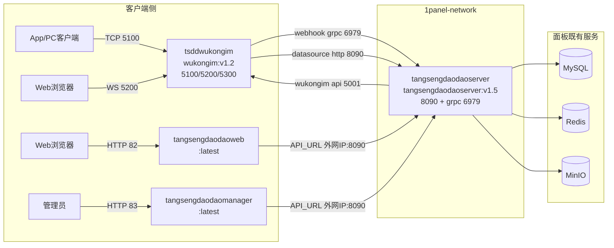

# appstore 仓库分析报告

> 分析对象：`/data/code/tsdd-analysis/appstore`
> 仓库性质：纯 YAML / Shell / 静态资源仓库（无任何编程语言代码）
> 分析方式：静态审查（所有文件均经 Read 确认存在）

---

## 1. 仓库概述

### 1.1 定位

本仓库是 **唐僧叨叨（TangSengDaoDao）/ 悟空IM（WuKongIM）面向服务器面板应用市场的一键部署打包仓库**，本身不包含任何应用源码，只包含：

- 1Panel 应用商店格式的应用定义（`data.yml` + `docker-compose.yml` + logo + README）
- 宝塔（BT Panel）Docker 应用格式的部署模板（`docker-compose.yml` + `.env` + logo + README）
- 一个将本仓库同步为 1Panel "本地应用商店" 的辅助 Shell 脚本

根 `README.md` 自述："适配本地应用面板 **1Panel**、**宝塔**，简单、私有部署企业级 IM"。其作用是把上游的 `TangSengDaoDaoServer`、`WuKongIM` 等 Docker 镜像，包装成面板用户"填表单一键安装"的分发渠道。

### 1.2 与 TangSengDaoDaoCli 仓库的关系（殊途同归）

同组织的 `TangSengDaoDaoCli`（Go 编写的命令行安装器，仓库根含内嵌 `docker-compose.yaml`）与本仓库解决**同一个问题——私有化一键部署**，但面向不同用户群：

| 维度 | appstore（本仓库） | TangSengDaoDaoCli |
| --- | --- | --- |
| 入口 | 1Panel / 宝塔面板 Web UI 表单 | 命令行 `tsdd install` |
| 依赖形态 | 引用阿里云镜像仓库的远程镜像 | 内嵌 `docker-compose.yaml` + `configs/*.yaml` |
| 配置方式 | 面板表单字段 → 环境变量注入 | CLI 交互/配置文件 → 环境变量 |
| 基础设施（MySQL/Redis/MinIO） | 1Panel 版复用面板已有服务；宝塔版自带 | 自带全套（含 adminer 调试工具） |
| 目标用户 | 面板运维人员 | 开发者/命令行用户 |

两条渠道维护的 compose 拓扑**并不一致**（详见 4.3 节对比表），版本号各自演进，存在漂移风险（详见第 8 节）。

---

## 2. 技术栈与依赖

### 2.1 1Panel 应用商店格式规范

`1panel/apps/<app>/` 遵循 1Panel 本地应用商店（local appstore）目录约定：

```
1panel/apps/<appKey>/
├── data.yml            # 应用元数据（名称、标签、官网、crossVersionUpdate 等）
├── logo.png            # 应用图标
├── README.md           # 应用介绍
└── <version>/
    ├── data.yml        # 安装表单定义（additionalProperties.formFields）
    ├── docker-compose.yml  # 编排模板，环境变量以 ${ENV_KEY} 占位
    └── (其他附属文件，如 prometheus.yml)
```

- 顶层 `data.yml` 的 `additionalProperties` 含 `key/name/tags/shortDescZh/shortDescEn/type/crossVersionUpdate/limit/website/github/document` 字段。
- 版本级 `data.yml` 的 `formFields` 声明安装表单：每个字段含 `envKey`（注入 compose 的环境变量名）、`labelZh/labelEn`、`type`（text/password/number/service）、`rule`（`paramCommon`/`paramComplexity`/`paramPort` 校验规则）、`random`（可随机生成）、`default`。
- `type: service` 的字段（如 `key: mysql`、`key: redis`、`key: minio`）用于**引用 1Panel 中已安装的数据库/缓存/对象存储服务**，面板会自动注入对应连接信息（如 `PANEL_DB_PORT`）。
- compose 统一加入外部网络 `1panel-network`（`external: true`），容器名用 `${CONTAINER_NAME}` 变量由面板注入。

### 2.2 宝塔（BT Panel）应用格式

`btpanel/<app>/` 为更朴素的 Docker Compose 模板：`docker-compose.yml` + `.env` 默认环境文件 + `logo.png` + `README.md`，由宝塔 Docker 管理器导入，无表单规范，配置靠用户手工编辑 `.env`。

### 2.3 依赖的镜像

全部业务镜像托管于阿里云上海镜像仓库 `registry.cn-shanghai.aliyuncs.com/wukongim/*`（例外：宝塔版 wukongim 用 Docker Hub `wukongim/wukongim:v1.2`，dozzle 用 Docker Hub `amir20/dozzle:v6.6.3`）。

---

## 3. 目录结构与模块架构

### 3.1 目录树

```
appstore/
├── README.md
├── .gitignore
├── 1panel/
│   ├── README.md                       # 同步脚本使用教程
│   ├── local_appstore_sync_helper.sh   # 1Panel 本地应用商店同步脚本（v1.0.0）
│   └── apps/
│       ├── tangsengdaodao/
│       │   ├── data.yml / logo.png / README.md
│       │   └── 1.5/
│       │       ├── data.yml            # 18 个表单字段
│       │       └── docker-compose.yml  # 4 服务
│       ├── wukongim/
│       │   ├── data.yml / logo.png / README.md
│       │   ├── 1.2/
│       │   │   ├── data.yml
│       │   │   └── docker-compose.yml  # 单服务（镜像实为 v1.1.8，见第8节）
│       │   └── 2.0.5/
│       │       ├── data.yml
│       │       ├── docker-compose.yml  # wukongim + prometheus
│       │       └── prometheus.yml      # 监控抓取配置
│       └── dozzle/
│           ├── data.yml / logo.png / README.md
│           └── 6.6.3/
│               ├── data.yml
│               └── docker-compose.yml  # 日志查看器，挂载 docker.sock
└── btpanel/
    ├── tangsengdaodao/
    │   ├── docker-compose.yml          # 7 服务全栈（含 mysql/redis/minio）
    │   ├── .env                        # 含默认密码（见第7节）
    │   ├── logo.png
    │   └── README.md
    └── wukongim/
        ├── docker-compose.yml          # 单服务
        └── .env                        # 注：缺 logo.png 与 README.md
```

### 3.2 应用/版本矩阵

| 应用 | 面板 | 版本目录 | 实际镜像 tag | 服务数 | 一致性 |
| --- | --- | --- | --- | --- | --- |
| tangsengdaodao | 1Panel | 1.5 | server:v1.5 + wukongim:v1.2 + web/manager:latest | 4 | 基本一致（web/manager 用 latest） |
| tangsengdaodao | 宝塔 | （无版本目录） | server:v1.5 + wukongim:v2 + web/manager:latest + mysql:8.0.33 + redis:7.2.3 + minio:RELEASE.2023-07-18 | 7 | wukongim 大版本与 1Panel 版不一致（v2 vs v1.2） |
| wukongim | 1Panel | 1.2 | **wukongim:v1.1.8**（目录名与镜像漂移） | 1 | 漂移，见 8.2 |
| wukongim | 1Panel | 2.0.5 | wukongim:v2.0.5-20240925 + prometheus:v2.53.1 | 2 | 基本一致 |
| wukongim | 宝塔 | （无版本目录） | wukongim:v1.2（Docker Hub 命名空间） | 1 | registry 与其他不一致 |
| dozzle | 1Panel | 6.6.3 | dozzle:v6.6.3 | 1 | 一致 |

---

## 4. 核心内容走读

### 4.a tangsengdaodao 1Panel 版 docker-compose 逐服务解读

文件：`1panel/apps/tangsengdaodao/1.5/docker-compose.yml`（compose 格式 `3.1`，统一接入外部网络 `1panel-network`）。



1. **tsddwukongim**（通讯层）：镜像 `wukongim:v1.2`；映射 TCP 长连接 5100、WebSocket 5200、监控 5300 三个端口到表单端口；数据卷 `./wukongim:/root/wukongim`；通过 `WK_WEBHOOK_GRPCADDR=tangsengdaodaoserver:6979` 与 `WK_DATASOURCE_ADDR=http://tangsengdaodaoserver:8090/v1/datasource` 把消息回调与频道数据源指向业务服务；开启 `WK_TOKENAUTHON=true`（token 认证）与 `WK_CONVERSATION_ON=true`（服务端维护最近会话）。
2. **tangsengdaodaoserver**（业务层）：镜像 `tangsengdaodaoserver:v1.5`，`command: "api"`；带 `/v1/ping` 健康检查（wget，10s 间隔，3 次重试）；`depends_on: tsddwukongim`；环境变量拼接 MySQL DSN（`${PANEL_DB_USER}:${PANEL_DB_USER_PASSWORD}@tcp(${PANEL_DB_HOST}:${PANEL_DB_PORT})/...`，其中 `PANEL_DB_PORT` 由 1Panel 的 service 类型字段自动注入）、Redis 地址/密码、MinIO 凭据、`TS_SMSCODE`（固定短信验证码）、`TS_ADMINPWD`（超管密码）、`TS_EXTERNAL_IP`；默认头像走 `api.multiavatar.com`。
3. **tangsengdaodaoweb**：Web 客户端静态站点（`:latest`），通过 `API_URL=http://${EXTERNAL_IP}:${PANEL_APP_PORT_TS_APP_HTTP}/` 指回业务 API，容器 80 → 宿主 82。
4. **tangsengdaodaomanager**：管理后台静态站点（`:latest`），同样注入 `API_URL`，容器 80 → 宿主 83。

特点：MySQL/Redis/MinIO **不自建**，全部通过表单 `type: service` 复用 1Panel 已装服务；`EXTERNAL_IP` 需用户手填，贯穿 wukongim 外网地址、Web/Manager 的 API_URL、MinIO URL。

### 4.b wukongim 1.2 vs 2.0.5 差异

| 维度 | 1.2（`1panel/apps/wukongim/1.2/`） | 2.0.5（`1panel/apps/wukongim/2.0.5/`） |
| --- | --- | --- |
| compose 格式版本字段 | `'1.1.8'`（非法的 compose 格式版本号，疑为笔误） | `'3.7'` |
| 镜像 | `wukongim:v1.1.8`（与目录名 1.2 漂移） | `wukongim:v2.0.5-20240925`（精确到构建日期） |
| 容器名 | `${CONTAINER_NAME}` | `${CONTAINER_NAME}-wukongim` / `-prometheus` |
| 环境变量 | 耦合唐僧叨叨：`WK_WEBHOOK_GRPCADDR=tangsengdaodaoserver:6979`、`WK_DATASOURCE_ADDR=...tangsengdaodaoserver:8090...`（单独安装 wukongim 时指向不存在的主机名） | 完全解耦，仅保留集群/监控/模式/外网 IP 5 项 |
| 集群支持 | 无 | `WK_CLUSTER_NODEID=1001`、`WK_CLUSTER_SERVERADDR=${EXTERNAL_IP}:11110`，并硬编码映射 `11110:11110` 节点通讯端口 |
| 健康检查 | 无 | `wget ... localhost:5001/health` |
| 监控 | 无 | 新增 **prometheus:v2.53.1** sidecar，挂载 `prometheus.yml`，硬编码 `9090:9090`；wukongim 通过 `WK_TRACE_PROMETHEUSAPIURL=http://prometheus:9090` 上报 |
| 数据卷 | `./wukongim` | `./wukongim_data`（目录改名，跨版本升级不会自动迁移数据） |
| 表单（data.yml） | 5 个端口字段 + EXTERNAL_IP | 与 1.2 **完全相同**（未为 9090/11110 增加表单字段） |

`2.0.5/prometheus.yml`：全局抓取/评估间隔 10s，单个 job `wukongim1-trace-metrics` 抓取 `wukongim:5300`，附 `id: "1001"` 标签（与 `WK_CLUSTER_NODEID=1001` 对应）。

### 4.c 三方对比：1Panel 版 vs 宝塔版 vs Cli 内嵌 compose

| 维度 | 1Panel 版（tangsengdaodao/1.5） | 宝塔版（btpanel/tangsengdaodao） | Cli 内嵌（TangSengDaoDaoCli/docker-compose.yaml） |
| --- | --- | --- | --- |
| wukongim 镜像 | v1.2 | **v2** | latest |
| tsdd server 镜像 | v1.5 | v1.5 | latest |
| web/manager 镜像 | latest | latest | latest |
| MySQL/Redis/MinIO | 不自建，复用面板服务（service 表单引用） | **自建**（mysql:8.0.33 / redis:7.2.3 / minio 固定 release） | 自建（mysql:latest / redis / minio:latest） |
| 配置注入 | 面板表单 → 环境变量，几乎全部 env 显式列出 | `.env` 文件（`env_file`）+ 少量 environment 覆盖 | `configs/wk.yaml`、`configs/tsdd.yaml` 挂卷 + 环境变量透传 |
| 管理后台 manager | 有（端口 83） | 有（TS_MANAGEMENT_PORT=83） | **无 manager 服务**，但有 adminer（8306，注明"调试用，为了安全生产不要打开"） |
| API_URL 指向 | 外网 IP:端口（客户端经公网回连） | 内网服务名 `http://tangsengdaodaoserver:8090/` | 环境变量透传 |
| wukongim 5001 API 端口 | 不映射宿主（仅内网，正确做法） | 注释掉不映射（正确） | 不映射（正确） |
| 网络 | 外部 `1panel-network` | compose 默认网络 | compose 默认网络 |
| 密码默认值 | 表单默认值（弱密码，可改） | `.env` 硬编码弱密码 | 由 CLI 生成交互填入 |

结论：三者拓扑同源（wukongim + server + web + manager + mysql/redis/minio），但**镜像版本、基础设施取舍、配置机制各成一套**，无任何单一事实来源（single source of truth）。

### 4.d local_appstore_sync_helper.sh 解读

文件：`1panel/local_appstore_sync_helper.sh`（270 行，署名作者 xxxily，移植自 `local-appstore-for-1Panel` 项目）。

执行流程（`main()`）：

1. 校验 `app_local_dir=/opt/1panel/resource/apps/local` 存在（否则退出）。
2. 规范化 `git_repo_url`（自动补 `.git` 后缀），用正则 `.*\/(.*)\/(.*)\.git` 提取用户名/项目名，构造工作目录 `/opt/1panel_hepler/temp/<user>/<repo>`。
3. 可选开启代理（`proxy_on`，校验 URL 必须含 `://`，否则回落默认 `http://127.0.0.1:7890`）。
4. 已有缓存则 `git pull --force`，否则 `clone_git_repo`：支持 access_token（`https://oauth2:<token>@host`）或用户名/密码（自实现 `url_encode` 逐字符百分号编码后拼入 URL）或匿名克隆。
5. 校验克隆结果含 `apps` 目录（实际仓库里是 `1panel/apps`，脚本检查的是 `$repo_dir/apps`——此处判断与第 6 步的 `cp -rf 1panel/apps/*` 存在目录假设不一致，见第 8 节）；可选 `rm -rf "$app_local_dir"/*` 清空本地应用。
6. `cp -rf 1panel/apps/* "$app_local_dir"` 把本仓库应用拷入 1Panel 本地应用目录，随后用户在 1Panel"应用商店 → 本地"中即可看到并安装。
7. 收尾：可选清缓存、关代理，日志写入 `$work_dir/logs/local_appstore_sync_helper_<date>.log`。

典型用法：在 1Panel 计划任务中粘贴该脚本定时执行，实现"应用商店自动更新"（`1panel/README.md` 有图文教程）。

---

## 5. 对外接口（端口/卷/环境变量总表）

### 5.1 1Panel tangsengdaodao 1.5

| 类别 | 项 | 说明 |
| --- | --- | --- |
| 宿主端口 | `${PANEL_APP_PORT_WK_TCP}`(默认5100)→5100 | 悟空IM TCP 长连接（0.0.0.0） |
| | `${PANEL_APP_PORT_WK_WS}`(5200)→5200 | WebSocket（0.0.0.0） |
| | `${PANEL_APP_PORT_WK_WEB_SERVER}`(5300)→5300 | 监控端口（0.0.0.0） |
| | `${PANEL_APP_PORT_TS_APP_HTTP}`(8090)→8090 | 业务 API（0.0.0.0） |
| | `${PANEL_APP_PORT_TS_APP_WEB}`(82)→80 | Web 客户端 |
| | `${PANEL_APP_PORT_HTTP}`(83)→80 | 管理后台 |
| 卷 | `./wukongim`、`./tsdd` | 数据持久化 |
| 关键环境变量 | `EXTERNAL_IP`、`PANEL_DB_*`、`TS_DB_REDIS*`、`MINIO_*`、`TS_SMSCODE`、`TS_ADMIN`、`TS_ADMINPWD`、`TS_WUKONGIM_APIURL`、`TS_AVATAR_DEFAULTBASEURL` | 详见 4.a |

### 5.2 1Panel wukongim（1.2 / 2.0.5）

| 端口 | 1.2 | 2.0.5 |
| --- | --- | --- |
| API | `${PANEL_APP_PORT_WK_API}`(5001)→5001 | 同左 |
| TCP | 5100 | 5100 |
| WS | 5200 | 5200 |
| 监控/管理 | `${PANEL_APP_PORT_HTTP}`(5300)→5300 | 5300 |
| demo | 5172 | 5172 |
| 集群节点通讯 | 无 | **硬编码 11110:11110** |
| Prometheus | 无 | **硬编码 9090:9090** |

卷：1.2 为 `./wukongim`；2.0.5 为 `./wukongim_data` + `./prometheus.yml`。

### 5.3 1Panel dozzle 6.6.3

- 端口：`${PANEL_APP_PORT_HTTP}`(默认 8674)→8080
- 卷：**`/var/run/docker.sock:/var/run/docker.sock`**（高权限，见第 7 节）
- 无任何认证相关环境变量

### 5.4 宝塔版

- tangsengdaodao：`.env` 定义 `WK_TCP_PORT/ WK_WS_PORT/ WK_WEB_SERVER_PORT/ TS_API_PORT(8090)/ TS_WEB_PORT(82)/ TS_MANAGEMENT_PORT(83)`；minio 硬编码 `9000:9000`、`9001:9001`；mysql/redis 不映射宿主（仅内网）。
- wukongim：`WK_API(5001)/WK_TCP(5100)/WK_WS(5200)/WK_MONITOR(5300)/WK_DEMO_SERVER(5172)` 全部映射宿主。

---

## 6. 部署与运维

### 6.1 1Panel 安装流程（以 tangsengdaodao 为例）

1. **前置**：服务器装好 1Panel；在 1Panel 中先安装 MySQL、Redis、MinIO 应用（因表单含 `type: service` 引用）。
2. **同步本地应用商店**：按 `1panel/README.md`，创建计划任务粘贴 `local_appstore_sync_helper.sh` 并执行；脚本把 `1panel/apps/*` 拷入 `/opt/1panel/resource/apps/local`。
3. **表单安装**：应用商店 → 本地 → TangSengDaoDao → 填写 18 个表单字段：
   - `EXTERNAL_IP`（必填，手工填服务器公网 IP，多处地址拼接都依赖它）；
   - 选择 mysql / redis / minio 服务实例（`type: service` 下拉）；
   - 数据库名/用户/密码（默认 `tsdd`/`tsdd`/`tsdd@123456`，带 `random: true` 可一键随机）；
   - 五个端口（默认 5100/5200/5300/8090/82/83）；
   - `TS_SMSCODE`（默认 123456，非空则所有短信验证码固定为该值）、`TS_ADMINPWD`（默认 `tsdd@123456`）。
4. 面板渲染 compose 并 `up -d`；健康检查通过后服务就绪。
5. wukongim 2.0.5 / dozzle 安装流程类似，表单字段更少（wukongim 仅 6 项，dozzle 仅 1 项端口）。

### 6.2 宝塔安装流程

将 `btpanel/<app>/` 导入宝塔 Docker 编排模板，**手工编辑 `.env`**（把 `EXTERNAL_IP=xxx.xxx.xxx.xxx` 改为真实 IP、修改默认密码），然后启动编排。宝塔版 tangsengdaodao 自带 mysql/redis/minio 容器，无外部依赖。

### 6.3 升级路径

- 三个 1Panel 应用的顶层 `data.yml` 均设 `crossVersionUpdate: true`（允许跨版本升级），`limit` 除 dozzle 为 1（限装一个）外均为 0。
- 实际升级即在面板中对已装应用切换版本目录重建。**风险点**：wukongim 1.2 → 2.0.5 数据卷目录由 `./wukongim` 改为 `./wukongim_data`，且 1.2 镜像实为 v1.1.8，跨版本升级的数据兼容性（自研消息 DB 格式 v1→v2）在本仓库中无任何说明或迁移脚本，属于运维盲区。
- 宝塔/Cli 渠道无版本目录概念，升级靠手工改镜像 tag。

---

## 7. 安全审计（仅静态审查）

### [CONFIRMED]

1. **弱默认密码/密钥（多处）**：
   - `1panel/apps/tangsengdaodao/1.5/data.yml`：`PANEL_DB_USER_PASSWORD` 默认 `tsdd@123456`、`TS_ADMINPWD` 默认 `tsdd@123456`；
   - `btpanel/tangsengdaodao/.env`：`MYSQL_ROOT_PASSWORD=Aa1234567`、`MINIO_ROOT_PASSWORD=Aa1234567`、`TS_ADMINPWD=admin1234567`、`WK_JWT_SECRET=wk_secret_123`（JWT 密钥硬编码且可猜测）——该 `.env` 随仓库公开分发，用户不改即上线则全线默认凭据。
2. **固定短信验证码后门式配置**：1Panel 表单 `TS_SMSCODE` 默认 `123456`，宝塔 `.env` `TS_SMSCODE=123456`（注释自述"如果此值不为空，则使用此值作为验证码"）。部署者若保留默认值，任何人可用 `123456` 通过短信验证注册/登录。
3. **超管密码表单字段为明文 text**：`1panel/apps/tangsengdaodao/1.5/data.yml` 中 `TS_ADMINPWD` 的 `type: text`（同文件其他密码字段均为 `type: password`），在 1Panel 安装表单及后续"已装应用参数"页面中明文显示。
4. **dozzle 无认证 + docker.sock 高权限挂载 + 公网暴露**：`1panel/apps/dozzle/6.6.3/docker-compose.yml` 挂载 `/var/run/docker.sock`，未配置任何 `DOZZLE_USERNAME/DOZZLE_PASSWORD` 等认证变量，端口 `8674` 绑定 `0.0.0.0`。任何可达该端口者可查看全部容器日志（常含敏感环境变量），docker.sock 泄露等价于宿主 root 级控制面。
5. **所有端口映射默认绑定 0.0.0.0**：compose 均为 `"宿主端口:容器端口"` 简写，含管理面端口——宝塔版 minio 控制台 `9001:9001`（配合默认凭据 `minio/Aa1234567`）、wukongim 监控端口 5300、唐僧叨叨管理后台 83、1Panel wukongim 2.0.5 硬编码的 Prometheus `9090:9090` 与集群端口 `11110:11110`（后者手填 `EXTERNAL_IP` 为公网 IP 时 `WK_CLUSTER_SERVERADDR` 即暴露公网）。
6. **`latest` / 漂移镜像 tag**：`tangsengdaodaoweb:latest`、`tangsengdaodaomanager:latest`（1Panel 与宝塔版均如此）；Cli 版更有 `wukongim:latest`、`mysql:latest`、`minio:latest`。latest 导致部署不可复现、回滚困难，且无法锚定安全补丁版本。
7. **同步脚本的供应链与凭据风险**：`local_appstore_sync_helper.sh` 将 access_token/账密拼入 `git clone` 的 URL（会出现在进程列表与 shell 历史），且脚本将远程 git 仓库内容**未经任何完整性校验（无签名/无 tag 固定）**直接 `cp` 进 1Panel 应用目录——仓库被篡改即投毒所有同步节点；`git pull --force` 会静默覆盖本地改动。
8. **头像服务外联第三方**：`TS_AVATAR_DEFAULTBASEURL` 指向 `api.multiavatar.com`（1Panel 版）/ `api.dicebear.com`（宝塔版），与"私有化部署、数据不出内网"的定位相悖，存在用户标识外泄给第三方的可能。

### [PLAUSIBLE]

9. **宝塔 wukongim `.env` 语法瑕疵**：`WK_DEMO_SERVER = 5172`（等号两侧带空格），部分 docker-compose 版本的 env_file 解析严格，可能导致该变量解析失败或端口映射异常。
10. **wukongim 1.2 独立安装时的无效配置**：其 compose 内 `WK_WEBHOOK_GRPCADDR`/`WK_DATASOURCE_ADDR` 指向 `tangsengdaodaoserver` 主机名，若用户单独安装 wukongim 1.2（未装 tsdd），回调与数据源持续失败，且 6979/8090 的依赖关系对用户不可见。
11. **硬编码端口冲突**：2.0.5 的 `9090`/`11110` 不在表单中，同一台 1Panel 多装或宿主已有 Prometheus 时端口冲突，安装即失败。

---

## 8. 质量评估

### 8.1 YAML 规范性

- 大体可读、注释充分（中文注释到位）；`docker-compose.yml` 均通过基本结构审查。
- **compose `version:` 字段使用不规范**：`wukongim/1.2/docker-compose.yml` 写 `version: '1.1.8'`、`dozzle/6.6.3/docker-compose.yml` 写 `version: '6.6.3'`——compose 格式版本只有 2.x/3.x 系列，这两个值疑为把"应用版本"误填入格式版本字段（新版 docker compose 会忽略并告警，老版本可能报错）。
- `dozzle/6.6.3/data.yml` 的 `formFields` 列表首行缩进比后续行少一个空格（`   - default:` vs `      edit:`），虽 YAML 解析可通过，但属格式不统一。
- 宝塔 `btpanel/wukongim/.env` 存在 `KEY = value` 空格问题（见 7-[PLAUSIBLE]-9）；`btpanel/tangsengdaodao/.env` 多处行首空格不一致（如 ` # mysql root用户的密码`）。

### 8.2 版本一致性与完整性

| 问题 | 位置 | 性质 |
| --- | --- | --- |
| 目录名 1.2 vs 镜像 v1.1.8 漂移 | `1panel/apps/wukongim/1.2/docker-compose.yml` | [CONFIRMED] 版本漂移 |
| 1Panel 版 wukongim 用 v1.2，宝塔版用 v2，Cli 用 latest | 三处 compose | [CONFIRMED] 多渠道版本各自演进 |
| 宝塔 wukongim 缺 `logo.png` 与 `README.md`（同目录的 tangsengdaodao 齐全） | `btpanel/wukongim/` | [CONFIRMED] 物料不完整 |
| `data.yml`（应用级）中 wukongim 的 `github` 字段指向 `TangSengDaoDaoServer` 而非 `WuKongIM/WuKongIM` | `1panel/apps/wukongim/data.yml` | [CONFIRMED] 元数据错误 |
| sync 脚本第 239 行检查 `$repo_dir/apps`，第 252 行却复制 `1panel/apps/*`——若仓库根无 `apps` 目录则脚本必然退出（当前仓库结构下确实如此，目录假设疑似历史遗留） | `1panel/local_appstore_sync_helper.sh:239` vs `:252` | [PLAUSIBLE] 脚本对非本仓库结构的兼容性 bug；对本仓库，因 git 历史中存在过根级 `apps` 目录（见 git log "更新目录为apps"），当前 `apps` 检查会因 `$repo_dir/apps` 不存在而失败退出——实际可用性存疑，需实测 |
| `work_dir=/opt/1panel_hepler` 拼写（hepler→helper） | 脚本及 README | [CONFIRMED] 拼写错误（仅影响观感） |

### 8.3 总体评价

仓库规模小、职责单一，表单字段设计与 1Panel 规范贴合度较好（service 引用、random、rule 校验都有使用）。主要短板是：**多渠道（1Panel/宝塔/Cli）多份 compose 手工维护导致版本漂移**、**默认凭据安全意识薄弱**、**细节一致性（目录名/镜像 tag/拼写/元数据）把关不足**。git 历史（15 次提交）显示 2023–2024 年间渐进添加，无 CI 校验。

---

## 9. 风险与改进建议汇总

| # | 风险/问题 | 级别 | 建议 |
| --- | --- | --- | --- |
| 1 | dozzle 无认证 + docker.sock + 0.0.0.0 暴露（7-C4） | 高 | compose 增加 `DOZZLE_USERNAME/DOZZLE_PASSWORD` 表单字段，或端口绑定 `127.0.0.1`；在 data.yml 描述中明示风险 |
| 2 | 全套弱默认密码/JWT 密钥（7-C1）、固定 SMS 验证码（7-C2） | 高 | 密码字段默认留空 + `random: true`（部分已具备），`TS_SMSCODE` 默认留空；`.env` 模板改为占位符 + README 强制要求修改 |
| 3 | `TS_ADMINPWD` 表单 `type: text` 明文（7-C3） | 中 | 改为 `type: password` |
| 4 | minio 控制台 9001、Prometheus 9090、监控 5300、管理后台 83 等管理面端口 0.0.0.0 暴露（7-C5） | 中 | 管理面端口默认绑 `127.0.0.1` 或在文档中要求面板防火墙收敛；9090/11110 加入表单字段 |
| 5 | `latest` 镜像 tag（7-C6）与 wukongim 1.2→v1.1.8 版本漂移（8.2） | 中 | 全部锚定具体 tag；建立"目录版本号 = 镜像 tag"的发布检查 |
| 6 | sync 脚本凭据入 URL、无完整性校验（7-C7） | 中 | 改用 `GIT_ASKPASS`/`credential.helper`；clone 固定到 tag/commit 并校验；README 提示 token 最小权限 |
| 7 | 三渠道 compose 各自漂移（4.c） | 中 | 抽取单一模板源（如由 Cli 仓库生成 1Panel/宝塔变体），CI 校验三处镜像版本一致 |
| 8 | wukongim 1.2→2.0.5 数据卷改名、无迁移说明（6.3） | 中 | 在版本目录 README 写明升级注意事项或提供迁移脚本 |
| 9 | compose `version` 字段误用、`.env` 空格、hepler 拼写、wukongim 元数据 github 链接错误、宝塔物料缺失（8.x） | 低 | 逐项修正；为 YAML 加 CI lint（yamllint + compose config 校验） |
| 10 | 第三方头像服务外联（7-C8） | 低 | 默认改为自托管/内置头像，文档说明外联行为 |

---

*报告基于静态审查，所有引用文件路径均经实际读取确认。*
