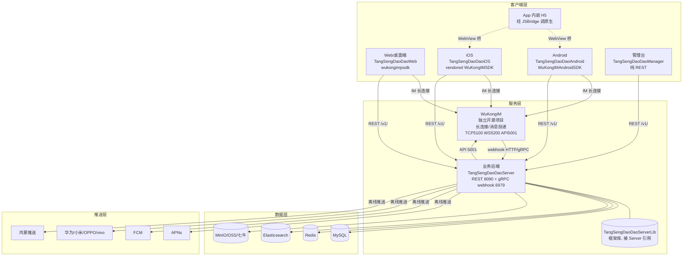
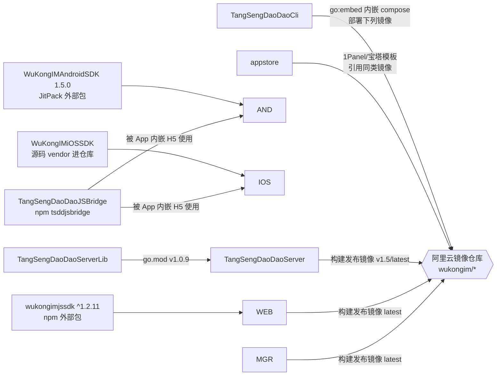
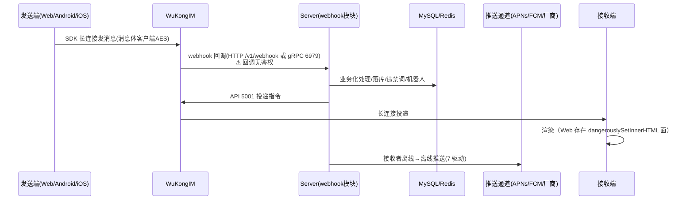

# TangSengDaoDao（唐僧叨叨）全生态仓库分析总览

> 分析对象：GitHub 组织 [TangSengDaoDao](https://github.com/orgs/TangSengDaoDao/repositories) 全部 10 个公开仓库
> 分析方式：静态代码审查（全面分析：架构与模块 / 核心流程代码级走读 / 部署运维 / 安全审计 / 代码质量）
> 分析日期：2026-10-12 ｜ 各仓库快照以当日 clone 的默认分支 HEAD 为准

唐僧叨叨是一套**运营级开源即时通讯（IM）系统**，底层通讯由 [WuKongIM](https://github.com/WuKongIM/WuKongIM)（独立开源项目，不在本组织内）提供长连接与消息投递，本组织 10 个仓库覆盖：业务后端、四端客户端（Web/Android/iOS/管理台）、框架库、部署工具链（Cli/面板商店）、JSBridge 与文档站。

---

## 1. 仓库索引

| # | 仓库 | 定位 | 技术栈 | 规模 | 分析文档 |
|---|------|------|--------|------|----------|
| 1 | TangSengDaoDaoServer | **业务后端**（核心） | Go 1.20 / gin(wkhttp) / MySQL+Redis+ES+MinIO | 209 文件 ~45k 行 | [TangSengDaoDaoServer.md](TangSengDaoDaoServer.md)（986 行） |
| 2 | TangSengDaoDaoServerLib | 服务端**框架底座库** | Go 1.20（config.Context DI / wkhttp / module 生命周期） | 73 文件 ~10k 行 | [TangSengDaoDaoServerLib.md](TangSengDaoDaoServerLib.md)（501 行） |
| 3 | TangSengDaoDaoWeb | **Web/桌面客户端** | TS + React 17 / yarn+Turbo monorepo / Electron 26(+Tauri) | 157 TS/TSX | [TangSengDaoDaoWeb.md](TangSengDaoDaoWeb.md)（805 行） |
| 4 | TangSengDaoDaoAndroid | **Android 客户端** | Kotlin+Java / AGP 8.13 / Retrofit+RxJava+FastJSON | 571 源文件 | [TangSengDaoDaoAndroid.md](TangSengDaoDaoAndroid.md)（703 行） |
| 5 | TangSengDaoDaoiOS | **iOS 客户端** | ObjC 为主+Swift / CocoaPods / vendored WuKongIM SDK | ~1558 源文件 | [TangSengDaoDaoiOS.md](TangSengDaoDaoiOS.md)（900 行） |
| 6 | TangSengDaoDaoManager | **运营管理台** | TS + Vue 3 / Vite 4 / Element Plus / Pinia | 64 ts + 63 vue | [TangSengDaoDaoManager.md](TangSengDaoDaoManager.md)（452 行） |
| 7 | TangSengDaoDaoCli | **一键部署 CLI** | Go / cobra + docker-compose-go（go:embed 内嵌编排） | 17 文件 ~1.3k 行 | [TangSengDaoDaoCli.md](TangSengDaoDaoCli.md)（347 行） |
| 8 | appstore | **面板应用商店打包** | 纯 YAML/Shell（1Panel + 宝塔） | — | [appstore.md](appstore.md)（352 行） |
| 9 | TangSengDaoDaoJSBridge | **H5↔原生桥库** | TS / Rollup（WebViewJavascriptBridge 协议） | 2 文件 ~134 行 | [TangSengDaoDaoJSBridge.md](TangSengDaoDaoJSBridge.md)（220 行） |
| 10 | TangSengDaoDaoDocs | **文档站** | VitePress 1.0 / nginx Docker | 82 篇 md | [TangSengDaoDaoDocs.md](TangSengDaoDaoDocs.md)（399 行） |

### 专题深度分析

| # | 文档 | 范围 | 说明 |
|---|------|------|------|
| 11 | [IM消息机制深度分析.md](IM消息机制深度分析.md)（1006 行） | WuKongIM 服务端 v1.2.6 + 三端 IM SDK + 业务服务端 + 三端 App | 基于真实源码（逐条 file:line 引用）的 IM 工程评审：二进制协议、HTTP 与长连接分工、移动端监听注册与收发全链路、离线消息/ACK/多端同步、跨仓库端到端时序、风险与待确认清单。分析基线额外引入 WuKongIM 组织 3 个仓库（WuKongIM / WuKongIMAndroidSDK / wukongimjssdk，版本对齐签出） |
| 12 | [移动端聊天窗口与消息性能专项分析.md](移动端聊天窗口与消息性能专项分析.md) | Android/iOS 聊天窗口 + 两端 IM SDK 消息内核 | 移动端专项：聊天窗口实现原理（页面结构/消息Model/Cell复用/事件驱动/生命周期）、大批量聊天记录处理（存储/分页/缓存/去重/增量更新）、性能专项（列表渲染/滑动/内存/DB/并发，16 项源码实证风险）、收发交互、技术债务与优化建议 |

**阅读建议**：先读 Server（核心）→ ServerLib（框架契约）→ 任一端客户端 → Cli/appstore（部署）→ Docs（官方口径）。每份文档第 9 节为该仓库的风险汇总表。

---

## 2. 生态架构与仓库关系

### 2.1 总体架构

### 2.2 代码级依赖关系

关键点：
- **ServerLib 是 Server 的框架底座**（模块注册、HTTP 封装、迁移、异步任务），但注意 Server 仓库 `pkg/` 下存在与 ServerLib **双份拷贝的 wkhttp/register 等代码**（演进分叉，详见 Server 文档第 8 节）。
- **三端 IM SDK 形态各异**：Web 用 npm 包、Android 用 JitPack 二进制、iOS 直接把整个 SDK **源码 vendor** 进仓库（`Modules/WuKongIMiOSSDK`）——iOS 端因此可对 SDK 做源码级分析（其明文 TCP、SQLCipher key=uid 等发现即源于此），三端 SDK 版本与协议行为一致性无保障机制。
- **WuKongIM 服务端不在本组织**，但其配置/部署全部内嵌在 Cli、appstore、Server testenv 中，版本从 v1.1.8 到 v2.0.5 不等（见 §3.2 版本对账）。

### 2.3 核心数据流（跨仓库链路）

**① 消息收发流**

**② 登录/鉴权流**：三端 + Web 均 `POST /v1/user/login`（**密码明文 JSON**，服务端比对 `MD5(MD5(pwd))`）→ 服务端签发 token（30 天有效、无设备绑定）→ 之后 REST 走 `token` 头，IM 长连接 CONNECT 包携带 token 由 WuKongIM 校验（`WK_TOKENAUTHON=true`）。

**③ 文件流**：客户端 `GET /v1/file/upload?path=...`（**path 客户端完全可控**）→ Server 直传 MinIO（**bucket 匿名读写删策略**）→ 消息中携带文件 URL。

**④ 推送矩阵**：

| 通道 | Server 驱动（modules/webhook/） | 客户端接收 |
|------|-------------------------------|-----------|
| APNs | push_apns.go / push_iosapns.go | iOS AppDelegate + NotificationService/Content 扩展（扩展为 stub） |
| FCM | push_firebase.go | Android WKFirebaseMessagingService |
| 华为 HMS | push_hms.go | Android HuaweiHmsMessageService |
| 小米 | push_mi.go | Android XiaoMiMessageReceiver |
| OPPO | push_oppo.go | Android OPPOPushMessageService（本地 AAR） |
| vivo | push_vivo.go | Android VivoPushMessageReceiverImpl（本地 AAR） |
| 鸿蒙 | push_harmonyos.go | HarmonyOS NEXT 设备 |

---

## 3. 跨仓库对账结果

### 3.1 接口对账（Server 路由 ↔ 各端调用）✅ 抽样一致

| 端 | 调用点 | Server 路由 | 结果 |
|----|--------|------------|------|
| Web | `login_vm.tsx:133` `POST user/login` | `modules/user/api.go:172` `/v1/user/login` | ✅ |
| Android | `LoginService.java:26` `@POST("user/login")` | 同上 | ✅ |
| iOS | `WKLoginVM.m:49` `POST user/login` | 同上 | ✅ |
| Manager | `api/user.ts:6` `/manager/user/add` | `modules/user/api_manager.go:64`（组前缀 `/v1/manager`） | ✅ |
| 文档站 | `src/api/` 整区 | — | ⚠️ 实为 **WuKongIM 5001 端口 API**（非业务端 8090），业务端 API 文档缺失且该区为导航孤岛 |

鉴权约定全生态统一：REST `token` 头；dev 硬编码 `https://api.botgate.cn/v1/`（Web/Manager/iOS），Android 运行时配置 `api_base_url`；prod 均为 `/api/v1/` + nginx `envsubst ${API_URL}` 反代（Web/Manager/Docs 同一模板）。

### 3.2 版本口径对账 ⚠️ 全线漂移

| 出处 | 版本口径 | 性质 |
|------|---------|------|
| 文档站首页 | **1.1.2**（`fetchReleaseTag.js:2` 硬编码） | 与全部部署渠道不符 |
| Web `package.json` | 1.5.0 | monorepo 版本 |
| appstore 1Panel tsdd | server **v1.5** + wukongim **v1.2**（镜像实为 **v1.1.8**） | 目录名与镜像漂移 |
| appstore 1Panel wukongim | 2.0.5（精确 tag） | 与 tsdd 应用内嵌的 v1.2 并存 |
| appstore 宝塔 | server v1.5 + wukongim **v2** | wukongim 大版本与 1Panel 版不一致 |
| Cli 内嵌 compose | **全部 latest** | 不可复现 |
| 文档站 Rainbond 篇 | 1.5.1 | 与 v1.5 镜像不一致 |
| web/manager 镜像（所有渠道） | latest | 不可复现 |

**结论：全生态没有任何单一版本事实来源**；wukongim v1↔v2 消息存储格式差异的迁移说明在任何仓库都不存在。

### 3.3 跨仓库同源问题

| 问题 | 分布仓库 |
|------|---------|
| **万能短信验证码 `smsCode=123456`** | Server `configs/tsdd.yaml:40`、Cli 内嵌配置、appstore（1Panel 表单+宝塔 .env）、Docs 两篇部署文档——**6 处** |
| **默认弱凭据**（root:demo / Aa1234567 / admin1234567 / wk_secret_123 / minio:12345678） | ServerLib config 默认值、appstore 宝塔 .env、Docs 部署文档、Cli .env |
| **密码明文传输 + 弱哈希存储**：三端登录均明文 POST 密码，服务端按 `MD5(MD5(pwd))` 无盐比对 | Web、Android、iOS → Server |
| **TLS 校验全端失守**：Android OkHttp 空 TrustManager+恒真 HostnameVerifier+WebView SSL proceed；iOS AFNetworking allowInvalidCertificates+WebView 无条件信任+IM 明文 TCP；Electron nodeIntegration:true | Android、iOS、Web |
| **token 明文存储**：Web/Manager localStorage、Android SharedPreferences(+allowBackup)、iOS NSUserDefaults | 全部客户端 |
| **WebView 桥无 origin 白名单**，且 JSBridge 与原生端**协议不对齐**（iOS 回蛇形键 JS 读驼峰、Android 缺 chooseConversation handler、iOS 错误回包无 err_code 被误判成功） | JSBridge × Android × iOS（JSBridge 文档已交叉验证） |
| **管理面端口/服务公网暴露**：adminer 8306、dozzle 8674(docker.sock)、MinIO 控制台 9001、Prometheus 9090、wukongim 监控 5300 | Cli、appstore |
| **第三方外联**：默认头像 api.multiavatar.com / api.dicebear.com、高德 IP key 硬编码、Bugly、tgo-ai live key、百度统计 | Server、appstore、iOS、Docs |

---

## 4. 共性风险汇总（按主题，详见各仓库文档第 7/9 节）

### 🔴 高危（建议优先处理）

1. **传输安全全线失守**（Android/iOS/Web 客户端 + Server CORS）：移动端证书校验全关、IM 长连接明文 TCP、Electron `nodeIntegration:true`+通用 IPC+Windows 更新不验签。任意中间人可窃 token/消息，XSS 在桌面端可升级 RCE。
2. **Server webhook 回调完全无鉴权**（HTTP `/v1/webhook*` + gRPC 6979）：可与内网/误暴露场景伪造消息落库、触发任意推送（代码内 TODO 自承）。
3. **文件服务失控**：MinIO bucket 匿名读写删 + 上传路径客户端可控（可覆盖任意对象）+ 无大小限制整文件读内存。
4. **万能验证码与全套默认凭据随分发渠道发布**（§3.3），部署者不改即裸奔。
5. **XSS 链条**：ServerLib markdown 渲染无 HTML 转义 + Web 全局搜索 4 处 `dangerouslySetInnerHTML` 渲染他人可控内容 + token 全端明文存储 → 盗号成本极低。

### 🟡 中危

6. **鉴权体系结构性薄弱**：token 30 天无设备绑定、无登录限流/失败锁定、管理端授权靠 62 处手工 `CheckLoginRole`（统计模块存在漏挂疑点）、Manager 纯前端鉴权 + 管理台代发消息可冒充群主（服务端是否校验 sender 待运行时验证）。
7. **供应链**：全渠道 `latest` 镜像 tag、JitPack/本地 AAR/fork 仓库（AsyncDisplayKit、lottie 等 tangtaoit/* fork）、curl|sudo bash 无校验安装、FastJSON 1.2.83 停更版、axios 0.25、Cli 升级无备份不可回滚。
8. **密钥管理**：APNs p12 证书入库（含默认口令 123456）、SQLCipher key=明文 uid、OPPO/vivo AppSecret 硬编码、RSA 签名用 MD5、`AesEncryptSimple` 实为解密（复制粘贴 bug）。
9. **版本与配置漂移**（§3.2）：五渠道版本各自演进；Cli 内嵌 compose 与 Server 仓库 docker/tsdd 逐字节相同但独立维护。

### 🔵 工程质量问题

10. **测试近乎为零**：全生态仅 Server(22)+ServerLib(10)+Cli(1) 有测试文件，四个前端/客户端仓库 0 测试；ServerLib 还内置测试用 SuperAdmin token。
11. **死代码/半成品**：Web 的 RSA 登录加密依赖（keypair/node-forge）为死依赖、react-virtuoso 声明未使用（消息列表全量渲染）、Manager 红包页为复制副本、iOS 通知扩展为 stub、Android E2EE Signal 密钥监听被整段注释、JSBridge 跨端协议不对齐。
12. **可观测性反面**：iOS Release 全量 NSLog 输出请求/token、Android `Log.e` 输出 token、Server 消息 payload 写日志。

---

## 5. 各仓库一句话结论

| 仓库 | 结论 |
|------|------|
| **Server** | 功能完整的业务后端（16 模块），但安全防线几乎未建：webhook 无鉴权、文件服务失控、弱口令体系，上线前必须整改 |
| **ServerLib** | 框架设计可用（DI/模块生命周期清晰），但 markdown XSS、签名串 bug、AES 复制粘贴错误属于"框架级埋雷" |
| **Web** | 自研 WKApp 插件框架有一定设计追求，但 dangerouslySetInnerHTML + localStorage token + Electron 高危配置形成完整攻击链 |
| **Android** | 模块化和 OEM 打包设计成熟，传输层安全（证书校验全关）与 WebView 配置是主要短板 |
| **iOS** | vendor 整个 IM SDK 便于审计但也暴露最严重问题：SQLCipher key=uid、明文 TCP、证书校验全关；WKApp 1782 行上帝单例 |
| **Manager** | 常规 Vue3 管理台，workplace 体系完整；纯前端鉴权与 sender 冒充是业务层风险 |
| **Cli** | 部署体验好（embed 模板+compose 编程化），但全 latest 镜像与 curl\|bash 安装是供应链弱点 |
| **appstore** | 面板分发降低了部署门槛，弱默认凭据与 dozzle/docker.sock 组合是最大问题；三渠道 compose 漂移 |
| **JSBridge** | 134 行微型桥库，协议实现经典但与两个客户端的实际 handler 已脱节 |
| **Docs** | 部署文档体系最完整（8 种部署方式），但业务 API 文档缺失、版本口径失真、api/ 区孤岛化 |

---

*本总览由 10 份单仓库分析报告交叉对账而成；所有标注 [CONFIRMED] 的发现均经二次回源码核实，标注"待验证"的条目需运行时确认。*
