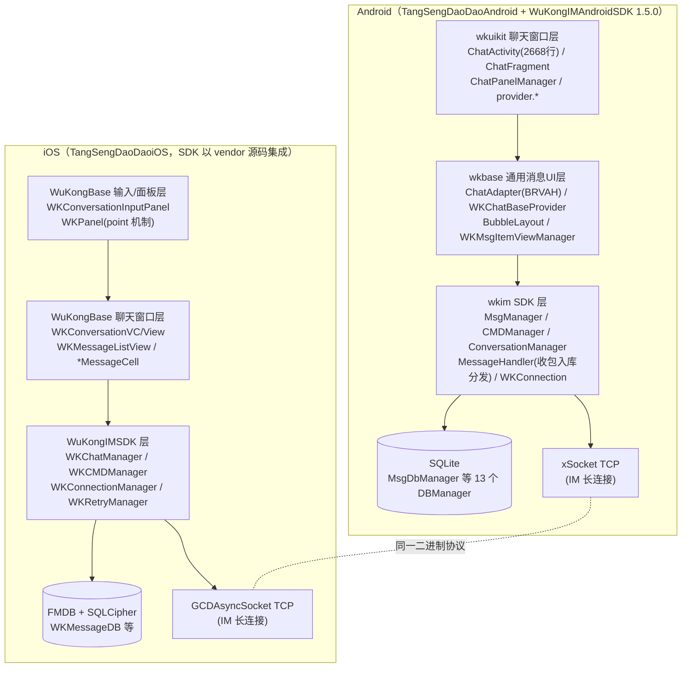
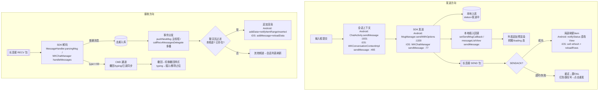
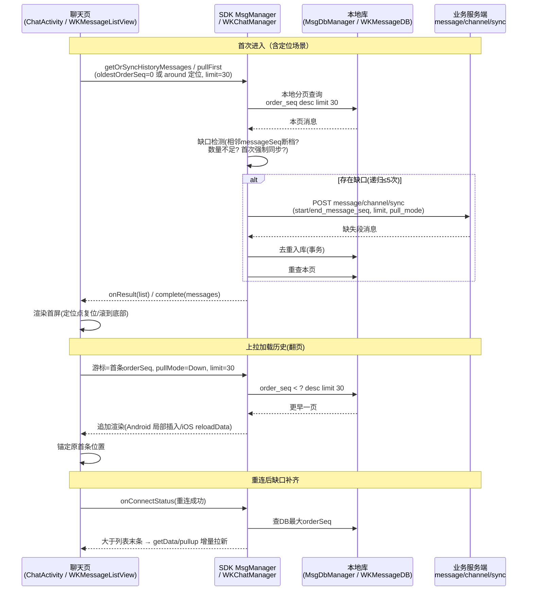
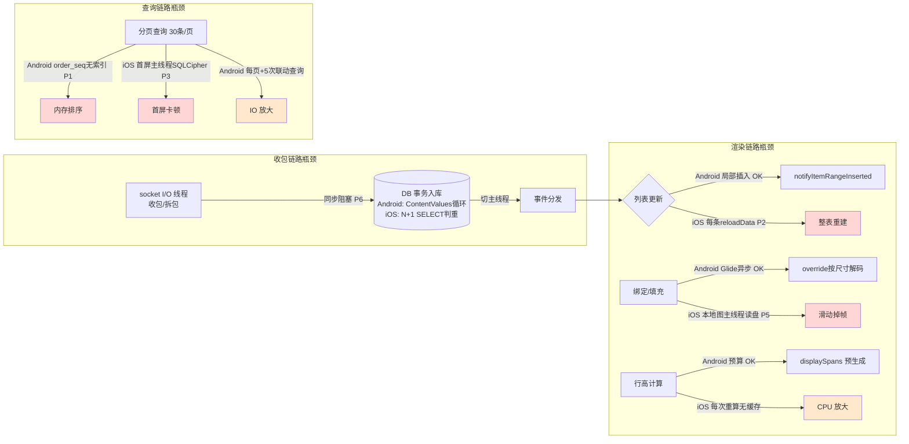

# 移动端聊天窗口与消息性能专项分析

> **分析对象**：TangSengDaoDao（唐僧叨叨）IM 项目的两个移动端仓库及其 IM SDK。
> **分析铁律**：全部结论基于本地真实源码，附 `文件路径:行号` 证据；无法确认处统一标注【缺少源码，无法确认】并收入第七章。

**路径前缀约定**（本仓库 `projects/` 下）：

| 前缀 | 实际路径 |
|---|---|
| 【Android App】 | `projects/TangSengDaoDaoAndroid/`（模块 `wkuikit`、`wkbase`、`app`） |
| 【Android SDK】 | `projects/WuKongIMAndroidSDK/wkim/`（`com.xinbida.wukongim`，版本 1.5.0） |
| 【iOS App】 | `projects/TangSengDaoDaoiOS/Modules/WuKongBase/WuKongBase/Classes/` |
| 【iOS SDK】 | `projects/TangSengDaoDaoiOS/Modules/WuKongIMiOSSDK/WuKongIMSDK/Classes/`（vendor 源码） |

---

# 一、移动端 IM 模块总览

## 1.1 整体架构与分层边界

两端均为清晰的三层结构：**App UI 层（聊天窗口）→ IM SDK 层（消息内核）→ 网络/存储**。SDK 对上只暴露 Manager 门面与监听回调，UI 层不直接接触协议与 socket。



**分层边界的关键证据**：

- Android：UI 层只通过 `WKIM.getInstance().getXxxManager()` 访问 SDK（如【Android App】`wkuikit/.../chat/ChatActivity.java:792` `MsgManager.addOnNewMsgListener`）；SDK 不知道 Activity 存在，事件经 `ConcurrentHashMap<key, Listener>` 回调上抛（【Android SDK】`manager/MsgManager.java:1251-1259 pushNewMsg`）。
- iOS：UI 层通过 `[WKSDK shared].chatManager` 等访问 SDK（【iOS App】`Sections/Conversation/WKMessageListView.m:81-90`）；SDK 经 `NSHashTable` 弱引用 delegate 多播上抛事件（【iOS SDK】`manager/WKChatManager.m:1541-1586`）。
- 两端 UI 层与 SDK 的**唯一契约** = Manager API + 消息实体（`WKMsg` / `WKMessage`）+ 监听回调，协议包结构、加解密、重试全部封装在 SDK 内。

## 1.2 技术栈对照

| 维度 | Android | iOS |
|---|---|---|
| UI 框架 | 原生 View 体系 + DataBinding（`act_chat_layout.xml`【Android App】`wkuikit/src/main/res/layout/act_chat_layout.xml:6-296`） | UIKit（Objective-C 为主），面板用懒加载 UIView 体系 |
| 消息列表组件 | `RecyclerView` + **BRVAH** `BaseProviderMultiAdapter`（`ChatAdapter extends BaseProviderMultiAdapter<WKUIChatMsgItemEntity>`【Android App】`wkbase/.../msg/ChatAdapter.java:42`） | **`UITableView` 子类 `WKConversationTableView`**（【iOS App】`Sections/Conversation/WKMessageListView.m:331-347`）；Texture(AsyncDisplayKit) 仅用于长按菜单/贴纸节点，**不参与列表渲染**（证据见 4.1） |
| 本地数据库 | 自研 `WKDBHelper`（SQLiteOpenHelper）+ assets/wk_sql 迁移脚本（【Android SDK】`db/WKDBUpgrade.java:37-54`） | **FMDB + SQLCipher** 加密库，按 uid 分库（【iOS SDK】`db/WKDB.m:60-94`），Migrations SQL 逐版执行 |
| 图片组件 | **Glide**（封装【Android App】`wkbase/.../glide/GlideUtils.java`）；大图查看 XPopup `SmartGlideImageLoader` | **SDWebImage 5.9.1** + YYImage(WebP)（`WuKongBase.podspec:76,86-87`）；大图浏览 **YBImageBrowser** 子类 `WKImageBrowser`（【iOS App】`Sections/Common/Component/WKImageBrowser.h:9`） |
| 多媒体 | MediaPlayer（`WKPlayVoiceUtils` prepareAsync【Android App】`wkuikit/.../view/WKPlayVoiceUtils.java:65`）；MediaMetadataRetriever 视频抽帧 | AVAudioPlayer（【iOS SDK】`manager/WKMediaManager.m:234-268`）；AMR→WAV VoiceConverter；AVAssetImageGenerator 抽帧 |
| 事件机制 | SDK key-Listener Map + App 自研 `EndpointManager`（仅横向扩展点，非消息主干） | SDK delegate 多播（NSHashTable weak）+ 少量 NSNotification（仅背景/截屏/键盘等外围） |
| 刷新控件 | 自实现 OnScrollListener 到顶/到底检测（`ChatActivity.java:584-606`） | **MJRefresh** header/footer（`WKMessageListView.m:351-367`） |

## 1.3 聊天相关核心类/包目录

**Android**：

| 包/类 | 职责 |
|---|---|
| `wkuikit/.../chat/ChatActivity.java`（2668 行） | 聊天窗口宿主：布局、监听注册（`initListener` :459）、数据加载（`getData` :1180）、收发（:1831/:2373） |
| `wkuikit/.../chat/ChatPanelManager.kt` | 输入框/表情/更多面板/@提醒/多选/禁言条 |
| `wkbase/.../msg/ChatAdapter.java` | 消息列表 Adapter（BRVAH 多 Provider），局部 payload 刷新（:318-412） |
| `wkbase/.../msgitem/WKChatBaseProvider.kt` | 所有消息 Item 的基类 Provider（外壳布局、状态、气泡形态） |
| `wkbase/.../msgitem/WKMsgItemViewManager.java` | viewType→Provider 注册表（:28-64） |
| `wkuikit/.../chat/manager/WKIMUtils.java` | App 级 IM 全局监听 hub + `msg2UiMsg` 转换（:379-433） |
| 【Android SDK】`manager/MsgManager.java` | 消息门面：发送/查询/同步/监听注册表 |
| 【Android SDK】`message/MessageHandler.java` | 收包拆包→入库→分发中枢 |
| 【Android SDK】`db/MsgDbManager.java` | 消息表全部 SQL（分页 :303、插入 :564、去重 :570-647） |

**iOS**：

| 包/类 | 职责 |
|---|---|
| `Sections/Conversation/WKConversationVC.m` | 聊天窗口宿主 VC（薄壳，viewDidLoad :41-94） |
| `Sections/Conversation/WKConversationView.m` | 真正的组装者：messageListView + input + VM + dataProvider（setupUI :112-125） |
| `Sections/Conversation/WKMessageListView.m`（约 1600 行） | 消息列表：dataSource/delegate、事件回调、加载与刷新 |
| `Sections/Conversation/WKMessageListDataProviderImp.m` | 列表数据提供者：pullFirst/pulldown/pullup 衔接 SDK |
| `Sections/Conversation/WKMessageList.m` | 内存消息容器：按日期分组字典 + 前后链表 |
| `Sections/Messages/WKMessageCell.m` 及各 `*MessageCell` | 气泡基类 + 16 种类型 Cell |
| `Services/Base/WKMessageRegistry.m` | contentType→Cell Class 注册表（:55-83） |
| 【iOS SDK】`manager/WKChatManager.m`（约 1800 行） | 消息门面：收发/拉取/ACK/extra 同步 + delegate 多播 |
| 【iOS SDK】`db/WKMessageDB.m` | 消息表全部 SQL（分页 :323、保存 :195、去重 :200-277） |

---

# 二、聊天窗口实现原理（重点）

## 2.1 页面结构

### Android：ChatActivity + PanelSwitchLayout

`ChatActivity extends SwipeBackActivity implements IConversationContext`（【Android App】`wkuikit/.../chat/ChatActivity.java:144`），DataBinding 布局 `act_chat_layout.xml`：

```
LinearLayout#rootView
├── include#topLayout（标题栏）
└── PanelSwitchLayout#panel_switch_layout（面板/键盘切换框架，:18-24）
    ├── RelativeContentContainer#content_view
    │   ├── ShapeBlurView#blurView（聊天背景高斯模糊，:46-50）
    │   ├── RelativeLayout#recyclerViewLayout
    │   │   ├── RecyclerView#recyclerView ← 消息列表（:58-63）
    │   │   ├── include#chatUnreadLayout（未读数/回到底部浮层）
    │   │   ├── #callLayout + #pinnedLayout（通话条/置顶消息条）
    │   │   └── TextView#timeTv（滚动悬浮时间）
    │   └── LinearLayout#bottomView（底部输入区）
    │       ├── FrameLayout#chatTopLayout（回复/编辑提示条）
    │       └── ContactEditText#editText + #sendIV 发送按钮（:187-267）
    └── PanelContainer#panel_container → #panel_emotion 表情面板（:281-293）
```

列表装配（`ChatActivity.java:449-453`）：

```java
chatAdapter = new ChatAdapter(this, ChatAdapter.AdapterType.normalMessage);
linearLayoutManager = new LinearLayoutManager(this, LinearLayoutManager.VERTICAL, false);
wkVBinding.recyclerView.setLayoutManager(linearLayoutManager);
wkVBinding.recyclerView.setAdapter(chatAdapter);
wkVBinding.recyclerView.setItemAnimator(new MyItemAnimator());
```

子组件：输入与附件面板由 `ChatPanelManager`（`ChatPanelManager.kt:117`，onStart 创建 :390-405）统管；拍摄/选图预览走 `PreviewNewImgActivity`（:24，结果回调 :2311-2318 后 `sendMsg(new WKImageContent(path))`）；滑动回复用 `ItemTouchHelper`（`MessageSwipeController.kt`，:460-471）。

### iOS：WKConversationVC → WKConversationView 二层组装

VC 是薄壳（viewDidLoad【iOS App】`Sections/Conversation/WKConversationVC.m:41-94`）：背景图 → `addDelegates` → 导航栏 `channelHeader` → `conversationView` → 调 `[conversationView viewDidLoad]`。真正的组装在 `WKConversationView.setupUI`（`WKConversationView.m:112-125`）：

```objc
-(void) setupUI {
    [self addDelegates];
    [self addSubview:self.messageListView];   // WKMessageListView 消息列表
    [self.inputParentView addSubview:self.input]; // WKConversationInputPanel 输入面板
    [[WKStickerManager shared] setupIfNeed];
    [self addSubview:self.topView];           // 顶部注入面板容器
}
```

输入面板 `WKConversationInputPanel`（`Input/WKConversationInputPanel.m:84-118`）：textView（WKGrowingTextView）+ 发送按钮 + 功能组；附件/表情/语音面板通过 **point 机制**按 ID 切换（`WKConversationPanel.m:82-85` 经 `[WKApp invoke:pointId]` 取得面板实例；`panel.emoji/panel.more/panel.voice` 注册于 `WKApp.m:1065,1157-1167`）。图片浏览为 YBImageBrowser 子类 `WKImageBrowser`（`WKImageMessageCell.m:232-256`）。

## 2.2 消息 Model 设计

### Android：WKMsg（SDK 实体）→ WKUIChatMsgItemEntity（UI 包装）

SDK 实体 `WKMsg`（【Android SDK】`entity/WKMsg.java:23-100`）关键字段：

```java
public String messageID;     // :26 服务器消息ID（全局唯一，无序）
public int messageSeq;       // :28 服务器消息序号（有序递增）
public long clientSeq;       // :30 客户端序号（本地自增主键）
public long orderSeq;        // :70 排序编号（分页/排序游标）
public String clientMsgNO;   // :68 客户端消息唯一编号（构造时生成 :100，去重键）
public int type;             // :42 消息正文类型
public String content;       // :44 消息内容Json
public int status = WKSendMsgResult.send_loading;  // :46,:99 发送状态
public WKMessageContent baseContentMsgModel;       // :60 解析后的内容模型
public WKMsgExtra remoteExtra;                     // :87 远程扩展(撤回/编辑/已读数/置顶)
public List<WKMsgReaction> reactionList;           // :89 回应
```

UI 包装 `WKUIChatMsgItemEntity`（`wkbase/.../msgitem/WKUIChatMsgItemEntity.java:54-70`）持有 `wkMsg` 并增加纯 UI 态：`showNickName/isPlaying/isChoose/isChecked/previousMsg/nextMsg/isUpdateStatus/isRefreshReaction/displaySpans`（预生成富文本）等。转换入口 `WKIMUtils.msg2UiMsg()`（`WKIMUtils.java:379-433`，含违禁词替换、@链接回调、是否显示昵称计算）。

**消息类型**：SDK 常量 `WKMsgContentType`（TEXT=1/IMAGE=2/GIF=3/VOICE=4/VIDEO=5/LOCATION=6/CARD=7/FILE=8/MULTIPLE_FORWARD=11/VECTOR_STICKER=12/EMOJI_STICKER=13/INSIDE_MSG=99）；App 扩展 `WKContentType`（`wkbase/.../msgitem/WKContentType.java:10`）含本地 UI 类型（typing=-4、revoke=-5、loading=-6 等）与系统消息段（1000~2000，`isSystemMsg(type)=1000..2000` :51）。Content 类体系：`WKMessageContent` 基类（【Android SDK】`msgmodel/WKMessageContent.java:17`）+ SDK 内置 Text/Image/Video/Voice（注册于 `MsgManager.initNormalMsg()` :122-130）+ App 自定义 `registerContentMsg`（名片/合并转发，注册点 `WKUIKitApplication.java:198-201`）。

**发送状态枚举**（【Android SDK】`message/type/WKSendMsgResult.java:8-21`）：`send_loading=0 / send_success=1 / send_fail=2 / no_relation=3 / black_list=4 / not_on_white_list=13`。流转点：构造时 loading；SENDACK 时 `MsgDbManager.updateMsgSendStatus`（`MessageHandler.java:329-341`）；附件上传失败置 fail（`WKConnection.java:1018`）；UI 在 `WKChatBaseProvider.setMsgTimeAndStatus()`（:768-854）画单勾/双勾/转圈/红色错误图标。

### iOS：WKMessage（SDK 实体）→ WKMessageModel（UI 包装）

SDK 实体 `WKMessage`（【iOS SDK】`model/WKMessage.h:34-105`）：

```objc
@property(nonatomic,copy) NSString *clientMsgNo;  // 客户端消息唯一编号(相同则视为重复消息)
@property(nonatomic,assign) uint64_t messageId;   // 消息ID（全局唯一）
@property(nonatomic,assign) uint32_t messageSeq;  // 消息序列号（有序）
@property(nonatomic,assign) uint32_t orderSeq;    // 消息排序号（越新越大）
@property(nonatomic,assign) NSInteger contentType; // 正文类型
@property(nonatomic,strong) WKMessageContent *content;
@property(nonatomic,assign) WKMessageStatus status; // 消息状态
@property(nonatomic,strong) WKMessageExtra *remoteExtra; // 远程扩展（撤回/编辑等）
@property(nonatomic,assign) BOOL streamOn;        // 流式消息
@property(nonatomic,strong,nullable) NSArray<WKReaction*> *reactions;
```

UI 包装 `WKMessageModel`（【iOS App】`Sections/Messages/WKMessageModel.h:20-165`）：强持有 `WKMessage`，status 直接代理（`WKMessageModel.m:144-150`），额外 UI 字段：`preMessageModel/nextMessageModel`（弱引用前后链表）、`dateStr/timeStr`、`checked`（多选）、`voicePlayStatus/voicePlayProgress`、`reactionTop3`、`preCellHeight`（流式高度）等。

**消息类型**：SDK 基础类型 `WKConst.h:11-20`（TEXT=1/IMAGE=2/GIF=3/VOICE=4/CMD=99）；App 扩展 `WKConstant.h:296-360`（SMALLVIDEO=5/LOCATION=6/CARD=7/FILE=8/REDPACKET=9/TRANSFER=10/MERGEFORWARD=11/TYPING=101/系统 1000-2000/音视频通话 9989-9999/本地 20000+）。

**发送状态枚举**（【iOS SDK】`WKConst.h:25-31`）：`WK_MESSAGE_WAITSEND / SUCCESS / ONLYSAVE / UPLOADING / FAIL`。流转点：发送时 WAITSEND（多媒体先 UPLOADING 走 `WKMediaManager`，`WKChatManager.m:77-91`）；SENDACK 置 SUCCESS（:472-502）；重试超限置 FAIL（`WKRetryManager.m:176-178`）；UI 发送中转菊花、失败红色感叹号（`WKMessageCell.m:686-690,720-724`）。

## 2.3 消息 Cell 实现与复用

### Android：BRVAH Provider 模式，viewType == contentType

`ChatAdapter.getItemType()`（`ChatAdapter.java:78-92`）：

```java
protected int getItemType(List<? extends WKUIChatMsgItemEntity> list, int i) {
    if (list.get(i).wkMsg.remoteExtra != null && list.get(i).wkMsg.remoteExtra.revoke == 1) {
        return WKContentType.revoke;   // 撤回消息强制映射为 -5
    }
    if (getItemProviderList().containsKey(list.get(i).wkMsg.type)) {
        return list.get(i).wkMsg.type;  // viewType 就是 contentType 本身
    }
    if (list.get(i).wkMsg.type >= 1000 && list.get(i).wkMsg.type <= 2000) {
        return WKContentType.systemMsg;
    }
    return WKContentType.unknown_msg;
}
```

- **收发方向不进 viewType**：同一类型收发共用一个 viewType 和同一 layout，方向在 Provider 内 `getMsgFromType()` 判断（`WKChatBaseProvider.kt:198-211`），复用率翻倍。
- **统一外壳 + 内容注入**：所有 Provider 基类 `WKChatBaseProvider` 用同一外壳 `R.layout.chat_item_base_layout`（头像/昵称/多选框/状态/时间），内容 View 由 `getChatViewItem()` inflate 进容器（:252-253）。
- **气泡不是九宫格图片**，而是自绘 View：`BubbleLayout extends LinearLayout`（`wkbase/.../views/BubbleLayout.java:36,223-266`）用 `Path`+三次贝塞尔绘制带尖角圆角气泡；按前后消息同发送者计算 single/top/center/bottom 四种形态（`WKChatBaseProvider.kt:398-432`）。图片消息无气泡，直接给 `FilterImageView` 设四角半径（`WKImageProvider.kt:405-427`）。
- 已注册 Provider（`WKUIKitApplication.java:203-213`）：文本/图片/语音/名片/合并转发/typing/撤回/系统/时间/新消息分割线/敏感词/非好友/空占位等。**视频(5)/文件(8)/位置(6)/GIF(3)/贴图(12,13) 无 Provider 注册**——见第七章。
- 已做的小优化：`setSupportsChangeAnimations(false)`（`ChatActivity.java:448`）+ 自定义 `MyItemAnimator` 去掉 change 位移（消除刷新闪动）。

### iOS：注册表 + identifier = Cell 类名

注册表 `WKMessageRegistry`（contentType→Cell Class 字典，未注册回落到系统/未知 Cell，【iOS App】`Services/Base/WKMessageRegistry.m:55-83`）；注册点 `WKApp.m:216-231`（文本/图片/语音/GIF/名片/Typing/合并转发/系统/撤回等 16 类）。复用规则（`WKMessageListView.m:1127-1138`）：

```objc
Class messageCellClass = [self getMessageCellClass:messageModel];
NSString *identifier = NSStringFromClass(messageCellClass);   // 一个类一个 identifier，方向不区分
WKMessageBaseCell *cell = [self.tableView dequeueReusableCellWithIdentifier:identifier];
if(!cell) { cell = [[messageCellClass alloc] initWithStyle:... reuseIdentifier:identifier]; }
```

- 数据填充放在 `willDisplayCell`（:1148-1166：`[baseCell refresh:messageModel]`），撤回消息优先短路返回 `WKMessageRevokeCell`（:610-617）。
- **气泡 = 九宫格拉伸 + Template 着色**（`WKMessageCell.m:881-910`）：按首/中/尾位置与收发方向选 `MessageSendBubbleFirst/Middle/...` 图片，`resizableImageWithCapInsets` 拉伸后 `UIImageRenderingModeAlwaysTemplate`，refresh 时 `tintColor = themeColor`（自己）/ `cellBackgroundColor`（接收）。
- **高度为手工预算**：`heightForRowAtIndexPath` → `[messageCellClass sizeForMessage:]`（:1140-1146；基类实现 `WKMessageCell.m:57-80` = 内容高+边距+昵称/错误高度），`estimatedRowHeight=0`，**行高无缓存每次重算**；仅文本的 NSAttributedString 有缓存（`WKTextMessageCell.m:148-183`，静态 `WKMemoryCache` 上限 500 条，key=messageId+clientMsgNo）。

## 2.4 消息事件驱动机制

### Android：key-Listener 注册表 + 主线程分发

SDK 各 Manager 用 `ConcurrentHashMap<String, Listener>` 持有监听，事件来时 `runOnMainThread` 遍历回调（【Android SDK】`manager/MsgManager.java`）：

```java
// 新消息（MsgManager.java:1251-1259）
public void pushNewMsg(List<WKMsg> list) { ... 遍历 newMsgListenerMap → INewMsgListener.newMsg(list) }
// 刷新（:1059-1068）setRefreshMsg → IRefreshMsg.onRefresh
// 发送本地插入（:925-933）setSendMsgCallback → ISendMsgCallBackListener.onInsertMsg
// 发送ACK（:1008-1017）setSendMsgAck → ISendACK.msgACK（注意：App 层全仓未注册此监听，见第七章）
```

收包分发主链（【Android SDK】`message/MessageHandler.java`）：

```
onReceiveMsg → WKProto.decodeMessage(:321)
├─ SENDACK(:327-344) → MsgDbManager.updateMsgSendStatus → setRefreshMsg + setSendMsgAck
└─ RECEIVED(:345) → parsingMsg(:566 解JSON取type)
     ├─ type==99 → CMDManager.handleCMD(:604-606) → cmdListenerMap
     └─ 普通 → addReceivedMsg → saveReceiveMsg(:400) → saveSyncMsg(:479)
              → MsgDbManager.insertMsgs(:488) → MsgManager.pushNewMsg(:490) → 更新会话表
```

**撤回通知链**（跨层完整链路，真实代码）：CMD 消息 → `CMDManager.handleCMD` → App 全局监听（key="system"，`WKIMUtils.java:321-324`）→ `case wk_messageRevoke → revokeMsg()`（:469-513：按频道设置决定 `syncExtraMsg` 同步远程扩展 或 直接删除）→ extra 同步回写后 SDK `setRefreshMsg` → ChatActivity `addOnRefreshMsgListener`（:781）→ `refreshMsg()`（:2508）把 `revoke/revoker` 写回列表项 → `getItemType` 命中 `revoke`（`ChatAdapter.java:80-83`）→ 切换为撤回样式。

**事件总线核实**：消息链路**不使用** EventBus/LiveData（grep 0 命中）；RxJava 仅用于 3 秒轮询上传已读（`startTimer` :1775-1800）；`EndpointManager` 只是横向扩展点（长按菜单配置、置顶条、被踢退出等），不在消息分发主干上。

### iOS：NSHashTable 弱引用 delegate 多播

SDK 分发核心（【iOS SDK】`manager/WKChatManager.m:1541-1586`）：

```objc
-(NSHashTable*) delegates {
    if (_delegates == nil) {
        _delegates = [NSHashTable hashTableWithOptions:NSPointerFunctionsWeakMemory];
    }
    return _delegates;
}
- (void)callRecvMessagesDelegate:(NSArray<WKMessage*>*)messages {
    [self.delegateLock lock];
    NSHashTable *copyDelegates = [self.delegates copy];   // 快照防遍历中变更
    [self.delegateLock unlock];
    for (id delegate in copyDelegates) {
        if ([delegate respondsToSelector:@selector(onRecvMessages:left:)]) {
            if (![NSThread isMainThread]) {
                dispatch_async(dispatch_get_main_queue(), ^{ ... 逐条 onRecvMessages ... });
            } ...
        }
    }
}
```

要点：弱引用持有（对象销毁自动失效）+ NSLock 保护 + 遍历时 copy 快照 + 自动切主线程 + 逐条回调带 `left`（剩余条数）。同一模式用于 `callMessageUpdateDelegate/callStreamDelegate/callSendackDelegate`。

**WKMessageListView 注册的 6 个 delegate**（【iOS App】`Sections/Conversation/WKMessageListView.m:81-90`）：channelManager（频道资料）、chatManager（消息）、reactionManager（回应）、connectionManager（连接状态）、typingManager（正在输入）、reminderManager（提醒）。各回调：`onRecvMessages:left:`（:1257 过滤非本频道/CMD → 判重 → 插入）、`onMessageUpdate:`（:1270 状态/撤回/删除）、`onMessageStream:`（:1334 流式追加）、`onMessageDeleted:`（:1387）、`onConnectStatus:`（:1514 重连成功 → pullup 拉新）等。

**撤回通知链**：CMD → `WKChatManager` 分流 `cmdManager callOnCMDDelegate:`（【iOS SDK】`WKChatManager.m:568-590`）→ 全局单例 `WKSystemMessageHandler.handleCMD:`（【iOS App】`Sections/Common/WKSystemMessageHandler.m:283`）→ `WKCMDMessageRevoke` 分支（:356-357）→ `handleMessageRevokeCMD:`（:253-273，按频道设置决定直接删或 `syncMessageExtra:` 同步远程扩展）→ extra 拉回后逐条 `callMessageUpdateDelegate:`（【iOS SDK】`WKChatManager.m:1785-1792`）→ UI `onMessageUpdate:` 中 `remoteExtra.revoke` 分支刷新为撤回 Cell（`WKMessageListView.m:1290-1305`）。

**NSNotification 核实**：消息收发不走通知中心；通知仅用于聊天背景变更、截屏、键盘、群成员更新等外围（`WKConversationVC.m:99`、`WKConversationView.m:135`、`WKConversationVM.m:120`）。

## 2.5 生命周期与监听解绑

### Android：注册在 onCreate，移除在 finish()（存在隐患）

- 注册：`onCreate`（`ChatActivity.java:263-273`）→ `initListener()`（:459 起），共 14+ 项监听，**key 几乎全部为 `channelId`**（新消息 :792、刷新 :781、发送回调 :789、删除 :746、CMD :752、连接状态 :821、频道/成员 :638-737、提醒 :811 等）。
- 移除：**全部在 `finish()`**（:2226-2244），`onDestroy` 里**没有任何 removeXxxListener**：

```java
@Override
public void finish() {
    super.finish();
    EndpointManager.getInstance().remove(channelId);
    WKIM.getInstance().getMsgManager().removeNewMsgListener(channelId);
    WKIM.getInstance().getMsgManager().removeRefreshMsgListener(channelId);
    WKIM.getInstance().getMsgManager().removeSendMsgCallBack(channelId);
    WKIM.getInstance().getCMDManager().removeCmdListener(channelId);
    ... // :2231-2244 共 14 项
}
```

- `onResume`（:276-299）：置"正在聊天频道"标记、开已读轮询；`onStop`（:2300-2308）：停语音、清标记、关截屏检测；`onDestroy`（:2247-2261）：dispose RxJava timer、保存草稿与浏览位置（keepMsgSeq/offsetY）。
- **隐患**：① 移除依赖 `finish()` 而非 `onDestroy()`——异常销毁路径下静态单例 `MsgManager` 的 listenerMap 会残留持有 Activity 的 lambda（重进同 channelId 会覆盖，风险限于最后未正常 finish 的会话）；② `EndpointManager` 中 `"hide_pinned_view"` 等**固定串 sid 从不移除**（`finish()` 只 `remove(channelId)`），且 `setMethod` 是 **List 追加不去重**（`EndpointManager.java:26-38`），`invokes(category)` 会执行全部重复项——真实泄漏/重复注册点；③ 多处 `new Handler().postDelayed(300ms)`（:624/:1104/:1664/:1676）销毁后不取消（短延迟风险有限）。

### iOS：注册在 setupUI，移除在 dealloc（规范）

- `WKMessageListView`：注册于 `setupUI`（:46-55 → :81-90），移除于 `dealloc`（:279-282，对称移除 6 个 manager）；NSHashTable 弱引用本身也不阻止 dealloc，双保险。
- `WKConversationVC`：viewDidLoad 注册（:97-100），dealloc 移除（:151-155）。
- 退页处理 `viewWillDisappear`（`WKConversationView.m:141-161`）：移除键盘监听、停语音（`mediaManager stopAudioPlay`）、`saveDraftOrKeepPosition`（草稿+浏览位置写入 `remoteExtra.draft/keepMessageSeq/keepOffsetY` 并同步服务端）、`requestSetUnreadIfNeed` 回写未读。
- 定时器/动画器：禁言 `forbiddenTimer` 用 block+weakSelf 且 invalidate（:589-592,609-618）；全仓手工 `__weak typeof(self) weakSelf`（未用 weakify 宏），未发现明显循环引用。
- 瑕疵：`WKConversationView` 截屏监听在 viewWillAppear 注册、viewDidDisappear 中仅 `takeScreenshotOn` 时移除（:162-169），注册/移除条件不对称，反复进出可能重复注册（重复回调）。

## 2.6 聊天窗口消息渲染流程图



## 2.7 关键源码片段（页面初始化与监听注册）

**Android 监听注册**（`ChatActivity.java:789-833`，全部 key=channelId）：

```java
WKIM.getInstance().getMsgManager().addOnSendMsgCallback(channelId, this::sendMsgInserted);
WKIM.getInstance().getMsgManager().addOnNewMsgListener(channelId, this::receivedMessages);
WKIM.getInstance().getMsgManager().addOnClearMsgListener(channelId, ...);
WKIM.getInstance().getReminderManager().addOnNewReminderListener(channelId, this::resetReminder);
EndpointManager.getInstance().setMethod(channelId, EndpointCategory.wkExitChat, ...);
WKIM.getInstance().getConnectionManager().addOnConnectionStatusListener(channelId, (status, reason) -> {
    if (status == WKConnectStatus.syncCompleted) {
        long maxOrderSeq = WKIM.getInstance().getMsgManager().getMaxOrderSeqWithChannel(channelId, channelType);
        if (maxOrderSeq > chatAdapter.getEndMsgOrderSeq()) {
            getData(0, true, maxOrderSeq, true);   // 重连同步完成后缺口补齐
        }
    }
});
```

**iOS delegate 注册与数据填充时机**（`WKMessageListView.m:81-90` + :1148-1166）：

```objc
-(void) addDelegates {
    [[WKSDK shared].channelManager addDelegate:self];
    [[WKSDK shared].chatManager addDelegate:self];
    [[WKSDK shared].reactionManager addDelegate:self];
    [[WKSDK shared].connectionManager addDelegate:self];
    [[WKTypingManager shared] addDelegate:self];
    [[WKReminderManager shared] addDelegate:self];
}
// willDisplayCell 才真正填充数据（懒绑定）：
- (void)tableView:... willDisplayCell:... {
    baseCell.conversationContext = self.conversationContext;
    [baseCell refresh:messageModel];
    [baseCell onWillDisplay];
    [self didReadedAndViewed:messageModel];   // 顺带做已读/已查看上报
}
```

---

# 三、大批量聊天记录处理方案（重点）

## 3.1 本地消息存储方案

### Android：自研 DBHelper + 无 order_seq 索引（关键发现）

消息表 DDL（【Android SDK】`assets/wk_sql/202008292051.sql:1-27`）：

```sql
create table message
(
    client_seq INTEGER PRIMARY KEY AUTOINCREMENT,
    message_id TEXT,
    message_seq BIGINT default 0,
    channel_id TEXT,
    channel_type int default 0,
    timestamp INTEGER,
    from_uid text, type int default 0, content text,
    status int default 0, voice_status int default 0,
    created_at text, updated_at text, searchable_word text,
    client_msg_no text, is_deleted int default 0,
    setting int default 0, order_seq BIGINT default 0, extra text
);
CREATE INDEX msg_channel_index ON message (channel_id,channel_type);
CREATE UNIQUE INDEX IF NOT EXISTS msg_client_msg_no_index ON message (client_msg_no);
CREATE INDEX searchable_word_index ON message (searchable_word);
CREATE INDEX type_index ON message (type);
```

- 分页/排序列是 **`order_seq`**，但**全部索引中没有 order_seq / message_seq**——分页只能靠 `(channel_id, channel_type)` 索引缩小范围后内存排序，大频道历史越深越慢（风险详见 4.7）。
- 扩展表 `message_extra`（撤回/编辑/已读数/置顶，`202204121518.sql:1-19`），`UNIQUE(message_id)`，主查询 LEFT JOIN 带出。
- 分页存储逻辑：本地只按页（30 条）查询，不做全量加载；消息持久化以 SQLite 为准，SDK **无内存消息缓存层**（每次现查库）。

### iOS：FMDB + SQLCipher，order_seq 有索引但无复合索引

消息表 DDL（【iOS SDK】`Assets/Migrations/201911270513.sql:56-81`）核心列：`id` 自增主键、`message_id`、`message_seq`、`order_seq`、`channel_id/channel_type`、`content_type`、`content`、`status` 等；索引：

```sql
CREATE INDEX IF NOT EXISTS idx_message ON message (channel_id, channel_type);
CREATE INDEX IF NOT EXISTS idx_order_seq ON message (order_seq);          -- 分页列有索引
CREATE INDEX IF NOT EXISTS idx_content_type ON message (content_type);
CREATE INDEX IF NOT EXISTS idx_message_id ON message (message_id);
-- 202005281108.sql:1-3 增补：client_msg_no 列 + UNIQUE INDEX idx_client_msg_no
```

- 优于 Android：分页列 `order_seq` 有独立索引；不足：`(channel_id,channel_type)` 与 `order_seq` 是两个独立索引，无三列复合索引；`message_seq` 无索引（around 定位查询按 message_seq 过滤走不到专用索引，SQL 见 `WKMessageDB.m:154`）。
- **SQLCipher 加密，密钥 = 登录 uid 本身**，按 uid 分库（【iOS SDK】`db/WKDB.m:60-94`）：

```objc
NSString *dbPath = [NSString stringWithFormat:@"%@/%@%@.db", ...dbDir, ...dbPrefix, uid]; // :73
NSString *dbKey = uid;      // :78 密钥就是 uid —— 无随机盐/Keychain，弱加密
[db setKeyWithData:[dbKey dataUsingEncoding:NSUTF8StringEncoding]];                        // :89
```

- 所有 DB 操作走全局唯一 **FMDatabaseQueue 串行队列**（同步 `inDatabase/inTransaction`，在调用线程阻塞等待）；批量保存用事务 + `@synchronized`（`WKMessageDB.m:195-252`），但**事务内每条消息先做一次 SELECT 判重（N+1 查询）**。

## 3.2 消息加载策略

两端高度同构：**每页 30 条 + orderSeq 游标分页 + 本地优先、缺口 HTTP 补齐**。

| 场景 | Android | iOS |
|---|---|---|
| 每页条数 | `limit = 30`（`ChatActivity.java:188`） | `eachPageMsgLimit = 30`（`WKAppConfig.m:81`） |
| 进入会话首次 | `initData()`（:954）→ 解析定位参数 → `getData(...)`（:1180）→ `MsgManager.getOrSyncHistoryMessages`（**每次 new 裸 Thread**，`MsgManager.java:306`）→ `MsgDbManager.queryOrSyncHistoryMessages` | `loadMessages`（`WKMessageListView.m:151-168`）→ `pullFirst:`（`WKMessageListDataProviderImp.m:45-74`）→ 有定位点 `pullAround:` / 无则 `pullLastMessages:`（`WKChatManager.m:1196,1213`） |
| 上拉更早历史 | RecyclerView 滚动到底部（历史在上方，`!canScrollVertically(-1)` 到顶）`SCROLL_STATE_IDLE` 时触发（:584-606）→ `showRefreshLoading()`（:1647，插 loading 占位，300ms 后 `getData(0)`）；游标 = `getFirstMsgOrderSeq()`（`ChatAdapter.java:186-206`）→ SQL `order_seq<=? desc limit 30` | MJRefresh header → `pulldown`（`WKMessageListView.m:403-422`）→ 游标 = 首条 `orderSeq` → `pullDown:startOrderSeq:limit:`（`WKChatManager.m:1200`）→ SQL `order_seq < ? desc limit 30`；加载后锚定回原首条 |
| 下拉加载更新 | 到顶反向（`!canScrollVertically(1)`）→ `showMoreLoading()`（:1667）→ `getData(1)`，游标 = `getEndMsgOrderSeq()` → `order_seq>? asc`；重连 syncCompleted 且服务端 orderSeq 更大时自动 `getData(0,true,maxOrderSeq,true)`（:821-834） | MJRefresh footer → `pullup`（:424-445）→ 游标 = 末条 orderSeq → `pullUp:` → `order_seq > ? asc limit 30`；重连成功同样触发 pullup（:1514-1532） |
| 定位加载（搜索/@我/回复跳转） | aroundMsgOrderSeq 校正：`queryOrderSeq(...,3)` 取附近第 3 条作起点（`MsgManager.java:310-349`） | `pullAround:`：向上偏移 5 条折算起点，再向后拉 30 条（"前 5 + 后 30"，`WKChatManager.m:1213-1255`） |

**缺口检测与 HTTP 补齐**（两端都是 SDK 内置、递归补齐）：

- Android `MsgDbManager.queryOrSyncHistoryMessages`（:68-232）：页内相邻 messageSeq 断档 → 用 `getDeletedCount` 核对删除数 → 判缺口；首次进入强制同步（:169-173）；`requestCount < 5` 限制（:209）→ 经 `ISyncChannelMsgListener`（App 注入：`WKIMUtils.java:171` → `MsgModel.syncChannelMsg` → HTTP `POST message/channel/sync`，`MsgService.java:59-60`）→ 回包入库后**递归重查**（:220）。
- iOS `WKChatManager pullMessages:...maxExecCount:5`（:803-1062）：四种缺口情形（页间游标差>1 :877、页内断档 :898、数量不足 :947、首屏为空/落后 :999）→ `calSync:` → App 注入的 `setSyncChannelMessageProvider`（`WKDataSourceModule.m:204-234`，同一 HTTP 接口）→ `replaceMessages:` 落库 → 递归重查最多 5 次。

## 3.3 消息缓存机制

| | Android | iOS |
|---|---|---|
| 内存列表位置 | `chatAdapter.getData()`（BRVAH 内部 List） | `WKMessageList`（按 yyyy-MM-dd 分组的 `NSMutableDictionary` + dates 数组，NSLock 保护，`WKMessageList.m:12-18`） |
| SDK 内存缓存 | **无**（仅 `channelMinMsgSeqs` 记最小 seq，`MsgDbManager.java:66`） | **无**（每次查库） |
| 缓存淘汰/上限 | **未发现**（grep LruCache/subList 裁剪无结果；列表只增不减，靠 `setNewInstance` 整体重置） | **未发现**（grep removeObjectsInRange/maxCount 无结果；已拉取页全量驻留内存） |
| 业务缓存 | 文本富文本在 `WKUIChatMsgItemEntity.displaySpans` 构造时预生成一次（`msg2UiMsg`） | 文本 NSAttributedString 静态缓存 `WKMemoryCache` 上限 500 条（`WKTextMessageCell.m:148-183`） |

结论：两端对"磁盘持久化 vs 内存列表"的划分一致（SQLite/FMDB 为唯一持久层，内存只有当前会话已加载页），但**都没有内存上限控制**——超大会话长时间上下翻页后内存驻留持续增长（风险见 4.3）。

## 3.4 消息去重机制

**三层去重（两端同构）**：

1. **DB 约束层**：`client_msg_no` 唯一索引（Android `202008292051.sql:25`；iOS `202005281108.sql:3`）——最终防线。
2. **入库前判重**：
   - Android `insertMsgs`（`MsgDbManager.java:564-686`）：批内 **O(n²) 双循环**比对（:570-584）+ 按 200 个 clientMsgNO 一批查库判重（:604-629）；冲突消息"改名 `clientMsgNO-messageSeq` + `isDeleted=1`"落库占位保 seq 连续（:644-645）。
   - iOS `saveMessages:`（`WKMessageDB.m:195-252`）：事务内**逐条 SELECT 判重**（:200）；冲突同样改名+isDeleted=1（:207-209,269-275）。
3. **UI 层判重**：Android `chatAdapter.isExist(clientMsgNO, messageID)` 全表 **O(n) 遍历**（`ChatAdapter.java:139-157`，在 getData 逐条过滤中构成 O(n×m)，`ChatActivity.java:1228-1232`）；iOS `indexPathAtClientMsgNo:` 线性查找（`WKMessageListView.m:1261-1264` → `WKMessageList.m:327`）。

## 3.5 消息增量更新

### Android：局部刷新为主，且有"直改 View"的 payload 通道

- 新消息/发送插入：BRVAH `addData`（内部 `notifyItemRangeInserted`，`sendMsgInserted` :2358、`receivedMessages` :2418）。
- 状态/撤回/编辑：`refreshMsg()`（:2508-2609）按 clientSeq/clientMsgNO/messageID 匹配定位后分流——状态变化走 `chatAdapter.notifyStatus(i)`（**不触发 rebind**，`findViewByPosition` 拿到 itemView 直接调 provider 改 View，`ChatAdapter.java:322-412`）；撤回走 `notifyItemChanged(i)` 并 200ms 后刷新前后相邻项背景（:2611-2622）；reaction 走 `notifyItemChanged(i, payload)`。
- 全量场景仅：首屏/重拉 `setNewInstance`（:1327）、清空会话重建 Adapter（:797-798）、横竖屏切换（:1822-1826）。直接 `notifyDataSetChanged` 仅一处且已注释（:883）。
- **未使用 DiffUtil/AsyncListDiffer**（grep 0 命中）。防崩溃工具 `SafeAdapterHelper.safeNotify`（`isComputingLayout` 时 post 延后）存在但**唯一调用点被注释**（:2390-2394，未启用）。

### iOS：新消息全量 reloadData，单条更新才局部

- **每条新消息一次 `reloadData`**（`WKMessageListView.m:1024-1051`）：

```objc
// handleRecvMessage:
[self.dataProvider addMessage:messageModel];
[self.tableView reloadData];          // :1040 每条新消息一次全量刷新
if(self.positionAtBottom) [self scrollToBottom:YES];
```

且 SDK 是逐条回调（`callRecvMessagesDelegate` 内 for 循环逐条 onRecvMessages，`WKChatManager.m:1571-1584`）——**批量收 N 条 = N 次 reloadData**。源码自身注释承认：`WKMessageListView.m:1257` "这里有优化的余地 优化到最后一条此会话的消息才刷新"。

- 单条更新（ACK 等 total==1）：`[cell refresh:] + reloadRowsAtIndexPaths`（:1307-1317，局部）；**撤回/批量结尾（left==0）走 reloadData**（:1290-1331）。
- 发送插入 `didAddMessageUI` 同样是 reloadData + scrollToBottom（:104-128）；删除用 deleteRows/deleteSections 局部（带 @try-catch 兜底 reloadData，:1433-1446）。
- 会话列表反而做了精细优化：单条变化 `moveRowAtIndexPath` 动画 / 新增 `insertRowsAtIndexPaths` / 多条才 reloadData（`WKConversationListVC.m:419-491`）。

## 3.6 大批量消息加载时序图



## 3.7 关键源码片段

**Android 分页 SQL**（【Android SDK】`db/MsgDbManager.java:303-330`，指定列 + LEFT JOIN，游标 order_seq）：

```java
sql = "SELECT * FROM (SELECT " + messageCols + "," + extraCols + " FROM " + message
    + " LEFT JOIN " + messageExtra + " on " + message + ".message_id=" + messageExtra + ".message_id"
    + " WHERE " + message + ".channel_id=? and " + message + ".channel_type=? and "
    + message + ".type<>0 and " + message + ".type<>99 AND " + message + ".order_seq<=?)"
    + " where is_deleted=0 and is_mutual_deleted=0 order by order_seq desc limit 0," + limit;
```

> 注：每页查询后还联动 4 次批量查询（reaction :361、群成员 :375、发送者频道 :387、被回复消息 extra :399）+ 每页查一次频道（:341）——大分页下的放大开销见 4.4。

**iOS 分页 SQL**（【iOS SDK】`db/WKMessageDB.m:37-42`）：

```objc
"select message.*,%@ from %@ left join message_extra on message.message_id=message_extra.message_id
 where message.channel_id=? and message.channel_type=? and message.is_deleted=0
 and message.content_type<>99 and message.order_seq %@ ? %@
 order by message.order_seq desc,message.timestamp desc limit 0,?"
// pullMode=Down: order_seq < ?（向历史）；Up: order_seq > ?（向新消息）
// 游标 orderSeq = messageSeq * 1000（WKOrderSeqFactor，WKConst.h:92）
```

**iOS 新消息全量刷新**（`WKMessageListView.m:1037-1050`，性能热点）：

```objc
[self.dataProvider addMessage:messageModel];
[self.tableView reloadData];                 // 每条新消息一次 reloadData
if(self.positionAtBottom) [self scrollToBottom:YES];
```

**Android 状态局部刷新（直改 View 不 rebind）**（`ChatAdapter.java:322-412` 摘要）：

```java
public void notifyStatus(int position) {
    View itemView = linearLayoutManager.findViewByPosition(position);
    if (itemView != null) {
        BaseItemProvider provider = ...;
        provider.setMsgTimeAndStatus(itemView, ...);   // 直接操作可见 View，无 notify 无 rebind
    }
}
```

---

# 四、聊天窗口性能问题处理专项（重点）

> 逐条从源码核实优化手段：**有则分析实现，无则明确标注"未发现"**。✅=已实现 ❌=未发现 ⚠️=有但存在缺陷。

## 4.1 列表渲染优化

| 手段 | Android | iOS |
|---|---|---|
| ViewHolder/Cell 复用 | ✅ 标准 RecyclerView + BRVAH 多 Provider；**收发共用 viewType**（方向在 Provider 内适配，复用率翻倍） | ✅ identifier=Cell 类名，方向不区分（`WKMessageListView.m:1127-1138`） |
| 复用增强（cacheSize/Pool/stableIds） | ❌ 未发现 `setItemViewCacheSize`/`RecycledViewPool`/`setHasStableIds` | ❌ 未发现（iOS 无对应 API 需求） |
| 数据绑定时机 | 常规 `convert()` 绑定；局部状态用 payload 直改 View | ✅ **willDisplayCell 才 refresh**（懒绑定，`WKMessageListView.m:1148-1166`），cellForRow 仅 dequeue |
| 高度计算 | ✅ 由消息内容预生成（`displaySpans` 在 `msg2UiMsg` 构造时算好） | ⚠️ 手工 `sizeForMessage:` **每次 heightForRow 重算，无行高缓存**（:1140-1146）；仅文本富文本有 500 条缓存 |
| 动画开销 | ✅ 关 change 动画（`ChatActivity.java:448`）+ `MyItemAnimator` 去位移 + 关 BRVAH 动画（:454-455） | ✅ 局部刷新均 `UITableViewRowAnimationNone`；提醒动画用 `UIViewPropertyAnimator` 且复用前 stop（:749-757） |
| 视图嵌套 | ⚠️ 外壳 `chat_item_base_layout` + 内容 inflate，图片项总层级约 6-7 层；**未用 ConstraintLayout/merge/ViewStub** | ⚠️ Cell 内子视图较多（气泡+头像+昵称+reaction+checkbox），但有 `hiddenBubble` 等类级裁剪 |
| 系统消息 viewType | ⚠️ 1000~2000 每种 type 独立注册 Provider（`WKMsgItemViewManager.java:38-40`）→ **回收池被细分成上千个 viewType**，layout 完全相同却无法互相复用；`getItemType` 中的 `1000..2000→systemMsg` 归一分支成为死代码（map 先命中） | ✅ 系统消息统一回落 `WKSystemMessageCell`（`WKMessageRegistry.m` getMessageCell 的 fallback） |

**Texture 核实（iOS）**：`Podfile:47` 依赖 AsyncDisplayKit，但消息列表本体是 UIKit UITableView+UITableViewCell（`WKMessageBaseCell.h:16`）；ASDisplayNode 仅用于长按上下文菜单与动效贴纸节点（`WKMessageCell.m:129-134`、`ContextUI`）。**列表无异步渲染**（grep `drawsAsynchronously` 0 命中）。

## 4.2 图片/语音/视频资源加载

| 手段 | Android | iOS |
|---|---|---|
| 列表缩略图 | ✅ 发送时 `inJustDecodeBounds` 只读宽高（【Android SDK】`message/WKConnection.java:917-925`）；展示按屏宽 1/2、屏高 1/4 等比计算（`ImageUtils.java:52-80`）→ **Glide `override(w,h)` 按显示尺寸解码**（`GlideRequestOptions.java:30-36`）+ DiskCacheStrategy.ALL | ✅ 发送时生成 JPEG 缩略图（【iOS SDK】`model/content/WKImageContent.m:84-150`）；远程图 SDWebImage `ScaleDownLargeImages`（`WKImageMessageCell.m:150-163`） |
| 大图预览 | ⚠️ XPopup `SmartGlideImageLoader`，**未发现 SubsamplingScaleImageView 分块解码**；保存原图 `Target.SIZE_ORIGINAL`（`CustomImageViewerPopup.java:195-198`）；发送前预览 `PreviewNewImgActivity` **加载原图**（:99） | ✅ YBImageBrowser（原图 URL/本地 data，`WKImageMessageCell.m:226-325`） |
| 气泡图主线程解码 | ✅ Glide 异步 | ⚠️ **本地图优先走 `initWithContentsOfFile` 主线程同步读全量文件 + `initWithData:` 解码**（`WKImageMessageCell.m:172-179`、`WKImageContent.m:56-71`），在 willDisplayCell 主线程执行 |
| 语音 | ✅ MediaPlayer `prepareAsync`（`WKPlayVoiceUtils.java:65`）；进度主线程 100ms 轮询 | ⚠️ AVAudioPlayer 播 wav；**AMR→WAV 同步转码**（`WKMediaManager.m:217-228`），调用方线程未显式切换 |
| 视频抽帧 | ⚠️ `MediaMetadataRetriever.getFrameAtTime()` + 写盘在**主线程**执行（`WKMediaFileUtils.java:192-197`，调用点 `WKUIKitApplication.java:589-613`） | ⚠️ `AVAssetImageGenerator copyCGImageAtTime` 同步调用（`WKVideoRecordUtil.m:105-111` 等 4 处），未见切后台线程 |

## 4.3 滑动性能与内存优化

| 手段 | Android | iOS |
|---|---|---|
| 滑动时暂停图片加载 | ❌ **未发现**：`onScrollStateChanged`（`ChatActivity.java:584-606`）只做未读清零/加载触发；`GlideEngine.pauseRequests/resumeRequests` 封装存在（`GlideEngine.java:90-97`）但**聊天列表无调用点** | ❌ **未发现**：scrollViewDidScroll 只做位置/浮动头像（`WKMessageListView.m:1215-1222`） |
| 滑动卡顿规避 | ✅ 关 change 动画；loading 占位 300ms 延迟防抖动（:1664） | ⚠️ 行高即时重算 + 图片主线程解码（见 4.2）是已知卡顿源 |
| 离屏渲染 | ✅ 气泡自绘 Path（无 cornerRadius+masksToBounds 叠加） | ⚠️ 图片消息 imgView/progressView/visualEffectView 均 `cornerRadius+masksToBounds`（`WKImageMessageCell.m:90-118`），未做 shouldRasterize/预切图规避 |
| 监听解绑/资源释放 | ⚠️ 移除在 `finish()` 非 `onDestroy()`（异常路径泄漏风险）；**EndpointManager 固定 sid 永不移除 + List 追加不去重**（`EndpointManager.java:26-38`），每次回前台累积重复 handler（调用点 `TSApplication.kt:146` 等 3 处） | ✅ dealloc 对称 removeDelegates + NSHashTable 弱引用双保险；⚠️ 截屏监听注册/移除条件不对称（`WKConversationView.m:162-169`） |
| 内存缓存上限 | ❌ 消息列表只增不减，无裁剪 | ❌ `WKMessageList` 无上限/裁剪（grep 无结果） |
| 图片内存管理 | ✅ Glide 统一管控（内存+磁盘缓存） | ✅ SDWebImage 管控；⚠️ 本地原图 `initWithData:` 全量解码驻留 cell |
| 其他泄漏点 | ⚠️ 多处 `new Handler().postDelayed` 销毁不取消（短延迟，风险低）；`MsgModel` flame `java.util.Timer` 未见销毁端 cancel（`MsgModel.java:88-98`） | ✅ timer 均 weakSelf/invalidate；未发现明显 block 循环引用 |

## 4.4 数据库性能优化

| 手段 | Android | iOS |
|---|---|---|
| 查询索引 | ⚠️ **order_seq/message_seq 无索引**（仅 channel/client_msg_no/searchable_word/type 四个），分页靠 channel 索引缩范围+内存排序 | ✅ order_seq 独立索引；⚠️ 无 (channel,type,order_seq) 复合索引，message_seq 无索引 |
| 避免 select * | ✅ 主分页查询指定 25 列 + 10 个 IFNULL 扩展列（`MsgDbManager.java:50-51`）；⚠️ 部分查询仍 `select *`（:259/:425/:773/:821） | ⚠️ 主分页查询 `select message.*` 宽行 + 11 扩展列 left join（`WKMessageDB.m:35-42`），每行还 JSON 解码 content/extra（:1037-1148） |
| DB IO 异步化 | ⚠️ 历史查询每次 `new Thread`（`MsgManager.java:306`）；**但主线程直接查库证据多处**：点击提醒跳转 `getWithMessageID`（`ChatActivity.java:536`）、`getMaxOrderSeqWithChannel`（:623/:824）、`getReminders`（:1066）、多处 `getChannel` | ⚠️ **首屏查询在主线程同步等待 SQLCipher 串行队列**（`pullFirst:` 主线程 → `getLocalMessages:` 同步 FMDatabaseQueue，`WKChatManager.m:813`）；socket 串行队列也被入库事务阻塞 |
| 批量插入/事务 | ✅ `insertMsgs` 用事务 + synchronized（:677-685）；⚠️ **未用 SQLiteStatement/compileStatement**（ContentValues 循环 insert）；无分批提交；批内去重 O(n²)（:570-584） | ✅ 事务 + @synchronized（`WKMessageDB.m:195-252`）；⚠️ 事务内逐条 SELECT 判重（N+1）；PreparedStatement 由 FMDB 内部缓存 |
| 每页联动查询 | ⚠️ 每页额外 4 次批量查询（reaction/群成员/发送者/被回复 extra）+ 1 次频道查询（`MsgDbManager.java:341-399`） | ✅ 主查询 left join message_extra 一次带出 |

## 4.5 消息更新性能

| | Android | iOS |
|---|---|---|
| 新消息追加 | ✅ `addData` → `notifyItemRangeInserted` 局部插入 | ❌ **每条一次 reloadData**（`WKMessageListView.m:1040`；SDK 逐条回调 → N 条 N 次全量刷新；源码 :1257 注释自述"这里有优化的余地"） |
| 状态变更（ACK） | ✅ `notifyStatus` **直改可见 View，零 notify 零 rebind**（`ChatAdapter.java:322-412`） | ✅ 单条 `[cell refresh:] + reloadRowsAtIndexPaths`（:1307-1317） |
| 撤回 | ⚠️ `notifyItemChanged(i)` + 200ms 后刷新相邻项 | ⚠️ **reloadData**（:1290-1331） |
| 全量刷新滥用 | ✅ 仅首屏/清空/横竖屏三处 | ❌ 首屏/上下拉/新消息/发送/撤回/清空均 reloadData（10+ 处） |
| DiffUtil/差异计算 | ❌ 未使用 | ❌ 未使用（会话列表手工 move/insert 单条优化） |

## 4.6 并发模型

**Android 线程链**（【Android SDK】`message/MessageHandler.java`）：

```
xsocket I/O 线程（ReentrantLock 公平锁 + 2s tryLock :107-116，512B 分批读每批 sleep 1ms :153-178）
→ cutBytes 拆包 → acceptMsg 解码 → addReceivedMsg（synchronized）
→ 同一 I/O 线程同步执行 saveSyncMsg → MsgDbManager.insertMsgs（事务批量入库）
→ MsgManager.pushNewMsg → runOnMainThread（Handler post）→ ChatActivity.receivedMessages（主线程）
```

- 发送侧：`sendingMsgHashMap` 用 ConcurrentHashMap（`WKConnection.java:92`）；重发走专用 `DispatchQueue("WKResendQueue")` 150ms 递增延迟（:641-651）；RECVACK 由主线程 Handler 100ms 间隔批量回（`MessageHandler.java:421-465`）。
- **已证实隐患**：① `channelMinMsgSeqs` 裸 HashMap（`MsgDbManager.java:66`）被多个 `new Thread` 查询线程读写；② `requestCount` 普通 int 成员被多查询线程共享做 `<5` 判断（:209），跨频道互相干扰重试计数；③ UI 列表 `removeAt`+`addData` 与动画并存依赖 `SafeAdapterHelper`——而它**被注释未启用**（`ChatActivity.java:2390-2394`）；④ socket 线程同步入库，大批量消息涌入时 I/O 线程被 DB 事务阻塞。

**iOS 线程链**（【iOS SDK】`manager/WKConnectionManager.m`、`WKChatManager.m`）：

```
GCDAsyncSocket 串行队列（"my.connection.queue"，WKConnectionManager.m:83,98,206）
→ handlePacketData → handlePackets → chatManager handleRecv:
→ socket 队列上同步 recvPacketsToMessages → saveMessages（同步进 FMDatabaseQueue 事务）
→ callRecvMessagesDelegate 内 dispatch_async 主线程（WKChatManager.m:1561-1587）
```

- 串行 `ackQueue` 回 RECVACK（:505-510,532-543）；声明了 `handleMessageQueue`（CONCURRENT，:512-517）**但 recv 路径未使用**（handleRecv 跑在 socket 队列）。
- **已证实隐患**：① socket 串行队列被 DB 写入阻塞（同 Android）；② `WKMessageList.insertMessage:`（历史分页插入主路径）**未加锁**，与加锁的 addMessage/clearMessages 不一致（`WKMessageList.m:29-49 vs :75-104`）；③ `tempPackets` 依赖 socket 串行队列天然保护但 `pullOfflineFinished` 标志无显式同步。

## 4.7 性能风险点清单（源码实证）

| # | 风险 | 平台 | 证据 | 影响 |
|---|---|---|---|---|
| P1 | **分页排序列 order_seq 无索引** | Android | `wk_sql/202008292051.sql:23-26`（4 个索引均不含 order_seq） | 大频道历史分页随数据量退化（索引缩范围后内存排序） |
| P2 | **每条新消息一次 reloadData** | iOS | `WKMessageListView.m:1040` + `WKChatManager.m:1571-1584` 逐条回调 | 消息刷屏时主线程整表重建，明显掉帧 |
| P3 | **首屏 SQLCipher 查询在主线程同步执行** | iOS | `WKMessageListDataProviderImp.m:45-74` → `WKChatManager.m:813`（FMDatabaseQueue 同步） | 大库首屏白屏/卡顿 |
| P4 | **主线程多处直接查库** | Android | `ChatActivity.java:536/:623/:824/:1066` 等 | 主线程 SQLite IO 卡顿 |
| P5 | **图片消息主线程同步读盘+解码** | iOS | `WKImageMessageCell.m:172-179`、`WKImageContent.m:56-71` | 滑动到图片消息时掉帧 |
| P6 | **socket I/O 线程同步入库** | 两端 | Android `MessageHandler.java:479-492`；iOS `WKChatManager.m:526-592` | 消息洪峰时收包阻塞，加剧延迟与重连 |
| P7 | **内存消息列表无上限** | 两端 | Android grep 无裁剪；iOS `WKMessageList` 无上限 | 大会话长时间浏览内存持续增长 |
| P8 | **EndpointManager List 追加不去重，固定 sid 永不移除** | Android | `EndpointManager.java:26-38,73-108` + `ChatActivity.java:865-925` |  handler 累积泄漏，`invokes` 重复执行 |
| P9 | **批内去重 O(n²) + UI isExist O(n)** | Android | `MsgDbManager.java:570-584`；`ChatAdapter.java:139-157` | 大批量入库/渲染时 CPU 放大 |
| P10 | **事务内 N+1 SELECT 判重** | iOS | `WKMessageDB.m:195-252` | 批量入库 IO 放大 |
| P11 | **系统消息 1000~2000 细分 viewType** | Android | `WKMsgItemViewManager.java:38-40` | RecyclerView 回收池碎片化，系统消息多的群复用失效 |
| P12 | **SafeAdapterHelper 防护被注释** | Android | `ChatActivity.java:2390-2394` | 动画期间 notify 存在 "computing layout" 崩溃风险 |
| P13 | 监听移除在 finish() 而非 onDestroy() | Android | `ChatActivity.java:2226-2261` | 异常销毁路径 Activity 泄漏 |
| P14 | **无滑动暂停图片加载** | 两端 | Android `GlideEngine.java:90-97` 有封装无调用；iOS 无对应逻辑 | 快速滑动时解码抢占主线程 |
| P15 | SQLCipher 密钥=uid，弱加密 | iOS | `WKDB.m:78` | 库文件被导出后可解密（安全项兼记） |
| P16 | 视频抽帧/GIF 全量解码在主线程 | Android | `WKUIKitApplication.java:589-613` | 选视频/GIF 发消息时卡顿 |

## 4.8 性能优化链路流程图（现状）



---

# 五、消息交互补充

## 5.1 发送消息流程（预渲染 → 发送 → ACK 更新）

**Android 完整调用栈**：

```
ChatPanelManager 发送按钮 (ChatPanelManager.kt:1280-1338，组装 WKTextContent/@提及/entities)
→ ChatActivity.sendMessage (:1831-1876，编辑态走 updateMsgEdit；回复态组装 WKReply)
→ sendMsg() (:1878-1890) → WKSendMsgUtils.sendMessage (WKSendMsgUtils.java:40-49，
   EndpointManager.invokes(sendMessage) 广播)
→ MsgManager.sendWithOptions (:1330-1348) → WKConnection.sendMessage (WKConnection.java:962-1028)
   ├─ saveSendMsg 本地入库(status=send_loading)
   ├─ MsgManager.setSendMsgCallback(msg) (:999)  ← 预渲染通知
   │    → ChatActivity.sendMsgInserted (:2338-2371：msg2UiMsg → addData 插入 → 滚底)
   ├─ 有附件: App 层上传成功后发网络包 (:1012-1016)；失败置 send_fail (:1018)
   └─ 无附件: addSendingMsg + 直接发 SEND 包
[SENDACK] MessageHandler:327-341 → MsgDbManager.updateMsgSendStatus (置成功/写messageID/Seq)
→ setRefreshMsg → ChatActivity.refreshMsg (:2508) → notifyStatus 直改 View 去转圈画单勾
[失败] reasonCode∈{2,3,4,13} → 红色感叹号 → 点击弹重发 (WKChatBaseProvider.kt:798-851)
```

**iOS 完整调用栈**：

```
WKSendButton → WKConversationInputPanel 代理 (Input/WKConversationInputPanel.m:353-362,655)
→ WKConversationView inputPanelSend:text: (WKConversationView.m:673-681)
→ WKConversationContextImpl sendTextMessage: (:288→394，组装文本/@/回复/编辑分支)
→ sendMessage: (:495-524，组装 WKSetting: receipt/阅后即焚/话题)
→ WKChatManager sendMessage:channel:setting:topic: (WKChatManager.m:77-91：
   置 WAITSEND(多媒体 UPLOADING 走 WKMediaManager) → saveMessage: 落库 → 同步返回 message)
→ UI 预渲染：messageListView sendMessage: (WKMessageListView.m:104-128：
   dataProvider addMessage: → reloadData → scrollToBottom)
[SENDACK] handleSendack: (WKChatManager.m:472-502) → updateMessageWithSendackPackets:
→ callMessageUpdateDelegate: → onMessageUpdate: → 单条 cell refresh + reloadRows 去转圈
[失败] WKRetryManager 5s×8 超限置 FAIL (WKRetryManager.m:176-178) → 红色感叹号
→ 点击重发 resendMessage: (WKConversationContextImpl.m:527-538)
```

## 5.2 接收实时消息流程

**Android**：

```
socket I/O 线程 MessageHandler 收 RECV 包 (:345) → parsingMsg (:566 解 JSON、单聊 channelID 改 fromUID)
→ addReceivedMsg → saveReceiveMsg → saveSyncMsg → MsgDbManager.insertMsgs (去重入库)
→ MsgManager.pushNewMsg → runOnMainThread
→ ChatActivity.receivedMessages (:2373-2442，synchronized)：
   过滤 CMD/撤回系统消息/isDeleted/noPersist → 非本频道丢弃(会话列表已另由 groupMsg 刷新)
   → chatAdapter.isExist 判重 → addTimeMsg 时间条 → msg2UiMsg → addData 局部插入
   → 维护 previousMsg/nextMsg 链 → 播消息音 → 在底部则 scrollToEnd，否则未读浮层+1
   → 需回执的消息 readMsgIds.add (3s 轮询上传)
```

**iOS**：

```
socket 串行队列 handlePackets → chatManager handleRecv: → recvPacketsToMessages: (:1383，置 SUCCESS/解码 content)
→ handleMessages: (:548-590：saveMessages: 落库 → 分流 CMD/流式 → 串行 ackQueue 回 RECVACK)
→ callRecvMessagesDelegate: (逐条，切主线程)
→ WKMessageListView onRecvMessages:left: (:1257)：
   needHandle: 过滤(非本频道/CMD/通话数据 :1009-1021)
   → indexPathAtClientMsgNo: 判重 (:1261-1264) → handleRecvMessage: (:1024-1051)
   → dataProvider addMessage: → reloadData → 在底部或自己发的则 scrollToBottom:YES
```

## 5.3 离线消息（进入会话的拉取时机）

两端**没有"进入会话先拉离线消息"的独立步骤**，离线补齐融入常规加载与同步机制：

1. **重连同步完成触发**：连接状态 syncCompleted 后比对 DB 最大 orderSeq 与列表末条，落后则增量重拉（Android `ChatActivity.java:821-834`；iOS `onConnectStatus:` → pullup，`WKMessageListView.m:1514-1532`）。
2. **首次进入强制同步**：Android `oldestOrderSeq==0` 时强制 `isSyncMsg=true`（`MsgDbManager.java:169-173`）；iOS 首屏为空或本地落后 maxMessageSeq 时 `calSyncForForce`（`WKChatManager.m:999-1040`）。
3. **页内缺口检测**：翻页过程中发现 messageSeq 断档即触发 HTTP `message/channel/sync` 补齐（详见 3.2，递归 ≤5 次）。
4. App 退后台即断开长连（Android `TSApplication.kt:153-166`；iOS `WKApp.m:645`），离线期间消息经厂商推送提醒，回前台重连后由上述机制补齐——**同一条消息不会同时经推送和长连进入处理，无需去重代码**。

---

# 六、总结：移动端聊天窗口架构优缺点 & 技术债务

## 6.1 现有方案优点

1. **分层干净**：两端 UI 与 SDK 仅靠 Manager API + 消息实体 + 监听回调解耦，协议/加解密/重试全部下沉 SDK，可独立替换。
2. **分页模型统一且务实**：两端同为 "30 条/页 + orderSeq 游标 + 本地优先 + 缺口 HTTP 递归补齐（≤5 次）"，弱网/换机场景体验一致；定位加载（搜索/@我/回复跳转）两端都有 around 查询实现。
3. **Android 的列表更新精细度优秀**：`notifyStatus` 直改可见 View 零 rebind（`ChatAdapter.java:322-412`）、payload 通道、关 change 动画、收发共用 viewType——属于成熟 IM 的做法。
4. **iOS 的资源管理规范**：delegate 弱引用多播 + dealloc 对称移除、timer 全部 weakSelf+invalidate、文本富文本 500 条缓存、willDisplayCell 懒绑定。
5. **去重三层防线**（唯一索引 + 入库判重 + UI 判重）两端一致，重复消息"改名落库占位"保 messageSeq 连续的设计保证了缺口检测不被误判。
6. **事件驱动链路清晰**：Android key-Listener 按 channelId 隔离、iOS 多播 delegate，CMD 与普通消息分流明确，撤回/编辑/已读扩展走统一的 remoteExtra 同步通道。

## 6.2 现存性能风险与架构缺陷（附源码位置）

按严重度排序（编号对应 4.7 详表）：

| 优先级 | 缺陷 | 位置 |
|---|---|---|
| 🔴 高 | Android 分页列 order_seq 无索引（P1） | `wk_sql/202008292051.sql:23-26` |
| 🔴 高 | iOS 每条新消息一次 reloadData（P2） | `WKMessageListView.m:1040`（源码 :1257 注释自认待优化） |
| 🔴 高 | iOS 首屏 SQLCipher 查询主线程同步（P3） | `WKChatManager.m:813` ← `WKMessageListDataProviderImp.m:45-74` |
| 🔴 高 | 两端 socket I/O 线程同步入库，消息洪峰阻塞收包（P6） | `MessageHandler.java:479-492` / `WKChatManager.m:526-592` |
| 🟡 中 | 两端内存消息列表无上限裁剪（P7） | Android 无裁剪逻辑；`WKMessageList.m` |
| 🟡 中 | Android 主线程多处直接查库（P4） | `ChatActivity.java:536/:623/:824/:1066` |
| 🟡 中 | iOS 图片消息主线程同步读盘解码（P5） | `WKImageMessageCell.m:172-179` |
| 🟡 中 | Android EndpointManager List 叠加 + 固定 sid 永不移除（P8） | `EndpointManager.java:26-38` + `ChatActivity.java:865-925` |
| 🟡 中 | Android 监听移除在 finish() 非 onDestroy()（P13） | `ChatActivity.java:2226-2261` |
| 🟡 中 | Android 系统消息 viewType 碎片化（P11） | `WKMsgItemViewManager.java:38-40` |
| 🟢 低 | 两端无滑动暂停图片加载（P14）；iOS 行高无缓存；Android 批内去重 O(n²)；iOS 事务内 N+1 判重 | 见 4.7 |
| 🟢 低 | SafeAdapterHelper 防护被注释（P12）；iOS `insertMessage:` 无锁；Android `channelMinMsgSeqs` 裸 HashMap | `ChatActivity.java:2390-2394` / `WKMessageList.m:75-104` / `MsgDbManager.java:66` |

**架构层面**：Android `ChatActivity` 2668 行承担了布局/监听/数据/收发/定位/提醒/置顶全部职责（无 Presenter/ViewModel 分层，grep 确认无 ChatPresenter 类），是后续维护与单测的最大障碍；iOS 侧 VC 薄 + View 组装 + VM/dataProvider 分层相对清晰，但刷新策略（reloadData 依赖）拖累了它。

## 6.3 优化建议（贴合现有代码，低成本优先）

**Android（预计每条 0.5~2 天）**：

1. **补 order_seq 索引**（P1）：新增一个 migration SQL `CREATE INDEX IF NOT EXISTS idx_order_seq ON message(order_seq);`（或直接复合索引 `(channel_id,channel_type,order_seq)`），放入 `assets/wk_sql/`，`WKDBUpgrade` 机制会自动执行。
2. **监听移除挪到 onDestroy()**（P13）：`finish()` 中的 14 项 remove 移入 `onDestroy`（finish 也会走 onDestroy，兼容两条路径）。
3. **EndpointManager 去重**（P8）：`setMethod` 前按 sid+category+handler 类判重，或对固定 sid 在 `ChatActivity.finish()` 显式 remove。
4. **系统消息 viewType 归一**（P11）：`WKMsgItemViewManager` 不再为 1000~2000 逐个注册，让 `getItemType` 的 `systemMsg` 分支生效，回收池合一。
5. **isExist 改 Set**（P9）：`ChatAdapter` 维护 `HashSet<clientMsgNO>`，O(n)→O(1)。
6. **滑动暂停 Glide**（P14）：`onScrollStateChanged` 中 `SCROLL_STATE_IDLE` 才 `resumeRequests`，其余 `pauseRequests`（封装已存在，接上即可）。
7. **恢复 SafeAdapterHelper**（P12）：取消 `ChatActivity.java:2390-2394` 注释。
8. **主线程查库消除**（P4）：`getMaxOrderSeqWithChannel` 等 4 处改到 `MsgManager` 现有线程模型异步化，回调更新 UI。

**iOS（预计每条 0.5~3 天）**：

1. **新消息批量插入替代 reloadData**（P2，收益最大）：利用回调已有的 `left` 参数，`left==0` 时统一 `insertRowsAtIndexPaths` + `performBatchUpdates`——SDK 侧本就逐条带剩余数回调，改动集中在 `handleRecvMessage:`（`WKMessageListView.m:1024-1051`）。
2. **撤回/批量更新改局部刷新**（4.5）：`remoteExtra.revoke` 分支由 reloadData 改为定位 indexPath 后 reloadRows（indexPath 查找已有现成方法）。
3. **首屏查询异步化**（P3）：`pullFirst:` 的 DB 查询移入后台 queue，complete 回调切主线程（SDK 的 `handleMessageQueue` 已声明未用，可直接启用）。
4. **图片消息解码异步化**（P5）：本地图读盘+解码移出 `refresh:`，用 SDWebImage 的 `sd_setImageWithURL:file://` 或后台预解码后回填。
5. **行高缓存**（4.1）：以 `messageId+clientMsgNo` 为 key 缓存 `sizeForMessage:` 结果（可复用现有 `WKMemoryCache`）。
6. **内存列表裁剪**（P7）：向上翻页超过 N 屏（如 10 屏=300 条）时裁剪列表尾部消息，回滚到底时重新 pullup——`WKMessageList` 已有分组结构，裁剪实现直接。
7. **入库判重消 N+1**（P10）：事务内先一次性 `IN (...)` 查出已存在 clientMsgNo 集合，再循环插入。

**两端共同（中期）**：消息入库从 socket 线程剥离到独立串行写库线程（P6）；为消息表加 (channel,type,order_seq) 复合索引；ChatActivity 拆分 ViewModel（长期）。

---

# 七、待确认清单（【缺少源码，无法确认】）

| # | 待确认项 | 现状 |
|---|---|---|
| Q1 | **视频(5)/文件(8)/位置(6)/GIF(3)/贴图(12,13) 消息的渲染实现** | Android 全仓无对应 Provider 注册（grep `addChatItemViewProvider` 仅 11 处，`WKUIKitApplication.java:203-213`）；iOS `WKApp.m registerMessages` 未含视频/文件/位置/红包/转账 Cell。这些类型会落到"未知消息"样式，或由**未开源的商业模块**注册——【缺少源码，无法确认】 |
| Q2 | **Android `ISendACK` 监听的 App 层使用方** | SDK 有完整注册/回调（`MsgManager.java:1002-1023`），`finish()` 也移除它（:2240），但 App 仓无任何注册点；发送状态实际走 `setRefreshMsg` 链路。该监听形同虚设，设计意图无法确认 |
| Q3 | **Android CMD 消息 RSA 验签** | `CMDManager.java:64-102` 验签代码整段被注释，当前 CMD 不验签（CMD 可触发撤回/清未读等敏感操作）。是临时关闭还是废弃，无法确认 |
| Q4 | **iOS 视频消息/文件消息等 Cell** | 同 Q1，WuKongBase 内未注册，可能在主 App 工程或其他私有模块——【缺少源码，无法确认】 |
| Q5 | **iOS `WKMessageListView.m:736` 的 `if (index >= 0)` 引用未定义变量 `index`** | 疑似笔误（应为 indexPath 判空），文件可编译说明可能有同名宏/全局，未深究，如实存疑 |
| Q6 | **iOS 更多面板的拍照/相册 handler** | `WKPOINT_PANELMORE_PHOTO/CAMERA`（`WKConstant.h:111-113`）有定义，Modules 内无 setMethod 注册点，应在主 App 工程——【缺少源码，无法确认】 |
| Q7 | **Android `MsgModel` flame 检查 Timer 的销毁时机** | `MsgModel.java:88-98` 只见"timer==null 才创建"，未找到 cancel 调用端 |
| Q8 | **Android 各处 `new Handler()`（未指定 Looper）的创建线程** | :624/:1104/:1374 等处语义依赖调用线程主 Looper，未逐处确认调用线程 |
| Q9 | **iOS 红包(WK_REDPACKET=9)/转账(10) 消息** | 常量有定义（`WKConstant.h:296-360`）但渲染/发送链路未在可见源码中出现，与 Manager 端红包管理页面无法闭环——【缺少源码，无法确认】 |
| Q10 | **Android `videoCallGroup(-7)` Provider** | 常量定义存在，无注册与使用点，应由 RTC 模块提供——【缺少源码，无法确认】 |

---

> **报告完。** 全文基于 `projects/` 下固定版本的 Android/iOS 仓库及 IM SDK 真实源码，所有引用均为 `文件路径:行号` 形式，可逐条复核。如需进一步深入某个子主题（如流式消息渲染、阅后即焚定时清理、合并转发详情页），可在此基线上继续。
